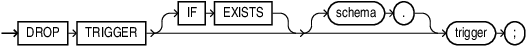

## DROP TRIGGER Statement

The `DROP` `TRIGGER` statement drops a database trigger from the database.

Topics

Prerequisites

The trigger must be in your schema or you must have the `DROP` `ANY` `TRIGGER` system privilege. To drop a trigger on `DATABASE` in another user's schema, you must also have the `ADMINISTER` `DATABASE` `TRIGGER` system privilege.

Syntax

drop\_trigger::=



> ```
> DROP TRIGGER [ IF EXISTS ] [ schema. ] trigger ;
> ```
>
> [  
> Copyright © 1996, 2026, Oracle and/or its affiliates.](https://docs.oracle.com/en/database/oracle/oracle-database/dcommon/html/cpyr.htm)


Semantics

IF EXISTS

Drops the trigger if it exists. If no such trigger exists, the statement is ignored without error.

schema

Name of the schema containing the trigger. Default: your schema.

trigger

Name of the trigger to be dropped.

Example

Example 14-36 Dropping a Trigger

This statement drops the `salary_check` trigger in the schema `hr`:

```
DROP TRIGGER hr.salary_check;
```