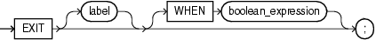

## EXIT Statement

The `EXIT` statement exits the current iteration of a loop, either conditionally or unconditionally, and transfers control to the end of either the current loop or an enclosing labeled loop.

Restriction on EXIT Statement

An `EXIT` statement must be inside a `LOOP` statement.

Topics

Syntax

exit\_statement::=



> ```
> EXIT [ label ] [ WHEN boolean_expression ] ;
> ```
>
> [  
> Copyright © 1996, 2026, Oracle and/or its affiliates.](https://docs.oracle.com/en/database/oracle/oracle-database/dcommon/html/cpyr.htm)


([boolean\_expression::=](expression.md))

Semantics

exit\_statement

label

Name that identifies either the current loop or an enclosing loop.

Without `label`, the `EXIT` statement transfers control to the end of the current loop. With `label`, the `EXIT` statement transfers control to the end of the loop that `label` identifies.

WHEN boolean\_expression

Without this clause, the `EXIT` statement exits the current iteration of the loop unconditionally. With this clause, the `EXIT` statement exits the current iteration of the loop if and only if the value of `boolean_expression` is `TRUE`.

Examples

- [Example 4-9](loop-statements.md), "Basic LOOP Statement with EXIT Statement"
- [Example 4-10](loop-statements.md), "Basic LOOP Statement with EXIT WHEN Statement"
- [Example 4-11](loop-statements.md), "Nested, Labeled Basic LOOP Statements with EXIT WHEN Statements"
- [Example 4-25](loop-statements.md), "EXIT WHEN Statement in FOR LOOP Statement"
- [Example 4-26](loop-statements.md), "EXIT WHEN Statement in Inner FOR LOOP Statement"