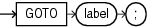

## GOTO Statement

The `GOTO` statement transfers control to a labeled block or statement.

If a `GOTO` statement exits a cursor `FOR` `LOOP` statement prematurely, the cursor closes.

Restrictions on GOTO Statement

- A `GOTO` statement cannot transfer control into an `IF` statement, `CASE` statement, `LOOP` statement, or sub-block.
- A `GOTO` statement cannot transfer control from one `IF` statement clause to another, or from one `CASE` statement `WHEN` clause to another.
- A `GOTO` statement cannot transfer control out of a subprogram.
- A `GOTO` statement cannot transfer control into an exception handler.
- A `GOTO` statement cannot transfer control from an exception handler back into the current block (but it can transfer control from an exception handler into an enclosing block).

Topics

Syntax

goto\_statement::=



> ```
> GOTO label ;
> ```
>
> [  
> Copyright © 1996, 2026, Oracle and/or its affiliates.](https://docs.oracle.com/en/database/oracle/oracle-database/dcommon/html/cpyr.htm)


Semantics

goto\_statement

label

Identifies either a block or a statement (see " [plsql\_block::=](block.md) ", " [statement::=](block.md) ", and " [label](block.md) ").

If `label` is not in the current block, then the `GOTO` statement transfers control to the first enclosing block in which `label` appears.

Examples

- [Example 4-29](sequential-control-statements.md), "GOTO Statement"
- [Example 4-32](sequential-control-statements.md), "GOTO Statement Transfers Control to Enclosing Block"
- [Example 4-33](sequential-control-statements.md), "GOTO Statement Cannot Transfer Control into IF Statement"