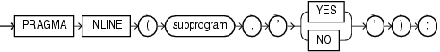

## INLINE Pragma

The `INLINE` pragma specifies whether a subprogram invocation is to be inlined.

Inlining replaces a subprogram invocation with a copy of the invoked subprogram (if the invoked and invoking subprograms are in the same program unit).

Note:

The `INLINE` pragma affects only the immediately following declaration or statement, and only some kinds of statements. For details, see " [Subprogram Inlining](pl-sql-optimizer.md) ".

Topics

Syntax

inline\_pragma::=



> ```
> PRAGMA INLINE ( subprogram , { 'YES' | 'NO' } ) ;
> ```
>
> [  
> Copyright © 1996, 2026, Oracle and/or its affiliates.](https://docs.oracle.com/en/database/oracle/oracle-database/dcommon/html/cpyr.htm)


Semantics

subprogram

Name of a subprogram. If `subprogram` is overloaded, then the `INLINE` pragma applies to every subprogram with that name.

YES

If `PLSQL_OPTIMIZE_LEVEL=2`, `'YES'` specifies that the subprogram invocation is to be inlined.

If `PLSQL_OPTIMIZE_LEVEL=3`, `'YES'` specifies that the subprogram invocation has a high priority for inlining.

NO

Specifies that the subprogram invocation is not to be inlined.

Examples

- [Example 12-1](pl-sql-optimizer.md), "Specifying that Subprogram Is To Be Inlined"
- [Example 12-2](pl-sql-optimizer.md), "Specifying that Overloaded Subprogram Is To Be Inlined"
- [Example 12-3](pl-sql-optimizer.md), "Specifying that Subprogram Is Not To Be Inlined"
- [Example 12-4](pl-sql-optimizer.md), "PRAGMA INLINE... 'NO' Overrides PRAGMA INLINE... 'YES'"