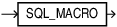

## SQL\_MACRO Clause

The `SQL_MACRO` clause marks a function as a SQL macro which can be used in a table expression.

A SQL macro referenced in a view is always executed with the view owner's privileges.

The `AUTHID` property cannot be specified. When a SQL macro is invoked, the function body executes with definer's rights to construct the text to return. The resulting expression is evaluated with invoker's rights. The SQL macro owner must grant inherit privileges to the invoking function.

When a macro annotated function is used in PL/SQL, it works like a regular function returning character or `CLOB` type with no macro expansion.

The SQL\_MACRO annotation can appear in the following SQL statement:

- [CREATE FUNCTION Statement](CREATE-FUNCTION-statement.md)

SQL Macro Usage Restrictions:
- A SQL macro can only appear in `FROM` clause of a query table expression.
- A SQL macro cannot appear in a virtual column expression, functional index, editioning view or materialized view.
- Type methods cannot be annotated with `SQL_MACRO`.

Syntax

sql\_macro\_clause::=



> SQL\_MACRO
>
> [  
> Copyright © 1996, 2026, Oracle and/or its affiliates.](https://docs.oracle.com/en/database/oracle/oracle-database/dcommon/html/cpyr.htm)


Semantics

sql\_macro\_clause

The sql\_macro\_clause can appear only once in the function. To make a SQL macro function, include the sql\_macro\_clause in the function definition. If you declare the SQL macro function before defining it, you must specify the sql\_macro\_clause in the function declaration.

Restrictions on sql\_macro\_clause

The `SQL_MACRO` annotation is disallowed with `RESULT_CACHE`, `PARALLEL_ENABLE`, and `PIPELINED`. Although the `DETERMINISTIC` property cannot be specified, a SQL macro is always implicitly deterministic.

The SQL macro function must have a return type of `VARCHAR2`, `CHAR`, or `CLOB`.

Examples

Example 13-22 Budget: Using a SQL Macro in a Table Expression

This example shows the SQL macro named budget used in a table expression to return the total salary in each department for employees for a given job title.

```sql
CREATE FUNCTION budget(job VARCHAR2) RETURN VARCHAR2 SQL_MACRO IS
BEGIN
   RETURN q'{SELECT deptno, SUM(sal) budget 
             FROM scott.emp
             WHERE job = budget.job
             GROUP BY deptno}';
END;
/
```

This query shows the SQL macro budget used in a table expression.

```sql
SELECT * FROM budget('MANAGER');
```

Result:

```
DEPTNO     BUDGET 
---------- ----------   
        20       2975  
        30       2850 
        10       2450
```

Example 13-23 Take: Using a Table Macro with a Polymorphic View

This example creates a table macro named take which returns the first n rows from table t.
```sql
CREATE FUNCTION take (n NUMBER, t DBMS_TF.TABLE_T) 
                      RETURN VARCHAR2 SQL_MACRO IS
BEGIN
   RETURN 'SELECT * FROM t FETCH FIRST take.n ROWS ONLY';
END;
/
```
The query returns the first two rows from table dept.
```sql
SELECT * FROM take(2, dept);
```

Result:
```
DEPTNO DNAME          LOC   
---------- -------------- -------------   
        10 ACCOUNTING     NEW YORK       
        20 RESEARCH       DALLAS
```

You can use SQL Macros with bind variables and more complex SQL constructs.
```sql
VAR row_count NUMBER;
EXEC :row_count := 5

WITH t AS (SELECT * FROM emp NATURAL JOIN dept ORDER BY ename)
SELECT ename, dname FROM take(:row_count, t);
```

Result:
```
ENAME      DNAME  
---------- --------------    
ADAMS      RESEARCH     
ALLEN      SALES     
BLAKE      SALES   
CLARK      ACCOUNTING   
FORD       RESEARCH
```