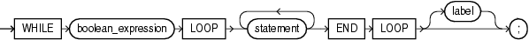

## WHILE LOOP Statement

The `WHILE` `LOOP` statement runs one or more statements while a condition is `TRUE`. The `WHILE` `LOOP` statement ends when the condition becomes `FALSE` or `NULL`, or when a statement inside the loop transfers control outside the loop or raises an exception.

Topics

Syntax

while\_loop\_statement::=



> ```
> WHILE boolean_expression
>   LOOP statement... END LOOP [ label ] ;
> ```
>
> [  
> Copyright © 1996, 2026, Oracle and/or its affiliates.](https://docs.oracle.com/en/database/oracle/oracle-database/dcommon/html/cpyr.htm)


( [boolean\_expression::=](expression.md), [statement::=](block.md) )

Semantics

while\_loop\_statement

boolean\_expression

Expression whose value is `TRUE`, `FALSE`, or `NULL`.

`boolean_expression` is evaluated at the beginning of each iteration of the loop. If its value is `TRUE`, the statements after `LOOP` run. Otherwise, control transfers to the statement after the `WHILE` `LOOP` statement.

statement

To prevent an infinite loop, at least one statement must change the value of `boolean_expression` to `FALSE` or `NULL`, transfer control outside the loop, or raise an exception. The statements that can transfer control outside the loop are:

- " [CONTINUE Statement](CONTINUE-statement.md) " (when it transfers control to the next iteration of an enclosing labeled loop)
- " [EXIT Statement](EXIT-statement.md) "
- " [GOTO Statement](GOTO-statement.md) "
- " [RAISE Statement](RAISE-statement.md) "

label

Label that identifies `while_loop_statement` (see " [statement::=](block.md) " and " [label](block.md) "). `CONTINUE`, `EXIT`, and `GOTO` statements can reference this label.

Labels improve readability, especially when `LOOP` statements are nested, but only if you ensure that the label in the `END` `LOOP` statement matches a label at the beginning of the same `LOOP` statement (the compiler does not check).

Related Topics

In this chapter:

- " [Basic LOOP Statement](basic-LOOP-statement.md) "
- " [CONTINUE Statement](CONTINUE-statement.md) "
- " [Cursor FOR LOOP Statement](cursor-FOR-LOOP-statement.md) "
- " [EXIT Statement](EXIT-statement.md) "
- " [Explicit Cursor Declaration and Definition](explicit-cursor-declaration-and-definition.md) "
- " [FETCH Statement](FETCH-statement.md) "
- " [FOR LOOP Statement](FOR-LOOP-statement.md) "
- " [FORALL Statement](FORALL-statement.md) "
- " [OPEN Statement](OPEN-statement.md) "

In other chapters:

- " [WHILE LOOP Statement](loop-statements.md) "