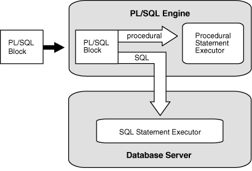

## Architecture of PL/SQL

Basic understanding of the PL/SQL architecture is beneficial to PL/SQL programmers.

Topics

### PL/SQL Engine

The PL/SQL compilation and runtime system is an engine that compiles and runs PL/SQL units.

The engine can be installed in the database or in an application development tool, such as Oracle Forms.

In either environment, the PL/SQL engine accepts as input any valid PL/SQL unit. The engine runs procedural statements, but sends SQL statements to the SQL engine in the database, as shown in Figure 1-1.

Figure 1-1 PL/SQL Engine

> The PL/SQL engine accepts as input any valid PL/SQL unit. It runs procedural statements, but sends SQL statements to the SQL engine in the database.
>
> [  
> Copyright © 1996, 2026, Oracle and/or its affiliates.](https://docs.oracle.com/en/database/oracle/oracle-database/dcommon/html/cpyr.htm)

Typically, the database processes PL/SQL units.

When an application development tool processes PL/SQL units, it passes them to its local PL/SQL engine. If a PL/SQL unit contains no SQL statements, the local engine processes the entire PL/SQL unit. This is useful if the application development tool can benefit from conditional and iterative control.

For example, Oracle Forms applications frequently use SQL statements to test the values of field entries and do simple computations. By using PL/SQL instead of SQL, these applications can avoid calls to the database.

### PL/SQL Units and Compilation Parameters

PL/SQL units are affected by PL/SQL compilation parameters (a category of database initialization parameters). Different PL/SQL units—for example, a package specification and its body—can have different compilation parameter settings.

A PL/SQL unit is one of these:

- PL/SQL anonymous block
- `FUNCTION`
- `LIBRARY`
- `PACKAGE`
- `PACKAGE` `BODY`
- `PROCEDURE`
- `TRIGGER`
- `TYPE`
- `TYPE` `BODY`

Table 1-2 summarizes the PL/SQL compilation parameters. To display the values of these parameters for specified or all PL/SQL units, query the static data dictionary view `ALL_PLSQL_OBJECT_SETTINGS`. For information about this view, see [Oracle Database Reference](https://docs.oracle.com/pls/topic/lookup?ctx=en/database/oracle/oracle-database/19/lnpls&id=REFRN20385).

Table 1-2 PL/SQL Compilation Parameters

| Parameter | Description |
| --- | --- |
| [`PLSCOPE_SETTINGS`](https://docs.oracle.com/pls/topic/lookup?ctx=en/database/oracle/oracle-database/19/lnpls&id=REFRN10271) | Controls the compile-time collection, cross-reference, and storage of PL/SQL source text identifier data. Used by the PL/Scope tool (see [Oracle Database Development Guide](https://docs.oracle.com/pls/topic/lookup?ctx=en/database/oracle/oracle-database/19/lnpls&id=ADFNS022)).  For more information about `PLSCOPE_SETTINGS`, see [Oracle Database Reference](https://docs.oracle.com/pls/topic/lookup?ctx=en/database/oracle/oracle-database/19/lnpls&id=REFRN10271). |
| [`PLSQL_CCFLAGS`](https://docs.oracle.com/pls/topic/lookup?ctx=en/database/oracle/oracle-database/19/lnpls&id=REFRN10261) | Lets you control conditional compilation of each PL/SQL unit independently.  For more information about `PLSQL_CCFLAGS`, see " [How Conditional Compilation Works](conditional-compilation1.md) " and [Oracle Database Reference](https://docs.oracle.com/pls/topic/lookup?ctx=en/database/oracle/oracle-database/19/lnpls&id=REFRN10261). |
| [`PLSQL_CODE_TYPE`](https://docs.oracle.com/pls/topic/lookup?ctx=en/database/oracle/oracle-database/19/lnpls&id=REFRN10253) | Specifies the compilation mode for PL/SQL units— `INTERPRETED` (the default) or `NATIVE`. For information about which mode to use, see " [Determining Whether to Use PL/SQL Native Compilation](compiling-pl-sql-units-native-execution.md) ".  If the optimization level (set by `PLSQL_OPTIMIZE_LEVEL`) is less than 2:  - The compiler generates interpreted code, regardless of `PLSQL_CODE_TYPE`. - If you specify `NATIVE`, the compiler warns you that `NATIVE` was ignored.  For more information about `PLSQL_CODE_TYPE`, see [Oracle Database Reference](https://docs.oracle.com/pls/topic/lookup?ctx=en/database/oracle/oracle-database/19/lnpls&id=REFRN10253). |
| [`PLSQL_OPTIMIZE_LEVEL`](https://docs.oracle.com/pls/topic/lookup?ctx=en/database/oracle/oracle-database/19/lnpls&id=REFRN10255) | Specifies the optimization level at which to compile PL/SQL units (the higher the level, the more optimizations the compiler tries to make).  `PLSQL_OPTIMIZE_LEVEL=1` instructs the PL/SQL compiler to generate and store code for use by the PL/SQL debugger.  For more information about `PLSQL_OPTIMIZE_LEVEL`, see " [PL/SQL Optimizer](pl-sql-optimizer.md) " and [Oracle Database Reference](https://docs.oracle.com/pls/topic/lookup?ctx=en/database/oracle/oracle-database/19/lnpls&id=REFRN10254). |
| [`PLSQL_WARNINGS`](https://docs.oracle.com/pls/topic/lookup?ctx=en/database/oracle/oracle-database/19/lnpls&id=REFRN10249) | Enables or disables the reporting of warning messages by the PL/SQL compiler, and specifies which warning messages to show as errors.  For more information about `PLSQL_WARNINGS`, see " [Compile-Time Warnings](compile-time-warnings.md) " and [Oracle Database Reference](https://docs.oracle.com/pls/topic/lookup?ctx=en/database/oracle/oracle-database/19/lnpls&id=REFRN10249). |
| [`NLS_LENGTH_SEMANTICS`](https://docs.oracle.com/pls/topic/lookup?ctx=en/database/oracle/oracle-database/19/lnpls&id=REFRN10124) | Lets you create `CHAR` and `VARCHAR2` columns using either byte-length or character-length semantics.  For more information about byte and character length semantics, see " [CHAR and VARCHAR2 Variables](sql-data-types.md) ".  For more information about `NLS_LENGTH_SEMANTICS`, see [Oracle Database Reference](https://docs.oracle.com/pls/topic/lookup?ctx=en/database/oracle/oracle-database/19/lnpls&id=REFRN10124). |
| [`PERMIT_92_WRAP_FORMAT`](https://docs.oracle.com/pls/topic/lookup?ctx=en/database/oracle/oracle-database/19/lnpls&id=REFRN10317) | Specifies whether the 12.1 PL/SQL compiler can use wrapped packages that were compiled with the 9.2 PL/SQL compiler. The default value is `TRUE`.  For more information about wrapped packages, see [PL/SQL Source Text Wrapping](plsql-source-text-wrapping.md).  For more information about `PERMIT_92_WRAP_FORMAT`, see [Oracle Database Reference](https://docs.oracle.com/pls/topic/lookup?ctx=en/database/oracle/oracle-database/19/lnpls&id=REFRN10317). |

Note:

The compilation parameter `PLSQL_DEBUG`, which specifies whether to compile PL/SQL units for debugging, is deprecated. To compile PL/SQL units for debugging, specify `PLSQL_OPTIMIZE_LEVEL=1`.

The compile-time values of the parameters in Table 1-2 are stored with the metadata of each stored PL/SQL unit, which means that you can reuse those values when you explicitly recompile the unit. (A stored PL/SQL unit is created with one of the " [CREATE \[ OR REPLACE \] Statements](https://docs.oracle.com/en/database/oracle/oracle-database/19/lnpls/sql-statements-for-stored-plsql-units.html#GUID-C918310F-F1BB-41D7-9466-B558B70DDFFE__BABBEFJD) ". An anonymous block is not a stored PL/SQL unit.)

To explicitly recompile a stored PL/SQL unit and reuse its parameter values, you must use an `ALTER` statement with both the `COMPILE` clause and the `REUSE` `SETTINGS` clause. All `ALTER` statements have this clause. For a list of `ALTER` statements, see " [ALTER Statements](sql-statements-for-stored-plsql-units.md) ".