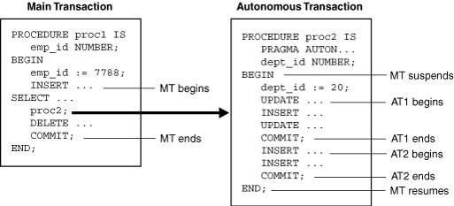

## Autonomous Transactions

An autonomous transaction is an independent transaction started by another transaction, the main transaction.

Autonomous transactions do SQL operations and commit or roll back, without committing or rolling back the main transaction.

Figure 6-1 shows how control flows from the main transaction (MT) to an autonomous routine (`proc2`) and back again. The autonomous routine commits two autonomous transactions (AT1 and AT2).

Figure 6-1 Transaction Control Flow



> This figure shows how control flows from a main transaction (MT) to an autonomous transaction (AT) and back again.
>
> The autonomous transaction commits two transactions, AT1 and AT2, before control returns to the main transaction. When control enters the executable section of the autonomous transaction (BEGIN), the main transaction suspends. When control exits the autonomous transaction (END), the main transaction resumes. COMMIT and ROLLBACK statements in an autonomous transaction end the active transaction, but they do not end the autonomous transaction.


Note:

Although an autonomous transaction is started by another transaction, it is not a nested transaction, because:

- It does not share transactional resources (such as locks) with the main transaction.
- It does not depend on the main transaction.
	For example, if the main transaction rolls back, nested transactions roll back, but autonomous transactions do not.
- Its committed changes are visible to other transactions immediately.
	A nested transaction's committed changes are not visible to other transactions until the main transaction commits.
- Exceptions raised in an autonomous transaction cause a transaction-level rollback, not a statement-level rollback.

Topics

See Also:

[Oracle Database Development Guide](https://docs.oracle.com/pls/topic/lookup?ctx=en/database/oracle/oracle-database/19/lnpls&id=ADFNS00205) for more information about autonomous transactions

### Advantages of Autonomous Transactions

After starting, an autonomous transaction is fully independent. It shares no locks, resources, or commit-dependencies with the main transaction. You can log events, increment retry counters, and so on, even if the main transaction rolls back.

Autonomous transactions help you build modular, reusable software components. You can encapsulate autonomous transactions in stored subprograms. An invoking application needs not know whether operations done by that stored subprogram succeeded or failed.

### Transaction Context

The main transaction shares its context with nested routines, but not with autonomous transactions. When one autonomous routine invokes another (or itself, recursively), the routines share no transaction context. When an autonomous routine invokes a nonautonomous routine, the routines share the same transaction context.

### Transaction Visibility

Changes made by an autonomous transaction become visible to other transactions when the autonomous transaction commits. These changes become visible to the main transaction when it resumes, if its isolation level is set to `READ` `COMMITTED` (the default).

If you set the isolation level of the main transaction to `SERIALIZABLE`, changes made by its autonomous transactions are not visible to the main transaction when it resumes:

```
SET TRANSACTION ISOLATION LEVEL SERIALIZABLE;
```

Note:

- Transaction properties apply only to the transaction in which they are set.
- Cursor attributes are not affected by autonomous transactions.

### Declaring Autonomous Routines

To declare an autonomous routine, use the `AUTONOMOUS_TRANSACTION` pragma.

For information about this pragma, see " [AUTONOMOUS\_TRANSACTION Pragma](AUTONOMOUS_TRANSACTION-pragma.md) ".

Tip:

For readability, put the `AUTONOMOUS_TRANSACTION` pragma at the top of the declarative section. (The pragma is allowed anywhere in the declarative section.)

You cannot apply the `AUTONOMOUS_TRANSACTION` pragma to an entire package or ADT, but you can apply it to each subprogram in a package or each method of an ADT.

Example 6-43 Declaring Autonomous Function in Package

This example marks a package function as autonomous.

```
CREATE OR REPLACE PACKAGE emp_actions AUTHID DEFINER AS  -- package specification
  FUNCTION raise_salary (emp_id NUMBER, sal_raise NUMBER)
  RETURN NUMBER;
END emp_actions;
/
CREATE OR REPLACE PACKAGE BODY emp_actions AS  -- package body
  -- code for function raise_salary
  FUNCTION raise_salary (emp_id NUMBER, sal_raise NUMBER)
  RETURN NUMBER IS
    PRAGMA AUTONOMOUS_TRANSACTION;
    new_sal NUMBER(8,2);
  BEGIN
    UPDATE employees SET salary =
      salary + sal_raise WHERE employee_id = emp_id;
    COMMIT;
    SELECT salary INTO new_sal FROM employees
      WHERE employee_id = emp_id;
    RETURN new_sal;
  END raise_salary;
END emp_actions;
/
```

Example 6-44 Declaring Autonomous Standalone Procedure

This example marks a standalone subprogram as autonomous.

```
CREATE OR REPLACE PROCEDURE lower_salary
  (emp_id NUMBER, amount NUMBER)
AUTHID DEFINER AS
  PRAGMA AUTONOMOUS_TRANSACTION;
BEGIN
  UPDATE employees
  SET salary =  salary - amount
  WHERE employee_id = emp_id;

  COMMIT;
END lower_salary;
/
```

Example 6-45 Declaring Autonomous PL/SQL Block

This example marks a schema-level PL/SQL block as autonomous. (A nested PL/SQL block cannot be autonomous.)

```
DROP TABLE emp;
CREATE TABLE emp AS SELECT * FROM employees;
 
DECLARE
  PRAGMA AUTONOMOUS_TRANSACTION;
  emp_id NUMBER(6)   := 200;
  amount NUMBER(6,2) := 200;
BEGIN
  UPDATE employees
  SET salary =  salary - amount
  WHERE employee_id = emp_id;
 
  COMMIT;
END;
/
```

### Controlling Autonomous Transactions

The first SQL statement in an autonomous routine begins a transaction. When one transaction ends, the next SQL statement begins another transaction. All SQL statements run since the last commit or rollback comprise the current transaction. To control autonomous transactions, use these statements, which apply only to the current (active) transaction:

- `COMMIT`
- `ROLLBACK` \[`TO` `savepoint_name`\]
- `SAVEPOINT` `savepoint_name`
- `SET` `TRANSACTION`

Topics

#### Entering and Exiting Autonomous Routines

When you enter the executable section of an autonomous routine, the main transaction suspends. When you exit the routine, the main transaction resumes.

If you try to exit an active autonomous transaction without committing or rolling back, the database raises an exception. If the exception is unhandled, or if the transaction ends because of some other unhandled exception, then the transaction rolls back.

To exit normally, the routine must explicitly commit or roll back all autonomous transactions. If the routine (or any routine invoked by it) has pending transactions, then PL/SQL raises an exception and the pending transactions roll back.

#### Committing and Rolling Back Autonomous Transactions

`COMMIT` and `ROLLBACK` end the active autonomous transaction but do not exit the autonomous routine. When one transaction ends, the next SQL statement begins another transaction. A single autonomous routine can contain several autonomous transactions, if it issues several `COMMIT` statements.

#### Savepoints

The scope of a savepoint is the transaction in which it is defined. Savepoints defined in the main transaction are unrelated to savepoints defined in its autonomous transactions. In fact, the main transaction and an autonomous transaction can use the same savepoint names.

You can roll back only to savepoints marked in the current transaction. In an autonomous transaction, you cannot roll back to a savepoint marked in the main transaction. To do so, you must resume the main transaction by exiting the autonomous routine.

When in the main transaction, rolling back to a savepoint marked before you started an autonomous transaction does not roll back the autonomous transaction. Remember, autonomous transactions are fully independent of the main transaction.

#### Avoiding Errors with Autonomous Transactions

To avoid some common errors, remember:

- If an autonomous transaction tries to access a resource held by the main transaction, a deadlock can occur. The database raises an exception in the autonomous transaction, which rolls back if the exception is unhandled.
- The database initialization parameter `TRANSACTIONS` specifies the maximum number of concurrent transactions. That number might be exceeded because an autonomous transaction runs concurrently with the main transaction.
- If you try to exit an active autonomous transaction without committing or rolling back, the database raises an exception. If the exception is unhandled, the transaction rolls back.
- You cannot run a `PIPE` `ROW` statement in an autonomous routine while an autonomous transaction is open. You must close the autonomous transaction before running the `PIPE` `ROW` statement. This is normally accomplished by committing or rolling back the autonomous transaction before running the `PIPE` `ROW` statement.

### Autonomous Triggers

A trigger must be autonomous to run TCL or DDL statements.

To run DDL statements, the trigger must use native dynamic SQL.

See Also:

- [PL/SQL Triggers](plsql-triggers.md), for general information about triggers
- " [Description of Static SQL](description-static-sql.md) " for general information about TCL statements
- [Oracle Database SQL Language Reference](https://docs.oracle.com/pls/topic/lookup?ctx=en/database/oracle/oracle-database/19/lnpls&id=SQLRF30041) for information about DDL statements
- " [Native Dynamic SQL](native-dynamic-sql.md) " for information about native dynamic SQL

One use of triggers is to log events transparently—for example, to log all inserts into a table, even those that roll back.

Example 6-46 Autonomous Trigger Logs INSERT Statements

In this example, whenever a row is inserted into the `EMPLOYEES` table, a trigger inserts the same row into a log table. Because the trigger is autonomous, it can commit changes to the log table regardless of whether they are committed to the main table.

```
DROP TABLE emp;
CREATE TABLE emp AS SELECT * FROM employees;
 
-- Log table:
 
DROP TABLE log;
CREATE TABLE log (
  log_id   NUMBER(6),
  up_date  DATE,
  new_sal  NUMBER(8,2),
  old_sal  NUMBER(8,2)
);
 
-- Autonomous trigger on emp table:
 
CREATE OR REPLACE TRIGGER log_sal
  BEFORE UPDATE OF salary ON emp FOR EACH ROW
DECLARE
  PRAGMA AUTONOMOUS_TRANSACTION;
BEGIN
  INSERT INTO log (
    log_id,
    up_date,
    new_sal,
    old_sal
  )
  VALUES (
    :old.employee_id,
    SYSDATE,
    :new.salary,
    :old.salary
  );
  COMMIT;
END;
/
UPDATE emp
SET salary = salary * 1.05
WHERE employee_id = 115;
 
COMMIT;
 
UPDATE emp
SET salary = salary * 1.05
WHERE employee_id = 116;
 
ROLLBACK;
 
-- Show that both committed and rolled-back updates
-- add rows to log table
 
SELECT * FROM log
WHERE log_id = 115 OR log_id = 116;
```

Result:

```
LOG_ID UP_DATE      NEW_SAL    OLD_SAL
---------- --------- ---------- ----------
       115 02-OCT-12    3255          3100
       116 02-OCT-12    3045          2900
 
2 rows selected.
```

Example 6-47 Autonomous Trigger Uses Native Dynamic SQL for DDL

In this example, an autonomous trigger uses native dynamic SQL (an `EXECUTE` `IMMEDIATE` statement) to drop a temporary table after a row is inserted into the table `log`.

```
DROP TABLE temp;
CREATE TABLE temp (
  temp_id NUMBER(6),
  up_date DATE
);

CREATE OR REPLACE TRIGGER drop_temp_table
  AFTER INSERT ON log
DECLARE 
  PRAGMA AUTONOMOUS_TRANSACTION;
BEGIN
  EXECUTE IMMEDIATE 'DROP TABLE temp';
  COMMIT;
END;
/
-- Show how trigger works
SELECT * FROM temp;
```

Result:

```
no rows selected

INSERT INTO log (log_id, up_date, new_sal, old_sal)
VALUES (999, SYSDATE, 5000, 4500);
 
1 row created.
 
SELECT * FROM temp;
```

Result:

```
SELECT * FROM temp
              *
ERROR at line 1:
ORA-00942: table or view does not exist
```

### Invoking Autonomous Functions from SQL

A function invoked from SQL statements must obey rules meant to control side effects.

By definition, an autonomous routine never reads or writes database state (that is, it neither queries nor modifies any database table).

See Also:

" [Subprogram Side Effects](subprogram-side-effects.md) " for more information

Example 6-48 Invoking Autonomous Function

The package function `log_msg` is autonomous. Therefore, when the query invokes the function, the function inserts a message into database table `debug_output` without violating the rule against writing database state (modifying database tables).

```
DROP TABLE debug_output;
CREATE TABLE debug_output (message VARCHAR2(200));
 
CREATE OR REPLACE PACKAGE debugging AUTHID DEFINER AS
  FUNCTION log_msg (msg VARCHAR2) RETURN VARCHAR2;
END debugging;
/
CREATE OR REPLACE PACKAGE BODY debugging AS
  FUNCTION log_msg (msg VARCHAR2) RETURN VARCHAR2 IS
    PRAGMA AUTONOMOUS_TRANSACTION;
  BEGIN
    INSERT INTO debug_output (message) VALUES (msg);
    COMMIT;
    RETURN msg;
  END;
END debugging;
/
-- Invoke package function from query
DECLARE
  my_emp_id    NUMBER(6);
  my_last_name VARCHAR2(25);
  my_count     NUMBER;
BEGIN
  my_emp_id := 120;
 
  SELECT debugging.log_msg(last_name)
  INTO my_last_name
  FROM employees
  WHERE employee_id = my_emp_id;
 
  /* Even if you roll back in this scope,
     the insert into 'debug_output' remains committed,
     because it is part of an autonomous transaction. */
 
  ROLLBACK;
END;
/
```