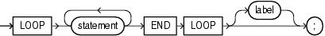

## Basic LOOP Statement

With each iteration of the basic `LOOP` statement, its statements run and control returns to the top of the loop. The `LOOP` statement ends when a statement inside the loop transfers control outside the loop or raises an exception.

Topics

Syntax

basic\_loop\_statement::=



> ```
> LOOP statement... END LOOP [ label ] ;
> ```
>
> [  
> Copyright © 1996, 2026, Oracle and/or its affiliates.](https://docs.oracle.com/en/database/oracle/oracle-database/dcommon/html/cpyr.htm)


([statement::=](block.md))

Semantics

basic\_loop\_statement

statement

To prevent an infinite loop, at least one statement must transfer control outside the loop. The statements that can transfer control outside the loop are:

- " [CONTINUE Statement](CONTINUE-statement.md) " (when it transfers control to the next iteration of an enclosing labeled loop)
- " [EXIT Statement](EXIT-statement.md) "
- " [GOTO Statement](GOTO-statement.md) "
- " [RAISE Statement](RAISE-statement.md) "

label

A label that identifies `basic_loop_statement` (see " [statement::=](block.md) " and " [label](block.md) "). `CONTINUE`, `EXIT`, and `GOTO` statements can reference this label.

Labels improve readability, especially when `LOOP` statements are nested, but only if you ensure that the label in the `END` `LOOP` statement matches a label at the beginning of the same `LOOP` statement (the compiler does not check).

Examples

- [Example 1-2](main-features-pl-sql.md), "Processing Query Result Rows One at a Time"
- [Example 4-9](loop-statements.md), "Basic LOOP Statement with EXIT Statement"
- [Example 4-10](loop-statements.md), "Basic LOOP Statement with EXIT WHEN Statement"
- [Example 4-11](loop-statements.md), "Nested, Labeled Basic LOOP Statements with EXIT WHEN Statements"
- [Example 4-13](loop-statements.md), "CONTINUE Statement in Basic LOOP Statement"
- [Example 4-14](loop-statements.md), "CONTINUE WHEN Statement in Basic LOOP Statement"