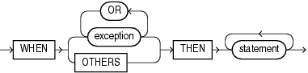

## Exception Handler

An exception handler processes a raised exception.

Exception handlers appear in the exception-handling parts of anonymous blocks, subprograms, triggers, and packages.

Topics

Syntax

exception\_handler::=



> ```
> WHEN { exception [ OR exception ]... | OTHERS }
>   THEN statement [ statement ]...
> ```
>
> [  
> Copyright © 1996, 2026, Oracle and/or its affiliates.](https://docs.oracle.com/en/database/oracle/oracle-database/dcommon/html/cpyr.htm)


([statement::=](block.md))

Semantics

exception\_handler

exception

Name of either a predefined exception (see [Table 11-3](predefined-exceptions.md)) or a user-defined exception (see " [Exception Declaration](exception-declaration.md) ").

If PL/SQL raises a specified exception, then the associated statements run.

OTHERS

Specifies all exceptions not explicitly specified in the exception-handling part of the block. If PL/SQL raises such an exception, then the associated statements run.

Note:

Oracle recommends that the last statement in the `OTHERS` exception handler be either `RAISE` or an invocation of the `RAISE_APPLICATION_ERROR` procedure.

If you do not follow this practice, and PL/SQL warnings are enabled, you get PLW-06009.

In the exception-handling part of a block, the `WHEN` `OTHERS` exception handler is optional. It can appear only once, as the last exception handler in the exception-handling part of the block.

Examples

- [Example 11-3](overview-exception-handling.md), "Single Exception Handler for Multiple Exceptions"
- [Example 11-4](overview-exception-handling.md), "Locator Variables for Statements that Share Exception Handler"
- [Example 11-6](predefined-exceptions.md), "Anonymous Block Handles ZERO\_DIVIDE"
- [Example 11-7](predefined-exceptions.md), "Anonymous Block Avoids ZERO\_DIVIDE"
- [Example 11-10](raising-exceptions-explicitly.md), "Declaring, Raising, and Handling User-Defined Exception"
- [Example 11-14](exception-propagation.md), "Exception that Propagates Beyond Scope is Handled"
- [Example 11-24](continuing-execution-handling-exceptions.md), "Exception Handler Runs and Execution Ends"
- [Example 11-25](continuing-execution-handling-exceptions.md), "Exception Handler Runs and Execution Continues"
- [Example 12-12](bulk-sql-and-bulk-binding.md), "Handling FORALL Exceptions Immediately"
- [Example 12-13](bulk-sql-and-bulk-binding.md), "Handling FORALL Exceptions After FORALL Statement Completes"

Related Topics

In this chapter:

- " [Block](block.md) "
- " [EXCEPTION\_INIT Pragma](EXCEPTION_INIT-pragma.md) "
- " [Exception Declaration](exception-declaration.md) "
- " [RAISE Statement](RAISE-statement.md) "
- " [SQLCODE Function](SQLCODE-function.md) "
- " [SQLERRM Function](SQLERRM-function.md) "

In other chapters:

- " [Overview of Exception Handling](overview-exception-handling.md) "
- " [Continuing Execution After Handling Exceptions](continuing-execution-handling-exceptions.md) "
- " [Retrying Transactions After Handling Exceptions](retrying-transactions-handling-exceptions.md) "
- " [CREATE PACKAGE BODY Statement](CREATE-PACKAGE-BODY-statement.md) "
- " [CREATE TRIGGER Statement](CREATE-TRIGGER-statement.md) "