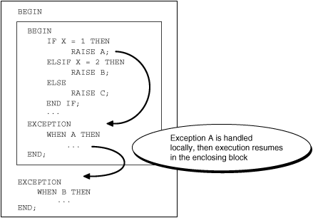
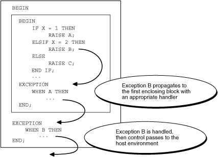
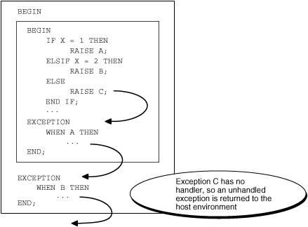

## Exception Propagation

If an exception is raised in a block that has no exception handler for it, then the exception propagates. That is, the exception reproduces itself in successive enclosing blocks until either a block has a handler for it or there is no enclosing block. If there is no handler for the exception, then PL/SQL returns an unhandled exception error to the invoker or host environment, which determines the outcome (for more information, see " [Unhandled Exceptions](unhandled-exceptions.md) ").

In Figure 11-1, one block is nested inside another. The inner block raises exception A. The inner block has an exception handler for A, so A does not propagate. After the exception handler runs, control transfers to the next statement of the outer block.

Figure 11-1 Exception Does Not Propagate



> This figure shows the outline of an anonymous block that contains another anonymous block. The inner block has an `IF-ELSIF-ELSE` statement that raises either exception A, B, or C, and an exception-handling part with an exception handler for A. The outer block has, immediately after the inner block, an exception-handling part with an exception handler for B.
>
> Two arrows show the flow of control. The first arrow points from the `RAISE A` statement in the inner block to the exception-handling part of the inner block. The second arrow points from the end of the exception handler for A to the next statement of the outer block (where the exception-handling part of the outer block begins).


In Figure 11-2, the inner block raises exception B. The inner block does not have an exception handler for exception B, so B propagates to the outer block, which does have an exception handler for it. After the exception handler runs, control transfers to the host environment.

Figure 11-2 Exception Propagates from Inner Block to Outer Block



> This figure shows the outline of an anonymous block that contains another anonymous block. The inner block has an `IF-ELSIF-ELSE` statement that raises either exception A, B, or C, and an exception-handling part with an exception handler for A. The outer block has, immediately after the inner block, an exception-handling part with an exception handler for B.
>
> Three arrows show the flow of control. The first arrow points from the `RAISE B` statement in the inner block to the exception-handling part of the inner block. The second arrow points from the end of the exception-handling part of the inner block to the next statement of the outer block, where the exception-handling part of the outer block begins. The third arrow points from the end of the exception handler for B to the host environment.


In Figure 11-3, the inner block raises exception C. The inner block does not have an exception handler for C, so exception C propagates to the outer block. The outer block does not have an exception handler for C, so PL/SQL returns an unhandled exception error to the host environment.

Figure 11-3 PL/SQL Returns Unhandled Exception Error to Host Environment



> This figure shows the outline of an anonymous block that contains another anonymous block. The inner block has an `IF-ELSIF-ELSE` statement that raises either exception A, B, or C, and an exception-handling part with an exception handler for A. The outer block has, immediately after the inner block, an exception-handling part with an exception handler for B.
>
> Three arrows show the flow of control. The first arrow points from the `RAISE C` statement in the inner block to the exception-handling part of the inner block. The second arrow points from the end of the exception-handling part of the inner block to the next statement of the outer block, where the exception-handling part of the outer block begins. The third arrow points from the end of the exception-handling part of the outer block to the host environment.


A user-defined exception can propagate beyond its scope (that is, beyond the block that declares it), but its name does not exist beyond its scope. Therefore, beyond its scope, a user-defined exception can be handled only with an `OTHERS` exception handler.

In Example 11-14, the inner block declares an exception named `past_due`, for which it has no exception handler. When the inner block raises `past_due`, the exception propagates to the outer block, where the name `past_due` does not exist. The outer block handles the exception with an `OTHERS` exception handler.

If the outer block does not handle the user-defined exception, then an error occurs, as in Example 11-15.

Note:

Exceptions cannot propagate across remote subprogram invocations. Therefore, a PL/SQL block cannot handle an exception raised by a remote subprogram.

Topics

- Propagation of Exceptions Raised in Declarations
- Propagation of Exceptions Raised in Exception Handlers

Example 11-14 Exception that Propagates Beyond Scope is Handled

```
CREATE OR REPLACE PROCEDURE p AUTHID DEFINER AS
BEGIN

  DECLARE
    past_due     EXCEPTION;
    PRAGMA EXCEPTION_INIT (past_due, -4910);
    due_date     DATE := trunc(SYSDATE) - 1;
    todays_date  DATE := trunc(SYSDATE);
  BEGIN
    IF due_date < todays_date THEN
      RAISE past_due;
    END IF;
  END;

EXCEPTION
  WHEN OTHERS THEN
    ROLLBACK;
    RAISE;
END;
/
```

Example 11-15 Exception that Propagates Beyond Scope is Not Handled

```
BEGIN

  DECLARE
    past_due     EXCEPTION;
    due_date     DATE := trunc(SYSDATE) - 1;
    todays_date  DATE := trunc(SYSDATE);
  BEGIN
    IF due_date < todays_date THEN
      RAISE past_due;
    END IF;
  END;

END;
/
```

Result:

```
BEGIN
*
ERROR at line 1:
ORA-06510: PL/SQL: unhandled user-defined exception
ORA-06512: at line 9
```

### Propagation of Exceptions Raised in Declarations

An exception raised in a declaration propagates immediately to the enclosing block (or to the invoker or host environment if there is no enclosing block). Therefore, the exception handler must be in an enclosing or invoking block, not in the same block as the declaration.

In Example 11-16, the `VALUE_ERROR` exception handler is in the same block as the declaration that raises `VALUE_ERROR`. Because the exception propagates immediately to the host environment, the exception handler does not handle it.

Example 11-17 is like Example 11-16 except that an enclosing block handles the `VALUE_ERROR` exception that the declaration in the inner block raises.

Example 11-16 Exception Raised in Declaration is Not Handled

```
DECLARE
  credit_limit CONSTANT NUMBER(3) := 5000;  -- Maximum value is 999
BEGIN
  NULL;
EXCEPTION
  WHEN VALUE_ERROR THEN
    DBMS_OUTPUT.PUT_LINE('Exception raised in declaration.');
END;
/
```

Result:

```
DECLARE
*
ERROR at line 1:
ORA-06502: PL/SQL: numeric or value error: number precision too large
ORA-06512: at line 2
```

Example 11-17 Exception Raised in Declaration is Handled by Enclosing Block

```
BEGIN
 
  DECLARE
    credit_limit CONSTANT NUMBER(3) := 5000;
  BEGIN
    NULL;
  END;
 
EXCEPTION
  WHEN VALUE_ERROR THEN
    DBMS_OUTPUT.PUT_LINE('Exception raised in declaration.');
END;
/
```

Result:

```
Exception raised in declaration.
```

### Propagation of Exceptions Raised in Exception Handlers

An exception raised in an exception handler propagates immediately to the enclosing block (or to the invoker or host environment if there is no enclosing block). Therefore, the exception handler must be in an enclosing or invoking block.

In Example 11-18, when `n` is zero, the calculation `1/n` raises the predefined exception `ZERO_DIVIDE`, and control transfers to the `ZERO_DIVIDE` exception handler in the same block. When the exception handler raises `ZERO_DIVIDE`, the exception propagates immediately to the invoker. The invoker does not handle the exception, so PL/SQL returns an unhandled exception error to the host environment.

Example 11-19 is like Example 11-18 except that when the procedure returns an unhandled exception error to the invoker, the invoker handles it.

Example 11-20 is like Example 11-18 except that an enclosing block handles the exception that the exception handler in the inner block raises.

In Example 11-21, the exception-handling part of the procedure has exception handlers for user-defined exception `i_is_one` and predefined exception `ZERO_DIVIDE`. When the `i_is_one` exception handler raises `ZERO_DIVIDE`, the exception propagates immediately to the invoker (therefore, the `ZERO_DIVIDE` exception handler does not handle it). The invoker does not handle the exception, so PL/SQL returns an unhandled exception error to the host environment.

Example 11-22 is like Example 11-21 except that an enclosing block handles the `ZERO_DIVIDE` exception that the `i_is_one` exception handler raises.

Example 11-18 Exception Raised in Exception Handler is Not Handled

```
CREATE PROCEDURE print_reciprocal (n NUMBER) AUTHID DEFINER IS
BEGIN
  DBMS_OUTPUT.PUT_LINE(1/n);  -- handled
EXCEPTION
  WHEN ZERO_DIVIDE THEN
    DBMS_OUTPUT.PUT_LINE('Error:');
    DBMS_OUTPUT.PUT_LINE(1/n || ' is undefined');  -- not handled
END;
/
 
BEGIN  -- invoking block
  print_reciprocal(0);
END;
```

Result:

```
Error:
BEGIN
*
ERROR at line 1:
ORA-01476: divisor is equal to zero
ORA-06512: at "HR.PRINT_RECIPROCAL", line 7
ORA-01476: divisor is equal to zero
ORA-06512: at line 2
```

Example 11-19 Exception Raised in Exception Handler is Handled by Invoker

```
CREATE PROCEDURE print_reciprocal (n NUMBER) AUTHID DEFINER IS
BEGIN
  DBMS_OUTPUT.PUT_LINE(1/n);
EXCEPTION
  WHEN ZERO_DIVIDE THEN
    DBMS_OUTPUT.PUT_LINE('Error:');
    DBMS_OUTPUT.PUT_LINE(1/n || ' is undefined');
END;
/
 
BEGIN  -- invoking block
  print_reciprocal(0);
EXCEPTION
  WHEN ZERO_DIVIDE THEN  -- handles exception raised in exception handler
    DBMS_OUTPUT.PUT_LINE('1/0 is undefined.');
END;
/
```

Result:

```
Error:
1/0 is undefined.
```

Example 11-20 Exception Raised in Exception Handler is Handled by Enclosing Block

```
CREATE PROCEDURE print_reciprocal (n NUMBER) AUTHID DEFINER IS
BEGIN
 
  BEGIN
    DBMS_OUTPUT.PUT_LINE(1/n);
  EXCEPTION
    WHEN ZERO_DIVIDE THEN
      DBMS_OUTPUT.PUT_LINE('Error in inner block:');
      DBMS_OUTPUT.PUT_LINE(1/n || ' is undefined.');
  END;
 
EXCEPTION
  WHEN ZERO_DIVIDE THEN  -- handles exception raised in exception handler
    DBMS_OUTPUT.PUT('Error in outer block: ');
    DBMS_OUTPUT.PUT_LINE('1/0 is undefined.');
END;
/
 
BEGIN
  print_reciprocal(0);
END;
/
```

Result:

```
Error in inner block:
Error in outer block: 1/0 is undefined.
```

Example 11-21 Exception Raised in Exception Handler is Not Handled

```
CREATE PROCEDURE descending_reciprocals (n INTEGER) AUTHID DEFINER IS
  i INTEGER;
  i_is_one EXCEPTION;
BEGIN
  i := n;
 
  LOOP
    IF i = 1 THEN
      RAISE i_is_one;
    ELSE
      DBMS_OUTPUT.PUT_LINE('Reciprocal of ' || i || ' is ' || 1/i);
    END IF;
 
    i := i - 1;
  END LOOP;
EXCEPTION
  WHEN i_is_one THEN
    DBMS_OUTPUT.PUT_LINE('1 is its own reciprocal.');
    DBMS_OUTPUT.PUT_LINE('Reciprocal of ' || TO_CHAR(i-1) ||
                         ' is ' || TO_CHAR(1/(i-1)));
                           
  WHEN ZERO_DIVIDE THEN
    DBMS_OUTPUT.PUT_LINE('Error:');
    DBMS_OUTPUT.PUT_LINE(1/n || ' is undefined');
END;
/
 
BEGIN
  descending_reciprocals(3);
END;
/
```

Result:

```
Reciprocal of 3 is .3333333333333333333333333333333333333333
Reciprocal of 2 is .5
1 is its own reciprocal.
BEGIN
*
ERROR at line 1:
ORA-01476: divisor is equal to zero
ORA-06512: at "HR.DESCENDING_RECIPROCALS", line 19
ORA-06510: PL/SQL: unhandled user-defined exception
ORA-06512: at line 2
```

Example 11-22 Exception Raised in Exception Handler is Handled by Enclosing Block

```
CREATE PROCEDURE descending_reciprocals (n INTEGER) AUTHID DEFINER IS
  i INTEGER;
  i_is_one EXCEPTION;
BEGIN
 
  BEGIN
    i := n;
 
    LOOP
      IF i = 1 THEN
        RAISE i_is_one;
      ELSE
        DBMS_OUTPUT.PUT_LINE('Reciprocal of ' || i || ' is ' || 1/i);
      END IF;
 
      i := i - 1;
    END LOOP;
  EXCEPTION
    WHEN i_is_one THEN
      DBMS_OUTPUT.PUT_LINE('1 is its own reciprocal.');
      DBMS_OUTPUT.PUT_LINE('Reciprocal of ' || TO_CHAR(i-1) ||
                           ' is ' || TO_CHAR(1/(i-1)));
                           
    WHEN ZERO_DIVIDE THEN
      DBMS_OUTPUT.PUT_LINE('Error:');
      DBMS_OUTPUT.PUT_LINE(1/n || ' is undefined');
  END;
 
EXCEPTION
  WHEN ZERO_DIVIDE THEN  -- handles exception raised in exception handler
    DBMS_OUTPUT.PUT_LINE('Error:');
    DBMS_OUTPUT.PUT_LINE('1/0 is undefined');
END;
/
 
BEGIN
  descending_reciprocals(3);
END;
/
```

Result:

```
Reciprocal of 3 is .3333333333333333333333333333333333333333
Reciprocal of 2 is .5
1 is its own reciprocal.
Error:
1/0 is undefined
```