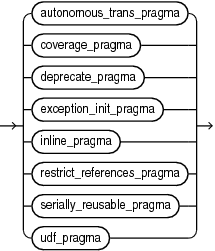

## Lexical Units

### Delimiters

A delimiter is a character, or character combination, that has a special meaning in PL/SQL.

Do not embed any others characters (including whitespace characters) inside a delimiter.

Table 2-2 summarizes the PL/SQL delimiters.

Table 2-2 PL/SQL Delimiters

| Delimiter | Meaning |
| --- | --- |
| `+` | Addition operator |
| `:=` | Assignment operator |
| `=>` | Association operator |
| `%` | Attribute indicator |
| `'` | Character string delimiter |
| `.` | Component indicator |
| `\|\|` | Concatenation operator |
| `/` | Division operator |
| `**` | Exponentiation operator |
| `(` | Expression or list delimiter (begin) |
| `)` | Expression or list delimiter (end) |
| `:` | Host variable indicator |
| `,` | Item separator |
| `<<` | Label delimiter (begin) |
| `>>` | Label delimiter (end) |
| `/*` | Multiline comment delimiter (begin) |
| `*/` | Multiline comment delimiter (end) |
| `*` | Multiplication operator |
| `"` | Quoted identifier delimiter |
| `..` | Range operator |
| `=` | Relational operator (equal) |
| `<>` | Relational operator (not equal) |
| `!=` | Relational operator (not equal) |
| `~=` | Relational operator (not equal) |
| ` ^=` | Relational operator (not equal) |
| `<` | Relational operator (less than) |
| `>` | Relational operator (greater than) |
| `<=` | Relational operator (less than or equal) |
| `>=` | Relational operator (greater than or equal) |
| `@` | Remote access indicator |
| `--` | Single-line comment indicator |
| `;` | Statement terminator |
| `-` | Subtraction or negation operator |

### Identifiers

Identifiers name PL/SQL elements, which include:

- Constants
- Cursors
- Exceptions
- Keywords
- Labels
- Packages
- Reserved words
- Subprograms
- Types
- Variables

Every character in an identifier, alphabetic or not, is significant. For example, the identifiers `lastname` and `last_name` are different.

You must separate adjacent identifiers by one or more whitespace characters or a punctuation character.

Except as explained in " Quoted User-Defined Identifiers ", PL/SQL is case-insensitive for identifiers. For example, the identifiers `lastname`, `LastName`, and `LASTNAME` are the same.

Topics

- Reserved Words and Keywords
- Predefined Identifiers
- User-Defined Identifiers

#### Reserved Words and Keywords

Reserved words and keywords are identifiers that have special meaning in PL/SQL.

You cannot use reserved words as ordinary user-defined identifiers. You can use them as quoted user-defined identifiers, but it is not recommended. For more information, see " Quoted User-Defined Identifiers ".

You can use keywords as ordinary user-defined identifiers, but it is not recommended.

For lists of PL/SQL reserved words and keywords, see [Table D-1](plsql-reserved-words-keywords.md) and [Table D-2](plsql-reserved-words-keywords.md), respectively.

#### Predefined Identifiers

Predefined identifiers are declared in the predefined package `STANDARD`.

An example of a predefined identifier is the exception `INVALID_NUMBER`.

For a list of predefined identifiers, connect to Oracle Database as a user who has the DBA role and use this query:

```
SELECT TYPE_NAME FROM ALL_TYPES WHERE PREDEFINED='YES';
```

You can use predefined identifiers as user-defined identifiers, but it is not recommended. Your local declaration overrides the global declaration (see " [Scope and Visibility of Identifiers](scope-and-visibility-identifiers.md) ").

#### User-Defined Identifiers

A user-defined identifier is:

- Composed of characters from the database character set
- Either ordinary or quoted

Tip:

Make user-defined identifiers meaningful. For example, the meaning of `cost_per_thousand` is obvious, but the meaning of `cpt` is not.

Tip:

Avoid using the same user-defined identifier for both a schema and a schema object. This decreases code readability and maintainability and can lead to coding mistakes. Note that local objects have name resolution precedence over schema qualification.

For more information about database object naming rules, see [Oracle Database SQL Language Reference](https://docs.oracle.com/pls/topic/lookup?ctx=en/database/oracle/oracle-database/19/lnpls&id=SQLRF-GUID-3C59E44A-5140-4BCA-B9E1-3039C8050C49).

For more information about PL/SQL-specific name resolution rules, see " [Differences Between PL/SQL and SQL Name Resolution Rules](differences-pl-sql-and-sql-name-resolution-rules.md) ".

##### Ordinary User-Defined Identifiers

An ordinary user-defined identifier:

- Begins with a letter
- Can include letters, digits, and these symbols:
	- Dollar sign ($)
		- Number sign (#)
		- Underscore (\_)
- Is not a reserved word (listed in [Table D-1](plsql-reserved-words-keywords.md)).

The database character set defines which characters are classified as letters and digits. If COMPATIBLE is set to a value of 12.2 or higher, the representation of the identifier in the database character set cannot exceed 128 bytes. If COMPATIBLE is set to a value of 12.1 or lower, the limit is 30 bytes.

Examples of acceptable ordinary user-defined identifiers:

```
X
t2
phone#
credit_limit
LastName
oracle$number
money$$$tree
SN##
try_again_
```

Examples of unacceptable ordinary user-defined identifiers:

```
mine&yours
debit-amount
on/off
user id
```

##### Quoted User-Defined Identifiers

A quoted user-defined identifier is enclosed in double quotation marks.

Between the double quotation marks, any characters from the database character set are allowed except double quotation marks, new line characters, and null characters. For example, these identifiers are acceptable:

```
"X+Y"
"last name"
"on/off switch"
"employee(s)"
"*** header info ***"
```

If COMPATIBLE is set to a value of 12.2 or higher, the representation of the quoted identifier in the database character set cannot exceed 128 bytes (excluding the double quotation marks). If COMPATIBLE is set to a value of 12.1 or lower, the limit is 30 bytes.

A quoted user-defined identifier is case-sensitive, with one exception: If a quoted user-defined identifier, without its enclosing double quotation marks, is a valid ordinary user-defined identifier, then the double quotation marks are optional in references to the identifier, and if you omit them, then the identifier is case-insensitive.

It is not recommended, but you can use a reserved word as a quoted user-defined identifier. Because a reserved word is not a valid ordinary user-defined identifier, you must always enclose the identifier in double quotation marks, and it is always case-sensitive.

Example 2-1 Valid Case-Insensitive Reference to Quoted User-Defined Identifier

In this example, the quoted user-defined identifier `"HELLO"`, without its enclosing double quotation marks, is a valid ordinary user-defined identifier. Therefore, the reference `Hello` is valid.

```
DECLARE
  "HELLO" varchar2(10) := 'hello';
BEGIN
  DBMS_Output.Put_Line(Hello);
END;
/
```

Result:

```
hello
```

Example 2-2 Invalid Case-Insensitive Reference to Quoted User-Defined Identifier

In this example, the reference `"Hello"` is invalid, because the double quotation marks make the identifier case-sensitive.

```
DECLARE
  "HELLO" varchar2(10) := 'hello';
BEGIN
  DBMS_Output.Put_Line("Hello");
END;
/
```

Result:

```
DBMS_Output.Put_Line("Hello");
                        *
ERROR at line 4:
ORA-06550: line 4, column 25:
PLS-00201: identifier 'Hello' must be declared
ORA-06550: line 4, column 3:
PL/SQL: Statement ignored
```

Example 2-3 Reserved Word as Quoted User-Defined Identifier

This example declares quoted user-defined identifiers `"BEGIN"`, `"Begin"`, and `"begin"`. Although `BEGIN`, `Begin`, and `begin` represent the same reserved word, `"BEGIN"`, `"Begin"`, and `"begin"` represent different identifiers.

```
DECLARE
  "BEGIN" varchar2(15) := 'UPPERCASE';
  "Begin" varchar2(15) := 'Initial Capital';
  "begin" varchar2(15) := 'lowercase';
BEGIN
  DBMS_Output.Put_Line("BEGIN");
  DBMS_Output.Put_Line("Begin");
  DBMS_Output.Put_Line("begin");
END;
/
```

Result:

```
UPPERCASE
Initial Capital
lowercase
 
PL/SQL procedure successfully completed.
```

Example 2-4 Neglecting Double Quotation Marks

This example references a quoted user-defined identifier that is a reserved word, neglecting to enclose it in double quotation marks.

```
DECLARE
  "HELLO" varchar2(10) := 'hello';  -- HELLO is not a reserved word
  "BEGIN" varchar2(10) := 'begin';  -- BEGIN is a reserved word
BEGIN
  DBMS_Output.Put_Line(Hello);      -- Double quotation marks are optional
  DBMS_Output.Put_Line(BEGIN);      -- Double quotation marks are required
end;
/
```

Result:

```
DBMS_Output.Put_Line(BEGIN);      -- Double quotation marks are required
                       *
ERROR at line 6:
ORA-06550: line 6, column 24:
PLS-00103: Encountered the symbol "BEGIN" when expecting one of the following:
( ) - + case mod new not null <an identifier>
<a double-quoted delimited-identifier> <a bind variable>
table continue avg count current exists max min prior sql
stddev sum variance execute multiset the both leading
trailing forall merge year month day hour minute second
timezone_hour timezone_minute timezone_region timezone_abbr
time timestamp interval date
<a string literal with character set specificat
```

Example 2-5 Neglecting Case-Sensitivity

This example references a quoted user-defined identifier that is a reserved word, neglecting its case-sensitivity.

```
DECLARE
  "HELLO" varchar2(10) := 'hello';  -- HELLO is not a reserved word
  "BEGIN" varchar2(10) := 'begin';  -- BEGIN is a reserved word
BEGIN
  DBMS_Output.Put_Line(Hello);      -- Identifier is case-insensitive
  DBMS_Output.Put_Line("Begin");    -- Identifier is case-sensitive
END;
/
```

Result:

```
DBMS_Output.Put_Line("Begin");    -- Identifier is case-sensitive
                        *
ERROR at line 6:
ORA-06550: line 6, column 25:
PLS-00201: identifier 'Begin' must be declared
ORA-06550: line 6, column 3:
PL/SQL: Statement ignored
```

### Literals

A literal is a value that is neither represented by an identifier nor calculated from other values.

For example, `123` is an integer literal and `'abc'` is a character literal, but `1+2` is not a literal.

PL/SQL literals include all SQL literals (described in [Oracle Database SQL Language Reference](https://docs.oracle.com/pls/topic/lookup?ctx=en/database/oracle/oracle-database/19/lnpls&id=SQLRF00217)) and `BOOLEAN` literals (which SQL does not have). A `BOOLEAN` literal is the predefined logical value `TRUE`, `FALSE`, or `NULL`. `NULL` represents an unknown value.

Note:

Like Oracle Database SQL Language Reference, this document uses the terms character literal and string interchangeably.

When using character literals in PL/SQL, remember:

- Character literals are case-sensitive.
	For example, `'Z'` and `'z'` are different.
- Whitespace characters are significant.
	For example, these literals are different:
	```
	'abc'
	' abc'
	'abc '
	' abc '
	'a b c'
	```
- PL/SQL has no line-continuation character that means "this string continues on the next source line." If you continue a string on the next source line, then the string includes a line-break character.
	For example, this PL/SQL code:
	```
	BEGIN
	  DBMS_OUTPUT.PUT_LINE('This string breaks
	here.');
	END;
	/
	```
	Prints this:
	```
	This string breaks
	here.
	```
	If your string does not fit on a source line and you do not want it to include a line-break character, then construct the string with the concatenation operator (`||`).
	For example, this PL/SQL code:
	```
	BEGIN
	  DBMS_OUTPUT.PUT_LINE('This string ' ||
	                       'contains no line-break character.');
	END;
	/
	```
	Prints this:
	```
	This string contains no line-break character.
	```
	For more information about the concatenation operator, see " [Concatenation Operator](expressions.md) ".
- `'0'` through `'9'` are not equivalent to the integer literals 0 through 9.
	However, because PL/SQL converts them to integers, you can use them in arithmetic expressions.
- A character literal with zero characters has the value `NULL` and is called a null string.
	However, this `NULL` value is not the `BOOLEAN` value `NULL`.
- An ordinary character literal is composed of characters in the database character set.
	For information about the database character set, see [Oracle Database Globalization Support Guide](https://docs.oracle.com/pls/topic/lookup?ctx=en/database/oracle/oracle-database/19/lnpls&id=NLSPG171).
- A national character literal is composed of characters in the national character set.
	For information about the national character set, see [Oracle Database Globalization Support Guide](https://docs.oracle.com/pls/topic/lookup?ctx=en/database/oracle/oracle-database/19/lnpls&id=NLSPG180).
- You can use `Q` or `q` as part of the character literal syntax to indicate that an alternative quoting mechanism will be used. This mechanism allows a wide range of delimiters for a string as opposed to simply single quotation marks.
	For more information about the alternative quoting mechanism, see [Oracle Database SQL Language Reference](https://docs.oracle.com/pls/topic/lookup?ctx=en/database/oracle/oracle-database/19/lnpls&id=SQLRF-GUID-1824CBAA-6E16-4921-B2A6-112FB02248DA).
	Live SQL:
	You can view and run examples of the `Q` mechanism at [Alternative Quoting Mechanism (''Q'') for String Literals](https://livesql.oracle.com/apex/livesql/file/content_CIREYU9EA54EOKQ7LAMZKRF6P.html)

### Pragmas

A pragma is an instruction to the compiler that it processes at compile time.

A pragma begins with the reserved word `PRAGMA` followed by the name of the pragma. Some pragmas have arguments. A pragma may appear before a declaration or a statement. Additional restrictions may apply for specific pragmas. The extent of a pragma’s effect depends on the pragma. A pragma whose name or argument is not recognized by the compiler has no effect.

pragma::=



> ```
> { autonomous_trans_pragma
> | coverage_pragma
> | deprecate_pragma
> | exception_init_pragma
> | inline_pragma
> | restrict_references_pragma
> | serially_reusable_pragma
> | udf_pragma
> }
> ```
>
> [  
> Copyright © 1996, 2026, Oracle and/or its affiliates.](https://docs.oracle.com/en/database/oracle/oracle-database/dcommon/html/cpyr.htm)


For information about pragmas syntax and semantics, see:

- " [AUTONOMOUS\_TRANSACTION Pragma](AUTONOMOUS_TRANSACTION-pragma.md) "
- " [COVERAGE Pragma](COVERAGE-pragma.md) "
- " [DEPRECATE Pragma](DEPRECATE-pragma.md) "
- " [EXCEPTION\_INIT Pragma](EXCEPTION_INIT-pragma.md) "
- " [INLINE Pragma](INLINE-pragma.md) "
- " [RESTRICT\_REFERENCES Pragma](RESTRICT_REFERENCES-pragma.md) "
- " [SERIALLY\_REUSABLE Pragma](SERIALLY_REUSABLE-pragma.md) "
- " [UDF Pragma](UDF-pragma.md) "

### Comments

The PL/SQL compiler ignores comments. Their purpose is to help other application developers understand your source text.

Typically, you use comments to describe the purpose and use of each code segment. You can also disable obsolete or unfinished pieces of code by turning them into comments.

Topics

#### Single-Line Comments

A single-line comment begins with `--` and extends to the end of the line.

Caution:

Do not put a single-line comment in a PL/SQL block to be processed dynamically by an Oracle Precompiler program. The Oracle Precompiler program ignores end-of-line characters, which means that a single-line comment ends when the block ends.

While testing or debugging a program, you can disable a line of code by making it a comment. For example:

```
-- DELETE FROM employees WHERE comm_pct IS NULL
```

Example 2-6 Single-Line Comments

This example has three single-line comments.

```
DECLARE
  howmany     NUMBER;
  num_tables  NUMBER;
BEGIN
  -- Begin processing
  SELECT COUNT(*) INTO howmany
  FROM USER_OBJECTS
  WHERE OBJECT_TYPE = 'TABLE'; -- Check number of tables
  num_tables := howmany;       -- Compute another value
END;
/
```

#### Multiline Comments

A multiline comment begins with `/*`, ends with `*/`, and can span multiple lines.

You can use multiline comment delimiters to "comment out" sections of code. When doing so, be careful not to cause nested multiline comments. One multiline comment cannot contain another multiline comment. However, a multiline comment can contain a single-line comment. For example, this causes a syntax error:

```
/*
  IF 2 + 2 = 4 THEN
    some_condition := TRUE;
  /* We expect this THEN to always be performed */
  END IF;
*/
```

This does not cause a syntax error:

```
/*
  IF 2 + 2 = 4 THEN
    some_condition := TRUE;
  -- We expect this THEN to always be performed
  END IF;
*/
```

Example 2-7 Multiline Comments

This example has two multiline comments. (The SQL function `TO_CHAR` returns the character equivalent of its argument. For more information about `TO_CHAR`, see [Oracle Database SQL Language Reference](https://docs.oracle.com/pls/topic/lookup?ctx=en/database/oracle/oracle-database/19/lnpls&id=SQLRF06128).)

```
DECLARE
  some_condition  BOOLEAN;
  pi              NUMBER := 3.1415926;
  radius          NUMBER := 15;
  area            NUMBER;
BEGIN
  /* Perform some simple tests and assignments */
 
  IF 2 + 2 = 4 THEN
    some_condition := TRUE;
  /* We expect this THEN to always be performed */
  END IF;
 
  /* This line computes the area of a circle using pi,
  which is the ratio between the circumference and diameter.
  After the area is computed, the result is displayed. */
 
  area := pi * radius**2;
  DBMS_OUTPUT.PUT_LINE('The area is: ' || TO_CHAR(area));
END;
/
```

Result:

```
The area is: 706.858335
```

### Whitespace Characters Between Lexical Units

You can put whitespace characters between lexical units, which often makes your source text easier to read.

Example 2-8 Whitespace Characters Improving Source Text Readability

```
DECLARE
  x    NUMBER := 10;
  y    NUMBER := 5;
  max  NUMBER;
BEGIN
  IF x>y THEN max:=x;ELSE max:=y;END IF;  -- correct but hard to read
  
  -- Easier to read:
  
  IF x > y THEN
    max:=x;
  ELSE
    max:=y;
  END IF;
END;
/
```