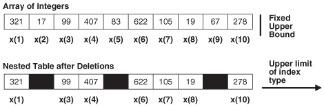

## Nested Tables

In the database, a nested table is a column type that stores an unspecified number of rows in no particular order.

When you retrieve a nested table value from the database into a PL/SQL nested table variable, PL/SQL gives the rows consecutive indexes, starting at 1. Using these indexes, you can access the individual rows of the nested table variable. The syntax is `variable_name` `(``index``)`. The indexes and row order of a nested table might not remain stable as you store and retrieve the nested table from the database.

The amount of memory that a nested table variable occupies can increase or decrease dynamically, as you add or delete elements.

An uninitialized nested table variable is a null collection. You must initialize it, either by making it empty or by assigning a non- `NULL` value to it. For details, see " [Collection Constructors](collection-constructors.md) " and " [Assigning Values to Collection Variables](assigning-values-collection-variables.md) ".

Note:

[Example 5-19](collection-methods.md), [Example 5-21](collection-methods.md), and [Example 5-22](collection-methods.md) reuse `nt_type` and `print_nt`.

Topics

- Important Differences Between Nested Tables and Arrays
- Appropriate Uses for Nested Tables

See Also:

- [Table 5-1](collection-types.md) for a summary of nested table characteristics
- " [nested\_table\_type\_def::=](collection-variable.md) " for the syntax of a nested table type definition
- " [CREATE TYPE Statement](CREATE-TYPE-statement.md) " for information about creating standalone nested table types
- " [INSTEAD OF DML Triggers](dml-triggers.md) " for information about triggers that update nested table columns of views
- [Oracle Database SQL Language Reference](https://docs.oracle.com/pls/topic/lookup?ctx=en/database/oracle/oracle-database/19/lnpls&id=SQLRF51008) for more information about nested tables

Example 5-5 Nested Table of Local Type

This example defines a local nested table type, declares a variable of that type (initializing it with a constructor), and defines a procedure that prints the nested table. (The procedure uses the collection methods `FIRST` and `LAST`, described in " [Collection Methods](collection-methods.md) ".) The example invokes the procedure three times: After initializing the variable, after changing the value of one element, and after using a constructor to the change the values of all elements. After the second constructor invocation, the nested table has only two elements. Referencing element 3 would raise error ORA-06533.

Live SQL:

You can view and run this example on Oracle Live SQL at [Nested Table of Local Type](https://livesql.oracle.com/apex/livesql/docs/lnpls/plsql-collections-and-records/composites56.html)

```
DECLARE
  TYPE Roster IS TABLE OF VARCHAR2(15);  -- nested table type
 
  -- nested table variable initialized with constructor:
 
  names Roster := Roster('D Caruso', 'J Hamil', 'D Piro', 'R Singh');
 
  PROCEDURE print_names (heading VARCHAR2) IS
  BEGIN
    DBMS_OUTPUT.PUT_LINE(heading);
 
    FOR i IN names.FIRST .. names.LAST LOOP  -- For first to last element
      DBMS_OUTPUT.PUT_LINE(names(i));
    END LOOP;
 
    DBMS_OUTPUT.PUT_LINE('---');
  END;
  
BEGIN 
  print_names('Initial Values:');
 
  names(3) := 'P Perez';  -- Change value of one element
  print_names('Current Values:');
 
  names := Roster('A Jansen', 'B Gupta');  -- Change entire table
  print_names('Current Values:');
END;
/
```

Result:

```
Initial Values:
D Caruso
J Hamil
D Piro
R Singh
---
Current Values:
D Caruso
J Hamil
P Perez
R Singh
---
Current Values:
A Jansen
B Gupta
```

Example 5-6 Nested Table of Standalone Type

This example defines a standalone nested table type, `nt_type`, and a standalone procedure to print a variable of that type, `print_nt`. An anonymous block declares a variable of type `nt_type`, initializing it to empty with a constructor, and invokes `print_nt` twice: After initializing the variable and after using a constructor to the change the values of all elements.

Live SQL:

You can view and run this example on Oracle Live SQL at [Nested Table of Standalone Type](https://livesql.oracle.com/apex/livesql/docs/lnpls/plsql-collections-and-records/composites86.html)

```
CREATE OR REPLACE TYPE nt_type IS TABLE OF NUMBER;
/
CREATE OR REPLACE PROCEDURE print_nt (nt nt_type) AUTHID DEFINER IS
  i  NUMBER;
BEGIN
  i := nt.FIRST;
 
  IF i IS NULL THEN
    DBMS_OUTPUT.PUT_LINE('nt is empty');
  ELSE
    WHILE i IS NOT NULL LOOP
      DBMS_OUTPUT.PUT('nt.(' || i || ') = ');
      DBMS_OUTPUT.PUT_LINE(NVL(TO_CHAR(nt(i)), 'NULL'));
      i := nt.NEXT(i);
    END LOOP;
  END IF;
 
  DBMS_OUTPUT.PUT_LINE('---');
END print_nt;
/
DECLARE
  nt nt_type := nt_type();  -- nested table variable initialized to empty
BEGIN
  print_nt(nt);
  nt := nt_type(90, 9, 29, 58);
  print_nt(nt);
END;
/
```

Result:

```
nt is empty
---
nt.(1) = 90
nt.(2) = 9
nt.(3) = 29
nt.(4) = 58
---
```

### Important Differences Between Nested Tables and Arrays

Conceptually, a nested table is like a one-dimensional array with an arbitrary number of elements. However, a nested table differs from an array in these important ways:

- An array has a declared number of elements, but a nested table does not. The size of a nested table can increase dynamically.
- An array is always dense. A nested array is dense initially, but it can become sparse, because you can delete elements from it.

Figure 5-2 shows the important differences between a nested table and an array.

Figure 5-2 Array and Nested Table



> This illustration is described in the text. It shows a varray and a nested table side-by-side. These data structures look similar except for the empty spaces in the nested table where some elements have been deleted. The varray has an upper limit on the number of elements while the nested table can be extended to hold an unlimited number of elements.


### Appropriate Uses for Nested Tables

A nested table is appropriate when:

- The number of elements is not set.
- Index values are not consecutive.
- You must delete or update some elements, but not all elements simultaneously.
	Nested table data is stored in a separate store table, a system-generated database table. When you access a nested table, the database joins the nested table with its store table. This makes nested tables suitable for queries and updates that affect only some elements of the collection.
- You would create a separate lookup table, with multiple entries for each row of the main table, and access it through join queries.