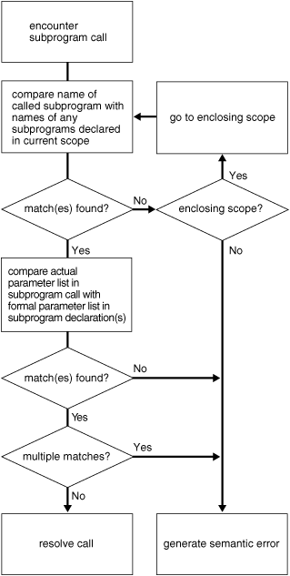

## Subprogram Invocation Resolution

When the PL/SQL compiler encounters a subprogram invocation, it searches for a matching subprogram declaration—first in the current scope and then, if necessary, in successive enclosing scopes.

A declaration and invocation match if their subprogram names and parameter lists match. The parameter lists match if each required formal parameter in the declaration has a corresponding actual parameter in the invocation.

If the compiler finds no matching declaration for an invocation, then it generates a semantic error.

Figure 8-1 shows how the PL/SQL compiler resolves a subprogram invocation.

Figure 8-1 How PL/SQL Compiler Resolves Invocations



> This illustration is described in the text. It shows a flowchart of the logic used to decide which version of an overloaded subprogram to invoke, or whether to raise an error, based on the types of the parameters in the subprogram call.
>
> [  
> Copyright © 1996, 2026, Oracle and/or its affiliates.](https://docs.oracle.com/en/database/oracle/oracle-database/dcommon/html/cpyr.htm)


In Example 8-25, the function `balance` tries to invoke the enclosing procedure `swap`, using appropriate actual parameters. However, `balance` contains two nested procedures named `swap`, and neither has parameters of the same type as the enclosing procedure `swap`. Therefore, the invocation causes compilation error PLS-00306.

Example 8-25 Resolving PL/SQL Procedure Names

```
DECLARE
  PROCEDURE swap (
    n1 NUMBER,
    n2 NUMBER
  )
  IS
    num1 NUMBER;
    num2 NUMBER;

    FUNCTION balance
      (bal NUMBER)
      RETURN NUMBER
    IS
      x NUMBER := 10;

      PROCEDURE swap (
        d1 DATE,
        d2 DATE
      ) IS
      BEGIN
        NULL;
      END;

      PROCEDURE swap (
        b1 BOOLEAN,
        b2 BOOLEAN
      ) IS
      BEGIN
        NULL;
      END;

    BEGIN  -- balance
      swap(num1, num2);
      RETURN x;
    END balance;

  BEGIN  -- enclosing procedure swap
    NULL;
  END swap;

BEGIN  -- anonymous block
  NULL;
END;   -- anonymous block
/
```

Result:

```
swap(num1, num2);
      *
ERROR at line 33:
ORA-06550: line 33, column 7:
PLS-00306: wrong number or types of arguments in call to 'SWAP'
ORA-06550: line 33, column 7:
PL/SQL: Statement ignored
```