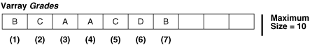

## Varrays (Variable-Size Arrays)

A varray (variable-size array) is an array whose number of elements can vary from zero (empty) to the declared maximum size.

To access an element of a varray variable, use the syntax `variable_name` `(``index``)`. The lower bound of `index` is 1; the upper bound is the current number of elements. The upper bound changes as you add or delete elements, but it cannot exceed the maximum size. When you store and retrieve a varray from the database, its indexes and element order remain stable.

Figure 5-1 shows a varray variable named `Grades`, which has maximum size 10 and contains seven elements. `Grades` (`n`) references the nth element of `Grades`. The upper bound of `Grades` is 7, and it cannot exceed 10.

Figure 5-1 Varray of Maximum Size 10 with 7 Elements



> This illustration is described in the text. It shows a varray data structure that holds a certain number of elements, and can be extended until it reaches a fixed upper limit.
>
> [  
> Copyright © 1996, 2026, Oracle and/or its affiliates.](https://docs.oracle.com/en/database/oracle/oracle-database/dcommon/html/cpyr.htm)


The database stores a varray variable as a single object. If a varray variable is less than 4 KB, it resides inside the table of which it is a column; otherwise, it resides outside the table but in the same tablespace.

An uninitialized varray variable is a null collection. You must initialize it, either by making it empty or by assigning a non- `NULL` value to it. For details, see " [Collection Constructors](collection-constructors.md) " and " [Assigning Values to Collection Variables](assigning-values-collection-variables.md) ".

Topics

- Appropriate Uses for Varrays

See Also:

- [Table 5-1](collection-types.md) for a summary of varray characteristics
- " [varray\_type\_def::=](collection-variable.md) " for the syntax of a `VARRAY` type definition
- " [CREATE TYPE Statement](CREATE-TYPE-statement.md) " for information about creating standalone `VARRAY` types
- [Oracle Database SQL Language Reference](https://docs.oracle.com/pls/topic/lookup?ctx=en/database/oracle/oracle-database/19/lnpls&id=SQLRF51007) for more information about varrays

Example 5-4 Varray (Variable-Size Array)

This example defines a local `VARRAY` type, declares a variable of that type (initializing it with a constructor), and defines a procedure that prints the varray. The example invokes the procedure three times: After initializing the variable, after changing the values of two elements individually, and after using a constructor to the change the values of all elements. (For an example of a procedure that prints a varray that might be null or empty, see [Example 5-26](collection-methods.md).)

```
DECLARE
  TYPE Foursome IS VARRAY(4) OF VARCHAR2(15);  -- VARRAY type
 
  -- varray variable initialized with constructor:
 
  team Foursome := Foursome('John', 'Mary', 'Alberto', 'Juanita');
 
  PROCEDURE print_team (heading VARCHAR2) IS
  BEGIN
    DBMS_OUTPUT.PUT_LINE(heading);
 
    FOR i IN 1..4 LOOP
      DBMS_OUTPUT.PUT_LINE(i || '.' || team(i));
    END LOOP;
 
    DBMS_OUTPUT.PUT_LINE('---'); 
  END;
  
BEGIN 
  print_team('2001 Team:');
 
  team(3) := 'Pierre';  -- Change values of two elements
  team(4) := 'Yvonne';
  print_team('2005 Team:');
 
  -- Invoke constructor to assign new values to varray variable:
 
  team := Foursome('Arun', 'Amitha', 'Allan', 'Mae');
  print_team('2009 Team:');
END;
/
```

Result:

```
2001 Team:
1.John
2.Mary
3.Alberto
4.Juanita
---
2005 Team:
1.John
2.Mary
3.Pierre
4.Yvonne
---
2009 Team:
1.Arun
2.Amitha
3.Allan
4.Mae
---
```

### Appropriate Uses for Varrays

A varray is appropriate when:

- You know the maximum number of elements.
- You usually access the elements sequentially.

Because you must store or retrieve all elements at the same time, a varray might be impractical for large numbers of elements.