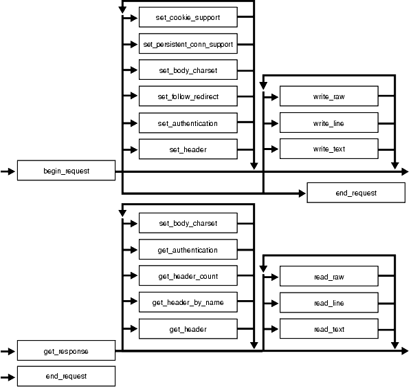

The `UTL_HTTP` package makes Hypertext Transfer Protocol (HTTP) callouts from SQL and PL/SQL. You can use it to access data on the Internet over HTTP.

When the package fetches data from a Web site using HTTPS, it requires Oracle Wallet Manager which can be created by either Oracle Wallet Manager or the orapki utility. Non-HTTPS fetches do not require an Oracle wallet.

This chapter contains the following topics:

**See Also:**

- [UTL\_URL](UTL_URL.md)
- [UTL\_SMTP](UTL_SMTP.md)
- [*Oracle Database Enterprise User Security Administrator’s Guide*](https://docs.oracle.com/pls/topic/lookup?ctx=en/database/oracle/oracle-database/19/arpls&id=DBIMI-GUID-D0AA8373-B0AC-4DD8-9FA9-403E345E5A71) for more information on Wallet Manager

### UTL\_HTTP Overview

With the `UTL_HTTP` package, you can write PL/SQL programs that communicate with Web (HTTP) servers. `UTL_HTTP` also contains a function that can be used in SQL queries.

The package supports HTTP over the Secured Socket Layer protocol (SSL), also known as HTTPS. It also supports SSL client authentication by sending the client-certificate in a wallet to authenticate with the remote Web server.

Other Internet-related data-access protocols (such as the File Transfer Protocol (FTP) or the Gopher protocol) are also supported using an HTTP proxy server that supports those protocols.

### UTL\_HTTP Security Model

This package is an invoker’s rights package. The invoking user will need the `connect` privilege granted in the access control list assigned to the remote network host to which he wants to connect, as well as the `use-client-certificates` or the `use-passwords` privilege to authenticate himself with the remote Web server using the credentials stored in an Oracle wallet.

**Note:** For more information about managing fine-grained access, see [*Oracle Database Security Guide*](https://docs.oracle.com/pls/topic/lookup?ctx=en/database/oracle/oracle-database/19/arpls&id=DBSEG-GUID-B7DB516A-3245-417F-BB89-8E8212A97542)

.infoboxnote}

### UTL\_HTTP Constants

The `UTL_HTTP` package defines several constants to use when specifying parameter values.

These are shown in following tables.

- Table 273-1
- Table 273-2
- Table 273-3

Table 1 UTL\_HTTP Constants - HTTP Versions

| Name | Type | Value | Description |
| --- | --- | --- | --- |
| `HTTP_VERSION_1_0` | `VARCHAR2` (10) | `'HTTP/1.0'` | Denotes HTTP version 1.0 that can be used in the function `BEGIN_REQUEST`. |
| `HTTP_VERSION_1_1` | `VARCHAR2` (10) | `'HTTP/1.1'` | Denotes HTTP version 1.1 that can be used in the function `BEGIN_REQUEST`. |

Table 2 UTL\_HTTP Constants - Default Ports

| Name | Type | Value | Description |
| --- | --- | --- | --- |
| `DEFAULT_HTTP_PORT` | `PLS_INTEGER` | `80` | The default TCP/IP port (80) at which a Web server or proxy server listens |
| `DEFAULT_HTTPS_PORT` | `PLS_INTEGER` | `443` | The default TCP/IP port (443) at which an HTTPS Web server listens |

Table 3 UTL\_HTTP Constants - HTTP 1.1 Status Codes

| Name | Type | Value | Description |
| --- | --- | --- | --- |
| `HTTP_CONTINUE` | `PLS_INTEGER` | `100` | The client should continue with its request. This interim response is used to inform the client that the initial part of the request has been received and has not yet been rejected by the server. |
| `HTTP_SWITCHING_PROTOCOLS` | `PLS_INTEGER` | `101` | The server understands and is willing to comply with the client’s request, through the Upgrade message header field, for a change in the application protocol being used on this connection. The server will switch protocols to those defined by the response’s Upgrade header field immediately after the empty line which terminates the 101 response. |
| `HTTP_OK` | `PLS_INTEGER` | `200` | The request has succeeded. The information returned with the response is dependent on the method used in the request |
| `HTTP_CREATED CONSTANT` | `PLS_INTEGER` | `201` | The request has been fulfilled and resulted in a new resource being created. |
| `HTTP_ACCEPTED` | `PLS_INTEGER` | `202` | The request has been accepted for processing, but the processing has not been completed. The request might or might not eventually be acted upon, as it might be disallowed when processing actually takes place. |
| `HTTP_NON_AUTHORITATIVE_INFO` | `PLS_INTEGER` | `203` | The returned metainformation in the entity-header is not the definitive set as available from the origin server, but is gathered from a local or a third-party copy. |
| `HTTP_NO_CONTENT` | `PLS_INTEGER` | `204` | The server has fulfilled the request but does not need to return an entity-body, and might want to return updated metainformation. |
| `HTTP_RESET_CONTENT` | `PLS_INTEGER` | `205` | The server has fulfilled the request and the user agent should reset the document view which caused the request to be sent. The response must not include an entity. |
| `HTTP_PARTIAL_CONTENT` | `PLS_INTEGER` | `206` | The server has fulfilled the partial GET request for the resource. |
| `HTTP_MULTIPLE_CHOICES` | `PLS_INTEGER` | `300` | The requested resource corresponds to any one of a set of representations, each with its own specific location, and agent- driven negotiation information is being provided so that the user (or user agent) can select a preferred representation and redirect its request to that location. |
| `HTTP_MOVED_PERMANENTLY` | `PLS_INTEGER` | `301` | The requested resource has been assigned a new permanent URI and any future references to this resource should use one of the returned URIs. |
| `HTTP_FOUND CONSTANT` | `PLS_INTEGER` | `302` | The requested resource resides temporarily under a different URI. |
| `HTTP_SEE_OTHER` | `PLS_INTEGER` | `303` | The response to the request can be found under a different URI and should be retrieved using a GET method on that resource. |
| `HTTP_NOT_MODIFIED` | `PLS_INTEGER` | `304` | If the client has performed a conditional GET request and access is allowed, but the document has not been modified, the server responds with this status code. |
| `HTTP_USE_PROXY` | `PLS_INTEGER` | `305` | The requested resource must be accessed through the proxy given by the Location field. The Location field gives the URI of the proxy. |
| `HTTP_TEMPORARY_REDIRECT` | `PLS_INTEGER` | `307` | The requested resource resides temporarily under a different URI. |
| `HTTP_BAD_REQUEST` | `PLS_INTEGER` | `400` | The request could not be understood by the server due to malformed syntax. |
| `HTTP_UNAUTHORIZED` | `PLS_INTEGER` | `401` | The request requires user authentication. The client may repeat the request with a suitable Authorization header field. If the request already included Authorization credentials, then the 401 response indicates that authorization has been refused for those credentials. |
| `HTTP_PAYMENT_REQUIRED` | `PLS_INTEGER` | `402` | This code is reserved for future use. |
| `HTTP_FORBIDDEN` | `PLS_INTEGER` | `403` | The server understood the request, but is refusing to fulfill it. |
| `HTTP_NOT_FOUND` | `PLS_INTEGER` | `404` | The server has not found anything matching the Request-URI. |
| `HTTP_NOT_ACCEPTABLE` | `PLS_INTEGER` | `406` | The resource identified by the request is only capable of generating response entities which have content characteristics not acceptable according to the accept headers sent in the request. |
| `HTTP_PROXY_AUTH_REQUIRED` | `PLS_INTEGER` | `407` | This code is similar to 401 (Unauthorized), but indicates that the client must first authenticate itself with the proxy. |
| `HTTP_REQUEST_TIME_OUT` | `PLS_INTEGER` | `408` | The client did not produce a request within the time that the server was prepared to wait. |
| `HTTP_CONFLICT` | `PLS_INTEGER` | `409` | The request could not be completed due to a conflict with the current state of the resource. |
| `HTTP_GONE` | `PLS_INTEGER` | `410` | The requested resource is no longer available at the server and no forwarding address is known. |
| `HTTP_LENGTH_REQUIRED` | `PLS_INTEGER` | `411` | The server refuses to accept the request without a defined `Content-Length`. |
| `HTTP_PRECONDITION_FAILED` | `PLS_INTEGER` | `412` | The precondition given in one or more of the request-header fields evaluated to false when it was tested on the server. |
| `HTTP_REQUEST_ENTITY_TOO_LARGE CONSTANT` | `PLS_INTEGER` | `413` | The server is refusing to process a request because the request entity is larger than the server is willing or able to process. |
| `HTTP_REQUEST_URI_TOO_LARGE` | `PLS_INTEGER` | `414` | The server is refusing to service the request because the Request-URI is longer than the server is willing to interpret. |
| `HTTP_UNSUPPORTED_MEDIA_TYPE` | `PLS_INTEGER` | `415` | The server is refusing to service the request because the entity of the request is in a format not supported by the requested resource for the requested method. |
| `HTTP_REQ_RANGE_NOT_SATISFIABLE` | `PLS_INTEGER` | `416` | A server returns a response with this status code if a request included a Range request-header field, and none of the range-specifier values in this field overlap the current extent of the selected resource, and the request did not include an If-Range request-header field. |
| `HTTP_EXPECTATION_FAILED` | `PLS_INTEGER` | `417` | The expectation given in an Expect request-header field could not be met by this server, or, if the server is a proxy, the server has unambiguous evidence that the request could not be met by the next-hop server. |
| `HTTP_NOT_IMPLEMENTED` | `PLS_INTEGER` | `501` | The server does not support the functionality required to fulfill the request. |
| `HTTP_BAD_GATEWAY` | `PLS_INTEGER` | `502` | The server, while acting as a gateway or proxy, received an invalid response from the upstream server it accessed in attempting to fulfill the request |
| `HTTP_SERVICE_UNAVAILABLE` | `PLS_INTEGER` | `503` | The server is currently unable to handle the request due to a temporary overloading or maintenance of the server. |
| `HTTP_GATEWAY_TIME_OUT` | `PLS_INTEGER` | `504` | The server, while acting as a gateway or proxy, did not receive a timely response from the upstream server specified by the URI (for example, HTTP, FTP, LDAP) or some other auxiliary server (for example, DNS) it needed to access in attempting to complete the request. |
| `HTTP_VERSION_NOT_SUPPORTED` | `PLS_INTEGER` | `505` | The server does not support, or refuses to support, the HTTP protocol version that was used in the request message. |

### UTL\_HTTP Exceptions

Exceptions indicate that the UTL\_HTTP package encountered issues.

The following table lists these exceptions. By default, `UTL_HTTP` raises the exception `request_failed` when a request fails to execute. If the package is set to raise a detailed exception by `set_detailed_excp_support`, the rest of the exceptions will be raised directly (except for the exception `end_of_body`, which will be raised by `READ_TEXT`, `READ_LINE`, and `READ_RAW` regardless of the setting).

Table 4 UTL\_HTTP Exceptions

| Exception | Error Code | Reason | Where Raised |
| --- | --- | --- | --- |
| `BAD_ARGUMENT` | `29261` | The argument passed to the interface is bad | Any HTTP request or response interface when `detailed_exception` is enabled |
| `BAD_URL` | `29262` | The requested URL is badly formed | `BEGIN_REQUEST`, when `detailed_exception` is enabled |
| `END_OF_BODY` | `29266` | The end of HTTP response body is reached | `READ_RAW`, `READ_TEXT`, and `READ_LINE`, when `detailed_exception` is enabled |
| `HEADER_NOT_FOUND` | `29265` | The header is not found | `GET_HEADER`, `GET_HEADER_BY_NAME`, when `detailed_exception` is enabled |
| `HTTP_CLIENT_ERROR` | `29268` | From `GET_RESPONSE`, the response status code indicates that a client error has occurred (status code in 4xx range). Or from `begin_request`, the HTTP proxy returns a status code in the 4xx range when making an HTTPS request through the proxy. | `GET_RESPONSE`, `BEGIN_REQUEST` when d `etailed_exception` is enabled |
| `HTTP_SERVER_ERROR` | `29269` | From `GET_RESPONSE`, the response status code indicates that a client error has occurred (status code in 5xx range). Or from `begin_request`, the HTTP proxy returns a status code in the 5xx range when making an HTTPS request through the proxy. | `GET_RESPONSE,` `BEGIN_REQUEST` when `detailed_exception` is enabled |
| `NETWORK_ACCESS_DENIED` | `24247` | Access to the remote network host or credentials in an Oracle wallet is denied | `BEGIN_REQUEST` and `SET_AUTHENTICATION_FROM_WALLET` when `detailed_exception` is enabled |
| `ILLEGAL_CALL` | `29267` | The call to `UTL_HTTP` is illegal at the current state of the HTTP request | `SET_HEADER`, `SET_AUTHENTICATION`, and `SET_PERSISTENT_CONN_SUPPORT`, when `detailed_exception` is enabled |
| `PARTIAL_MULTIBYTE_EXCEPTION` | `29275` | No complete character is read and a partial multibyte character is found at the end of the response body | `READ_TEXT` and `READ_LINE,` when `detailed_exception` is enabled |
| `PROTOCOL_ERROR` | `29263` | An HTTP protocol error occurs when communicating with the Web server | `SET_HEADER`, `GET_RESPONSE`, `READ_RAW`, `READ_TEXT`, and `READ_LINE`, when `detailed_exception` is enabled |
| `REQUEST_FAILED` | `29273` | The request fails to executes | Any HTTP request or response interface when `detailed_exception` is disabled |
| `TOO_MANY_REQUESTS` | `29270` | Too many requests or responses are open | `BEGIN_REQUEST`, when detailed\_exception is enabled |
| `TRANSFER_TIMEOUT` | `29276` | No data is read and a read timeout occurred | `READ_TEXT` and `READ_LINE,` when `detailed_exception` is enabled |
| `UNKNOWN_SCHEME` | `29264` | The scheme of the requested URL is unknown | `BEGIN_REQUEST` and `GET_RESPONSE`, when `detailed_exception` is enabled |

**Note:** The `partial_multibyte_char` and `transfer_timeout` exceptions are duplicates of the same exceptions defined in `UTL_TCP.`They are defined in this package so that the use of this package does not require the knowledge of the `UTL_TCP`. As those exceptions are duplicates, an exception handle that catches the `partial_multibyte_char` and `transfer_timeout` exceptions in this package also catch the exceptions in the `UTL_TCP.`

.infoboxnote}

For `REQUEST` and `REQUEST_PIECES`, the `request_failed` exception is raised when any exception occurs and `detailed_exception` is disabled.

### UTL\_HTTP Examples

These five examples demonstrate how to use `UTL_HTTP`.

- General Usage
- Retrieving HTTP Response Headers
- Handling HTTP Authentication
- Retrieving and Restoring Cookies
- Making HTTP Request with Private Wallet and Cookie Table

### UTL\_HTTP General Usage

This is an general example of `UTL_HTTP` usage.

```md
SET SERVEROUTPUT ON SIZE 40000

DECLARE
  req   UTL_HTTP.REQ;
  resp  UTL_HTTP.RESP;
  value VARCHAR2(1024);
BEGIN
  UTL_HTTP.SET_PROXY('proxy.my-company.com', 'corp.my-company.com');
  req := UTL_HTTP.BEGIN_REQUEST('http://www-hr.corp.my-company.com');
  UTL_HTTP.SET_HEADER(req, 'User-Agent', 'Mozilla/
4.0');
  resp := UTL_HTTP.GET_RESPONSE(req);
  LOOP
    UTL_HTTP.READ_LINE(resp, value, TRUE);
    DBMS_OUTPUT.PUT_LINE(value);
  END LOOP;
  UTL_HTTP.END_RESPONSE(resp);
EXCEPTION
  WHEN UTL_HTTP.END_OF_BODY THEN
    UTL_HTTP.END_RESPONSE(resp);
END;
```

### UTL\_HTTP Retrieving HTTP Response Headers

This example shows how `UTL_HTTP` retrieves HTTP response headers.

```md
SET SERVEROUTPUT ON SIZE 40000

DECLARE
  req   UTL_HTTP.REQ;
  resp  UTL_HTTP.RESP;
  name  VARCHAR2(256);
  value VARCHAR2(1024);
BEGIN
  UTL_HTTP.SET_PROXY('proxy.my-company.com', 'corp.my-company.com');
  req := UTL_HTTP.BEGIN_REQUEST('http://www-hr.corp.my-company.com');
  UTL_HTTP.SET_HEADER(req, 'User-Agent', 'Mozilla/4.0');
  resp := UTL_HTTP.GET_RESPONSE(req);
  DBMS_OUTPUT.PUT_LINE('HTTP response status code: ' || resp.status_code);
  DBMS_OUTPUT.PUT_LINE('HTTP response reason phrase: ' || resp.reason_phrase);
  FOR i IN 1..UTL_HTTP.GET_HEADER_COUNT(resp) LOOP
    UTL_HTTP.GET_HEADER(resp, i, name, value);
    DBMS_OUTPUT.PUT_LINE(name || ': ' || value);
  END LOOP;
  UTL_HTTP.END_RESPONSE(resp);
END;
```

### UTL\_HTTP Handling HTTP Authentication

This code sample indicates how `UTL_HTTP` handles HTTP authentication.

```md
SET serveroutput ON SIZE 40000

CREATE OR REPLACE PROCEDURE get_page (url      IN VARCHAR2,
                                      username IN VARCHAR2 DEFAULT NULL,
                                      password IN VARCHAR2 DEFAULT NULL,
                                      realm    IN VARCHAR2 DEFAULT NULL) AS
  req       UTL_HTTP.REQ;
  resp      UTL_HTTP.RESP;
  my_scheme VARCHAR2(256);
  my_realm  VARCHAR2(256);
  name      VARCHAR2(256);
  value     VARCHAR2(256);
BEGIN
  -- Turn off checking of status code. We will check it by ourselves.
  UTL_HTTP.SET_RESPONSE_ERROR_CHECK(FALSE);
  req := UTL_HTTP.BEGIN_REQUEST(url);
  IF (username IS NOT NULL) THEN
    UTL_HTTP.SET_AUTHENTICATION(req, username, password); -- Use HTTP Basic Authen. Scheme
  END IF;
  resp := UTL_HTTP.GET_RESPONSE(req);
  IF (resp.status_code = UTL_HTTP.HTTP_UNAUTHORIZED) THEN
    UTL_HTTP.GET_AUTHENTICATION(resp, my_scheme, my_realm, FALSE);
    DBMS_OUTPUT.PUT_LINE('Web proxy server is protected.');
    DBMS_OUTPUT.PUT('Please provide the required ' || my_scheme || ' authentication username/password for realm ' || my_realm || '
     for the proxy server.');
    UTL_HTTP.END_RESPONSE(resp);
    RETURN;
  ELSIF (resp.status_code = UTL_HTTP.HTTP_PROXY_AUTH_REQUIRED) THEN
    UTL_HTTP.GET_AUTHENTICATION(resp, my_scheme, my_realm, TRUE);
    DBMS_OUTPUT.PUT_LINE('Web page ' || url || ' is protected.');
    DBMS_OUTPUT.PUT('Please provide the required ' || my_scheme || ' authentication username/password for realm ' || my_realm || '
     for the Web page.');
    UTL_HTTP.END_RESPONSE(resp);
    RETURN;
  END IF;
  FOR i IN 1..UTL_HTTP.GET_HEADER_COUNT(resp) LOOP
    UTL_HTTP.GET_HEADER(resp, i, name, value);
    DBMS_OUTPUT.PUT_LINE(name || ': ' || value);
  END LOOP;
  UTL_HTTP.END_RESPONSE(resp);
END;
```

### UTL\_HTTP Retrieving and Restoring Cookies

This example show how UTL\_HTTP can be used to retrieve and restore cookies.

```md
CREATE TABLE my_cookies (
    session_id  INTEGER,
    name        VARCHAR2(256),
    value       VARCHAR2(1024),
    domain      VARCHAR2(256),
    expire      DATE,
    path        VARCHAR2(1024),
    secure      VARCHAR2(1),
    version     INTEGER);

CREATE SEQUENCE session_id;
SET SERVEROUTPUT ON SIZE 40000

REM Retrieve cookies from UTL_HTTP
CREATE OR REPLACE FUNCTION save_cookies RETURN PLS_INTEGER AS
  cookies        UTL_HTTP.COOKIE_TABLE;
  my_session_id  PLS_INTEGER;
  secure         VARCHAR2(1);
BEGIN
  /* assume that some cookies have been set in previous HTTP requests. */
  UTL_HTTP.GET_COOKIES(cookies);
  SELECT session_id.nextval INTO my_session_id FROM DUAL;
  FOR i in 1..cookies.count LOOP
    IF (cookies(i).secure) THEN
      secure := 'Y';
    ELSE
      secure := 'N';
    END IF;
    INSERT INTO my_cookies
    VALUES (my_session_id, cookies(i).name, cookies(i).value,
            cookies(i).domain,
            cookies(i).expire, cookies(i).path, secure, cookies(i).version);
  END LOOP;
  RETURN my_session_id;
END;
/

REM Retrieve cookies from UTL_HTTP
CREATE OR REPLACE PROCEDURE restore_cookies (this_session_id IN PLS_INTEGER)
AS
  cookies        UTL_HTTP.COOKIE_TABLE;
  cookie         UTL_HTTP.COOKIE;
  i              PLS_INTEGER := 0;
  CURSOR c (c_session_id PLS_INTEGER) IS
    SELECT * FROM my_cookies WHERE session_id = c_session_id;
BEGIN
  FOR r IN c(this_session_id) LOOP
    i := i + 1;
    cookie.name     := r.name;
    cookie.value    := r.value;
    cookie.domain   := r.domain;
    cookie.expire   := r.expire;
    cookie.path     := r.path;
    IF (r.secure = 'Y') THEN
      cookie.secure := TRUE;
    ELSE
      cookie.secure := FALSE;
    END IF;
    cookie.version := r.version;
    cookies(i) := cookie;
  END LOOP;
  UTL_HTTP.CLEAR_COOKIES;
  UTL_HTTP.ADD_COOKIES(cookies);
END;
/
```

### UTL\_HTTP Making HTTP Request with Private Wallet and Cookie Table

This example shows how `UTL_HTTP` creates a request context with a wallet and cookie table, then makes an HTTP Request using that wallet and cookie table.

```md
SET SERVEROUTPUT ON SIZE 40000

CREATE OR REPLACE PROCEDURE DISPLAY_PAGE(url IN VARCHAR2) AS
  request_context UTL_HTTP.REQUEST_CONTEXT_KEY;
  req             UTL_HTTP.REQ;
  resp            UTL_HTTP.RESP;
  data            VARCHAR2(1024);

BEGIN

  -- Create a request context with its wallet and cookie table
  request_context := UTL_HTTP.CREATE_REQUEST_CONTEXT(
                       wallet_path          => 'file:/oracle/wallets/test/wallet',
                       wallet_password      => '******',
                       enable_cookies       => TRUE,
                       max_cookies          => 300,
                       max_cookies_per_site => 20);

  -- Make a HTTP request using the private wallet and cookie
  -- table in the request context
  req := UTL_HTTP.BEGIN_REQUEST(
           url             => url,
           request_context => request_context);
  resp := UTL_HTTP.GET_RESPONSE(req);

  BEGIN
    LOOP
       UTL_HTTP.READ_TEXT(resp, data);
       DBMS_OUTPUT.PUT(data);
    END LOOP;
  EXCEPTION
      WHEN UTL_HTTP.END_OF_BODY THEN
         UTL_HTTP.END_RESPONSE(resp);
  END;

  -- Destroy the request context
  UTL_HTTP.DESTROY_REQUEST_CONTEXT(request_context);

END;

BEGIN
  DISPLAY_PAGE('https://www.example.com/');
END;
/
```

### UTL\_HTTP Using a Proxy Server

This example shows using a proxy server for an Oracle Database connection.

The `UTL_HTTP.REQUEST` procedure uses the proxy server host name and the port number to access the HTTPS URL from within the Oracle Database.

```md
SELECT UTL_HTTP.REQUEST('<URL>', '<proxy_hostname>:<proxy_port_number>', '<wallet_directory>', '<wallet_password>') FROM DUAL;
```

**Note:** By default, the `UTL_HTTP.REQUEST` procedure enables you to omit or set the “proxy” argument as `NULL`.

.infoboxnote}

### UTL\_HTTP Data Structures

Data structures are used to represent requests, responses, cookies, connections, and request context.

- REQ Type
- RESP Type
- COOKIE and COOKIE\_TABLE Types
- CONNECTION Type
- REQUEST\_CONTEXT\_KEY Type

### REQ Type

Use this PL/SQL record type to represent an HTTP request.

**Syntax**

```md
TYPE req IS RECORD (
   url           VARCHAR2(32767),
   method        VARCHAR2(64),
   http_version  VARCHAR2(64));
```

**Parameters**

Table 5 REQ Type Parameters

| Parameter | Description |
| --- | --- |
| `url` | The URL of the HTTP request. It is set after the request is created by `BEGIN_REQUEST`. |
| `method` | The method to be performed on the resource identified by the URL. It is set after the request is created by `BEGIN_REQUEST`. |
| `http_version` | The HTTP protocol version used to send the request. It is set after the request is created by `BEGIN_REQUEST`. |

**Usage Notes**

The information returned in `REQ` from the interface `begin_request` is for read-only. Changing the field values in the record has no effect on the request.

There are other fields in `REQ` record type whose names begin with the prefix `private_.` The fields are private and are intended for use by implementation of the `UTL_HTTP` package. You should not modify the fields.

### REQUEST\_CONTEXT\_KEY Type

This type is used to represent the key to a request context.

A request context is a context that holds a private wallet and cookie table to make a HTTP request. This private wallet and cookie table, unlike the session-wide ones maintained in the package, will not be shared with other HTTP requests within the database session.

**Syntax**

```md
SUBTYPE request_context_key IS PLS_INTEGER;
```

**Usage Notes**

To provide enhanced security, `UTL_HTTP` allows PL/SQL programs to create request contexts. A request context is a private context that holds a wallet and a cookie table that will not be shared with other programs in the same database session when making HTTP requests and receiving HTTP responses. PL/SQL programs should use request contexts when they need to use wallets or cookies that contain sensitive information such as authentication credentials.

### RESP Type

This PL/SQL record type is used to represent an HTTP response.

**Syntax**

```md
TYPE resp IS RECORD (
   status_code    PLS_INTEGER,
   reason_phrase  VARCHAR2(256),
   http_version   VARCHAR2(64));
```

**Parameters**

Table 6 RESP Type Parameters

| Parameter | Description |
| --- | --- |
| `status_code` | The status code returned by the Web server. It is a 3-digit integer that indicates the results of the HTTP request as handled by the Web server. It is set after the response is processed by `GET_RESPONSE`. |
| `reason_phrase` | The short textual message returned by the Web server that describe the status code. It gives a brief description of the results of the HTTP request as handled by the Web server. It is set after the response is processed by `GET_RESPONSE`. |
| `http_version` | The HTTP protocol version used in the HTTP response. It is set after the response is processed by `GET_RESPONSE`. |

**Usage Notes**

The information returned in `RESP` from the interface `GET_RESPONSE` is read-only. There are other fields in the `RESP` record type whose names begin with the prefix `private_.` The fields are private and are intended for use by implementation of the `UTL_HTTP` package. You should not modify the fields.

### COOKIE and COOKIE\_TABLE Types

The `COOKIE` type is the PL/SQL record type that represents an HTTP cookie. The `COOKIE_TABLE` type is a PL/SQL index-by-table type that represents a collection of HTTP cookies.

**Syntax**

```md
TYPE cookie IS RECORD (
   name  VARCHAR2(256),
   value  VARCHAR2(1024),
   domain  VARCHAR2(256),
   expire  TIMESTAMP WITH TIME ZONE,
   path  VARCHAR2(1024),
   secure  BOOLEAN,
   version  PLS_INTEGER,
   comment  VARCHAR2(1024));

TYPE cookie_table IS TABLE OF cookie INDEX BY binary_integer;
```

**Fields of COOKIE Record Type** Table 273-7 shows the fields for the `COOKIE` and `COOKIE_TABLE` record types.

Table 7 Fields of COOKIE and COOKIE\_TABLE Type

| Field | Description |
| --- | --- |
| `name` | The name of the HTTP cookie |
| `value` | The value of the cookie |
| `domain` | The domain for which the cookie is valid |
| `expire` | The time by which the cookie will expire |
| `path` | The subset of URLs to which the cookie applies |
| `secure` | Should the cookie be returned to the Web server using secured means only. |
| `version` | The version of the HTTP cookie specification the cookie conforms. This field is `NULL` for Netscape cookies. |
| `comment` | The comment that describes the intended use of the cookie. This field is `NULL` for Netscape cookies. |

**Usage Notes**

PL/SQL programs do not usually examine or change the cookie information stored in the `UTL_HTTP` package. The cookies are maintained by the package transparently. They are maintained inside the `UTL_HTTP` package, and they last for the duration of the database session only. PL/SQL applications that require cookies to be maintained beyond the lifetime of a database session can read the cookies using `GET_COOKIES,` store them persistently in a database table, and re-store the cookies back in the package using `ADD_COOKIES` in the next database session. All the fields in the `cookie` record, except for the comment field, must be stored. Do not alter the cookie information, which can result in an application error in the Web server or compromise the security of the PL/SQL and the Web server applications. See “ Retrieving and Restoring Cookies ”.

### CONNECTION Type

Use the PL/SQL record type to represent the remote hosts and TCP/IP ports of a network connection that is kept persistent after an HTTP request is completed, according to the HTTP 1.1 protocol specification. The persistent network connection may be reused by a subsequent HTTP request to the same host and port. The subsequent HTTP request may be completed faster because the network connection latency is avoided. `connection_table` is a PL/SQL table of `connection`.

For a direct HTTP persistent connection to a Web server, the `host` and `port` fields contain the host name and TCP/IP port number of the Web server. The `proxy_host` and `proxy_port` fields are not set. For an HTTP persistent connection that was previously used to connect to a Web server using a proxy, the `proxy_host` and `proxy_port` fields contain the host name and TCP/IP port number of the proxy server. The host and port fields are not set, which indicates that the persistent connection, while connected to a proxy server, is not bound to any particular target Web server. An HTTP persistent connection to a proxy server can be used to access any target Web server that is using a proxy.

The `SSL` field indicates if Secured Socket Layer (SSL) is being used in an HTTP persistent connection. An HTTPS request is an HTTP request made over SSL. For an HTTPS (SSL) persistent connection connected using a proxy, the host and port fields contain the host name and TCP/IP port number of the target HTTPS Web server and the fields will always be set. An HTTPS persistent connection to an HTTPS Web server using a proxy server can only be reused to make another request to the same target Web server.

**Syntax**

```md
TYPE connection IS RECORD (
   host  VARCHAR2(256),
   port  PLS_INTEGER,
   proxy_host  VARCHAR2(256),
   proxy_port  PLS_INTEGER,
   ssl  BOOLEAN);

TYPE connection_table IS TABLE OF connection INDEX BY BINARY_INTEGER;
```

### UTL\_HTTP Operations

These topics provide information about how `UTL_HTTP` makes HTTP requests from SQL and PL/SQL.

- Operational Flow
- Simple HTTP Fetches
- HTTP Requests
- HTTP Responses
- HTTP Persistent Connections
- Error Conditions
- Session Settings
- Request Context
- External Password Store

### UTL\_HTTP Operational Flow

The `UTL_HTTP` package provides access to the HTTP protocol.

The interfaces must be called in the order shown in the following illustration, or an exception will be raised.

Figure 1: Flow of the Core UTL\_HTTP Package



> This illustration describes execution flow in UTL\_HTTP that has two phases: (1) beginning with “begin\_request” and ending with “end\_request”, (2) beginning with “get\_response” and ending with “end\_response”.
>
> The key to the symbols used is:
>
> … -> (an arrow) denotes “continue to next step”, for example, “begin\_request” -> “get\_response”
>
> … material enclosed in double quotation marks denotes an action, for example “PARSE”
>
> … material enclosed in single qutotation marks denotes a choice point, for example, ‘perform pre-response set operations’: Yes/No
>
> … material unenclosed denotes a choice of direction, for example, Yes
>
> ---
>
> PHASE #1.
>
> “begin\_request” -> ‘perform pre-response set operations’: Yes/No
>
> ‘perform set operations’: Yes -> “set\_cookie\_support” (optional with option to repeat multiple times) -> “set\_persistent\_conn\_support” (optional with option to repeat multiple times)-> “set\_body\_charset” (optional with option to repeat multiple times) -> “set\_follow\_redirect” (optional with option to repeat multiple times) ->”set\_authentication” (optional with option to repeat multiple times) -> “set\_header” (optional with option to repeat multiple times) -> ‘perform pre-response write operations’:Yes/No
>
> ‘perform set operations’: No -> ‘perform write operations’:Yes/No
>
> ‘perform pre-response write operations’:Yes -> “write\_raw” (optional with option to repeat multiple times) -> “write\_line” (optional with option to repeat multiple times) -> “write\_text” (optional with option to repeat multiple times) -> “end\_request”
>
> ‘perform pre-response write operations’: No -> “end\_request”
>
> PHASE #2.
>
> “get\_response” -> ‘perform get operations’: Yes/No
>
> ‘perform get operations’: Yes -> “set\_body\_charset” (optional with option to repeat multiple times) -> “get\_authentication” (optional with option to repeat multiple times) -> “get\_header\_count” (optional with option to repeat multiple times) ->”get\_header\_by\_name” (optional with option to repeat multiple times) -> ‘peform read operations’:Yes/No
>
> ‘perform get operations’: No -> ‘peform read operations’:Yes/No
>
> ‘peform read operations’:Yes -> “read\_raw” (optional with option to repeat multiple times) ->”read\_line” (optional with option to repeat multiple times) -> “read\_text” (optional with option to repeat multiple times) -> end\_response
>
> ‘peform read operations’:No -> end\_response


The following can be called at any time:

- Non-protocol interfaces that manipulate cookies
	- `GET_COOKIE_COUNT`
		- `GET_COOKIES`
		- `ADD_COOKIES`
		- `CLEAR_COOKIES`
- Persistent connections
	- `GET_PERSISTENT_CONN_COUNT`
		- `GET_PERSISTENT_CONNS`
		- `CLOSE_PERSISTENT_CONN`
		- `CLOSE_PERSISTENT_CONNS`
- Interfaces that manipulate attributes and configurations of the `UTL_HTTP` package in the current session
	- `SET_PROXY`
		- `GET_PROXY`
		- `SET_COOKIE_SUPPORT`
		- `GET_COOKIE_SUPPORT`
		- `SET_FOLLOW_REDIRECT`
		- `GET_FOLLOW_REDIRECT`
		- `SET_BODY_CHARSET`
		- `GET_BODY_CHARSET`
		- `SET_PERSISTENT_CONN_SUPPORT`
		- `GET_PERSISTENT_CONN_SUPPORT`
		- `SET_DETAILED_EXCP_SUPPORT`
		- `GET_DETAILED_EXCP_SUPPORT`
		- `SET_WALLET`
		- `SET_TRANSFER_TIMEOUT`
		- `GET_TRANSFER_TIMEOUT`
- Interfaces that retrieve the last detailed exception code and message `UTL_HTTP` package in the current session
	- `GET_DETAILED_SQLCODE`
		- `GET_DETAILED_SQLERRM`
		**Note:** Some of the request and response interfaces bear the same name as the interface that manipulates the attributes and configurations of the package in the current session. They are overloaded versions of the interface that manipulate a request or a response.

### UTL\_HTTP Simple HTTP Fetches

`REQUEST` and `REQUEST_PIECES` take a string uniform resource locator (URL), contact that site, and return the data (typically HTML) obtained from that site.

You should not expect `REQUEST` or `REQUEST_PIECES` to succeed in contacting a URL unless you can contact that URL by using a browser on the same machine (and with the same privileges, environment variables, and so on.)

If `REQUEST` or `REQUEST_PIECES` fails (for example, if it raises an exception, or if it returns an HTML-formatted error message, but you believe that the URL argument is correct), then try contacting that same URL with a browser to verify network availability from your machine. You may have a proxy server set in your browser that needs to be set with each `REQUEST` or `REQUEST_PIECES` call using the optional `proxy` parameter.

**Note:** `UTL_HTTP` can also use environment variables to specify its proxy behavior. For example, on UNIX, setting the environment variable `http_proxy` to a URL uses that service as the proxy server for HTTP requests. Setting the environment variable `no_proxy` to a domain name does not use the HTTP proxy server for URLs in that domain. When the `UTL_HTTP` package is executed in the Oracle database server, the environment variables are the ones that are set when the database instance is started.

**See Also:** Simple HTTP Fetches in a Single Call Subprograms

### UTL\_HTTP HTTP Requests

The HTTP Requests group of subprograms begin an HTTP request, manipulate attributes, and send the request information to the Web server. When a request is created, it inherits the default settings of the HTTP cookie support, follow-redirect, body character set, persistent-connection support, and transfer timeout of the current session. The settings can be changed by calling the request interface.

**See Also:** HTTP Requests Subprograms

### UTL\_HTTP HTTP Responses

The HTTP Responses group of subprograms manipulate an HTTP response obtained from GET\_RESPONSE and receive response information from the Web server.

When a response is created for a request, it inherits settings of the HTTP cookie support, follow-redirect, body character set, persistent-connection support, and transfer timeout from the request. Only the body character set can be changed by calling the response interface.

**See Also:** HTTP Responses Subprograms

### UTL\_HTTP HTTP Cookies

The `UTL_HTTP` package provides subprograms to manipulate HTTP cookies.

**See Also:** HTTP Cookies Subprograms

### UTL\_HTTP HTTP Persistent Connections

The `UTL_HTTP` package provides subprograms to manipulate persistent connections.

**See Also:** HTTP Persistent Connections Subprograms

### UTL\_HTTP Error Conditions

The `UTL_HTTP` package provides subprograms to retrieve error information.

**See Also:** Error Conditions Subprograms

### UTL\_HTTP Session Settings

Session settings manipulate the configuration and default behavior of `UTL_HTTP` when HTTP requests are executed within a database user session.

When a request is created, it inherits the default settings of the HTTP cookie support, follow-redirect, body character set, persistent-connection support, and transfer timeout of the current session. Those settings can be changed later by calling the request interface. When a response is created for a request, it inherits those settings from the request. Only the body character set can be changed later by calling the response interface.

**See Also:** Session Settings Subprograms

### UTL\_HTTP Request Context

The `UTL_HTTP` package maintains a common wallet and cookie table within the database session that all HTTP requests and responses share. This makes it easy for users to share the wallet or to maintain application state in the cookies within the session. However, if an application stores private information in the wallet or in the cookies that it does not want to share with other applications in the same database session, it may define a request context to hold its own wallet and cookie table and use this request context to make HTTP requests.

**See Also:** HTTP Requests Subprograms

### UTL\_HTTP External Password Store

The `UTL_HTTP` package allows HTTP password credentials to be stored in an Oracle wallet’s external password store. The external password store provides an easy but secure storage for passwords and frees the application developers from the need to maintain their own storage.

**See Also:** SET\_AUTHENTICATION\_FROM\_WALLET Procedure

### UTL\_HTTP Subprogram Groups

This section describes the `UTL_HTTP` subprograms. They are grouped by function.

- Simple HTTP Fetches in a Single Call Subprograms
- Session Settings Subprograms
- HTTP Requests Subprograms
- HTTP Request Contexts Subprograms
- HTTP Responses Subprograms
- HTTP Cookies Subprograms
- HTTP Persistent Connections Subprograms
- Error Conditions Subprograms

### UTL\_HTTP Simple HTTP Fetches in a Single Call Subprograms

`REQUEST` and `REQUEST_PIECES` take a string uniform resource locator (URL), contact that site, and return the data (typically HTML) obtained from that site.

Table 8 UTL\_HTTP Subprograms-Simple HTTP Fetches in a Single Call

| Subprogram | Description |
| --- | --- |
| REQUEST Function | Returns up to the first 2000 bytes of the data retrieved from the given URL. This function can be used directly in SQL queries. |
| REQUEST\_PIECES Function | Returns a PL/SQL table of 2000-byte pieces of the data retrieved from the given URL |

### UTL\_HTTP Session Settings Subprograms

This table lists and briefly describes the `UTL_HTTP` Session Settings Subprograms.

Table 9 UTL\_HTTP Subprograms-Session Settings

| Subprogram | Description |
| --- | --- |
| GET\_BODY\_CHARSET Procedure | Retrieves the default character set of the body of all future HTTP requests |
| GET\_COOKIE\_SUPPORT Procedure | Retrieves the current cookie support settings |
| GET\_DETAILED\_EXCP\_SUPPORT Procedure | Checks if the `UTL_HTTP` package will raise a detailed exception or not |
| GET\_FOLLOW\_REDIRECT Procedure | Retrieves the follow-redirect setting in the current session |
| GET\_PERSISTENT\_CONN\_SUPPORT Procedure | Checks if the persistent connection support is enabled and gets the maximum number of persistent connections in the current session |
| GET\_PROXY Procedure | Retrieves the current proxy settings |
| GET\_RESPONSE\_ERROR\_CHECK Procedure | Checks if the response error check is set or not |
| GET\_TRANSFER\_TIMEOUT Procedure | Retrieves the current network transfer timeout value |
| SET\_COOKIE\_SUPPORT Procedures | Sets whether or not future HTTP requests will support HTTP cookies; sets the maximum number of cookies maintained in the current database user session |
| SET\_DETAILED\_EXCP\_SUPPORT Procedure | Sets the `UTL_HTTP` package to raise a detailed exception |
| SET\_FOLLOW\_REDIRECT Procedures | Sets the maximum number of times `UTL_HTTP` follows the HTTP redirect instruction in the HTTP responses to future requests in the `GET_RESPONSE` function |
| SET\_PERSISTENT\_CONN\_SUPPORT Procedure | Sets whether or not future HTTP requests will support the HTTP 1.1 persistent connection; sets the maximum number of persistent connections maintained in the current database user session |
| SET\_PROXY Procedure | Sets the proxy to be used for requests of HTTP or other protocols |
| SET\_RESPONSE\_ERROR\_CHECK Procedure | Sets whether or not `GET_RESPONSE` raises an exception when the Web server returns a status code that indicates an error-a status code in the 4xx or 5xx ranges |
| SET\_TRANSFER\_TIMEOUT Procedure | Sets the timeout value for `UTL_HTTP` to read the HTTP response from the Web server or proxy server |
| SET\_WALLET Procedure | Sets the Oracle Wallet used for all HTTP requests over Secured Socket Layer (SSL), that is, HTTPS |

### UTL\_HTTP HTTP Requests Subprograms

This table lists and briefly describes the `UTL_HTTP` HTTP Requests.

Table 10 UTL\_HTTP Subprograms-HTTP Requests

| Subprogram | Description |
| --- | --- |
| BEGIN\_REQUEST Function | Begins a new HTTP request.`UTL_HTTP` establishes the network connection to the target Web server or the proxy server and sends the HTTP request line. |
| SET\_HEADER Procedure | Sets an HTTP request header. The request header is sent to the Web server as soon as it is set. |
| SET\_AUTHENTICATION Procedure | Sets HTTP authentication information in the HTTP request header. The Web server needs this information to authorize the request. |
| SET\_AUTHENTICATION\_FROM\_WALLET Procedure | Sets the HTTP authentication information in the HTTP request header needed for the request to be authorized by the Web server using the username and password credential stored in the Oracle wallet. |
| SET\_BODY\_CHARSET Procedures | Sets the character set of the request body when the media type is `text` but the character set is not specified in the `Content-Type` header |
| SET\_COOKIE\_SUPPORT Procedures | Enables or disables support for the HTTP cookies in the request |
| SET\_FOLLOW\_REDIRECT Procedures | Sets the maximum number of times `UTL_HTTP` follows the HTTP redirect instruction in the HTTP response to this request in the GET\_RESPONSE Function |
| SET\_PERSISTENT\_CONN\_SUPPORT Procedure | Enables or disables support for the HTTP 1.1 persistent-connection in the request |
| SET\_PROXY Procedure | Writes a text line in the HTTP request body and ends the line with new-line characters (CRLF as defined in `UTL_TCP`) |
| WRITE\_RAW Procedure | Writes some binary data in the HTTP request body |
| WRITE\_TEXT Procedure | Writes some text data in the HTTP request body |

### UTL\_HTTP HTTP Request Contexts Subprograms

`UTL_HTTP` HTTP Request Contexts subprograms create or destroy a request context.

The following table lists and briefly describes the `UTL_HTTP` HTTP Request Contexts.

Table 11 UTL\_HTTP Subprograms-HTTP Request Contexts

| Subprogram | Description |
| --- | --- |
| CREATE\_REQUEST\_CONTEXT Function | Creates a request context in `UTL_HTTP` for a wallet and a cookie table |
| DESTROY\_REQUEST\_CONTEXT Procedure | Destroys a request context in `UTL_HTTP` |

### UTL\_HTTP HTTP Responses Subprograms

This table lists and briefly describes the HTTP Responses Subprograms of `UTL_HTTP`.

Table 12 UTL\_HTTP Subprograms-HTTP Responses

| Subprogram | Description |
| --- | --- |
| END\_RESPONSE Procedure | Ends the HTTP response. It completes the HTTP request and response. |
| GET\_AUTHENTICATION Procedure | Retrieves the HTTP authentication information needed for the request to be accepted by the Web server as indicated in the HTTP response header |
| GET\_HEADER Procedure | Returns the n <sup>th</sup> HTTP response header name and value returned in the response |
| GET\_HEADER\_BY\_NAME Procedure | Returns the HTTP response header value returned in the response given the name of the header |
| GET\_HEADER\_COUNT Function | Returns the number of HTTP response headers returned in the response |
| GET\_RESPONSE Function | Reads the HTTP response. When the function returns, the status line and the HTTP response headers have been read and processed. |
| READ\_LINE Procedure | Reads the HTTP response body in text form until the end of line is reached and returns the output in the caller-supplied buffer |
| READ\_RAW Procedure | Reads the HTTP response body in binary form and returns the output in the caller-supplied buffer |
| READ\_TEXT Procedure | Reads the HTTP response body in text form and returns the output in the caller-supplied buffer |
| SET\_BODY\_CHARSET Procedures | Sets the character set of the response body when the media type is “text” but the character set is not specified in the `Content-Type` header |

### UTL\_HTTP HTTP Cookies Subprograms

The HTTP cookies subprograms manages cookies in the `UTL_HTTP` package.

The following table lists and briefly describes the HTTP cookies subprograms of `UTL_HTTP`.

Table 13 UTL\_HTTP Subprograms-HTTP Cookies

| Subprogram | Description |
| --- | --- |
| ADD\_COOKIES Procedure | Add the cookies either to a request context or to the `UTL_HTTP` package’s session state |
| CLEAR\_COOKIES Procedure | Clears all the cookies maintained either in a request context or in the `UTL_HTTP` package’s session state |
| GET\_COOKIE\_COUNT Function | Returns the number of cookies maintained either in a request context or in the `UTL_HTTP` package’s session states |
| GET\_COOKIES Function | Returns all the cookies maintained either in a request context or in the `UTL_HTTP` package’s session state. |

### UTL\_HTTP HTTP Persistent Connections Subprograms

This table lists and briefly describes the `UTL_HTTP` HTTP Persistent Connections subprograms.

Table 14 UTL\_HTTP Subprograms-HTTP Persistent Connections

| Subprogram | Description |
| --- | --- |
| CLOSE\_PERSISTENT\_CONN Procedure | Closes an HTTP persistent connection maintained by the `UTL_HTTP` package in the current database session |
| CLOSE\_PERSISTENT\_CONNS Procedure | Closes a group of HTTP persistent connections maintained by the `UTL_HTTP` package in the current database session |
| GET\_PERSISTENT\_CONN\_COUNT Function | Returns the number of network connections currently kept persistent by the `UTL_HTTP` package to the Web servers |
| GET\_PERSISTENT\_CONNS Procedure | Returns all the network connections currently kept persistent by the `UTL_HTTP` package to the Web servers |

### UTL\_HTTP Error Conditions Subprograms

This table lists and briefly describes error conditions subprograms of `UTL_HTTP`.

Table 15 UTL\_HTTP Subprograms-Error Conditions

| Subprogram | Description |
| --- | --- |
| GET\_DETAILED\_SQLCODE Function | Retrieves the detailed SQLCODE of the last exception raised |
| GET\_DETAILED\_SQLERRM Function | Retrieves the detailed SQLERRM of the last exception raised |

### Summary of UTL\_HTTP Subprograms

This table lists the `UTL_HTTP` subprograms and briefly describes them.

Table 16 UTL\_HTTP Package Subprograms

| Subprogram | Description | Group |
| --- | --- | --- |
| ADD\_COOKIES Procedure | Add the cookies either to a request context or to the `UTL_HTTP` package’s session state | HTTP Cookies Subprograms |
| BEGIN\_REQUEST Function | Begins a new HTTP request. `UTL_HTTP` establishes the network connection to the target Web server or the proxy server and sends the HTTP request line | HTTP Requests Subprograms |
| CLEAR\_COOKIES Procedure | Clears all the cookies maintained either in a request context or in the `UTL_HTTP` package’s session state | HTTP Cookies Subprograms |
| CLOSE\_PERSISTENT\_CONN Procedure | Closes an HTTP persistent connection maintained by the `UTL_HTTP` package in the current database session | HTTP Persistent Connections Subprograms |
| CLOSE\_PERSISTENT\_CONNS Procedure | Closes a group of HTTP persistent connections maintained by the `UTL_HTTP` package in the current database session | HTTP Persistent Connections Subprograms |
| CREATE\_REQUEST\_CONTEXT Function | Creates a request context in `UTL_HTTP` for a wallet and a cookie table | HTTP Requests Subprograms |
| DESTROY\_REQUEST\_CONTEXT Procedure | Destroys a request context in `UTL_HTTP` for a wallet and a cookie table | HTTP Requests Subprograms |
| END\_REQUEST Procedure | Ends the HTTP request | HTTP Requests Subprograms |
| END\_RESPONSE Procedure | Ends the HTTP response. It completes the HTTP request and response | HTTP Responses Subprograms |
| GET\_AUTHENTICATION Procedure | Retrieves the HTTP authentication information needed for the request to be accepted by the Web server as indicated in the HTTP response header | HTTP Responses Subprograms |
| GET\_BODY\_CHARSET Procedure | Retrieves the default character set of the body of all future HTTP requests | Session Settings Subprograms |
| GET\_COOKIE\_COUNT Function | Returns the number of cookies currently maintained by the `UTL_HTTP` package set by all Web servers | HTTP Cookies Subprograms |
| GET\_COOKIE\_SUPPORT Procedure | Retrieves the current cookie support settings | Session Settings Subprograms |
| GET\_COOKIES Function | Returns all the cookies currently maintained by the `UTL_HTTP` package set by all Web servers | HTTP Cookies Subprograms |
| GET\_DETAILED\_EXCP\_SUPPORT Procedure | Checks if the `UTL_HTTP` package will raise a detailed exception or not | Session Settings Subprograms |
| GET\_DETAILED\_SQLCODE Function | Retrieves the detailed `SQLCODE` of the last exception raised | Error Conditions Subprograms |
| GET\_DETAILED\_SQLERRM Function | Retrieves the detailed `SQLERRM` of the last exception raised | Error Conditions Subprograms |
| GET\_FOLLOW\_REDIRECT Procedure | Retrieves the follow-redirect setting in the current session | Session Settings Subprograms |
| GET\_HEADER Procedure | Returns the n <sup>th</sup> HTTP response header name and value returned in the response | HTTP Responses Subprograms |
| GET\_HEADER\_BY\_NAME Procedure | Returns the HTTP response header value returned in the response given the name of the header | HTTP Responses Subprograms |
| GET\_HEADER\_COUNT Function | Returns the number of HTTP response headers returned in the response | HTTP Responses and HTTP Responses Subprograms |
| GET\_PERSISTENT\_CONN\_COUNT Function | Returns the number of network connections currently kept persistent by the `UTL_HTTP` package to the Web servers | HTTP Persistent Connections Subprograms |
| GET\_HEADER\_COUNT Function | Sees whether or not future HTTP requests will support the HTTP 1.1 persistent connection; sets the maximum number of persistent connections maintained in the current database user session | Session Settings Subprograms |
| GET\_PERSISTENT\_CONN\_SUPPORT Procedure | Checks if the persistent connection support is enabled and gets the maximum number of persistent connections in the current session (see Session Settings Subprograms) | HTTP Persistent Connections Subprograms |
| GET\_PERSISTENT\_CONNS Procedure | Returns all the network connections currently kept persistent by the `UTL_HTTP` package to the Web servers | HTTP Persistent Connections Subprograms |
| GET\_PROXY Procedure | Retrieves the current proxy settings | Session Settings Subprograms |
| GET\_RESPONSE Function | Reads the HTTP response. When the function returns, the status line and the HTTP response headers have been read and processed | HTTP Responses Subprograms |
| GET\_RESPONSE\_ERROR\_CHECK Procedure | Checks if the response error check is set or no | Session Settings Subprograms |
| GET\_TRANSFER\_TIMEOUT Procedure | Retrieves the current network transfer timeout value | Session Settings Subprograms |
| READ\_LINE Procedure | Reads the HTTP response body in text form until the end of line is reached and returns the output in the caller-supplied buffer | HTTP Responses Subprograms |
| READ\_RAW Procedure | Reads the HTTP response body in binary form and returns the output in the caller-supplied buffer | HTTP Responses Subprograms |
| READ\_TEXT Procedure | Reads the HTTP response body in text form and returns the output in the caller-supplied buffer | HTTP Responses Subprograms |
| REQUEST Function | Returns up to the first 2000 bytes of the data retrieved from the given URL. This function can be used directly in SQL queries. | Simple HTTP Fetches in a Single Call Subprograms |
| REQUEST\_PIECES Function | Returns a PL/SQL table of 2000-byte pieces of the data retrieved from the given URL | Simple HTTP Fetches in a Single Call Subprograms |
| SET\_AUTHENTICATION Procedure | Sets HTTP authentication information in the HTTP request header. The Web server needs this information to authorize the request. | HTTP Requests Subprograms |
| SET\_AUTHENTICATION\_FROM\_WALLET Procedure | Sets the HTTP authentication information in the HTTP request header needed for the request to be authorized by the Web server using the username and password credential stored in the Oracle wallet. | HTTP Requests Subprograms |
| SET\_BODY\_CHARSET Procedures | Sets the default character set of the body of all future HTTP requests when the media type is `text` and the character set is not specified in the `Content-Type` header | Session Settings Subprograms |
| SET\_BODY\_CHARSET Procedures | Sets the character set of the request body when the media type is `text` but the character set is not specified in the `Content-Type` header | HTTP Requests Subprograms |
| SET\_BODY\_CHARSET Procedures | Sets the character set of the response body when the media type is “text” but the character set is not specified in the `Content-Type` header | HTTP Responses Subprograms and Session Settings Subprograms |
| SET\_COOKIE\_SUPPORT Procedures | Enables or disables support for the HTTP cookies in the request | HTTP Requests Subprograms |
| SET\_DETAILED\_EXCP\_SUPPORT Procedure | Sets whether or not future HTTP requests will support HTTP cookies; sets the maximum number of cookies maintained in the current database user session | Session Settings Subprograms |
| SET\_DETAILED\_EXCP\_SUPPORT Procedure | Sets the `UTL_HTTP` package to raise a detailed exception | Session Settings Subprograms |
| SET\_FOLLOW\_REDIRECT Procedures | Sets the maximum number of times `UTL_HTTP` follows the HTTP redirect instruction in the HTTP response to this request in the `GET_RESPONSE` function | HTTP Requests Subprograms |
| SET\_HEADER Procedure | Sets the maximum number of times `UTL_HTTP` follows the HTTP redirect instruction in the HTTP responses to future requests in the `GET_RESPONSE` function | Session Settings Subprograms |
| SET\_HEADER Procedure | Sets an HTTP request header. The request header is sent to the Web server as soon as it is set. | HTTP Requests Subprograms |
| SET\_PERSISTENT\_CONN\_SUPPORT Procedure | Enables or disables support for the HTTP 1.1 persistent-connection in the request | HTTP Requests Subprograms |
| SET\_PROXY Procedure | Sets the proxy to be used for requests of HTTP or other protocols | Session Settings and Session Settings Subprograms |
| SET\_RESPONSE\_ERROR\_CHECK Procedure | Sets whether or not `GET_RESPONSE` raises an exception when the Web server returns a status code that indicates an error-a status code in the 4xx or 5xx ranges | Session Settings Subprograms |
| SET\_TRANSFER\_TIMEOUT Procedure | Sets the timeout value for `UTL_HTTP` to read the HTTP response from the Web server or proxy server | Session Settings and Session Settings Subprograms |
| SET\_WALLET Procedure | Sets the Oracle Wallet used for all HTTP requests over Secured Socket Layer (SSL), that is, HTTPS | Session Settings Subprograms |
| WRITE\_LINE Procedure | Writes a text line in the HTTP request body and ends the line with new-line characters (CRLF as defined in UTL\_TCP | HTTP Requests Subprograms |
| WRITE\_RAW Procedure | Writes some binary data in the HTTP request body | HTTP Requests Subprograms |
| WRITE\_TEXT Procedure | Writes some text data in the HTTP request body | HTTP Requests Subprograms |

### ADD\_COOKIES Procedure

This procedure adds the cookies either to a request context or to the `UTL_HTTP` package’s session state.

**See Also:** HTTP Cookies and HTTP Cookies Subprograms

**Syntax**

```md
UTL_HTTP.ADD_COOKIES (
   cookies          IN  cookie_table,
   request_context  IN  request_context_key DEFAULT NULL);
```

**Parameters**

Table 17 ADD\_COOKIES Procedure Parameters

| Parameter | Description |
| --- | --- |
| `cookies` | The cookies to be added |
| `request_context` | Request context to add the cookies. If `NULL`, the cookies will be added to the `UTL_HTTP` package’s session state instead. |

**Usage Notes**

The cookies that the package currently maintains are not cleared before new cookies are added.

### BEGIN\_REQUEST Function

This function begins a new HTTP request. `UTL_HTTP` establishes the network connection to the target Web server or the proxy server and sends the HTTP request line. The PL/SQL program continues the request by calling some other interface to complete the request.

The URL may contain the username and password needed to authenticate the request to the server. The format is:

```md
scheme://[user[:password]@]host[:port]/[...]
```

**See Also:** HTTP Requests and HTTP Requests Subprograms

**Syntax**

```md
UTL_HTTP.BEGIN_REQUEST (
   url               IN  VARCHAR2,
   method            IN  VARCHAR2 DEFAULT 'GET',
   http_version      IN  VARCHAR2 DEFAULT NULL,
   request_context   IN  request_context_key DEFAULT NULL,
   https_host        IN  VARCHAR2 DEFAULT NULL)
RETURN req;
```

**Parameters**

Table 18 BEGIN\_REQUEST Function Parameters

| Parameter | Description |
| --- | --- |
| `url` | The URL of the HTTP request |
| `method` | The method performed on the resource identified by the URL |
| `http_version` | The HTTP protocol version that sends the request. The format of the protocol version is `HTTP/major-version.minor-version`, where `major-version` and `minor-version` are positive numbers. If this parameter is set to `NULL`, `UTL_HTTP` uses the latest HTTP protocol version that it supports to send the request. The latest version that the package supports is 1.1 and it can be upgraded to a later version. The default is `NULL`. |
| `request_context` | Request context that holds the private wallet and the cookie table to use in this `HTTP` request. If this parameter is `NULL`, the wallet and cookie table shared in the current database session will be used instead. |
| `https_host` | A string representing the host name.  If the string does not begin with a wildcard, the string will be used as the host name for server name indication (SNI).  If the string begins with a wildcard, the string will be used to match against the common name (CN) of the remote server's certificate for an HTTPS request.  If NULL, the host name in the given URL will be used for SNI. |

**Usage Notes**

- The URL passed as an argument to this function is not examined for illegal characters, such as spaces, according to URL specification RFC 2396. You should escape those characters with the `UTL_URL` package to return illegal and reserved characters. URLs should consist of US-ASCII characters only. See [UTL\_URL](UTL_URL.md) for a list of legal characters in URLs. Note that URLs should consist of US-ASCII characters only. The use of non-US-ASCII characters in a URL is generally unsafe.
- `BEGIN_REQUEST` can send a URL whose length is up to 32767 bytes. However, different Web servers impose different limits on the length of the URL they can accept. This limit is often about 4000 bytes. If this limit is exceeded, the outcome will depend on the Web server. For example, a Web server might simply drop the HTTP connection without returning a response of any kind. If this happens, a subsequent invocation of the GET\_RESPONSE Function will raise the `PROTOCOL_ERROR` exception.
	A URL will be long when its `QUERY_STRING` (that is, the information that follows the question mark (?)) is long. In general, it is better to send this parameterization in the body of the request using the `POST` method.
	```md
	req := UTL_HTTP.BEGIN_REQUEST (url=>the_url, method=>'POST');
	UTL_HTTP.SET_HEADER (r      =>  req,
	                     name   =>  'Content-Type',
	                     value  =>  'application/x-www-form-urlencoded');
	UTL_HTTP.SET_HEADER (r      =>   req,
	                     name   =>   'Content-Length',
	                     value  =>'  <length of data posted in bytes>');
	UTL_HTTP.WRITE_TEXT (r      =>   req,
	                     data   =>   'p1 = value1&p2=value2...');
	resp := UTL_HTTP.GET_RESPONSE
	                     (r     =>   req);
	...
	```
	The programmer must determine whether a particular Web server may, or may not, accept data provided in this way.
- An Oracle wallet must be set before accessing Web servers over HTTPS. See the SET\_WALLET Procedure procedure on how to set up an Oracle wallet. To use SSL client authentication, the client certificate should be stored in the wallet and the caller must have the `use-client-certificates` privilege on the wallet. See [“Managing Fine-grained Access to External Network Services”](https://docs.oracle.com/pls/topic/lookup?ctx=en/database/oracle/oracle-database/19/arpls&id=DBSEG40012) in the *Oracle Database Security Guide* to grant the privilege.
- To connect to the remote Web server directly, or indirectly through a HTTP proxy, the `UTL_HTTP` must have the `connect` ACL privilege to the remote Web server host or the proxy host respectively.

### CLEAR\_COOKIES Procedure

This procedure clears all the cookies maintained either in a request context or in the `UTL_HTTP` package’s session state.

**See Also:** HTTP Cookies and HTTP Cookies Subprograms

**Syntax**

```md
UTL_HTTP.CLEAR_COOKIES (
   request_context  IN  request_context_key DEFAULT NULL);
```

**Parameters**

Table 19 CLEAR\_COOKIES Procedure Parameters

| Parameter | Description |
| --- | --- |
| `request_context` | Request context to clear the cookies. If `NULL`, the cookies maintained in the `UTL_HTTP` package’s session state will be cleared instead. |

### CLOSE\_PERSISTENT\_CONN Procedure

This procedure closes an HTTP persistent connection maintained by the `UTL_HTTP` package in the current database session.

**See Also:** HTTP Persistent Connections and HTTP Persistent Connections Subprograms

**Syntax**

```md
UTL_HTTP.CLOSE_PERSISTENT_CONN (
   conn  IN connection);
```

**Parameters**

Table 20 CLOSE\_PERSISTENT\_CONN Procedure Parameters

| Parameter | Description |
| --- | --- |
| `conn` | The HTTP persistent connection to close |

### CLOSE\_PERSISTENT\_CONNS Procedure

This procedure closes a group of HTTP persistent connections maintained by the `UTL_HTTP` package in the current database session. This procedure uses a pattern-match approach to decide which persistent connections to close.

To close a group of HTTP persistent connection that share a common property (for example, all connections to a particular host, or all SSL connections), set the particular parameters and leave the rest of the parameters `NULL`. If a particular parameter is set to `NULL` when this procedure is called, that parameter will not be used to decide which connections to close.

For example, the following call to the procedure closes all persistent connections to `foobar`:

```md
UTL_HTTP.CLOSE_PERSISTENT_CONNS(host => 'foobar');
```

And the following call to the procedure closes all persistent connections through the `foobar` at TCP/IP port 80:

```md
UTL_HTTP.CLOSE_PERSISTENT_CONNS(proxy_host => 'foobar',
                                proxy_port => 80);
```

And the following call to the procedure closes all persistent connections:

```md
UTL_HTTP.CLOSE_PERSISTENT_CONNS;
```

**See Also:** HTTP Persistent Connections and HTTP Persistent Connections Subprograms

**Syntax**

```md
UTL_HTTP.CLOSE_PERSISTENT_CONNS (
   host        IN VARCHAR2 DEFAULT NULL,
   port        IN PLS_INTEGER DEFAULT NULL,
   proxy_host  IN VARCHAR2 DEFAULT NULL,
   proxy_port  IN PLS_INTEGER DEFAULT NULL,
   ssl         IN BOOLEAN DEFAULT NULL);
```

**Parameters**

Table 21 CLOSE\_PERSISTENT\_CONNS Procedure Parameters

| Parameter | Description |
| --- | --- |
| `host` | The host for which persistent connections are to be closed |
| `port` | The port number for which persistent connections are to be closed |
| `proxy_host` | The proxy host for which persistent connections are to be closed |
| `proxy_port` | The proxy port for which persistent connections are to be closed |
| `ssl` | Close persistent SSL connection |

**Usage Notes**

Connections to the same Web server at different TCP/IP ports are counted individually. The host names of the Web servers are identified as specified in the URL of the original HTTP requests. Therefore, fully qualified host names with domain names will be counted differently from the host names without domain names.

Note that the use of a `NULL` value in a parameter when this procedure is called means that the caller does not care about its value when the package decides which persistent connection to close. If you want a `NULL` value in a parameter to match only a `NULL` value of the parameter of a persistent connection (which is when you want to close a specific persistent connection), you should use the `CLOSE_PERSISTENT_CONN` procedure that closes a specific persistent connection.

### CREATE\_REQUEST\_CONTEXT Function

This function creates a request context. A request context is a context that holds a wallet and a cookie for private use in making a HTTP request. This allows the HTTP request to use a wallet and a cookie table that will not be shared with other applications making HTTP requests in the same database session.

**See Also:** Request Context and HTTP Request Contexts Subprograms

**Syntax**

```md
UTL_HTTP.CREATE_REQUEST_CONTEXT (
 wallet_path          IN VARCHAR2 DEFAULT NULL,
 wallet_password      IN VARCHAR2 DEFAULT NULL,
 enable_cookies       IN BOOLEAN  DEFAULT TRUE,
 max_cookies          IN PLS_INTEGER DEFAULT 300,
 max_cookies_per_site IN PLS_INTEGER DEFAULT 20)
RETURN request_context_key;
```

**Parameters**

Table 22 CREATE\_REQUEST\_CONTEXT Function Parameters

| Parameter | Description |
| --- | --- |
| `wallet_path` | Directory path that contains the Oracle wallet. The format is `file:``directory-path`  If you want to use the operating system certificate store to act in place of the Oracle wallet, then set the `path` parameter to `system:` (include the colon). This simplifies configuration and improves productivity. |
| `wallet_password` | The password needed to open the wallet. If the wallet is auto-login enabled, the password may be omitted and should be set to `NULL`. See the [Oracle Database Enterprise User Security Administrator's Guide](https://docs.oracle.com/pls/topic/lookup?ctx=en/database/oracle/oracle-database/19/arpls&id=DBIMI160) for detailed information about wallets.  If you set `path` to `system:`, then omit the password by setting it to `NULL`. |
| `enable_cookies` | Sets whether HTTP requests using this request context should support HTTP cookies or not: `TRUE` to enable the support, `FALSE` to disable it. |
| `max_cookies` | Sets the maximum total number of cookies that will be maintained in this request context |
| `max_cookies_per_site` | Sets the maximum number of cookies per each Web site that will be maintained in this request context |

**Return Values**

The request context created.

**Examples**

```md
DECLARE
  request_context  UTL_HTTP.REQUEST_CONTEXT_KEY;
  req              utl_http.req;
BEGIN
  request_context := UTL_HTTP.CREATE_REQUEST_CONTEXT(
       wallet_path          => 'file:/oracle/wallets/test_wallets',
       wallet_password      => NULL,
       enable_cookies       => TRUE,
       max_cookies          => 300,
       max_cookies_per_site => 20);
  req := UTL_HTTP.BEGIN_REQUEST(
       url                  => 'http://www.example.com/',
       request_context      => request_context);
END;
```

### DESTROY\_REQUEST\_CONTEXT Procedure

This procedure destroys a request context in `UTL_HTTP`. A request context cannot be destroyed when it is in use by a HTTP request or response.

**See Also:** Request Context and HTTP Request Contexts Subprograms

**Syntax**

```md
UTL_HTTP.DESTROY_REQUEST_CONTEXT (
   request_context    request_context_key);
```

**Parameters**

Table 23 DESTROY\_REQUEST\_CONTEXT Procedure Parameters

| Parameter | Description |
| --- | --- |
| request\_context | Request context to destroy |

**Examples**

```md
DECLARE
  request_context  UTL_HTTP.REQUEST_CONTEXT_KEY;
BEGIN
  request_context := UTL_HTTP.CREATE_REQUEST_CONTEXT(...);
  ...
  UTL_HTTP.DESTROY_REQUEST_CONTEXT(request_context);
END;
```

### END\_REQUEST Procedure

This procedure ends the HTTP request. To terminate the HTTP request without completing the request and waiting for the response, the program can call this procedure. Otherwise, the program should go through the normal sequence of beginning a request, getting the response, and closing the response. The network connection will always be closed and will not be reused.

**See Also:** HTTP Requests and HTTP Requests Subprograms

**Syntax**

```md
UTL_HTTP.END_REQUEST (
   r  IN OUT NOCOPY req);
```

**Parameters**

Table 24 END\_REQUEST Procedure Parameters

| Parameter | Description |
| --- | --- |
| `r` | The HTTP request |

### END\_RESPONSE Procedure

This procedure ends the HTTP response. It completes the HTTP request and response. Unless HTTP 1.1 persistent connection is used in this request, the network connection is also closed.

**See Also:** HTTP Responses and HTTP Responses Subprograms

**Syntax**

```md
UTL_HTTP.END_RESPONSE (
   r  IN OUT NOCOPY resp);
```

**Parameters**

Table 25 END\_RESPONSE Procedure Parameters

| Parameter | Description |
| --- | --- |
| `r` | The HTTP response |

### GET\_AUTHENTICATION Procedure

This procedure retrieves the HTTP authentication information needed for the request to be accepted by the Web server as indicated in the HTTP response header.

**See Also:** HTTP Responses and HTTP Responses Subprograms

**Syntax**

```md
UTL_HTTP.GET_AUTHENTICATION(
   r          IN OUT NOCOPY resp,
   scheme     OUT VARCHAR2,
   realm      OUT VARCHAR2,
   for_proxy  IN BOOLEAN  DEFAULT FALSE);
```

**Parameters**

Table 26 GET\_AUTHENTICATION Procedure Parameters

| Parameter | Description |
| --- | --- |
| `r` | The HTTP response |
| `scheme` | The scheme for the required HTTP authentication |
| `realm` | The realm for the required HTTP authentication |
| `for_proxy` | Returns the HTTP authentication information required for the access to the HTTP proxy server instead of the Web server? Default is `FALSE` |

**Usage Notes**

When a Web client is unaware that a document is protected, at least two HTTP requests are required for the document to be retrieved. In the first HTTP request, the Web client makes the request without supplying required authentication information; so the request is denied. The Web client can determine the authentication information required for the request to be authorized by calling `GET_AUTHENTICATION`. The Web client makes the second request and supplies the required authentication information with `SET_AUTHORIZATION`. If the authentication information can be verified by the Web server, the request will succeed and the requested document is returned. Before making the request, if the Web client knows that authentication information is required, it can supply the required authentication information in the first request, thus saving an extra request.

### GET\_BODY\_CHARSET Procedure

This procedure retrieves the default character set of the body of all future HTTP requests.

**See Also:** Session Settings and Session Settings Subprograms

**Syntax**

```md
UTL_HTTP.GET_BODY_CHARSET (
   charset  OUT NOCOPY VARCHAR2);
```

**Parameters**

Table 27 GET\_BODY\_CHARSET Procedure Parameters

| Parameter | Description |
| --- | --- |
| `charset` | The default character set of the body of all future HTTP requests |

### GET\_COOKIE\_COUNT Function

This function returns the number of cookies maintained either in a request context or in the `UTL_HTTP` package’s session state.

**See Also:** HTTP Cookies and HTTP Cookies Subprograms

**Syntax**

```md
UTL_HTTP.GET_COOKIE_COUNT (
   request_context  IN  request_context_key DEFAULT NULL)
 RETURN PLS_INTEGER;
```

**Parameters**

Table 28 GET\_COOKIE\_COUNT Function Parameters

| Parameter | Description |
| --- | --- |
| `request_context` | Request context to return the cookie count for. If `NULL`, the cookie count maintained in the `UTL_HTTP` package’s session state will be returned instead. |

### GET\_COOKIE\_SUPPORT Procedure

This procedure retrieves the current cookie support settings.

**See Also:** Session Settings and Session Settings Subprograms

**Syntax**

```md
UTL_HTTP.GET_COOKIE_SUPPORT (
   enable                OUT BOOLEAN,
   max_cookies           OUT PLS_INTEGER,
   max_cookies_per_site  OUT PLS_INTEGER);
```

**Parameters**

Table 29 GET\_COOKIE\_SUPPORT Procedure Parameters

| Parameter | Description |
| --- | --- |
| `enable` | Indicates whether future HTTP requests should support HTTP cookies (`TRUE`) or not (`FALSE`) |
| `max_cookies` | Indicates the maximum total number of cookies maintained in the current session |
| `max_cookies_per_site` | Indicates the maximum number of cookies maintained in the current session for each Web site |

### GET\_COOKIES Function

This function returns all the cookies maintained either in a request context or in the `UTL_HTTP` package’s session state.

**See Also:** HTTP Cookies and HTTP Cookies Subprograms

**Syntax**

```md
UTL_HTTP.GET_COOKIES (
   cookies          IN  OUT NOCOPY cookie_table,
   request_context  IN             request_context_key DEFAULT NULL);
```

**Parameters**

Table 30 GET\_COOKIES Function Parameters

| Parameter | Description |
| --- | --- |
| `cookies` | The cookies returned |
| `request_context` | Request context to return the cookies for. If `NULL`, the cookies maintained in the `UTL_HTTP` package’s session state will be returned instead. |

### GET\_DETAILED\_EXCP\_SUPPORT Procedure

This procedure checks if the `UTL_HTTP` package will raise a detailed exception or not.

**See Also:** Session Settings and Session Settings Subprograms

**Syntax**

```md
UTL_HTTP.GET_DETAILED_EXCP_SUPPORT (
   enable  OUT BOOLEAN);
```

**Parameters**

Table 31 GET\_DETAILED\_EXCP\_SUPPORT Procedure Parameters

| Parameter | Description |
| --- | --- |
| `enable` | `TRUE` if `UTL_HTTP` raises a detailed exception; otherwise `FALSE` |

### GET\_DETAILED\_SQLCODE Function

This function retrieves the detailed `SQLCODE` of the last exception raised.

**See Also:** Error Conditions and Error Conditions Subprograms

**Syntax**

```md
UTL_HTTP.GET_DETAILED_SQLCODE
RETURN PLS_INTEGER;
```

### GET\_DETAILED\_SQLERRM Function

This function retrieves the detailed `SQLERRM` of the last exception raised.

**See Also:** Error Conditions and Error Conditions Subprograms

**Syntax**

```md
UTL_HTTP.GET_DETAILED_SQLERRM
RETURN VARCHAR2;
```

### GET\_FOLLOW\_REDIRECT Procedure

This procedure retrieves the follow-redirect setting in the current session

**See Also:** Session Settings and Session Settings Subprograms

**Syntax**

```md
UTL_HTTP.GET_FOLLOW_REDIRECT (
   max_redirects  OUT PLS_INTEGER);
```

**Parameters**

Table 32 GET\_FOLLOW\_REDIRECT Procedure Parameters

| Parameter | Description |
| --- | --- |
| `max_redirects` | The maximum number of redirections for all future HTTP requests |

### GET\_HEADER Procedure

This procedure returns the nth HTTP response header name and value returned in the response.

**See Also:** HTTP Responses and HTTP Responses Subprograms

**Syntax**

```md
UTL_HTTP.GET_HEADER (
   r      IN OUT NOCOPY resp,
   n      IN PLS_INTEGER,
   name   OUT NOCOPY VARCHAR2,
   value  OUT NOCOPY VARCHAR2);
```

**Parameters**

Table 33 GET\_HEADER Procedure Parameters

| Parameter | Description |
| --- | --- |
| `r` | The HTTP response |
| `n` | The n <sup>th</sup> header to return |
| `name` | The name of the HTTP response header |
| `value` | The value of the HTTP response header |

**Usage Notes**

If the response body returned by the remote Web server is encoded in chunked transfer encoding format, the trailer headers that are returned at the end of the response body will be added to the response, and the response header count will be updated. You can retrieve the additional headers after the end of the response body is reached and before you end the response.

### GET\_HEADER\_BY\_NAME Procedure

This procedure returns the HTTP response header value returned in the response given the name of the header.

**See Also:** HTTP Responses and HTTP Responses Subprograms

**Syntax**

```md
UTL_HTTP.GET_HEADER_BY_NAME(
   r      IN OUT NOCOPY resp,
   name   IN VARCHAR2,
   value  OUT NOCOPY VARCHAR2,
   n      IN PLS_INTEGER DEFAULT 1);
```

**Parameters**

Table 34 GET\_HEADER\_BY\_NAME Procedure Parameters

| Parameter | Description |
| --- | --- |
| `r` | The HTTP response |
| `name` | The name of the HTTP response header for which the value is to return |
| `value` | The value of the HTTP response header |
| `n` | The n <sup>th</sup> occurrence of an HTTP response header by the specified name to return. The default is 1. |

**Usage Notes**

If the response body returned by the remote Web server is encoded in chunked transfer encoding format, the trailer headers that are returned at the end of the response body will be added to the response, and the response header count will be updated. You can retrieve the additional headers after the end of the response body is reached and before you end the response.

### GET\_HEADER\_COUNT Function

This function returns the number of HTTP response headers returned in the response.

**See Also:** HTTP Responses and HTTP Responses Subprograms

**Syntax**

```md
UTL_HTTP.GET_HEADER_COUNT (
   r  IN OUT NOCOPY resp)
RETURN PLS_INTEGER;
```

**Parameters**

Table 35 GET\_HEADER\_COUNT Function Parameters

| Parameter | Description |
| --- | --- |
| `r` | The HTTP response |

**Usage Notes**

If the response body returned by the remote Web server is encoded in chunked transfer encoding format, the trailer headers that are returned at the end of the response body will be added to the response, and the response header count will be updated. You can retrieve the additional headers after the end of the response body is reached and before you end the response.

### GET\_PERSISTENT\_CONN\_COUNT Function

This function returns the number of network connections currently kept persistent by the `UTL_HTTP` package to the Web servers.

**See Also:** HTTP Persistent Connections and HTTP Persistent Connections Subprograms

**Syntax**

```md
UTL_HTTP.GET_PERSISTENT_CONN_COUNT
RETURN PLS_INTEGER;
```

**Usage Notes**

Connections to the same Web server at different TCP/IP ports are counted individually. The host names of the Web servers are identified as specified in the URL of the original HTTP requests. Therefore, fully qualified host names with domain names will be counted differently from the host names without domain names.

### GET\_PERSISTENT\_CONN\_SUPPORT Procedure

This procedure checks if the persistent connection support is enabled, and gets the maximum number of persistent connections in the current session.

**See Also:** Session Settings and Session Settings Subprograms

**Syntax**

```md
UTL_HTTP.GET_PERSISTENT_CONN_SUPPORT (
   enable     OUT BOOLEAN,
   max_conns  OUT PLS_INTEGER);
```

**Parameters**

Table 36 GET\_PERSISTENT\_CONN\_SUPPORT Procedure Parameters

| Parameter | Description |
| --- | --- |
| `enable` | `TRUE` if persistent connection support is enabled; otherwise `FALSE` |
| `max_conns` | the maximum number of persistent connections maintained in the current session |

### GET\_PERSISTENT\_CONNS Procedure

This procedure returns all the network connections currently kept persistent by the `UTL_HTTP` package to the Web servers.

**See Also:** HTTP Persistent Connections and HTTP Persistent Connections Subprograms

**Syntax**

```md
UTL_HTTP.get_persistent_conns (
   connections  IN OUT NOCOPY connection_table);
```

**Parameters**

Table 37 GET\_PERSISTENT\_CONNS Procedure Parameters

| Parameter | Description |
| --- | --- |
| `connections` | The network connections kept persistent |

**Usage Notes**

Connections to the same Web server at different TCP/IP ports are counted individually. The host names of the Web servers are identified as specified in the URL of the original HTTP requests. Therefore, fully qualified host names with domain names will be counted differently from the host names without domain names.

### GET\_PROXY Procedure

This procedure retrieves the current proxy settings.

**See Also:** Session Settings and Session Settings Subprograms

**Syntax**

```md
UTL_HTTP.GET_PROXY (
   proxy             OUT NOCOPY VARCHAR2,
   no_proxy_domains  OUT NOCOPY VARCHAR2);
```

**Parameters**

Table 38 GET\_PROXY Procedure Parameters

| Parameter | Description |
| --- | --- |
| `proxy` | The proxy (host and an optional port number) currently used by the `UTL_HTTP` package |
| `no_proxy_domains` | The list of hosts and domains for which no proxy is used for all requests |

### GET\_RESPONSE Function

This function reads the HTTP response.

When the function returns, the status line and the HTTP response headers have been read and processed. The status code, reason phrase, and the HTTP protocol version are stored in the response record. This function completes the HTTP headers section.

**See Also:** HTTP Responses and HTTP Responses Subprograms

**Syntax**

```md
UTL_HTTP.GET_RESPONSE (
   r                       IN OUT NOCOPY req,
   return_info_response    IN BOOLEAN DEFAULT FALSE)
RETURN resp;
```

**Parameters**

Table 39 GET\_RESPONSE Function Parameters

| Parameter | Description |
| --- | --- |
| `r` | The HTTP response |
| `return_info_response` | Return 100 informational response or not.  - `TRUE` means `get_response` should return 100 informational response when it is received from the HTTP server. The request will not be ended if a 100 response is returned. - `FALSE` means the API should ignore any 100 informational response received from the HTTP server and should return the following non-100 response instead. The default is `FALSE`. |

**Exceptions**

- When detailed-exception is disabled:
	`ORA-29273 REQUEST_FAILED` - the request fails to execute. Use the GET\_DETAILED\_EXCP\_SUPPORT Procedure and the GET\_DETAILED\_SQLERRM Function to get the detailed error message.
- When detailed-exception is enabled:
	`ORA-29261 BAD_ARGUMENT` - some arguments passed are not valid
- When response error check is enabled:
	`ORA-29268 HTTP_CLIENT_ERROR` - the response code is in 400 range
	`ORA-29269 HTTP_SERVER_ERROR` - the response code is in 500 range

**Usage Notes**

- The request will be ended when this functions returns regardless of whether an exception is raised or not. There is no need to invoke the END\_REQUEST Procedure.
- If URL redirection occurs, the URL and method fields in the `req` record will be updated to the last redirected URL and the method used to access the URL.

**Examples**

In certain situations (initiated by the HTTP client or not), the HTTP server may return a `1xx` informational response. The user who does not expect such a response may indicate to `GET_RESPONSE` to ignore the response and proceed to receive the regular response. In the case when the user expects such a response, the user can indicate to `GET_RESPONSE` to return the response.

For example, when a user is issuing a `HTTP` `POST` request with a large request body, the user may want to check with the HTTP server to ensure that the server will accept the request before sending the data. To do so, the user will send the additional `EXPECT: 100-CONTINUE` request header, and check for `100 CONTINUE` response from the server before proceeding to send the request body. Then, the user will get the regular HTTP response.

The following code example illustrates this:

```md
DECLARE
 data  VARCHAR2(1024) := '...';
 req   utl_http.req;
 resp  utl_http.resp;
BEGIN

 req := utl_http.begin_request('http://www.acme.com/receiver', 'POST');
 utl_http.set_header(req, 'Content-Length', length(data));
 -- Ask HTTP server to return "100 Continue" response
 utl_http.set_header(req, 'Expect', '100-continue');
 resp := utl_http.get_response(req, TRUE);

 -- Check for and dispose "100 Continue" response
 IF (resp.status_code <> 100) THEN
   utl_http.end_response(resp);
   raise_application_error(20000, 'Request rejected');
 END IF;
 utl_http.end_response(resp);

 -- Now, send the request body
 utl_http.write_text(req, data);

 -- Get the regular response
 resp := utl_http.get_response(req);
 utl_http.read_text(resp, data);

 utl_http.end_response(resp);

END;
```

### GET\_RESPONSE\_ERROR\_CHECK Procedure

This procedure checks if the response error check is set or not.

**See Also:** Session Settings and Session Settings Subprograms

**Syntax**

```md
UTL_HTTP.GET_RESPONSE_ERROR_CHECK (
   enable  OUT BOOLEAN);
```

**Parameters**

Table 40 GET\_RESPONSE\_ERROR\_CHECK Procedure Parameters

| Parameter | Description |
| --- | --- |
| `enable` | `TRUE` if the response error check is set; otherwise `FALSE` |

### GET\_TRANSFER\_TIMEOUT Procedure

This procedure retrieves the default timeout value for all future HTTP requests.

**See Also:** Session Settings and Session Settings Subprograms

**Syntax**

```md
UTL_HTTP.GET_TRANSFER_TIMEOUT (
   timeout  OUT PLS_INTEGER);
```

**Parameters**

Table 41 GET\_TRANSFER\_TIMEOUT Procedure Parameters

| Parameter | Description |
| --- | --- |
| `timeout` | The network transfer timeout value in seconds |

### READ\_LINE Procedure

This procedure reads the HTTP response body in text form until the end of line is reached and returns the output in the caller-supplied buffer.

The end of line is as defined in the function `read_line` of UTL\_TCP. The `end_of_body` exception will be raised if the end of the HTTP response body is reached. Text data is automatically converted from the response body character set to the database character set.

**See Also:** HTTP Responses and HTTP Responses Subprograms

**Syntax**

```md
UTL_HTTP.READ_LINE(
   r            IN OUT NOCOPY resp,
   data         OUT NOCOPY  VARCHAR2 CHARACTER SET ANY_CS,
   remove_crlf  IN  BOOLEAN DEFAULT FALSE);
```

**Parameters**

Table 42 READ\_LINE Procedure Parameters

| Parameter | Description |
| --- | --- |
| `r` | The HTTP response |
| `data` | The HTTP response body in text form |
| `remove_crlf` | Removes the newline characters if set to `TRUE` |

**Usage Notes**

The `UTL_HTTP` package supports HTTP 1.1 chunked transfer-encoding. When the response body is returned in chunked transfer-encoding format as indicated in the response header, the package automatically decodes the chunks and returns the response body in de-chunked format.

If transfer timeout is set in the request of this response, `read_line` waits for each data packet to be ready to read until timeout occurs. If it occurs, this procedure stops reading and returns all the data read successfully. If no data is read successfully, the `transfer_timeout` exception is raised. The exception can be handled and the read operation can be retried later.

If a partial multibyte character is found at the end of the response body, `read_line` stops reading and returns all the complete multibyte characters read successfully. If no complete character is read successfully, the `partial_multibyte_char` exception is raised. The exception can be handled and the bytes of that partial multibyte character can be read as binary by the `read_raw` procedure. If a partial multibyte character is seen in the middle of the response body because the remaining bytes of the character have not arrived and read timeout occurs, the `transfer_timeout` exception is raised instead. The exception can be handled and the read operation can be retried later.

When the `Content-Type` response header specifies the character set of the response body and the character set is unknown or unsupported by Oracle, the “ORA-01482: unsupported character set” exception is raised if you try to read the response body as text. You can either read the response body as binary using the `READ_RAW` procedure, or set the character set of the response body explicitly using the `SET_BODY_CHARSET` procedure and read the response body as text again.

### READ\_RAW Procedure

This procedure reads the HTTP response body in binary form and returns the output in the caller-supplied buffer.

The `end_of_body` exception is raised if the end of the HTTP response body is reached.

**See Also:** HTTP Responses and HTTP Responses Subprograms

**Syntax**

```md
UTL_HTTP.READ_RAW(
   r     IN OUT NOCOPY resp,
   data  OUT NOCOPY RAW,
   len   IN PLS_INTEGER DEFAULT NULL);
```

**Parameters**

Table 43 READ\_RAW Procedure Parameters

| Parameter | Description |
| --- | --- |
| `r` | The HTTP response |
| `data` | The HTTP response body in binary form |
| `len` | The number of bytes of data to read. If `len` is `NULL`, this procedure will read as much input as possible to fill the buffer allocated in `data`. The actual amount of data returned may be less than that specified if not much data is available before the end of the HTTP response body is reached or the `transfer_timeout` amount of time has elapsed. The default is `NULL` |

**Usage Notes**

The `UTL_HTTP` package supports HTTP 1.1 chunked transfer-encoding. When the response body is returned in chunked transfer-encoding format as indicated in the response header, the package automatically decodes the chunks and returns the response body in de-chunked format.

If transfer timeout is set in the request of this response, `read_raw` waits for each data packet to be ready to read until timeout occurs. If it occurs, `read_raw` stops reading and returns all the data read successfully. If no data is read successfully, the `transfer_timeout` exception is raised. The exception can be handled and the read operation can be retried later.

### READ\_TEXT Procedure

This procedure reads the HTTP response body in text form and returns the output in the caller-supplied buffer.

The `end_of_body` exception is raised if the end of the HTTP response body is reached. Text data is automatically converted from the response body character set to the database character set.

**See Also:** HTTP Responses and HTTP Responses Subprograms

**Syntax**

```md
UTL_HTTP.READ_TEXT(
   r     IN OUT NOCOPY resp,
   data  OUT NOCOPY VARCHAR2 CHARACTER SET ANY_CS,
   len   IN PLS_INTEGER DEFAULT NULL);
```

**Parameters**

Table 44 READ\_TEXT Procedure Parameters

| Parameter | Description |
| --- | --- |
| `r` | The HTTP response |
| `data` | The HTTP response body in text form |
| `len` | The maximum number of characters of data to read. If `len` is NULL, this procedure will read as much input as possible to fill the buffer allocated in `data`. The actual amount of data returned may be less than that specified if little data is available before the end of the HTTP response body is reached or the `transfer_timeout` amount of time has elapsed. The default is NULL. |

**Usage Notes**

The `UTL_HTTP` package supports HTTP 1.1 chunked transfer-encoding. When the response body is returned in chunked transfer-encoding format as indicated in the response header, the package automatically decodes the chunks and returns the response body in de-chunked format.

If transfer timeout is set in the request of this response, `read_text` waits for each data packet to be ready to read until timeout occurs. If it occurs, this procedure stops reading and returns all the data read successfully. If no data is read successfully, the `transfer_timeout` exception is raised. The exception can be handled and the read operation can be retried later.

If a partial multibyte character is found at the end of the response body, `read_text` stops reading and returns all the complete multibyte characters read successfully. If no complete character is read successfully, the `partial_multibyte_char` exception is raised. The exception can be handled and the bytes of that partial multibyte character can be read as binary by the `read_raw` procedure. If a partial multibyte character is seen in the middle of the response body because the remaining bytes of the character have not arrived and read timeout occurs, the `transfer_timeout` exception is raised instead. The exception can be handled and the read operation can be retried later.

When the `Content-Type` response header specifies the character set of the response body and the character set is unknown or unsupported by Oracle, the “ `ORA-01482: unsupported character set` ” exception is raised if you try to read the response body as text. You can either read the response body as binary using the `READ_RAW` procedure, or set the character set of the response body explicitly using the `SET_BODY_CHARSET` procedure and read the response body as text again.

### REQUEST Function

This function returns up to the first 2000 bytes of data retrieved from the given URL.

This function can be used directly in SQL queries. The URL may contain the username and password needed to authenticate the request to the server. The format is

```md
scheme://[user[:password]@]host[:port]/[...]
```

You can define a username/password for the proxy to be specified in the proxy string. The format is

```md
[http://][user[:password]@]host[:port][/]
```

**See Also:** Simple HTTP Fetches and Simple HTTP Fetches in a Single Call Subprograms

**Syntax**

```md
UTL_HTTP.REQUEST (
   url              IN VARCHAR2,
   proxy            IN VARCHAR2 DEFAULT NULL,
   wallet_path      IN VARCHAR2 DEFAULT NULL,
   wallet_password  IN VARCHAR2 DEFAULT NULL,
   https_host       IN VARCHAR2 DEFAULT NULL)
RETURN VARCHAR2;
```

**Pragmas**

```md
pragma restrict_references (request, wnds, rnds, wnps, rnps);
```

**Parameters**

Table 45 REQUEST Function Parameters

| Parameter | Description |
| --- | --- |
| `url` | Uniform resource locator |
| `proxy` | (Optional) Specifies a proxy server to use when making the HTTP request. See `SET_PROXY` for the full format of the proxy setting. |
| `wallet_path` | (Optional) Specifies a client-side wallet. The client-side wallet contains the list of trusted certificate authorities required for HTTPS request. The format of `wallet_path` on a PC is, for example, file:c`:\WINNT\Profiles\` `username` `\WALLETS,` and in Unix is, for example, `file:/home/` `username` `/wallets`  When the `UTL_HTTP` package is executed in the Oracle database server, the wallet is accessed from the database server. Therefore, the wallet path must be accessible from the database server. See `SET_WALLET` for a description on how to set up an Oracle wallet. Non-HTTPS requests do not require an Oracle wallet.  If you want to use the operating system certificate store to act in place of the Oracle wallet, then set the `path` parameter to `system:` (include the colon). This simplifies configuration and improves productivity. |
| `wallet_password` | (Optional) Specifies the password required to open the wallet  If you set `path` to `system:`, then omit the password by setting it to `NULL`. |
| `https_host` | A string representing the host name.  If the string does not begin with a wildcard, the string will be used as the host name for server name indication (SNI).  If the string begins with a wildcard, the string will be used to match against the common name (CN) of the remote server's certificate for an HTTPS request.  If NULL, the host name in the given URL will be used for SNI. |

**Return Values**

The return type is a string of length 2000 or less, which contains up to the first 2000 bytes of the HTML result returned from the HTTP request to the argument URL.

**Exceptions**

```md
INIT_FAILED
REQUEST_FAILED
```

**Usage Notes**

The URL passed as an argument to this function is not examined for illegal characters, for example, spaces, according to URL specification RFC 2396. The caller should escape those characters with the UTL\_URL package. See the comments of the package for the list of legal characters in URLs. Note that URLs should consist of US-ASCII characters only. The use of non-US-ASCII characters in a URL is generally unsafe.

Please see the documentation of the function `SET_WALLET` on the use of an Oracle wallet, which is required for accessing HTTPS Web servers.

Unless response error check is turned on, this function does not raise an exception when a 4xx or 5xx response is received from the Web server. Instead, it returns the formatted error message from the Web server:

```md
<HTML>
<HEAD>
<TITLE>Error Message</TITLE>
</HEAD>
<BODY>
<H1>Fatal Error 500</H1>
Can't Access Document:  http://home.nothing.comm.
<P>
<B>Reason:</B> Can't locate remote host:  home.nothing.comm.
<P>
<P><HR>
<ADDRESS><A HREF="http://www.w3.org">
CERN-HTTPD3.0A</A></ADDRESS>
</BODY>
</HTML>
```

**Examples**

```md
SQL> SELECT UTL_HTTP.REQUEST('http://www.my-company.com/') FROM DUAL;
UTL_HTTP.REQUEST('HTTP://WWW.MY-COMPANY.COM/')
<html>
<head><title>My Company Home Page</title>
<!--changed Jan. 16, 19
1 row selected.
```

If you are behind a firewall, include the `proxy` parameter. For example, from within the Oracle firewall, where there might be a proxy server named `www-proxy`.`my-company.com`:

```md
SQLPLUS> SELECT
UTL_HTTP.REQUEST('http://www.my-company.com', 'www-proxy.us.my-company.com') FROM DUAL;
```

### REQUEST\_PIECES Function

This function returns a PL/SQL table of 2000-byte pieces of the data retrieved from the given URL.

You can define a username/password for the proxy to be specified in the proxy string. The format is

```md
[http://][user[:password]@]host[:port][/]
```

**See Also:** Simple HTTP Fetches and Simple HTTP Fetches in a Single Call Subprograms

**Syntax**

```md
TYPE html_pieces IS TABLE OF VARCHAR2(2000) INDEX BY BINARY_INTEGER;

UTL_HTTP.REQUEST_PIECES (
   url             IN VARCHAR2,
   max_pieces      IN NATURAL DEFAULT 32767,
   proxy           IN VARCHAR2 DEFAULT NULL,
   wallet_path     IN VARCHAR2 DEFAULT NULL,
   wallet_password IN VARCHAR2 DEFAULT NULL,
   https_host      IN VARCHAR2 DEFAULT NULL)
RETURN html_pieces;
```

**Pragmas**

```md
PRAGMA RESTRICT_REFERENCES (request_pieces, WNDS, RNDS, WNPS, RNPS);
```

**Parameters**

Table 46 REQUEST\_PIECES Function Parameters

| Parameter | Description |
| --- | --- |
| `url` | Uniform resource locator |
| `max_pieces` | (Optional) The maximum number of pieces (each 2000 characters in length, except for the last, which may be shorter), that `REQUEST_PIECES` should return. If provided, then that argument should be a positive integer. |
| `proxy` | (Optional) Specifies a proxy server to use when making the HTTP request. See `SET_PROXY` for the full format of the proxy setting. |
| `wallet_path` | (Optional) Specifies a client-side wallet. The client-side wallet contains the list of trusted certificate authorities required for HTTPS request.  The format of wallet\_path on a PC is, for example, `file:c:\WINNT\Profiles\` `username` `\WALLETS`, and in Unix is, for example,` file:/home/` `username` `/wallets`. When the `UTL_HTTP` package is executed in the Oracle database server, the wallet is accessed from the database server. Therefore, the wallet path must be accessible from the database server.  See `SET_WALLET` for the description on how to set up an Oracle wallet. Non-HTTPS requests do not require an Oracle wallet.  If you want to use the operating system certificate store to act in place of the Oracle wallet, then set the `path` parameter to `system:` (include the colon). This simplifies configuration and improves productivity. |
| `wallet_password` | (Optional) Specifies the password required to open the wallet  If you set `path` to `system:`, then omit the password by setting it to `NULL`. |
| `https_host` | A string representing the host name.  If the string does not begin with a wildcard, the string will be used as the host name for server name indication (SNI).  If the string begins with a wildcard, the string will be used to match against the common name (CN) of the remote server's certificate for an HTTPS request.  If NULL, the host name in the given URL will be used for SNI. |

**Return Values**

`REQUEST_PIECES` returns a PL/SQL table of type `UTL_HTTP`.`HTML_PIECES`. Each element of that PL/SQL table is a string of maximum length 2000. The elements of the PL/SQL table returned by `REQUEST_PIECES` are successive pieces of the data obtained from the HTTP request to that URL.

**Exceptions**

```md
INIT_FAILED
REQUEST_FAILED
```

**Usage Notes**

The URL passed as an argument to this function will not be examined for illegal characters, for example, spaces, according to URL specification RFC 2396. The caller should escape those characters with the `UTL_URL` package. See the comments of the package for the list of legal characters in URLs. Note that URLs should consist of US-ASCII characters only. The use of non-US-ASCII characters in a URL is generally unsafe.

Each entry of the PL/SQL table (the “pieces”) returned by this function may not be filled to their fullest capacity. The function may start filling the data in the next piece before the previous “piece” is totally full.

Please see the documentation of the function `SET_WALLET` on the use of an Oracle wallet, which is required for accessing HTTPS Web servers.

Unless response error check is turned on, this function does not raise an exception when a 4xx or 5xx response is received from the Web server. Instead, it returns the formatted error message from the Web server:

```md
<HTML>
<HEAD>
<TITLE>Error Message</TITLE>
</HEAD>
<BODY>
<H1>Fatal Error 500</H1>
Can't Access Document:  http://home.nothing.comm.
<P>
<B>Reason:</B> Can't locate remote host:  home.nothing.comm.
<P>
<P><HR>
<ADDRESS><A HREF="http://www.w3.org">
CERN-HTTPD3.0A</A></ADDRESS>
</BODY>
</HTML>
```

**Examples**

```md
SET SERVEROUTPUT ON

DECLARE
   x   UTL_HTTP.HTML_PIECES;
   len PLS_INTEGER;
BEGIN
   x := UTL_HTTP.REQUEST_PIECES('http://www.oracle.com/', 100);
   DBMS_OUTPUT.PUT_LINE(x.count || ' pieces were retrieved.');
   DBMS_OUTPUT.PUT_LINE('with total length ');
   IF x.count < 1 THEN
      DBMS_OUTPUT.PUT_LINE('0');
  ELSE
   len := 0;
   FOR i in 1..x.count LOOP
      len := len + length(x(i));
   END LOOP;
   DBMS_OUTPUT.PUT_LINE(len);
  END IF;
END;
/
-- Output
Statement processed.
4 pieces were retrieved.
with total length
7687
```

### SET\_AUTHENTICATION Procedure

This procedure sets HTTP authentication information in the HTTP request header. The Web server needs this information to authorize the request.

**See Also:** HTTP Requests and HTTP Requests Subprograms

**Syntax**

```md
UTL_HTTP.SET_AUTHENTICATION(
   r         IN OUT NOCOPY req,
   username  IN VARCHAR2,
   password  IN VARCHAR2,
   scheme    IN VARCHAR2 DEFAULT 'Basic',
   for_proxy IN BOOLEAN  DEFAULT FALSE);
```

**Parameters**

Table 47 SET\_AUTHENTICATION Procedure Parameters

| Parameter | Description |
| --- | --- |
| `r` | HTTP request |
| `username` | Username for the HTTP authentication |
| `password` | Password for the HTTP authentication |
| `scheme` | HTTP authentication scheme. Either `Basic` for the HTTP basic or `AWS` for Amazon S3 authentication scheme. Default is basic. |
| `for_proxy` | Identifies if the HTTP authentication information is for access to the HTTP proxy server instead of the Web server. Default is `FALSE`. |

**Usage Notes**

The supported authentication schemes are HTTP basic and Amazon S3 authentication.

### SET\_AUTHENTICATION\_FROM\_WALLET Procedure

This procedure sets the HTTP authentication information in the HTTP request header needed for the request to be authorized by the Web server using the username and password credential stored in the Oracle wallet.

**See Also:** External Password Store on, and HTTP Requests Subprograms

**Syntax**

```md
UTL_HTTP.SET_AUTHENTICATION_FROM_WALLET(
   r         IN OUT NOCOPY req,
   alias     IN VARCHAR2,
   scheme    IN VARCHAR2 DEFAULT 'Basic',
   for_proxy IN BOOLEAN  DEFAULT FALSE);
```

**Parameters**

Table 48 SET\_AUTHENTICATION\_FROM\_WALLET Procedure Parameters

| Parameter | Description |
| --- | --- |
| `r` | The HTTP request |
| `alias` | Alias to identify and retrieve the username and password credential stored in the Oracle wallet |
| `scheme` | HTTP authentication scheme. Either `Basic` for the HTTP basic or `AWS` for Amazon S3 authentication scheme. Default is basic. |
| `for_proxy` | Identifies if the HTTP authentication information is for access to the HTTP proxy server instead of the Web server. Default is `FALSE`. |

**Usage Notes**

- To use the password credentials in a wallet, the `UTL_HTTP` user must have the `use-passwords` privilege on the wallet.
- The supported authentication schemes are HTTP basic and Amazon S3 authentication schemes.

**Examples**

Creating a wallet and entering username and password in the wallet

```md
> mkstore -wrl /oracle/wallets/test_wallet -create
Enter password: ******
Enter password again: ******
> mkstore -wrl /oracle/wallets/test_wallet -createCredential hr-access jsmith
Your secret/Password is missing in the command line
Enter your secret/Password: ****
Re-enter your secret/Password: ****
Enter wallet password: ******
```

Granting the use-passwords privilege on the wallet to a user by the database administrator

```md
BEGIN
  DBMS_NETWORK_ACL_ADMIN.CREATE_ACL(
    acl         => 'wallet-acl.xml',
    description => 'Wallet ACL',
    principal   => 'SCOTT',
    is_grant    => TRUE,
    privilege   => 'use-passwords');
  DBMS_NETWORK_ACL_ADMIN.ASSIGN_WALLET_acl(
      acl          => 'wallet-acl.xml',
      wallet_path  => 'file: /oracle/wallets/test_wallet');
END;
```

Using username and password from the wallet

```md
DECLARE
  req  UTL_HTTP.req;
BEGIN
  UTL_HTTP.SET_WALLET(path => 'file:/oracle/wallets/test_wallet');
  req := UTL_HTTP.BEGIN_REQUEST(...);
  UTL_HTTP.SET_AUTHENTICATION_FROM_WALLET(req, 'hr-access');
  ...
END;
```

### SET\_BODY\_CHARSET Procedures

This procedure is overloaded. The description of different functionality is located alongside the syntax declarations.

**Syntax**

Sets the default character set of the body of all future HTTP requests when the media type is `text` and the character set is not specified in the `Content-Type` header. Following the HTTP protocol standard specification, if the media type of a request or a response is `text`, but the character set information is missing in the `Content-Type` header, the character set of the request or response body should default to `ISO-8859-1`. A response created for a request inherits the default body character set of the request instead of the body character set of the current session. The default body character set is ISO-8859-1 in a database user session. The default body character set setting affects only future requests and has no effect on existing requests. After a request is created, the body character set can be changed by using the other `SET_BODY_CHARSET` procedure that operates on a request:

```md
UTL_HTTP.SET_BODY_CHARSET (
   charset  IN VARCHAR2 DEFAULT NULL);
```

Sets the character set of the request body when the media type is `text` but the character set is not specified in the `Content-Type` header. According to the HTTP protocol standard specification, if the media type of a request or a response is “text” but the character set information is missing in the `Content-Type` header, the character set of the request or response body should default to “ `ISO-8859-1` ”. Use this procedure to change the default body character set a request inherits from the session default setting:

```md
UTL_HTTP.SET_BODY_CHARSET(
   r        IN OUT NOCOPY req,
   charset  IN VARCHAR2 DEFAULT NULL);
```

Sets the character set of the response body when the media type is “text” but the character set is not specified in the `Content-Type` header. For each the HTTP protocol standard specification, if the media type of a request or a response is “text” but the character set information is missing in the `Content-Type` header, the character set of the request or response body should default to “ISO-8859-1”. Use this procedure to change the default body character set a response inherits from the request:

```md
UTL_HTTP.SET_BODY_CHARSET(
   r        IN OUT NOCOPY resp,
   charset  IN VARCHAR2 DEFAULT NULL);
```

**Parameters**

Table 49 SET\_BODY\_CHARSET Procedure Parameters

| Parameter | Description |
| --- | --- |
| `r` | The HTTP response. |
| `charset` | The default character set of the response body. The character set can be in Oracle or Internet Assigned Numbers Authority (IANA) naming convention. If `charset` is `NULL`, the database character set is assumed. |

### SET\_COOKIE\_SUPPORT Procedures

This overloaded procedure handles cookie support. The description of different functionality is located alongside the syntax declarations.

**Syntax**

Enables or disables support for the HTTP cookies in the request. Use this procedure to change the cookie support setting a request inherits from the session default setting:

```md
UTL_HTTP.SET_COOKIE_SUPPORT(
   r       IN OUT NOCOPY REQ,
   enable  IN BOOLEAN DEFAULT TRUE);
```

Sets whether or not future HTTP requests will support HTTP cookies, and the maximum number of cookies maintained in the current database user session:

```md
UTL_HTTP.SET_COOKIE_SUPPORT (
   enable       IN BOOLEAN,
   max_cookies  IN PLS_INTEGER DEFAULT 300,
   max_cookies_per_site  IN PLS_INTEGER DEFAULT 20);
```

**Parameters**

Table 50 SET\_COOKIE\_SUPPORT Procedure Parameters

| Parameter | Description |
| --- | --- |
| `r` | The HTTP request |
| `enable` | Set enable to `TRUE` to enable HTTP cookie support; `FALSE` to disable |
| `max_cookies` | Sets the maximum total number of cookies maintained in the current session |
| `max_cookies_per_site` | Sets the maximum number of cookies maintained in the current session for each Web site |

**Usage Notes**

If cookie support is enabled for an HTTP request, all cookies saved in the current session and applicable to the request are returned to the Web server in the request in accordance with HTTP cookie specification standards. Cookies set in the response to the request are saved in the current session for return to the Web server in the subsequent requests if cookie support is enabled for those requests. If the cookie support is disabled for an HTTP request, no cookies are returned to the Web server in the request and the cookies set in the response to the request are not saved in the current session, although the `Set-Cookie` HTTP headers can still be retrieved from the response.

Cookie support is enabled by default for all HTTP requests in a database user session. The default setting of the cookie support (enabled versus disabled) affects only the future requests and has no effect on the existing ones. After your request is created, the cookie support setting may be changed by using the other `SET_COOKIE_SUPPORT` procedure that operates on a request.

The default maximum number of cookies saved in the current session is 20 for each site and 300 total.

If you lower the maximum total number of cookies or the maximum number of cookies for each Web site, the oldest cookies will be purged first to reduce the number of cookies to the lowered maximum. HTTP cookies saved in the current session last for the duration of the database session only; there is no persistent storage for the cookies. Cookies saved in the current session are not cleared if you disable cookie support.

See “ Examples ” for how to use `GET_COOKIES` and `ADD_COOKIES` to retrieve, save, and restore cookies.

### SET\_DETAILED\_EXCP\_SUPPORT Procedure

This procedure sets the `UTL_HTTP` package to raise a detailed exception.

By default, `UTL_HTTP` raises the `request_failed` exception when an HTTP request fails. Use `GET_DETAILED_SQLCODE` and `GET_DETAILED_SQLEERM` for more detailed information about the error.

**See Also:** Session Settings and Session Settings Subprograms

**Syntax**

```md
UTL_HTTP.SET_DETAILED_EXCP_SUPPORT (
   enable  IN BOOLEAN DEFAULT FALSE);
```

**Parameters**

Table 51 SET\_DETAILED\_EXCP\_SUPPORT Procedure Parameters

| Parameter | Description |
| --- | --- |
| `enable` | Asks `UTL_HTTP` to raise a detailed exception directly if set to `TRUE`; otherwise `FALSE` |

### SET\_FOLLOW\_REDIRECT Procedures

This procedure sets the maximum number of times `UTL_HTTP` follows the HTTP redirect instruction in the HTTP response to this request, or future requests, in the `GET_RESPONSE` function.

**Syntax**

Use this procedure to set the maximum number of redirections:

```md
UTL_HTTP.SET_FOLLOW_REDIRECT (
   max_redirects  IN PLS_INTEGER DEFAULT 3);
```

Use this procedure to change the maximum number of redirections a request inherits from the session default setting:

```md
UTL_HTTP.SET_FOLLOW_REDIRECT(
   r              IN OUT NOCOPY req,
   max_redirects  IN PLS_INTEGER DEFAULT 3);
```

**Parameters**

Table 52 SET\_FOLLOW\_REDIRECT Procedure Parameters

| Parameter | Description |
| --- | --- |
| `r` | The HTTP request |
| `max_redirects` | The maximum number of redirects. Set to zero to disable redirects. |

**Usage Notes**

If `max_redirects` is set to a positive number, the GET\_RESPONSE Function will automatically follow the redirected URL for the HTTP response status code 301, 302, and 307 for the HTTP HEAD and GET methods, and 303 for all HTTP methods, and retry the HTTP request (the request method will be changed to HTTP GET for the status code 303) at the new location. It follows the redirection until the final, non-redirect location is reached, or an error occurs, or the maximum number of redirections has been reached (to prevent an infinite loop). The URL and method fields in the `REQ` record will be updated to the last redirected URL and the method used to access the URL. Set the maximum number of redirects to zero to disable automatic redirection.

While it is set not to follow redirect automatically in the current session, it is possible to specify individual HTTP requests to follow redirect instructions the function `FOLLOW_REDIRECT` and vice versa.

The default maximum number of redirections in a database user session is 3. The default value affects only future requests and has no effect on existing requests.

`The SET_FOLLOW_REDIRECT` procedure must be called before `GET_RESPONSE` for any redirection to take effect.

### SET\_HEADER Procedure

This procedure sets an HTTP request header. The request header is sent to the Web server as soon as it is set.

**See Also:** HTTP Requests and HTTP Requests Subprograms

**Syntax**

```md
UTL_HTTP.SET_HEADER (
   r      IN OUT NOCOPY req,
   name   IN VARCHAR2,
   value  IN VARCHAR2);
```

**Parameters**

Table 53 SET\_HEADER Procedure Parameters

| Parameter | Description |
| --- | --- |
| `r` | The HTTP request |
| `name` | The name of the HTTP request header |
| `value` | The value of the HTTP request header |

**Usage Notes**

Multiple HTTP headers with the same name are allowed in the HTTP protocol standard. Therefore, setting a header does not replace a prior header with the same name.

If the request is made using HTTP 1.1, `UTL_HTTP` sets the Host header automatically for you.

When you set the `Content-Type` header with this procedure, `UTL_HTTP` looks for the character set information in the header value. If the character set information is present, it is set as the character set of the request body. It can be overridden later by using the `SET_BODY_CHARSET` procedure.

When you set the Transfer-Encoding header with the value `chunked,` `UTL_HTTP` automatically encodes the request body written by the `WRITE_TEXT, WRITE_LINE` and `WRITE_RAW` `procedures.` Note that some HTTP-1.1-based Web servers or CGI programs do not support or accept the request body encoding in the HTTP 1.1 chunked transfer-encoding format.

### SET\_PERSISTENT\_CONN\_SUPPORT Procedure

This overloaded procedure provides persistent connection support. Descriptions of the different functionality are given in the syntax declarations.

**See Also:** HTTP Requests and HTTP Requests Subprograms

**Syntax**

Sets whether future HTTP requests should support the HTTP 1.1 persistent connection or not, and the maximum numbers of persistent connections to be maintained in the current database user session.

```md
UTL_HTTP.SET_PERSISTENT_CONN_SUPPORT(
   enable      IN BOOLEAN DEFAULT FALSE,
   max_conns   IN PLS_INTEGER DEFAULT 0);
```

Enables or disables support for the HTTP 1.1 persistent-connection in the request.

```md
UTL_HTTP.SET_PERSISTENT_CONN_SUPPORT(
   r           IN OUT NOCOPY req,
   enable      IN BOOLEAN DEFAULT FALSE);
```

**Parameters**

Table 54 SET\_PERSISTENT\_CONN\_SUPPORT Procedure Parameters

| Parameter | Description |
| --- | --- |
| `enable` | `TRUE` to keep the network connection persistent. `FALSE` otherwise. |
| maximum\_conns | Maximum number of connections |
| `r` | The HTTP request |

**Usage Notes**

If the persistent-connection support is enabled for an HTTP request, the package will keep the network connections to a Web server or the proxy server open in the package after the request is completed properly for a subsequent request to the same server to reuse for each HTTP 1.1 protocol specification. With the persistent connection support, subsequent HTTP requests may be completed faster because the network connection latency is avoided. If the persistent-connection support is disabled for a request, the package will always send the HTTP header “Connection: close” automatically in the HTTP request and close the network connection when the request is completed. This setting has no effect on HTTP requests that follows HTTP 1.0 protocol, for which the network connections will always be closed after the requests are completed.

When a request is being made, the package attempts to reuse an existing persistent connection to the target Web server (or proxy server) if one is available. If none is available, a new network connection will be initiated. The persistent-connection support setting for a request affects only whether the network connection should be closed after a request completes.

Use this procedure to change the persistent-connection support setting a request inherits from the session default setting.

Users should note that while the use of persistent connections in `UTL_HTTP` may reduce the time it takes to fetch multiple Web pages from the same server, it consumes precious system resources (network connections) in the database server. Also, excessive use of persistent connections may reduce the scalability of the database server when too many network connections are kept open in the database server. Network connections should be kept open only if they will be used immediately by subsequent requests and should be closed immediately when they are no longer needed. Set the default persistent connection support as disabled in the session, and enable persistent connection in individual HTTP requests as shown in “ Examples ”.

The default value of the maximum number of persistent connections in a database session is zero. To truly enable persistent connections, you must also set the maximum number of persistent connections to a positive value or no connections will be kept persistent.

Note that if you want to use persistent connections, you must call the overload that takes the maximum\_conns parameter prior to calling the BEGIN\_REQUEST Function, otherwise persistent connections will not be enabled for the current request even if the other form of `SET_PERSISTENT_CONN_SUPPORT` is called.

**Examples**

Using SET\_PERSISTENT\_CONN\_SUPPORT in http requests at the session level, showing the active persistent connection after each request

```md
DECLARE
  pieces utl_http.html_pieces;
  conns  utl_http.connection_table;
BEGIN

  -- Turns on persistent connection support for the request_pieces call.
  utl_http.set_persistent_conn_support(true, 1);

  FOR i IN 1..10 LOOP

    pieces := utl_http.request_pieces('http://www.example.com/');

    -- Shows the active persistent connection
    utl_http.get_persistent_conns(conns);
    FOR j IN 1..conns.count LOOP
       dbms_output.put_line('Persistent connection '||j||': '||conns(j).host||':'||conns(j).port);
    END LOOP;

  END LOOP;

  -- Turns off persistent connection support. Set active max persistent connection to 0 to close all active connections.
  utl_http.set_persistent_conn_support(false, 0);

END;
/
```

Using SET\_PERSISTENT\_CONN\_SUPPORT in HTTP requets showing how to use persistent connection individually in each request to fetch multiple URLs at the same host

```md
DECLARE
-- Table to store the URLs
TYPE vc2_table IS TABLE OF VARCHAR2(256) INDEX BY BINARY_INTEGER;
paths VC2_TABLE;

PROCEDURE fetch_pages(paths IN vc2_table) AS
  req  UTL_HTTP.REQ;
  resp UTL_HTTP.RESP;
  data VARCHAR2(1024);

BEGIN

  -- Set the proxy server
  UTL_HTTP.SET_PROXY('www-proxy.example.com:80', '');

  FOR i IN 1..paths.count LOOP

    req := UTL_HTTP.BEGIN_REQUEST(paths(i));

    -- Use persistent connections except for the last request
    IF (i < paths.count) THEN
      -- Use a persistent connection for the current request
      UTL_HTTP.SET_PERSISTENT_CONN_SUPPORT(req, TRUE);
    END IF;

    resp := UTL_HTTP.GET_RESPONSE(req);

    -- Display the results of the response
    DBMS_OUTPUT.PUT_LINE('-');
    DBMS_OUTPUT.PUT_LINE('URL: ' || paths(i));
    DBMS_OUTPUT.PUT_LINE('HTTP Response Status Code:   ' || resp.status_code);
    DBMS_OUTPUT.PUT_LINE('HTTP Response Reason Phrase: ' || resp.reason_phrase);
    DBMS_OUTPUT.PUT_LINE('HTTP Response Version:       ' || resp.http_version);

    BEGIN
      LOOP
        UTL_HTTP.READ_TEXT(resp, data);
        -- do something with the data
      END LOOP;
    EXCEPTION
      WHEN UTL_HTTP.END_OF_BODY THEN
        NULL;
    END;
    UTL_HTTP.END_RESPONSE(resp);
  END LOOP;
END;

BEGIN
-- Set a maximum of 1 persistent connection, but start with persistent connections
-- off
   UTL_HTTP.SET_PERSISTENT_CONN_SUPPORT(FALSE, 1);

   -- Create a list of URLs
   paths(1) := 'http://www.example.com/technetwork/index.html';
   paths(2) := 'http://www.example.com/us/products/index.html';

   fetch_pages(paths);
 END;
/
```

### SET\_PROXY Procedure

This procedure sets the proxy to be used for requests of the HTTP or other protocols, excluding those for hosts that belong to the domain specified in `no_proxy_domains`.

`no_proxy_domains` is a comma-, semi-colon-, or space-separated list of domains or hosts for which HTTP requests should be sent directly to the destination HTTP server instead of going through a proxy server.

**See Also:** Session Settings and Session Settings Subprograms

**Syntax**

```md
UTL_HTTP.SET_PROXY (
   proxy             IN VARCHAR2,
   no_proxy_domains  IN VARCHAR2);
```

**Parameters**

Table 55 SET\_PROXY Procedure Parameters

| Parameter | Description |
| --- | --- |
| `proxy` | The proxy (host and an optional port number) to be used by the `UTL_HTTP` package |
| `no_proxy_domains` | The list of hosts and domains for which no proxy should be used for all requests |

**Usage Notes**

The proxy may include an optional TCP/IP port number at which the proxy server listens. The syntax is `[http://]host[:port][/]`, for example, `www-proxy.my-company.com:80`. If the port is not specified for the proxy, port 80 is assumed.

Optionally, a port number can be specified for each domain or host. If the port number is specified, the no-proxy restriction is only applied to the request at the port of the particular domain or host, for example, `corp.my-company.com, eng.my-company.com:80`. When `no_proxy_domains` is `NULL` and the proxy is set, all requests go through the proxy. When the proxy is not set, `UTL_HTTP` sends requests to the target Web servers directly.

You can define a username/password for the proxy to be specified in the proxy string. The format is

```md
[http://][user[:password]@]host[:port][/]
```

If proxy settings are set when the database server instance is started, the proxy settings in the environment variables `http_proxy` and `no_proxy` are assumed. Proxy settings set by this procedure override the initial settings.

### SET\_RESPONSE\_ERROR\_CHECK Procedure

This procedure sets whether or not `GET_RESPONSE` raises an exception when the Web server returns a status code that indicates an error-a status code in the 4xx or 5xx ranges.

For example, when the requested URL is not found in the destination Web server, a 404 (document not found) response status code is returned.

**See Also:** Session Settings and Session Settings Subprograms

**Syntax**

```md
UTL_HTTP.SET_RESPONSE_ERROR_CHECK (
   enable  IN BOOLEAN DEFAULT FALSE);
```

**Parameters**

Table 56 SET\_RESPONSE\_ERROR\_CHECK Procedure Parameters

| Parameter | Description |
| --- | --- |
| `enable` | `TRUE` to check for response errors; otherwise `FALSE` |

**Usage Notes**

If the status code indicates an error-a 4xx or 5xx code-and this procedure is enabled, `GET_RESPONSE` will raise the `HTTP_CLIENT_ERROR` or `HTTP_SERVER_ERROR` exception. If `SET_RESPONSE_ERROR_CHECK` is set to `FALSE`, `GET_RESPONSE` will not raise an exception when the status code indicates an error.

Response error check is turned off by default.

The `GET_RESPONSE` function can raise other exceptions when `SET_RESPONSE_ERROR_CHECK` is set to `FALSE`.

### SET\_TRANSFER\_TIMEOUT Procedure

This procedure sets the default time out value for all future HTTP requests that the `UTL_HTTP` package should attempt while reading the HTTP response from the Web server or proxy server.

This time out value may be used to avoid the PL/SQL programs from being blocked by busy Web servers or heavy network traffic while retrieving Web pages from the Web servers.

**See Also:** Session Settings and Session Settings Subprograms

**Syntax**

```md
UTL_HTTP.SET_TRANSFER_TIMEOUT (
   timeout  IN PLS_INTEGER DEFAULT 60);
```

**Parameters**

Table 57 SET\_TRANSFER\_TIMEOUT Procedure Parameters

| Parameter | Description |
| --- | --- |
| `timeout` | The network transfer timeout value in seconds. |

**Usage Notes**

The default value of the time out is 60 seconds.

### SET\_WALLET Procedure

This procedure sets the Oracle wallet used for all HTTP requests over Secured Socket Layer (SSL), namely HTTPS.

When the `UTL_HTTP` package communicates with an HTTP server over SSL, the HTTP server presents its digital certificate, which is signed by a certificate authority, to the `UTL_HTTP` package for identification purpose. The Oracle wallet contains the list of certificate authorities that are trusted by the user of the `UTL_HTTP` package. An Oracle wallet is required to make an HTTPS request.

**See Also:**

- Session Settings and Session Settings Subprograms
- [*Oracle Database Security Guide*](https://docs.oracle.com/pls/topic/lookup?ctx=en/database/oracle/oracle-database/19/arpls&id=DBSEG-GUID-B7DB516A-3245-417F-BB89-8E8212A97542) managing fine-grained access

**Syntax**

```md
UTL_HTTP.SET_WALLET (
   path      IN VARCHAR2,
   password  IN VARCHAR2 DEFAULT NULL);
```

**Parameters**

Table 58 SET\_WALLET Procedure Parameters

| Parameter | Description |
| --- | --- |
| `path` | The directory path that contains the Oracle wallet. The format is `file:``directory-path`.  The format of wallet\_path on a PC is, for example, `file:c:\WINNT\Profiles\` `username` `\WALLETS`, and in Unix is, for example, `file:/home/` `username` `/wallets`. When the `UTL_HTTP` package is executed in the Oracle database server, the wallet is accessed from the database server. Therefore, the wallet path must be accessible from the database server.  If you want to use the operating system certificate store to act in place of the Oracle wallet, then set the `path` parameter to `system:` (include the colon). This simplifies configuration and improves productivity. |
| `password` | The password needed to open the wallet. If the wallet is auto-login enabled, the password may be omitted and should be set to `NULL`. See [Oracle Database Advanced Security Guide](https://docs.oracle.com/pls/topic/lookup?ctx=en/database/oracle/oracle-database/19/arpls&id=ASOAG-GUID-5D7343A0-4934-444F-97A1-5F189385A5DE) for information about using Oracle Wallet Manager and the `ORAPKI` utility to create an auto-login wallet.  If you set `path` to `system:`, then omit the password by setting it to `NULL`. |

**Usage Notes**

To set up an Oracle wallet, use the Oracle Wallet Manager to create a wallet. In order for the HTTPS request to succeed, the certificate authority that signs the certificate of the remote HTTPS Web server must be a trust point set in the wallet.

When a wallet is created, it is populated with a set of well-known certificate authorities as trust points. If the certificate authority that signs the certificate of the remote HTTPS Web server is not among the trust points, or the certificate authority has new root certificates, you should obtain the root certificate of that certificate authority and install it as a trust point in the wallet using Oracle Wallet Manager

**See Also:** [*Oracle Database Advanced Security Guide*](https://docs.oracle.com/pls/topic/lookup?ctx=en/database/oracle/oracle-database/19/arpls&id=ASOAG-GUID-5D7343A0-4934-444F-97A1-5F189385A5DE) for more information on Wallet Manager

### WRITE\_LINE Procedure

This procedure writes a text line in the HTTP request body and ends the line with new-line characters (CRLF as defined in `UTL_TCP`).

As soon as some data is sent as the HTTP request body, the HTTP request headers section is completed. Text data is automatically converted from the database character set to the request body character set.

**See Also:** HTTP Requests and HTTP Requests Subprograms

**Syntax**

```md
UTL_HTTP.WRITE_LINE(
   r     IN OUT NOCOPY req,
   data  IN VARCHAR2 CHARACTER SET ANY_CS);
```

**Parameters**

Table 59 WRITE\_LINE Procedure Parameters

| Parameter | Description |
| --- | --- |
| `r` | The HTTP request |
| `data` | The text line to send in the HTTP request body |

**Usage Notes**

An HTTP client must always let the remote Web server know the length of the request body it is sending. If the amount of data is known beforehand, you can set the `Content-Length` header in the request, where the length of the content is measured in bytes instead of characters. If the length of the request body is not known beforehand, you can send the request body using the HTTP 1.1 chunked transfer-encoding format. The request body is sent in chunks, where the length of each chunk is sent before the chunk is sent. The `UTL_HTTP` package performs chunked transfer-encoding on the request body transparently when the Transfer-Encoding: chunked header is set. Note that some HTTP-1.1-based Web servers or CGI programs do not support or accept the request body encoding in the HTTP 1.1 chunked transfer-encoding format. See the `SET_HEADER` procedure for details.

If you send the `Content-Length` header, you should note that the length specified in the header should be the byte-length of the textual request body after it is converted from the database character set to the request body character set. When either one of the two character sets is a multibyte character set, the precise byte-length of the request body in the request body character set cannot be known beforehand. In this case, you can perform the character set conversion explicitly, determine the byte-length of the results, send the `Content-Length` header, and the results using the `WRITE_RAW` procedure to avoid the automatic character set conversion. Or, if the remove Web server or CGI programs allow, you can send the request body using the HTTP 1.1 chunked transfer-encoding format, where `UTL_HTTP` handles the length of the chunks transparently.

### WRITE\_RAW Procedure

This procedure writes some binary data in the HTTP request body. As soon as some data is sent as the HTTP request body, the HTTP request headers section is completed.

**See Also:** HTTP Requests and HTTP Requests Subprograms

**Syntax**

```md
UTL_HTTP.WRITE_RAW(
   r     IN OUT NOCOPY REQ,
   data  IN            RAW);
```

**Parameters**

Table 60 WRITE\_RAW Procedure Parameters

| Parameter | Description |
| --- | --- |
| `r` | The HTTP request |
| `data` | The binary data to send in the HTTP request body |

**Usage Notes**

An HTTP client must always let the remote Web server know the length of the request body it is sending. If the amount of data is known beforehand, you can set the `Content-Length` header in the request, where the length of the content is measured in bytes instead of characters. If the length of the request body is not known beforehand, you can send the request body using the HTTP 1.1 chunked transfer-encoding format. The request body is sent in chunks, where the length of each chunk is sent before the chunk is sent. `UTL_HTTP` performs chunked transfer-encoding on the request body transparently when the `Transfer-Encoding:chunked` header is set. Note that some HTTP-1.1-based Web servers or CGI programs do not support or accept the request body encoding in the HTTP 1.1 chunked transfer-encoding format. See the `SET_HEADER` procedure for details.

### WRITE\_TEXT Procedure

This procedure writes some text data in the HTTP request body.

As soon as some data is sent as the HTTP request body, the HTTP request headers section is completed. Text data is automatically converted from the database character set to the request body character set.

**See Also:** HTTP Requests and HTTP Requests Subprograms

**Syntax**

```md
UTL_HTTP.WRITE_TEXT(
   r     IN OUT NOCOPY REQ,
   data  IN            VARCHAR2 CHARACTER SET ANY_CS);
```

**Parameters**

Table 61 WRITE\_TEXT Procedure Parameters

| Parameter | Description |
| --- | --- |
| `r` | The HTTP request |
| `data` | The text data to send in the HTTP request body |

**Usage Notes**

An HTTP client must always let the remote Web server know the length of the request body it is sending. If the amount of data is known beforehand, you can set the `Content-Length` header in the request, where the length of the content is measured in bytes instead of characters. If the length of the request body is not known beforehand, you can send the request body using the HTTP 1.1 chunked transfer-encoding format. The request body is sent in chunks, where the length of each chunk is sent before the chunk is sent. `UTL_HTTP` performs chunked transfer-encoding on the request body transparently when the `Transfer-Encoding: chunked` header is set. Note that some HTTP-1.1-based Web servers or CGI programs do not support or accept the request body encoding in the HTTP 1.1 chunked transfer-encoding format. See the `SET_HEADER` procedure for details.

If you send the `Content-Length` header, you should note that the length specified in the header should be the byte-length of the textual request body after it is converted from the database character set to the request body character set. When either one of the two character sets is a multibyte character set, the precise byte-length of the request body in the request body character set cannot be known beforehand. In this case, you can perform the character set conversion explicitly, determine the byte-length of the results, send the `Content-Length` header, and the results using the `WRITE_RAW` procedure to avoid the automatic character set conversion. Or, if the remove Web server or CGI programs allow, you can send the request body using the HTTP 1.1 chunked transfer-encoding format, where `UTL_HTTP` handles the length of the chunks transparently.