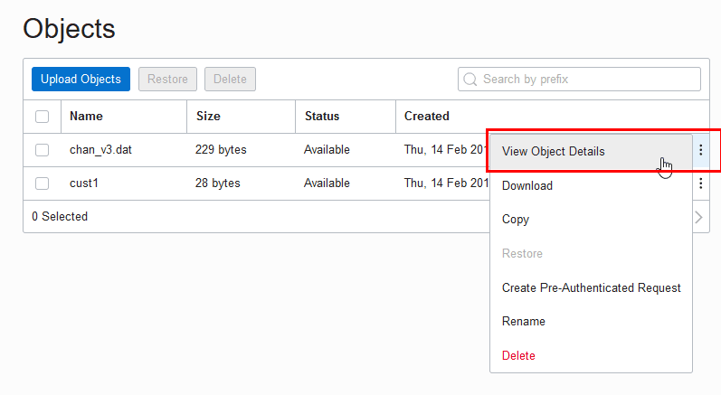

The script content on this page is for navigation purposes only and does not alter the content in any way.

The `DBMS_CLOUD` package provides database routines for working with cloud resources.

### Installing DBMS\_CLOUD Packages

The `DBMS_CLOUD` family of packages is not pre-installed or configured with Oracle database. You need to manually install the `DBMS_CLOUD` packages and also configure users or roles to use this package.

For information on installation and configuration with Oracle Database 19c, Release 19.30 and above, see [Using the DBMS\_CLOUD Family of Packages](https://docs.oracle.com/en/database/oracle/oracle-database/26/sutil/using-dbms_cloud-family-packages.html#SUTIL-GUID-0F94EA7F-1BD0-41BF-90FA-25F5B89DC87B).

For installing the `DBMS_CLOUD` packages and configuring users or roles for Oracle Database 19c, Releases prior to 19.30, see the MOS-NOTE with Doc ID [2748362.1](https://support.oracle.com/epmos/faces/DocumentDisplay?_afrLoop=213651872530310&id=2748362.1&_afrWindowMode=0&_adf.ctrl-state=dz5ua14hn_4). Note that earlier releases provide limited `DBMS_CLOUD` functionality only.

### DBMS\_CLOUD Endpoint Management

The `DBMS_CLOUD` package supports a number of object store and REST endpoints that are all pre-configured for the service. This package also allows you to access additional non-preconfigured endpoints after properly enabling such endpoints through network access control lists (**ACLs**).

The authentication for pre-configured endpoints is automatically understood and derived in `DBMS_CLOUD`. In order to know the proper authentication type for additional, customer-managed endpoints, `DBMS_CLOUD` supports `URI` schemes to indicate the authentication type for the URI endpoint. The `URI` endpoint must support HTTPS on port 443 for secure HTTP requests.

- For more information on pre-configured URIs, see DBMS\_CLOUD URI Formats.
- For more information on customer-managed URIs, see Additional Customer-Managed URI Formats.

### DBMS\_CLOUD Subprograms and REST APIs

This section covers the `DBMS_CLOUD` subprograms and REST APIs provided with Oracle Database.

The `DBMS_CLOUD` package is made up of the following:

### DBMS\_CLOUD for Access Management

The subprograms for credential management within the DBMS\_CLOUD package, including creating, deleting, and updating credentials.

| Subprogram | Description |
| --- | --- |
| CREATE\_CREDENTIAL Procedure | This procedure stores cloud service credentials in Oracle Database. |
| DROP\_CREDENTIAL Procedure | This procedure removes an existing credential from Oracle Database. |
| UPDATE\_CREDENTIAL Procedure | This procedure updates cloud service credential attributes in Oracle Database. |

### CREATE\_CREDENTIAL Procedure

This procedure stores cloud service credentials in Oracle database.

Use stored cloud service credentials to access the cloud service for data loading, for querying external data residing in the cloud, or for other cases when you use `DBMS_CLOUD` procedures with a `credential_name` parameter. This procedure is overloaded:

- Use the Oracle Cloud Infrastructure-related parameters, including: `user_ocid`, `tenancy_ocid`, `private_key`, and `fingerprint` only when you are using Oracle Cloud Infrastructure Signing Keys authentication.

**Syntax**

```sql
DBMS_CLOUD.CREATE_CREDENTIAL (
      credential_name   IN VARCHAR2,
      username          IN VARCHAR2,
      password          IN VARCHAR2 DEFAULT NULL);

DBMS_CLOUD.CREATE_CREDENTIAL (
      credential_name IN VARCHAR2,
      user_ocid       IN VARCHAR2,
      tenancy_ocid    IN VARCHAR2,
      private_key     IN VARCHAR2,
      fingerprint     IN VARCHAR2);
```

**Parameters**

| Parameter | Description |
| --- | --- |
| `credential_name` | The name of the credential to be stored. The `credential_name` parameter must conform to Oracle object naming conventions, which do not allow spaces or hyphens. |
| `username` | The `username` and `password` arguments together specify your cloud service credentials. See the usage notes for what to specify for the `username` and `password` for different cloud services. |
| `password` | The `username` and `password` arguments together specify your cloud service credentials. |
| `user_ocid` | Specifies the user’s OCID. See [Where to Get the Tenancy’s OCID and User’s OCID](https://docs.cloud.oracle.com/iaas/Content/API/Concepts/apisigningkey.htm#Other) for details on obtaining the User’s OCID. |
| `tenancy_ocid` | Specifies the tenancy’s OCID. See [Where to Get the Tenancy’s OCID and User’s OCID](https://docs.cloud.oracle.com/iaas/Content/API/Concepts/apisigningkey.htm#Other) for details on obtaining the Tenancy’s OCID. |
| `private_key` | Specifies the generated private key. Private keys generated with a passphrase are not supported. You need to generate the private key without a passphrase. See [How to Generate an API Signing Key](https://docs.cloud.oracle.com/iaas/Content/API/Concepts/apisigningkey.htm#How) for details on generating a key pair in PEM format. |
| `fingerprint` | Specifies a fingerprint. After a generated public key is uploaded to the user’s account the fingerprint is displayed in the console. Use the displayed fingerprint for this argument. See [How to Get the Key’s Fingerprint](https://docs.cloud.oracle.com/iaas/Content/API/Concepts/apisigningkey.htm#How3) and [How to Generate an API Signing Key](https://docs.cloud.oracle.com/iaas/Content/API/Concepts/apisigningkey.htm#How) for more details. |

**Usage Notes**

- This operation stores the credentials in the database in an encrypted format.
- You can see the credentials in your schema by querying the `user_credentials` table.
- A privileged user can see all the credentials by querying the `dba_credentials` table.
- You only need to create credentials once unless your cloud service credentials change. Once you store the credentials you can then use the same credential name for `DBMS_CLOUD` procedures that require a `credential_name` parameter.
- This procedure is overloaded. If you provide one of the key based authentication attributes, `user_ocid`, `tenancy_ocid`, `private_key`, or `fingerprint`, the call is assumed to be an Oracle Cloud Infrastructure Signing Key based credential.
- You can list credentials from the view `ALL_CREDENTIALS`. For example, run the following command to list credentials:
	```sql
	SELECT credential_name, username, comments FROM all_credentials;
	```

**Oracle Cloud Infrastructure Credentials (Auth Tokens)**

For Oracle Cloud Infrastructure the `username` is your Oracle Cloud Infrastructure user name. The `password` is your Oracle Cloud Infrastructure auth token. See [Working with Auth Tokens](https://docs.cloud.oracle.com/iaas/Content/Identity/Tasks/managingcredentials.htm#two).

For example:

```sql
BEGIN
  DBMS_CLOUD.CREATE_CREDENTIAL(
    credential_name => 'DEF_CRED_NAME',
    username => 'adb_user@example.com',
    password => 'password' );
END;
/
```

Use Auth Token based credentials when you are authenticating calls to. For calls to any other type of Oracle Cloud Infrastructure cloud service, use Oracle Cloud Infrastructure Signing Key Based Credentials.

For, `username` parameter value must include the Identity domain and the user name from your profile. You can find the Identity domain associated with a user in the Oracle Cloud Infrastructure Console.

For example:

```md
oracleidentitycloudservice/adb_user@example.com
```

With the default Identity domain you are not required to include the domain name `Default`. For example:

```md
adb_user@example.com
```

**Oracle Cloud Infrastructure Signing Key Based Credentials**

Use the Oracle Cloud Infrastructure signing key related parameters, including: `user_ocid`, `tenancy_ocid`, `private_key`, and `fingerprint` with Oracle Cloud Infrastructure Signing Keys authentication.

For example:

```sql
BEGIN
   DBMS_CLOUD.CREATE_CREDENTIAL (
       credential_name => 'OCI_KEY_CRED',
       user_ocid       => 'ocid1.user.oc1..aaaaaaaauq54mi7zdyfhw33ozkwuontjceel7fok5nq3bf2vwetkpqsoa',
       tenancy_ocid    => 'ocid1.tenancy.oc1..aabbbbbbaafcue47pqmrf4vigneebgbcmmoy5r7xvoypicjqqge32ewnrcyx2a',
       private_key     => 'MIIEogIBAAKCAQEAtUnxbmrekwgVac6FdWeRzoXvIpA9+0r1.....wtnNpESQQQ0QLGPD8NM//JEBg=',
       fingerprint     => 'f2:db:f9:18:a4:aa:fc:94:f4:f6:6c:39:96:16:aa:27');
END;
/
```

Private keys generated with a passphrase are not supported. You need to generate the private key without a passphrase. See [How to Generate an API Signing Key](https://docs.cloud.oracle.com/iaas/Content/API/Concepts/apisigningkey.htm#How) for more information.

**Oracle Cloud Infrastructure Object Storage Classic Credentials**

If your source files reside in Oracle Cloud Infrastructure Object Storage Classic, the `username` is your Oracle Cloud Infrastructure Classic user name and the `password` is your Oracle Cloud Infrastructure Classic password.

**Amazon Web Services (AWS) Credentials**

If your source files reside in Amazon S3 or you are calling an AWS API, the `username` is your AWS access key ID and the `password` is your AWS secret access key. See [AWS Identity and Access Management](http://docs.aws.amazon.com/IAM/latest/UserGuide/id_credentials_access-keys.html#Using_CreateAccessKey).

**Microsoft Azure Credentials**

If your source files reside in Azure Blob Storage or you are calling an Azure API, the `username` is your Azure storage account name and the `password` is an Azure storage account access key. See [About Azure storage accounts](https://docs.microsoft.com/en-us/azure/storage/common/storage-create-storage-account?toc=%2fazure%2fstorage%2fblobs%2ftoc.json).

**GitHub Personal Access Token**

If your source files reside in a GitHub repository or you are calling a GitHub API, the `username` is your GitHub email and the `password` is your GitHub personal access token. See [Creating a personal access token](https://docs.github.com/en/authentication/keeping-your-account-and-data-secure/creating-a-personal-access-token) for more information.

For example:

```sql
BEGIN
  DBMS_CLOUD.CREATE_CREDENTIAL(
    credential_name => 'MY_GITHUB_CRED',
    username => 'user@example.com',
    password => 'your_personal_access_token' );
END;
/
```

### DROP\_CREDENTIAL Procedure

This procedure removes an existing credential from Oracle database.

**Syntax**

```sql
DBMS_CLOUD.DROP_CREDENTIAL (
   credential_name     IN VARCHAR2);
```

**Parameters**

| Parameter | Description |
| --- | --- |
| `credential_name` | The name of the credential to be removed. |

### UPDATE\_CREDENTIAL Procedure

This procedure updates an attribute with a new value for a specified `credential_name`.

Use stored credentials for data loading, for querying external data residing in the Cloud, or wherever you use `DBMS_CLOUD` procedures with a `credential_name` parameter.

**Syntax**

```sql
DBMS_CLOUD.UPDATE_CREDENTIAL (
    credential_name   IN VARCHAR2,
    attribute         IN VARCHAR2,
    value             IN VARCHAR2);
```

**Parameters**

| Parameter | Description |
| --- | --- |
| `credential_name` | The name of the credential to be updated. |
| `attribute` | Name of attribute to update.  For a username/password type credential, the valid `attribute` values are: `USERNAME` and `PASSWORD`.  See CREATE\_CREDENTIAL Procedure for more information. |
| `value` | New value for the specified attribute. |

**Usage Notes**

- The username value is case sensitive. It cannot contain double quotes or spaces.
- A user with DBA privileges can see all the credentials by querying `dba_credentials`.
- You only need to create credentials once unless your cloud service credentials change. Once you store the credentials you can then use the same credential name for `DBMS_CLOUD` procedures that require a `credential_name` parameter.
- You can list credentials from the view `ALL_CREDENTIALS`. For example, run the following command to list credentials:
	```sql
	SELECT credential_name, username, comments FROM all_credentials;
	```

**Examples**

```sql
BEGIN
  DBMS_CLOUD.UPDATE_CREDENTIAL(
     credential_name => 'OBJ_STORE_CRED',
     attribute => 'PASSWORD',
     value => 'password');
END;
/
```
```sql
BEGIN
  DBMS_CLOUD.UPDATE_CREDENTIAL(
     credential_name => 'ARN_CRED',
     attribute => 'aws_role_arn',
     value => 'NEW_AWS_ARN');
END;
/
```

### DBMS\_CLOUD for Objects and Files

The subprograms for object and file management within the DBMS\_CLOUD package.

| Subprogram | Description |
| --- | --- |
| COPY\_DATA Procedure | This procedure loads data into existing Oracle Database tables either from Cloud Object Storage or from files in a directory. |
| COPY\_DATA Procedure for Avro or Parquet Files | This procedure with the `format` parameter `type` set to the value `orc`, `parquet`, or `avro` loads data into existing Oracle Database tables from ORC, Parquet, or Avro files in the Cloud or from ORC, Parquet, or Avro files in a directory.\<p>Similar to text files, the data is copied from the source ORC, Parquet, or Avro file into the preexisting internal table.\</p> |
| COPY\_OBJECT Procedure | This procedure copies files from one Cloud Object Storage bucket to another. |
| CREATE\_EXTERNAL\_TABLE Procedure | This procedure creates an external table on files in the Cloud or on files in a directory. This allows you to run queries on external data from Oracle Database. |
| CREATE\_EXTERNAL\_TABLE Procedure for Avro or Parquet Files | This procedure with the `format` parameter `type` set to the value `parquet`, `orc`, or `avro`, creates an external table with either Parquet, ORC, or Avro format files in the Cloud or in a directory. \<p>This allows you to run queries on external data from Oracle Database. \</p> |
| CREATE\_EXTERNAL\_PART\_TABLE Procedure | This procedure creates an external partitioned table on files in the Cloud. This allows you to run queries on external data from Oracle Database. |
| CREATE\_HYBRID\_PART\_TABLE Procedure | This procedure creates a hybrid partitioned table. This allows you to run queries on hybrid partitioned data from Oracle Database. |
| DELETE\_ALL\_OPERATIONS Procedure | This procedure clears either all data load operations logged in the `user_load_operations` table in your schema or clears all the data load operations of the specified type, as indicated with the `type` parameter. |
| DELETE\_FILE Procedure | This procedure removes the specified file from the specified directory on Oracle Database |
| DELETE\_OBJECT Procedure | This procedure deletes the specified object on object store. |
| DELETE\_OPERATION Procedure | This procedure accepts an `operation_id` as input and deletes the logs associated with the specified `operation_id`. |
| GET\_OBJECT Procedure and Function | This procedure is overloaded. The procedure form reads an object from Cloud Object Storage and copies it to Oracle Database. The function form reads an object from Cloud Object Storage and returns a `BLOB` to Oracle Database. |
| LIST\_FILES Function | This function lists the files in the specified directory. The results include the file names and additional metadata about the files such as file size in bytes, creation timestamp, and the last modification timestamp. |
| LIST\_OBJECTS Function | This function lists objects in the specified location on object store. The results include the object names and additional metadata about the objects such as size, checksum, creation timestamp, and the last modification timestamp. |
| MOVE\_OBJECT Procedure | This procedure moves an object from one Cloud Object Storage bucket to another one. |
| PUT\_OBJECT Procedure | This procedure is overloaded. In one form the procedure copies a file from Oracle Database to the Cloud Object Storage. In another form the procedure copies a `BLOB` from Oracle Database to the Cloud Object Storage. |
| SYNC\_EXTERNAL\_PART\_TABLE Procedure | This procedure simplifies updating an external partitioned table from files in the Cloud. Run this procedure whenever new partitions are added or when partitions are removed from the Object Store source for the external partitioned table. |
| VALIDATE\_EXTERNAL\_TABLE Procedure | This procedure validates the source files for an external table, generates log information, and stores the rows that do not match the format options specified for the external table in a *badfile* table on Oracle Database. |
| VALIDATE\_EXTERNAL\_PART\_TABLE Procedure | This procedure validates the source files for an external partitioned table, generates log information, and stores the rows that do not match the format options specified for the external table in a *badfile* table on Oracle Database. |
| VALIDATE\_HYBRID\_PART\_TABLE Procedure | This procedure validates the source files for a hybrid partitioned table, generates log information, and stores the rows that do not match the format options specified for the hybrid table in a *badfile* table on Oracle Database. |

### COPY\_DATA Procedure

This procedure loads data into existing Oracle Database tables from files in the Cloud, or from files in a directory. The overloaded form enables you to use the `operation_id` parameter.

**Syntax**

```sql
DBMS_CLOUD.COPY_DATA (
    table_name        IN VARCHAR2,
    credential_name   IN VARCHAR2 DEFAULT NULL,
    file_uri_list     IN CLOB,
    schema_name       IN VARCHAR2,
    field_list        IN CLOB,
    format            IN CLOB);

DBMS_CLOUD.COPY_DATA (
    table_name        IN VARCHAR2,
    credential_name   IN VARCHAR2 DEFAULT NULL,
    file_uri_list     IN CLOB DEFAULT NULL,
    schema_name       IN VARCHAR2 DEFAULT NULL,
    field_list        IN CLOB DEFAULT NULL,
    format            IN CLOB DEFAULT NULL
    operation_id      OUT NOCOPY NUMBER);
```

**Parameters**

| Parameter | Description |
| --- | --- |
| `table_name` | The name of the target table on the database. The target table needs to be created before you run `COPY_DATA`. |
| `credential_name` | The name of the credential to access the Cloud Object Storage.  This parameter is not used when you specify a directory or Pre-Authenticated Request (PAR) URL with `file_uri_list`. |
| `file_uri_list` | This parameter specifies one of the following:  - Comma-delimited list of source file URIs - Comma-delimited list of Pre-Authenticated Request (PAR) URL - One or more directories and source files  You can use wildcards as well as regular expressions in the file names in Cloud source file URIs.  Cloud source file URIs  This parameter specifies either a comma-delimited list of source file URIs or one or more directories and source files.  Regular expressions can only be used when the `regexuri` `format` parameter is set to `TRUE`.  The characters "\*" and "?" are considered wildcard characters when the `regexuri` parameter is set to `FALSE`. When the `regexuri` parameter is set to `TRUE` the characters "\*" and "?" are part of the specified regular expression pattern.  Regular expression patterns are only supported for the file name or subfolder path in your URIs and the pattern matching is identical to that performed by the `REGEXP_LIKE` function.  For example:  ```sql file_uri_list => 'https://objectstorage.us-phoenix-1.oraclecloud.com/n/namespace-string/b/bucketname/o(/)*year=[0-9]+(/)*month=[0-9]+(/)*[a-z]+[1-3]??.csv' ```  The format of the URIs depends on the Cloud Object Storage service you are using, for details see DBMS\_CLOUD URI Formats.  Pre-Authenticated Request (PAR) URL  You can create an external table on the following:  - A Pre-Authenticated Request (PAR) URL and also apply filters and clauses on the data. For example, you can filter the data using the `WHERE` clause or sort it using the `ORDER BY` clause. 	For example: 	```md 	file_uri_list => 'https://dataaccess.adb.us-chicago-1.oraclecloudapps.com/adb/p/K6XExample/data' 	``` - A comma-delimited list of Pre-Authenticated Request (PAR) URLs, you must ensure that all included PAR URLs must have the same column names, column order, and column data types. 	For example: 	```md 	file_uri_list => 'https://dataaccess.adb.us-chicago-1.oraclecloudapps.com/adb/p/K6XExample/data','https://dataaccess.adb.us-chicago-1.oraclecloudapps.com/adb/p/K7XExample/data' 	```  Directory  You can specify one directory and one or more file names or use a comma separated list of directories and file names. The format to specify a directory is:`'MY_DIR:filename.ext'`. By default the directory name `MY_DIR` is a database object and is case-insensitive. The file name is case sensitive.  Regular expressions are not supported when specifying the file names in a directory. You can only use wildcards to specify file names in a directory. The character "\*" can be used as the wildcard for multiple characters, and the character "?" can be used as the wildcard for a single character. For example:`'MY_DIR:*"` or `'MY_DIR:test?'`  To specify multiple directories, use a comma separated list of directories: For example:`'MY_DIR1:*, MY_DIR2:test?'`  Use double quotes to specify a case-sensitive directory name. For example:`'"my_dir1":*, "my_dir2":Test?'`  To include a quote character, use two quotes. For example:`'MY_DIR:''filename.ext'`. This specifies the `filename` starts with a quote (`'`). |
| `schema_name` | The name of the schema where the target table resides. The default value is NULL meaning the target table is in the same schema as the user running the procedure. |
| `field_list` | Identifies the fields in the source files and their data types. The default value is NULL meaning the fields and their data types are determined by the target table definition. This argument's syntax is the same as the `field_list` clause in regular Oracle external tables.  For an example using `field_list`, see CREATE\_EXTERNAL\_TABLE Procedure. |
| `format` | The options describing the format of the source, log, and bad files. For the list of the options and how to specify the values see DBMS\_CLOUD Package Format Options.  For Avro or Parquet file format options, see DBMS\_CLOUD Package Format Options for Avro or Parquet. |
| `operation_id` | Use this parameter to track the progress and final status of the load operation as the corresponding ID in the `USER_LOAD_OPERATIONS` view. |

**Usage Note**

The default record delimiter is `detected newline`. With `detected newline`, `DBMS_CLOUD` tries to automatically find the correct newline character to use as the record delimiter. `DBMS_CLOUD` first searches for the Windows newline character `\r\n`. If it finds the Windows newline character, this is used as the record delimiter for all files in the procedure. If a Windows newline character is not found, `DBMS_CLOUD` searches for the UNIX/Linux newline character `\n`, and if it finds one it uses `\n` as the record delimiter for all files in the procedure. If the source files use a combination of different record delimiters, you may encounter an error such as, “ `KUP-04020: found record longer than buffer size supported` ”. In this case, you need to either modify the source files to use the same record delimiter or only specify the source files that use the same record delimiter.

See DBMS\_CLOUD Package Format Options for information on the `recorddelmiter` format option.

**Examples**

```sql
BEGIN
 DBMS_CLOUD.COPY_DATA(
    table_name =>'CHANNELS',
    credential_name =>'DEF_CRED_NAME',
    file_uri_list =>'https://objectstorage.us-phoenix-1.oraclecloud.com/n/namespace-string/b/bucketname/o/channels.txt',
    format => json_object('delimiter' value ',')
 );
END;
/
```
```sql
BEGIN
    DBMS_CLOUD.COPY_DATA(
            table_name      => 'ORDERS',
            schema_name     => 'TEST_SCHEMA',
            credential_name => 'DEF_CRED_NAME',
         file_uri_list   => 'https://objectstorage.us-phoenix-1.oraclecloud.com/n/adbexample/b/json/o/orde[r]s.tbl.1'
            format          =>  json_object('ignoreblanklines' value TRUE,
                                            'rejectlimit' value '0',
                                            'dateformat' value 'yyyy-mm-dd',
                                            'regexuri' value TRUE)
            );
END;
/
```

### COPY\_DATA Procedure for Avro or Parquet Files

This procedure with the `format` parameter `type` set to the value `avro` or `parquet` loads data into existing Oracle Database tables from Avro or Parquet files in the Cloud or from files in a directory.

Similar to text files, the data is copied from the source Avro or Parquet file into the preexisting internal table.

**Syntax**

```sql
DBMS_CLOUD.COPY_DATA (
    table_name        IN VARCHAR2,
    credential_name   IN VARCHAR2 DEFAULT NULL,
    file_uri_list     IN CLOB,
    schema_name       IN VARCHAR2 DEFAULT,
    field_list        IN CLOB DEFAULT,
    format            IN CLOB DEFAULT);
```

**Parameters**

| Parameter | Description |
| --- | --- |
| `table_name` | The name of the target table on the database. The target table needs to be created before you run `COPY_DATA`. |
| `credential_name` | The name of the credential to access the Cloud Object Storage.  This parameter is not used when you specify a directory with `file_uri_list`. |
| `file_uri_list` | This parameter specifies either a comma-delimited list of source file URIs or one or more directories and source files.  Cloud source file URIs  You can use wildcards as well as regular expressions in the file names in Cloud source file URIs.  Regular expressions can only be used when the `regexuri` `format` parameter is set to `TRUE`.  The characters "\*" and "?" are considered wildcard characters when the `regexuri` parameter is set to `FALSE`. When the `regexuri` parameter is set to `TRUE` the characters "\*" and "?" are part of the specified regular expression pattern.  Regular expression patterns are only supported for the file name or subfolder path in your URIs and the pattern matching is identical to that performed by the `REGEXP_LIKE` function.  For example:  ```sql file_uri_list => 'https://objectstorage.us-phoenix-1.oraclecloud.com/n/namespace-string/b/bucketname/o(/)*year=[0-9]+(/)*month=[0-9]+(/)*[a-z]+[1-3]??.csv' ```  The format of the URIs depends on the Cloud Object Storage service you are using, for details see DBMS\_CLOUD URI Formats.  Directory  You can specify one directory and one or more file names or use a comma separated list of directories and file names. The format to specify a directory is:`'MY_DIR:filename.ext'`. By default the directory name `MY_DIR` is a database object and is case-insensitive. The file name is case sensitive.  Regular expressions are not supported when specifying the file names in a directory. You can only use wildcards to specify file names in a directory. The character "\*" can be used as the wildcard for multiple characters, and the character "?" can be used as the wildcard for a single character. For example:`'MY_DIR:*"` or `'MY_DIR:test?'`  To specify multiple directories, use a comma separated list of directories: For example:`'MY_DIR1:*, MY_DIR2:test?'`  Use double quotes to specify a case-sensitive directory name. For example:`'"my_dir1":*, "my_dir2":Test?'`  To include a quote character, use two quotes. For example:`'MY_DIR:''filename.ext'`. This specifies the `filename` starts with a quote (`'`). |
| `schema_name` | The name of the schema where the target table resides. The default value is NULL meaning the target table is in the same schema as the user running the procedure. |
| `field_list` | Ignored for Avro or Parquet files.  The fields in the source match the external table columns by name. Source data types are converted to the external table column data type.  For Parquet files, see DBMS\_CLOUD Package Parquet to Oracle Data Type Mapping for details on mapping.  For Avro files, see DBMS\_CLOUD Package Avro to Oracle Data Type Mapping for details on mapping. |
| `format` | The options describing the format of the source files. For Avro or Parquet files, only two options are supported: see DBMS\_CLOUD Package ORC to Oracle Data Type Mapping. |

**Usage Notes**

- As with other data files, Avro and Parquet data loads generate logs that are viewable in the tables `dba_load_operations` and `user_load_operations`. Each load operation adds a record to `dba` \[*user*\] `_load_operations` that indicates the table containing the logs.
	The log table provides summary information about the load.
- For Avro or Parquet, when the `format` parameter `type` is set to the value `avro` or `parquet`, the `BADFILE_TABLE` table is always empty.
	- For Parquet files, `PRIMARY KEY` constraint errors throw an `ORA` error.
		- If data for a column encounters a conversion error, for example, the target column is not large enough to hold the converted value, the value for the column is set to `NULL`. This does not produce a rejected record.

### COPY\_OBJECT Procedure

This procedure copies an object from one Cloud Object Storage bucket or folder to another.

The source and target bucket or folder can be in the same or different Cloud Object store provider.

When the source and target are in distinct Object Stores or have different accounts with the same cloud provider, you can give separate credential names for the source and target locations.

The source credential name is by default also used by the target location when target credential name is not provided.

**Syntax**

```sql
DBMS_CLOUD.COPY_OBJECT (
    source_credential_name  IN  VARCHAR2 DEFAULT NULL,
    source_object_uri       IN  VARCHAR2,
    target_object_uri       IN  VARCHAR2,
    target_credential_name  IN  VARCHAR2 DEFAULT NULL
);
```

**Parameters**

| Parameter | Description |
| --- | --- |
| `source_credential_name` | The name of the credential to access the source Cloud Object Storage.  If you do not supply a `source_credential_name` value, the `credential_name` is set to `NULL`. |
| `source_object_uri` | Specifies URI, that point to the source Object Storage bucket or folder location.  This parameter is mandatory.  The format of the URIs depends on the Cloud Object Storage service. See DBMS\_CLOUD URI Formats for more information. |
| `target_object_uri` | Specifies the URI for the target Object Store.  This parameter is mandatory.  The format of the URIs depends on the Cloud Object Storage service. See DBMS\_CLOUD URI Formats for more information. |
| `target_credential_name` | The name of the credential to access the target Cloud Object Storage location.  If you do not supply a `target_credential_name` value, the `target_object_uri` is set to the `source_credential_name` value. |

**Example**

```sql
BEGIN
DBMS_CLOUD.COPY_OBJECT (
    source_credential_name => 'OCI_CRED',
    source_object_uri    => 'https://objectstorage.us-phoenix-1.oraclecloud.com/n/namespace-string/b/bucketname1/bgfile.csv',
    target_object_uri    => 'https://objectstorage.us-phoenix-1.oraclecloud.com/n/namespace-string/b/bucketname2/myfile.csv'
);
END;
/
```

### CREATE\_EXTERNAL\_PART\_TABLE Procedure

This procedure creates an external partitioned table on files in the Cloud, or from files in a directory. This allows you to run queries on external data from Oracle Database.

**Syntax**

```sql
DBMS_CLOUD.CREATE_EXTERNAL_PART_TABLE (
    table_name           IN VARCHAR2,
    credential_name      IN VARCHAR2,
    partitioning_clause  IN CLOB,
    column_list          IN CLOB,
    field_list           IN CLOB DEFAULT,
    format               IN CLOB DEFAULT);

DBMS_CLOUD.CREATE_EXTERNAL_PART_TABLE (
    table_name           IN VARCHAR2,
    credential_name      IN VARCHAR2,
    file_uri_list        IN VARCHAR2,
    column_list          IN CLOB,
    field_list           IN CLOB DEFAULT,
    format               IN CLOB DEFAULT);
```

**Parameters**

| Parameter | Description |
| --- | --- |
| `table_name` | The name of the external table. |
| `credential_name` | The name of the credential to access the Cloud Object Storage. |
| `partitioning_clause` | Specifies the complete partitioning clause, including the location information for individual partitions.  If you use the `partitioning_clause` parameter, the `file_uri_list` parameter is not allowed. |
| `file_uri_list` | This parameter specifies one of the following:  - Comma-delimited list of source file URIs - Comma-delimited list of Pre-Authenticated Request (PAR) URL - One or more directories and source files  Cloud source file URIs  You can use wildcards as well as regular expressions in the file names in Cloud source file URIs.  Regular expressions can only be used when the `regexuri` `format` parameter is set to `TRUE`.  The characters "\*" and "?" are considered wildcard characters when the `regexuri` parameter is set to `FALSE`. When the `regexuri` parameter is set to `TRUE` the characters "\*" and "?" are part of the specified regular expression pattern.  Regular expression patterns are only supported for the file name or subfolder path in your URIs and the pattern matching is identical to that performed by the `REGEXP_LIKE` function.  This option is only supported with external tables that are created on a file in the Object Storage.  For example:  ```sql file_uri_list => 'https://objectstorage.us-phoenix-1.oraclecloud.com/n/namespace-string/b/bucketname/o(/)*year=[0-9]+(/)*month=[0-9]+(/)*[a-z]+[1-3]??.csv' ```  If you use the parameter `file_uri_list`, the `partitioning_clause` parameter is not allowed.  The format of the URIs depends on the Cloud Object Storage service. See DBMS\_CLOUD URI Formats for more information.  Pre-Authenticated Request (PAR) URL  You can create an external table on the following:  - An Oracle Database Pre-Authenticated Request (PAR) URL and also apply filters and clauses on the data. For example, you can filter the data using the `WHERE` clause or sort it using the `ORDER BY` clause. 	For example: 	```md 	file_uri_list => 'https://dataaccess.adb.us-chicago-1.oraclecloudapps.com/adb/p/K6XExample/data' 	``` - A comma-delimited list of Oracle Database Pre-Authenticated Request (PAR) URLs, you must ensure that all included PAR URLs must have the same column names, column order, and column data types in the same schema. 	For example: 	```md 	file_uri_list => 'https://dataaccess.adb.us-chicago-1.oraclecloudapps.com/adb/p/K6XExample/data','https://dataaccess.adb.us-chicago-1.oraclecloudapps.com/adb/p/K7XExample/data' 	``` |
| `column_list` | Comma-delimited list of column names and data types for the external table. This parameter has the following requirements, depending on the type of the data files specified with the `file_uri_list` parameter:  - The `column_list` parameter is required with unstructured files. Using unstructured files, for example with CSV text files, the `column_list` parameter must specify all the column names and data types inside the data file as well as the partition columns derived from the object name. - The `column_list` parameter is optional with structured files. For example, with Avro, ORC, or Parquet data files, the `column_list` is not required. When the `column_list` is not included, the `format` parameter `partition_columns` option must include specifications for both column names (`name`) and data types (`type`). |
| `field_list` | Identifies the fields in the source files and their data types. The default value is NULL meaning the fields and their data types are determined by the *column\_list* parameter. This argument’s syntax is the same as the `field_list` clause in regular Oracle external tables. For more information about `field_list` see [Oracle® Database Utilities](https://docs.oracle.com/pls/topic/lookup?ctx=en/database/oracle/oracle-database/19/arpls&id=SUTIL1413). |
| `format` | The format option `partition_columns` specifies the `DBMS_CLOUD.CREATE_EXTERNAL_PART_TABLE` column names and data types of partition columns when the partition columns are derived from the file path, depending on the type of data file, structured or unstructured:  - When the `DBMS_CLOUD.CREATE_EXTERNAL_PART_TABLE` includes the `column_list` parameter and the data files are unstructured, such as with CSV text files, `partition_columns` does not include the data type. For example, use a format such as the following for this type of `partition_columns` specification: 	```md 	'"partition_columns":["state","zipcode"]' 	``` 	The data type is not required because it is specified in the `DBMS_CLOUD.CREATE_EXTERNAL_PART_TABLE` `column_list` parameter. - When the `DBMS_CLOUD.CREATE_EXTERNAL_PART_TABLE` does not include the `column_list` parameter and the data files are structured, such as Avro, ORC, or Parquet files, the `partition_columns` option includes both the column name, `name` sub-clause, and the data type, `type` sub-clause. For example, the following shows a `partition_columns` specification: 	```md 	'"partition_columns":[ {"name":"country", "type":"varchar2(10)"}, {"name":"year", "type":"number"}, {"name":"month", "type":"varchar2(10)"}]' 	```  If the data files are unstructured and the `type` sub-clause is specified with `partition_columns`, the `type` sub-clause is ignored.  For object names that are not based on hive format, the order of the `partition_columns` specified columns must match the order as they appear in the object name in the file path specified in the `file_uri_list` parameter.  To see all the `format` parameter options describing the format of the source files, see DBMS\_CLOUD Package Format Options. |

**Usage Notes**

- You cannot call this procedure with both `partitioning_clause` and `file_uri_list` parameters.
- Specifying the `column_list` parameter is optional with structured data files, including Avro, Parquet, or ORC data files. If `column_list` is not specified, the `format` parameter `partition_columns` option must include both `name` and `type`.
- The `column_list` parameter is required with unstructured data files, such as CSV text files.
- The procedure `DBMS_CLOUD.CREATE_EXTERNAL_PART_TABLE` supports external partitioned files in the supported cloud object storage services, including:
	- Oracle Cloud Infrastructure Object Storage
		- Azure Blob Storage
		- Amazon S3
		- GitHub Repository
	See DBMS\_CLOUD URI Formats for more information.
- The procedure `DBMS_CLOUD.CREATE_EXTERNAL_PART_TABLE` supports external partitioned files in directories, either in a local file system or in a network file system.
- When you call `DBMS_CLOUD.CREATE_EXTERNAL_PART_TABLE` with the `file_uri_list` parameter, the types for columns specified in the Cloud Object Store file name must be one of the following types:
	```md
	VARCHAR2(n)
	NUMBER(n)
	NUMBER(p,s)
	NUMBER
	DATE
	TIMESTAMP(9)
	```
- The default record delimiter is `detected newline`. With `detected newline`, `DBMS_CLOUD` tries to automatically find the correct newline character to use as the record delimiter. `DBMS_CLOUD` first searches for the Windows newline character `\r\n`. If it finds the Windows newline character, this is used as the record delimiter for all files in the procedure. If a Windows newline character is not found, `DBMS_CLOUD` searches for the UNIX/Linux newline character `\n`, and if it finds one it uses `\n` as the record delimiter for all files in the procedure. If the source files use a combination of different record delimiters, you may encounter an error such as, “ `KUP-04020: found record longer than buffer size supported` ”. In this case, you need to either modify the source files to use the same record delimiter or only specify the source files that use the same record delimiter.
	See DBMS\_CLOUD Package Format Options for information on the `recorddelmiter` format option.

**Examples**

Example using the `partitioning_clause` parameter:

```sql
BEGIN
   DBMS_CLOUD.CREATE_EXTERNAL_PART_TABLE(
      table_name =>'PET1',
      credential_name =>'OBJ_STORE_CRED',
      format => json_object('delimiter' value ',', 'recorddelimiter' value 'newline', 'characterset' value 'us7ascii'),
      column_list => 'col1 number, col2 number, col3 number',
      partitioning_clause => 'partition by range (col1)
                                (partition p1 values less than (1000) location
                                    ( ''&base_URL//file_11.txt'')
                                 ,
                                 partition p2 values less than (2000) location
                                    ( ''&base_URL/file_21.txt'')
                                 ,
                                 partition p3 values less than (3000) location
                                    ( ''&base_URL/file_31.txt'')
                                 )'
     );
   END;
/

BEGIN
    DBMS_CLOUD.CREATE_EXTERNAL_PART_TABLE(
       table_name          => 'PET',
       format              => json_object('delimiter'value ','),
       column_list         => 'name varchar2(20), gender varchar2(10), salary number',
       partitioning_clause => 'partition by range (salary)
              (   -- Use test1.csv in the DEFAULT DIRECTORY DATA_PUMP_DIR
                  partition p1 values less than (100) LOCATION (''test1.csv''),
                   -- Use test2.csv in a specified directory MY_DIR
                  partition p2 values less than (300) DEFAULT DIRECTORY MY_DIR LOCATION (''test2.csv'')        )'   );
END;
/
```

Example using the `file_uri_list` without the `column_list` parameter with structured data files:

```sql
BEGIN
  DBMS_CLOUD.CREATE_EXTERNAL_PART_TABLE(
  table_name => 'MYSALES',
  credential_name => 'DEF_CRED_NAME',
  DBMS_CLOUD.CREATE_EXTERNAL_PART_TABLE(
    table_name      => 'MYSALES',
    credential_name => 'DEF_CRED_NAME',
    file_uri_list   => 'https://objectstorage.us-phoenix-1.oraclecloud.com/n/namespace-string/b/bucketname/o/*.parquet',
    format          =>
        json_object('type' value 'parquet', 'schema' value 'first',
                    'partition_columns' value
                          json_array(
                                json_object('name' value 'country', 'type' value 'varchar2(100)'),
                                json_object('name' value 'year', 'type' value 'number'),
                                json_object('name' value 'month', 'type' value 'varchar2(2)')
                          )
         )
    );
END;
/
```

### CREATE\_EXTERNAL\_TABLE Procedure

This procedure creates an external table on files in the Cloud or from files in a directory. This allows you to run queries on external data from Oracle Database.

**Syntax**

```sql
DBMS_CLOUD.CREATE_EXTERNAL_TABLE (
    table_name       IN VARCHAR2,
    credential_name  IN VARCHAR2 DEFAULT NULL,
    file_uri_list    IN CLOB,
    column_list      IN CLOB,
    field_list       IN CLOB DEFAULT,
    format           IN CLOB DEFAULT);
```

**Parameters**

| Parameter | Description |
| --- | --- |
| `table_name` | The name of the external table. |
| `credential_name` | The name of the credential to access the Cloud Object Storage.  This parameter is not used when you specify a directory or Pre-Authenticated Request (PAR) URL with `file_uri_list`. |
| `file_uri_list` | This parameter specifies one of the following:  - Comma-delimited list of source file URIs. - Comma-delimited list of Pre-Authenticated Request (PAR) URL. - One or more directories and source files.  Cloud source file URIs  You can use wildcards as well as regular expressions in the file names in Cloud source file URIs.  Regular expressions can only be used when the `regexuri` `format` parameter is set to `TRUE`.  The characters "\*" and "?" are considered wildcard characters when the `regexuri` parameter is set to `FALSE`. When the `regexuri` parameter is set to `TRUE` the characters "\*" and "?" are part of the specified regular expression pattern.  Regular expression patterns are only supported for the file name or subfolder path in your URIs and the pattern matching is identical to that performed by the `REGEXP_LIKE` function.  This option is only supported with external tables that are created on a file in the Object Storage.  For example:  ```sql file_uri_list => 'https://objectstorage.us-phoenix-1.oraclecloud.com/n/namespace-string/b/bucketname/o(/)*year=[0-9]+(/)*month=[0-9]+(/)*[a-z]+[1-3]??.csv' ```  The format of the URIs depends on the Cloud Object Storage service you are using, for details see DBMS\_CLOUD URI Formats.  Pre-Authenticated Request (PAR) URL  You can create an external table on the following:  - An Oracle Database Pre-Authenticated Request (PAR) URL and also apply filters and clauses on the data. For example, you can filter the data using the `WHERE` clause or sort it using the `ORDER BY` clause. 	For example: 	```md 	file_uri_list => 'https://dataaccess.adb.us-chicago-1.oraclecloudapps.com/adb/p/K6XExample/data' 	``` - A comma-delimited list of Oracle Database Pre-Authenticated Request (PAR) URLs, you must ensure that all included PAR URLs must have the same column names, column order, and column data types in the same schema. 	For example: 	```md 	file_uri_list => 'https://dataaccess.adb.us-chicago-1.oraclecloudapps.com/adb/p/K6XExample/data','https://dataaccess.adb.us-chicago-1.oraclecloudapps.com/adb/p/K7XExample/data' 	``` Directory  You can specify one directory and one or more file names or use a comma separated list of directories and file names. The format to specify a directory is:`'MY_DIR:filename.ext'`. By default the directory name `MY_DIR` is a database object and is case-insensitive. The file name is case sensitive.  Regular expressions are not supported when specifying the file names in a directory. You can only use wildcards to specify file names in a directory. The character "\*" can be used as the wildcard for multiple characters, and the character "?" can be used as the wildcard for a single character. For example:`'MY_DIR:*"` or `'MY_DIR:test?'`  To specify multiple directories, use a comma separated list of directories: For example:`'MY_DIR1:*, MY_DIR2:test?'`  Use double quotes to specify a case-sensitive directory name. For example:`'"my_dir1":*, "my_dir2":Test?'`  To include a quote character, use two quotes. For example:`'MY_DIR:''filename.ext'`. This specifies the `filename` starts with a quote (`'`). |
| `column_list` | Comma-delimited list of column names and data types for the external table. |
| `field_list` | Identifies the fields in the source files and their data types. The default value is NULL meaning the fields and their data types are determined by the `column_list` parameter. This argument’s syntax is the same as the `field_list` clause in regular Oracle Database external tables. For more information about `field_list` see [ORACLE\_LOADER Access Driver field\_list under field\_definitions Clause inOracle Database Utilities](https://docs.oracle.com/pls/topic/lookup?ctx=en/database/oracle/oracle-database/19/arpls&id=SUTIL-GUID-5CAF68BD-5C79-4473-AAA3-AB7CDA00B434). |
| `format` | The options describing the format of the source files. For the list of the options and how to specify the values see DBMS\_CLOUD Package Format Options.  For Avro or Parquet format files, see CREATE\_EXTERNAL\_TABLE Procedure for Avro or Parquet Files. |

**Usage Notes**

- The procedure `DBMS_CLOUD.CREATE_EXTERNAL_TABLE` supports external partitioned files in the supported cloud object storage services, including:
	- Oracle Cloud Infrastructure Object Storage
		- Azure Blob Storage
		- Amazon S3
		- GitHub Repository
	The credential is a table level property; therefore, the external files must be on the same object store.
	See DBMS\_CLOUD URI Formats for more information.
- The default record delimiter is `detected newline`. With `detected newline`, `DBMS_CLOUD` tries to automatically find the correct newline character to use as the record delimiter. `DBMS_CLOUD` first searches for the Windows newline character `\r\n`. If it finds the Windows newline character, this is used as the record delimiter for all files in the procedure. If a Windows newline character is not found, `DBMS_CLOUD` searches for the UNIX/Linux newline character `\n`, and if it finds one it uses `\n` as the record delimiter for all files in the procedure. If the source files use a combination of different record delimiters, you may encounter an error such as, “ `KUP-04020: found record longer than buffer size supported` ”. In this case, you need to either modify the source files to use the same record delimiter or only specify the source files that use the same record delimiter.
	See DBMS\_CLOUD Package Format Options for information on the `recorddelimiter` format option.

**Example**

```sql
BEGIN
   DBMS_CLOUD.CREATE_EXTERNAL_TABLE(
      table_name =>'WEATHER_REPORT_DOUBLE_DATE',
      credential_name =>'OBJ_STORE_CRED',
      file_uri_list =>'&base_URL/Charlotte_NC_Weather_History_Double_Dates.csv',
      format => json_object('type' value 'csv', 'skipheaders' value '1'),
      field_list => 'REPORT_DATE DATE''mm/dd/yy'',
                     REPORT_DATE_COPY DATE ''yyyy-mm-dd'',
                     ACTUAL_MEAN_TEMP,
                     ACTUAL_MIN_TEMP,
                     ACTUAL_MAX_TEMP,
                     AVERAGE_MIN_TEMP,
                     AVERAGE_MAX_TEMP,
                     AVERAGE_PRECIPITATION',
      column_list => 'REPORT_DATE DATE,
                     REPORT_DATE_COPY DATE,
                     ACTUAL_MEAN_TEMP NUMBER,
                     ACTUAL_MIN_TEMP NUMBER,
                     ACTUAL_MAX_TEMP NUMBER,
                     AVERAGE_MIN_TEMP NUMBER,
                     AVERAGE_MAX_TEMP NUMBER,
                     AVERAGE_PRECIPITATION NUMBER');
   END;
/

SELECT * FROM WEATHER_REPORT_DOUBLE_DATE where
   actual_mean_temp > 69 and actual_mean_temp < 74
```

### CREATE\_EXTERNAL\_TABLE Procedure for Avro or Parquet Files

This procedure with the `format` parameter `type` set to the value `avro` or `parquet` creates an external table with either Avro or Parquet format files in the Cloud or in a directory.

This allows you to run queries on external data from Oracle Database.

**Syntax**

```sql
DBMS_CLOUD.CREATE_EXTERNAL_TABLE (
    table_name       IN VARCHAR2,
    credential_name  IN VARCHAR2 DEFAULT NULL,
    file_uri_list    IN CLOB,
    column_list      IN CLOB,
    field_list       IN CLOB DEFAULT,
    format           IN CLOB DEFAULT);
```

**Parameters**

| Parameter | Description |
| --- | --- |
| `table_name` | The name of the external table. |
| `credential_name` | The name of the credential to access the Cloud Object Storage.  This parameter is not used when you specify a directory with `file_uri_list`. |
| `file_uri_list` | This parameter specifies either a comma-delimited list of source file URIs or one or more directories and source files.  Cloud source file URIs  You can use wildcards as well as regular expressions in the file names in Cloud source file URIs.  Regular expressions can only be used when the `regexuri` `format` parameter is set to `TRUE`.  The characters "\*" and "?" are considered wildcard characters when the `regexuri` parameter is set to `FALSE`. When the `regexuri` parameter is set to `TRUE` the characters "\*" and "?" are part of the specified regular expression pattern.  Regular expression patterns are only supported for the file name or subfolder path in your URIs and the pattern matching is identical to that performed by the `REGEXP_LIKE` function.  This option is only supported with external tables that are created on a file in the Object Storage.  For example:  ```sql file_uri_list => 'https://objectstorage.us-phoenix-1.oraclecloud.com/n/namespace-string/b/bucketname/o(/)*year=[0-9]+(/)*month=[0-9]+(/)*[a-z]+[1-3]??.parquet' ```  The format of the URIs depends on the Cloud Object Storage service you are using, for details see DBMS\_CLOUD URI Formats.  Directory  You can specify one directory and one or more file names or use a comma separated list of directories and file names. The format to specify a directory is:`'MY_DIR:filename.ext'`. By default the directory name `MY_DIR` is a database object and is case-insensitive. The file name is case sensitive.  Regular expressions are not supported when specifying the file names in a directory. You can only use wildcards to specify file names in a directory. The character "\*" can be used as the wildcard for multiple characters, and the character "?" can be used as the wildcard for a single character. For example:`'MY_DIR:*"` or `'MY_DIR:test?'`  To specify multiple directories, use a comma separated list of directories: For example:`'MY_DIR1:*, MY_DIR2:test?'`  Use double quotes to specify a case-sensitive directory name. For example:`'"my_dir1":*, "my_dir2":Test?'`  To include a quote character, use two quotes. For example:`'MY_DIR:''filename.ext'`. This specifies the `filename` starts with a quote (`'`). |
| `column_list` | (Optional) This field, when specified, overrides the `format->schema` parameter which specifies that the schema, columns, and data types, are derived automatically. See the format parameter for details.  When the `column_list` is specified for Avro or Parquet source, the column names must match those columns found in the file. Oracle data types must map appropriately to the Avro or Parquet data types.  For Parquet files, see DBMS\_CLOUD Package Parquet to Oracle Data Type Mapping for details.  For Avro files, see DBMS\_CLOUD Package Avro to Oracle Data Type Mapping for details. |
| `field_list` | Ignored for Avro or Parquet files.  The fields in the source match the external table columns by name. Source data types are converted to the external table column data type.  For Parquet files, see DBMS\_CLOUD Package Parquet to Oracle Data Type Mapping for details.  For Avro files, see DBMS\_CLOUD Package Avro to Oracle Data Type Mapping for details. |
| `format` | For Avro or Parquet `type` source files, see DBMS\_CLOUD Package Format Options for Avro or Parquet for details. |

**Examples Avro**

```md
format => '{"type":"avro", "schema": "all"}'
```
```md
format => json_object('type' value 'avro', 'schema' value 'first')
```

**Examples Parquet**

```md
format => '{"type":"parquet", "schema": "all"}'
```
```md
format => json_object('type' value 'parquet', 'schema' value 'first')
```

**Avro or Parquet Column Name Mapping to Oracle Column Names**

See DBMS\_CLOUD Package Avro and Parquet to Oracle Column Name Mapping for information on column name mapping and column name conversion usage in Oracle SQL.

### CREATE\_HYBRID\_PART\_TABLE Procedure

This procedure creates a hybrid partitioned table. This allows you to run queries on hybrid partitioned data from Oracle Database using database objects and files in the Cloud, or database objects and files in a directory.

**Syntax**

```sql
DBMS_CLOUD.CREATE_HYBRID_PART_TABLE (
    table_name           IN VARCHAR2,
    credential_name      IN VARCHAR2,
    partitioning_clause  IN CLOB,
    column_list          IN CLOB,
    field_list           IN CLOB DEFAULT,
    format               IN CLOB DEFAULT);
```

**Parameters**

| Parameter | Description |
| --- | --- |
| `table_name` | The name of the external table. |
| `credential_name` | The name of the credential to access the Cloud Object Storage. |
| `partitioning_clause` | Specifies the complete partitioning clause, including the location information for individual partitions.  To use directories, the partitioning clause supports the `LOCATION` and `DEFAULT DIRECTORY` values.  You can use wildcards as well as regular expressions in the file names in Cloud source file URIs.  Regular expressions can only be used when the `regexuri` `format` parameter is set to `TRUE`.  The characters "\*" and "?" are considered wildcard characters when the `regexuri` parameter is set to `FALSE`. When the `regexuri` parameter is set to `TRUE` the characters "\*" and "?" are part of the specified regular expression pattern.  Regular expression patterns are only supported for the file name or subfolder path in your URIs and the pattern matching is identical to that performed by the `REGEXP_LIKE` function. Regular expression patterns are not supported for directory names.  For example:  ```sql partitioning_clause => 'partition by range (col1) (partition p1 values less than (1000) external location ( ''https://objectstorage.us-phoenix-1.oraclecloud.com/n/namespace-string/b/bucketname/o(/)*year=[0-9]+(/)*month=[0-9]+(/)*[a-z]+[1-3]??.txt''),.... ```  You can use a Pre-Authenticated Request (PAR) URL to create an external table as follows:  - Specify a single Oracle Database Pre-Authenticated Request (PAR) URL and apply filters and clauses on the data. For example, you can filter the data using the `WHERE` clause or sort it using the `ORDER BY` clause. - Specify comma-delimited list of Oracle Database Pre-Authenticated Request (PAR) URLs, you must ensure that all included PAR URLs must have the same column names, column order, and column data types. |
| `column_list` | Comma-delimited list of column names and data types for the external table. |
| `field_list` | Identifies the fields in the source files and their data types. The default value is NULL meaning the fields and their data types are determined by the *column\_list* parameter. This argument’s syntax is the same as the `field_list` clause in regular Oracle external tables. For more information about `field_list` see [Oracle® Database Utilities](https://docs.oracle.com/pls/topic/lookup?ctx=en/database/oracle/oracle-database/19/arpls&id=SUTIL1413). |
| `format` | The options describing the format of the source files. For the list of the options and how to specify the values see DBMS\_CLOUD Package Format Options. |

**Usage Notes**

- The procedure `DBMS_CLOUD.CREATE_HYBRID_PART_TABLE` supports external partitioned files in the supported cloud object storage services, including:
	- Oracle Cloud Infrastructure Object Storage
		- Azure Blob Storage
		- Amazon S3
		- GitHub Repository
	The credential is a table level property; therefore, the external files must be on the same object store.
	See DBMS\_CLOUD URI Formats for more information.
- The procedure `DBMS_CLOUD.CREATE_HYBRID_PART_TABLE` supports hybrid partitioned files in directories, either in a local file system or in a network file system.
- The external partitioned tables you create with `DBMS_CLOUD.CREATE_HYBRID_PART_TABLE` include two invisible columns `file$path` and `file$name`. These columns help identify which file a record is coming from.
	- `file$path`: Specifies the file path text up to the beginning of the object name.
		- `file$name`: Specifies the object name, including all the text that follows the bucket name.

**Examples**

```sql
BEGIN
   DBMS_CLOUD.CREATE_HYBRID_PART_TABLE(
      table_name =>'HPT1',
      credential_name =>'OBJ_STORE_CRED',
      format => json_object('delimiter' value ',', 'recorddelimiter' value 'newline', 'characterset' value 'us7ascii'),
      column_list => 'col1 number, col2 number, col3 number',
      partitioning_clause => 'partition by range (col1)
                                (partition p1 values less than (1000) external location
                                    ( ''&base_URL/file_11.txt'')
                                 ,
                                 partition p2 values less than (2000) external location
                                    ( ''&base_URL/file_21.txt'')
                                 ,
                                 partition p3 values less than (3000)
                                 )'
     );
   END;
/

BEGIN
   DBMS_CLOUD.CREATE_HYBRID_PART_TABLE(
    table_name  => 'HPT1',
    format      => json_object('delimiter'value ',', 'recorddelimiter'value 'newline'),
    column_list => 'NAME VARCHAR2(30), GENDER VARCHAR2(10), BALANCE number',
    partitioning_clause => 'partition by range (B  2  ALANCE)
               (partition p1 values less than (1000) external DEFAULT DIRECTORY DATA_PUMP_DIR LOCATION (''Scott_male_1000.csv''),
                partition p2 values less than (2000) external DEFAULT DIRECTORY DATA_PUMP_DIR LOCATION (''Mary_female_3000.csv''),
                partition p3 values less than (3000))' );
END;
/
```

### DELETE\_ALL\_OPERATIONS Procedure

This procedure clears either all data load operations logged in the `user_load_operations` table in your schema or clears all the data load operations of the specified type, as indicated with the `type` parameter.

**Syntax**

```sql
DBMS_CLOUD.DELETE_ALL_OPERATIONS (
    type      IN VARCHAR DEFAULT NULL);
```

**Parameters**

| Parameter | Description |
| --- | --- |
| `type` | Specifies the type of operation to delete. Type values can be found in the `TYPE` column in the `user_load_operations` table.  If no `type` is specified all rows are deleted. |

**Usage Note**

- `DBMS_CLOUD.DELETE_ALL_OPERATIONS` does not delete currently running operations (operations in a “Running” status).

### DELETE\_FILE Procedure

This procedure removes the specified file from the specified directory on Oracle database.

**Syntax**

```sql
DBMS_CLOUD.DELETE_FILE (
      directory_name     IN VARCHAR2,
      file_name          IN VARCHAR2);
```

**Parameters**

| Parameter | Description |
| --- | --- |
| `directory_name` | The name of the directory on the Oracle database instance. |
| `file_name` | The name of the file to be removed. |

**Note:**

To run

`DBMS_CLOUD.DELETE_FILE`

, you need to grant write privileges on the directory that contains the file to the user. For example, run the following command as a privileged user to grant write privileges to

`db_user`

:

```sql
GRANT WRITE ON DIRECTORY data_pump_dir TO db_user;
```

**Example**

```sql
BEGIN
   DBMS_CLOUD.DELETE_FILE(
      directory_name =>  'DATA_PUMP_DIR',
      file_name => 'exp1.dmp' );
   END;
/
```

### DELETE\_OBJECT Procedure

This procedure deletes the specified object on object store.

**Syntax**

```sql
DBMS_CLOUD.DELETE_OBJECT (
       credential_name      IN VARCHAR2,
       object_uri           IN VARCHAR2,
       force                IN BOOLEAN DEFAULT FALSE);
```

**Parameters**

| Parameter | Description |
| --- | --- |
| `credential_name` | The name of the credential to access the Cloud Object Storage. |
| `object_uri` | Object or file URI for the object to delete. The format of the URI depends on the Cloud Object Storage service you are using, for details see DBMS\_CLOUD URI Formats. |
| `force` | Ignore and do not report errors if object does not exist. Valid values are: `TRUE` and `FALSE`. The default value is `FALSE`. |

**Example**

```sql
BEGIN
   DBMS_CLOUD.DELETE_OBJECT(
       credential_name => 'DEF_CRED_NAME',
       object_uri => 'https://objectstorage.us-ashburn-
1.oraclecloud.com/n/namespace-string/b/bucketname/o/exp1.dmp' );
   END;
/
```

### DELETE\_OPERATION Procedure

This procedure clears the data load entries for the specified operation ID logged in the `user_load_operations` or `dba_load_operations` tables in your schema.

**Syntax**

```sql
DBMS_CLOUD.DELETE_OPERATION (
    id      IN NUMBER);
```

**Parameters**

| Parameter | Description |
| --- | --- |
| `id` | Specifies the operation ID associated with the log file entries you want to delete. |

**Example**

```sql
SELECT id FROM user_load_operations WHERE type LIKE '%BAD%';
EXEC DBMS_CLOUD.DELETE_OPERATION(id);
```

### GET\_OBJECT Procedure and Function

This procedure is overloaded. The procedure form reads an object from Cloud Object Storage and copies it to Oracle Database. The function form reads an object from Cloud Object Storage and returns a `BLOB` to Oracle Database.

**Syntax**

```sql
DBMS_CLOUD.GET_OBJECT (
       credential_name      IN VARCHAR2,
       object_uri           IN VARCHAR2,
       directory_name       IN VARCHAR2,
       file_name            IN VARCHAR2 DEFAULT  NULL,
       startoffset          IN NUMBER DEFAULT  0,
       endoffset            IN NUMBER DEFAULT  0,
       compression          IN VARCHAR2 DEFAULT  NULL);

DBMS_CLOUD.GET_OBJECT(
       credential_name      IN VARCHAR2 DEFAULT NULL,
       object_uri           IN VARCHAR2,
       startoffset          IN NUMBER DEFAULT  0,
       endoffset            IN NUMBER DEFAULT  0,
       compression          IN VARCHAR2 DEFAULT  NULL)
RETURN BLOB;
```

**Parameters**

| Parameter | Description |
| --- | --- |
| `credential_name` | The name of the credential to access the Cloud Object Storage. |
| `object_uri` | Object or file URI. The format of the URI depends on the Cloud Object Storage service you are using, for details see DBMS\_CLOUD URI Formats. |
| `directory_name` | The name of the directory on the database.  Foot 1  You can use a Pre-Authenticated Request (PAR) URL to create an external table as follows:  - Specify a single Oracle Database Pre-Authenticated Request (PAR) URL and apply filters and clauses on the data. For example, you can filter the data using the `WHERE` clause or sort it using the `ORDER BY` clause. - Specify comma-delimited list of Oracle Database Pre-Authenticated Request (PAR) URLs, you must ensure that all included PAR URLs must have the same column names, column order, and column data types in the same schema. |
| `file_name` | Specifies the name of the file to create. If file name is not specified, the file name is taken from after the last slash in the `object_uri` parameter. For special cases, for example when the file name contains slashes, use the `file_name` parameter. |
| `startoffset` | The offset, in bytes, from where the procedure starts reading. |
| `endoffset` | The offset, in bytes, until where the procedure stops reading. |
| `compression` | Specifies the compression used to store the object. When `compression` is set to `'AUTO'` the file is uncompressed (the value `'AUTO'` implies the object specified with `object_uri` is compressed with Gzip). |

Footnote 1

**Note:** To run `DBMS_CLOUD.GET_OBJECT`, you need to grant `WRITE` privileges on the directory to that user. For example, run the following command as a priviledged user to grant write privileges to `db_user`:

```md
GRANT WRITE ON DIRECTORY data_pump_dir TO db_user;
```

**Return Values**

The function form reads from Object Store and `DBMS_CLOUD.GET_OBJECT` returns a `BLOB`.

**Examples**

```sql
BEGIN
   DBMS_CLOUD.GET_OBJECT(
     credential_name => 'OBJ_STORE_CRED',
     object_uri => 'https://objectstorage.us-phoenix-1.oraclecloud.com/n/namespace-string/b/bucketname/o/file.txt',
     directory_name => 'DATA_PUMP_DIR');
END;
/
```

To read character data from a file in Object Store:

```sql
SELECT to_clob(
     DBMS_CLOUD.GET_OBJECT(
       credential_name => 'OBJ_STORE_CRED',
       object_uri => 'https://objectstorage.us-phoenix-1.oraclecloud.com/n/namespace-string/b/bucketname/o/file.txt'))
FROM DUAL;
```

To add an image stored on Object Store in a `BLOB` in the database:

```sql
DECLARE
   l_blob BLOB := NULL;
BEGIN
   l_blob := DBMS_CLOUD.GET_OBJECT(
     credential_name => 'OBJ_STORE_CRED',
     object_uri => 'https://objectstorage.us-phoenix-1.oraclecloud.com/n/namespace-string/b/bucketname/o/MyImage.gif' );
END;
/
```

In this example, `namespace-string` is the Oracle Cloud Infrastructure object storage namespace and `bucketname` is the bucket name. See [Understanding Object Storage Namespaces](https://docs.cloud.oracle.com/iaas/Content/Object/Tasks/understandingnamespaces.htm) for more information.

### LIST\_FILES Function

This function lists the files in the specified directory. The results include the file names and additional metadata about the files such as file size in bytes, creation timestamp, and the last modification timestamp.

**Syntax**

```sql
DBMS_CLOUD.LIST_FILES (
    directory_name      IN VARCHAR2)
       RETURN TABLE;
```

**Parameters**

| Parameter | Description |
| --- | --- |
| `directory_name` | The name of the directory on the database. |

**Usage Notes**

- `DBMS_CLOUD.LIST_FILES` is only supported for directory objects mapping to Oracle File System (OFS) or Database File System (DBFS) file systems.
- To run `DBMS_CLOUD.LIST_FILES`, you need to grant read privileges on the directory to the user. For example, run the following command as a privileged user to grant read privileges to `db_user`:
```sql
GRANT READ ON DIRECTORY data_pump_dir TO db_user;
```
- This is a pipelined table function with return type as `DBMS_CLOUD_TYPES.list_object_ret_t`.
- `DBMS_CLOUD.LIST_FILES` does not obtain the checksum value and returns `NULL` for this field.

**Example**

This is a pipelined function that returns a row for each file. For example, use the following query to use this function:

```sql
SELECT * FROM DBMS_CLOUD.LIST_FILES('DATA_PUMP_DIR');

OBJECT_NAME       BYTES   CHECKSUM      CREATED              LAST_MODIFIED
------------ ---------- ----------    ---------------------  ---------------------
cwallet.sso        2965               2018-12-12T18:10:47Z   2019-11-23T06:36:54Z
```

### LIST\_OBJECTS Function

This function lists objects in the specified location on object store. The results include the object names and additional metadata about the objects such as size, checksum, creation timestamp, and the last modification timestamp.

**Syntax**

```sql
DBMS_CLOUD.LIST_OBJECTS (
       credential_name      IN VARCHAR2,
       location_uri         IN VARCHAR2)
   RETURN TABLE;
```

**Parameters**

| Parameter | Description |
| --- | --- |
| `credential_name` | The name of the credential to access the Cloud Object Storage. |
| `location_uri` | Object or file URI. The format of the URI depends on the Cloud Object Storage service you are using, for details see DBMS\_CLOUD URI Formats. |

**Usage Notes**

- Depending on the capabilities of the object store, `DBMS_CLOUD.LIST_OBJECTS` does not return values for certain attributes and the return value for the field is `NULL` in this case.
	All supported Object Stores return values for the `OBJECT_NAME`, `BYTES`, and `CHECKSUM` fields.
	The following table shows support for the fields `CREATED` and `LAST_MODIFIED` by Object Store:
	| Object Store | `CREATED` | `LAST_MODIFIED` |
	| --- | --- | --- |
	| Oracle Cloud Infrastructure Native | Returns timestamp | Returns timestamp |
	| Oracle Cloud Infrastructure Swift | Returns `NULL` | Returns timestamp |
	| Oracle Cloud Infrastructure Classic | Returns `NULL` | Returns timestamp |
	| Amazon S3 | Returns `NULL` | Returns timestamp |
	| Azure | Returns timestamp | Returns timestamp |
	| GitHub Repository |  |  |
- The checksum value is the MD5 checksum. This is a 32-character hexadecimal number that is computed on the object contents.
- This is a pipelined table function with return type as `DBMS_CLOUD_TYPES.list_object_ret_t`.

**Example**

This is a pipelined function that returns a row for each object. For example, use the following query to use this function:

```sql
SELECT * FROM DBMS_CLOUD.LIST_OBJECTS('OBJ_STORE_CRED',
    'https://objectstorage.us-phoenix-1.oraclecloud.com/n/namespace-string/b/bucketname/o/');

OBJECT_NAME   BYTES              CHECKSUM                       CREATED         LAST_MODIFIED
------------ ---------- -------------------------------- --------------------- --------------------
cwallet.sso   2965      2339a2731ba24a837b26d344d643dc07 2019-11-23T06:36:54Z
```

In this example, `namespace-string` is the Oracle Cloud Infrastructure object storage namespace and `bucketname` is the bucket name. See [Understanding Object Storage Namespaces](https://docs.cloud.oracle.com/iaas/Content/Object/Tasks/understandingnamespaces.htm) for more information.

### MOVE\_OBJECT Procedure

This procedure moves an object from one Cloud Object Storage bucket or folder to another.

The source and target bucket or folder can be in the same or different Cloud Object store provider.

When the source and target are in distinct Object Stores or have different accounts with the same cloud provider, you can give separate credential names for the source and target locations.

The source credential name is by default also used by the target location when target credential name is not provided.

**Syntax**

```sql
DBMS_CLOUD.MOVE_OBJECT (
    source_credential_name  IN  VARCHAR2 DEFAULT NULL,
    source_object_uri       IN  VARCHAR2,
    target_object_uri       IN  VARCHAR2,
    target_credential_name  IN  VARCHAR2 DEFAULT NULL
);
```

**Parameters**

| Parameter | Description |
| --- | --- |
| `source_credential_name` | The name of the credential to access the source Cloud Object Storage.  If you do not supply a `source_credential_name` value, the `credential_name` is set to `NULL`. |
| `source_object_uri` | Specifies URI, that point to the source Object Storage bucket or folder location.  This parameter is mandatory.  The format of the URIs depends on the Cloud Object Storage service. See DBMS\_CLOUD URI Formats for more information. |
| `target_object_uri` | Specifies the URI for the target Object Storage bucket or folder, where the files need to be moved.  This parameter is mandatory.  The format of the URIs depends on the Cloud Object Storage service. See DBMS\_CLOUD URI Formats for more information. |
| `target_credential_name` | The name of the credential to access the target Cloud Object Storage location.  If you do not supply a `target_credential_name` value, the `target_object_uri` is set to the `source_credential_name` value. |

**Example**

```sql
BEGIN
DBMS_CLOUD.MOVE_OBJECT (
    source_credential_name => 'OCI_CRED',
    source_object_uri    => 'https://objectstorage.us-phoenix-1.oraclecloud.com/n/namespace-string/b/bucketname1/bgfile.csv',
    target_object_uri    => 'https://objectstorage.us-phoenix-1.oraclecloud.com/n/namespace-string/b/bucketname2/myfile.csv'
);
END;
/
```

### PUT\_OBJECT Procedure

This procedure is overloaded. In one form the procedure copies a file from Oracle Database to the Cloud Object Storage. In another form the procedure copies a `BLOB` from Oracle Database to the Cloud Object Storage.

**Syntax**

```sql
DBMS_CLOUD.PUT_OBJECT (
       credential_name      IN VARCHAR2,
       object_uri           IN VARCHAR2,
       directory_name       IN VARCHAR2,
       file_name            IN VARCHAR2
       compression          IN VARCHAR2 DEFAULT  NULL);

DBMS_CLOUD.PUT_OBJECT (
       credential_name      IN VARCHAR2,
       object_uri           IN VARCHAR2,
       contents             IN BLOB
       compression          IN VARCHAR2 DEFAULT  NULL);
```

**Parameters**

| Parameter | Description |
| --- | --- |
| `credential_name` | The name of the credential to access the Cloud Object Storage. |
| `object_uri` | Object or file URI. The format of the URI depends on the Cloud Object Storage service you are using, for details see DBMS\_CLOUD URI Formats. |
| `directory_name` | \<p>The name of the directory on the Oracle Database. \</p> Foot 2 |
| `contents` | Specifies the `BLOB` to copy from Oracle Database to the Cloud Object Storage. |
| `file_name` | The name of the file in the specified directory. |
| `compression` | Specifies the compression used to store the object.  Default value: `NULL` |

Footnote 2

**Note:** To run `DBMS_CLOUD.PUT_OBJECT`, you need to grant read privileges on the directory to the user. For example, run the following command as a privileged user to grant read privileges to `db_user`:

```sql
GRANT READ ON DIRECTORY data_pump_dir TO db_user;
```

**Example**

To handle `BLOB` data after in-database processing and then store the data directly into a file in the object store:

```sql
DECLARE
      my_blob_data BLOB;
BEGIN
 /* Some processing producing BLOB data and populating my_blob_data */
DBMS_CLOUD.PUT_OBJECT(
     credential_name => 'OBJ_STORE_CRED',
     object_uri => 'https://objectstorage.us-phoenix-1.oraclecloud.com/n/namespace-string/b/bucketname/o/my_new_file',
     contents => my_blob_data));
END;
/
```

**Usage Notes**

Depending on your Cloud Object Storage, the size of the object you transfer is limited as follows:

| Cloud Object Storage Service | Object Transfer Size Limit |
| --- | --- |
| Oracle Cloud Infrastructure Object Storage | 50 GB |
| Amazon S3 | 5 GB |
| Azure Blob Storage | 256 MB |

Oracle Cloud Infrastructure object store does not allow writing files into a public bucket without supplying credentials (Oracle Cloud Infrastructure allows users to download objects from public buckets). Thus, you must supply a credential name with valid credentials to store an object in an Oracle Cloud Infrastructure public bucket using `PUT_OBJECT`.

See DBMS\_CLOUD URI Formats for more information.

### SYNC\_EXTERNAL\_PART\_TABLE Procedure

This procedure simplifies updating an external partitioned table from files in the Cloud. Run this procedure whenever new partitions are added or when partitions are removed from the Object Store source for the external partitioned table.

**Syntax**

```sql
DBMS_CLOUD.SYNC_EXTERNAL_PART_TABLE (
    table_name        IN VARCHAR2,
    schema_name       IN VARCHAR2 DEFAULT,
    update_columns    IN BOOLEAN DEFAULT);
```

**Parameters**

| Parameter | Description |
| --- | --- |
| `table_name` | The name of the target table. The target table needs to be created before you run `DBMS_CLOUD.SYNC_EXTERNAL_PART_TABLE`. |
| `schema_name` | The name of the schema where the target table resides. The default value is NULL meaning the target table is in the same schema as the user running the procedure. |
| `update_columns` | The new files may introduce a change to the schema. Updates supported include: new columns, deleted columns. Updates to existing columns, for example a change in the data type throw errors.  Default Value: False |

### VALIDATE\_EXTERNAL\_PART\_TABLE Procedure

This procedure validates the source files for an external partitioned table, generates log information, and stores the rows that do not match the format options specified for the external table in a *badfile* table on Oracle Database. The overloaded form enables you to use the `operation_id` parameter.

**Syntax**

```sql
DBMS_CLOUD.VALIDATE_EXTERNAL_PART_TABLE (
       table_name                 IN VARCHAR2,
       partition_name             IN CLOB DEFAULT,
       subpartition_name          IN CLOB DEFAULT,
       schema_name                IN VARCHAR2 DEFAULT,
       rowcount                   IN NUMBER DEFAULT,
       partition_key_validation   IN BOOLEAN DEFAULT,
       stop_on_error              IN BOOLEAN DEFAULT);

DBMS_CLOUD.VALIDATE_EXTERNAL_PART_TABLE (
       table_name                 IN VARCHAR2,
       operation_id               OUT NUMBER,
       partition_name             IN CLOB DEFAULT,
       subpartition_name          IN CLOB DEFAULT,
       schema_name                IN VARCHAR2 DEFAULT,
       rowcount                   IN NUMBER DEFAULT,
       partition_key_validation   IN BOOLEAN DEFAULT,
       stop_on_error              IN BOOLEAN DEFAULT);
```

**Parameters**

| Parameter | Description |
| --- | --- |
| `table_name` | The name of the external table. |
| `operation_id` | Use this parameter to track the progress and final status of the load operation as the corresponding ID in the `USER_LOAD_OPERATIONS` view. |
| `partition_name` | If defined, then only a specific partition is validated. If not specified then read all partitions sequentially until `rowcount` is reached. |
| `subpartition_name` | If defined, then only a specific subpartition is validated. If not specified then read from all external partitions or subpartitions sequentially until `rowcount` is reached. |
| `schema_name` | The name of the schema where the external table resides. The default value is NULL meaning the external table is in the same schema as the user running the procedure. |
| `rowcount` | Number of rows to be scanned. The default value is NULL meaning all the rows in the source files are scanned. |
| `partition_key_validation` | For internal use only. Do not use this parameter. |
| `stop_on_error` | Determines if the validate should stop when a row is rejected. The default value is `TRUE` meaning the validate stops at the first rejected row. Setting the value to `FALSE` specifies that the validate does not stop at the first rejected row and validates all rows up to the value specified for the `rowcount` parameter. |

### VALIDATE\_EXTERNAL\_TABLE Procedure

This procedure validates the source files for an external table, generates log information, and stores the rows that do not match the format options specified for the external table in a *badfile* table on Oracle Database. The overloaded form enables you to use the `operation_id` parameter.

**Syntax**

```sql
DBMS_CLOUD.VALIDATE_EXTERNAL_TABLE (
    table_name      IN VARCHAR2,
    schema_name     IN VARCHAR2 DEFAULT,
    rowcount        IN NUMBER DEFAULT,
    stop_on_error   IN BOOLEAN DEFAULT);

DBMS_CLOUD.VALIDATE_EXTERNAL_TABLE(
    table_name      IN VARCHAR2,
    operation_id    OUT NOCOPY NUMBER,
    schema_name     IN VARCHAR2 DEFAULT NULL,
    rowcount        IN NUMBER DEFAULT 0,
    stop_on_error   IN BOOLEAN DEFAULT TRUE);
```

**Parameters**

| Parameter | Description |
| --- | --- |
| `table_name` | The name of the external table. |
| `operation_id` | Use this parameter to track the progress and final status of the load operation as the corresponding ID in the `USER_LOAD_OPERATIONS` view. |
| `schema_name` | The name of the schema where the external table resides. The default value is NULL meaning the external table is in the same schema as the user running the procedure. |
| `rowcount` | Number of rows to be scanned. The default value is NULL meaning all the rows in the source files are scanned. |
| `stop_on_error` | Determines if the validate should stop when a row is rejected. The default value is `TRUE` meaning the validate stops at the first rejected row. Setting the value to `FALSE` specifies that the validate does not stop at the first rejected row and validates all rows up to the value specified for the `rowcount` parameter.  If the external table refers to Avro or Parquet files then the validate stops at the first rejected row.  When the external table specifies the `format` parameter `type` set to the value `avro` or `parquet`, the parameter `stop_on_error` effectively always has the value `TRUE`. Thus, the table badfile will always be empty for an external table referring to Avro or Parquet files. |

**Usage Notes**

- `DBMS_CLOUD.VALIDATE_EXTERNAL_TABLE` works with both partitioned external tables and hybrid partitioned tables. This potentially reads data from all external partitions until `rowcount` is reached or `stop_on_error` applies. You do not have control over which partition, or parts of a partition, is read in which order.

### VALIDATE\_HYBRID\_PART\_TABLE Procedure

This procedure validates the source files for a hybrid partitioned table, generates log information, and stores the rows that do not match the format options specified for the hybrid table in a *badfile* table on Oracle Database. The overloaded form enables you to use the `operation_id` parameter.

**Syntax**

```md
DBMS_CLOUD.VALIDATE_HYBRID_PART_TABLE (
       table_name                 IN VARCHAR2,
       partition_name             IN CLOB DEFAULT,
       subpartition_name          IN CLOB DEFAULT,
       schema_name                IN VARCHAR2 DEFAULT,
       rowcount                   IN NUMBER DEFAULT,
       partition_key_validation   IN BOOLEAN DEFAULT,
       stop_on_error              IN BOOLEAN DEFAULT);

DBMS_CLOUD.VALIDATE_HYBRID_PART_TABLE (
       table_name                 IN VARCHAR2,
       operation_id               OUT NUMBER,
       partition_name             IN CLOB DEFAULT,
       subpartition_name          IN CLOB DEFAULT,
       schema_name                IN VARCHAR2 DEFAULT,
       rowcount                   IN NUMBER DEFAULT,
       partition_key_validation   IN BOOLEAN DEFAULT,
       stop_on_error              IN BOOLEAN DEFAULT);
```

**Parameters**

| Parameter | Description |
| --- | --- |
| `table_name` | The name of the external table. |
| `operation_id` | Use this parameter to track the progress and final status of the load operation as the corresponding ID in the `USER_LOAD_OPERATIONS` view. |
| `partition_name` | If defined, then only a specific partition is validated. If not specified then read from all external partitions sequentially until `rowcount` is reached. |
| `subpartition_name` | If defined, then only a specific subpartition is validated. If not specified then read from all external partitions or subpartitions sequentially until `rowcount` is reached. |
| `schema_name` | The name of the schema where the external table resides. The default value is NULL meaning the external table is in the same schema as the user running the procedure. |
| `rowcount` | Number of rows to be scanned. The default value is NULL meaning all the rows in the source files are scanned. |
| `partition_key_validation` | For internal use only. Do not use this parameter. |
| `stop_on_error` | Determines if the validate should stop when a row is rejected. The default value is `TRUE` meaning the validate stops at the first rejected row. Setting the value to `FALSE` specifies that the validate does not stop at the first rejected row and validates all rows up to the value specified for the `rowcount` parameter. |

### DBMS\_CLOUD for Bulk File Management

The subprograms for bulk file operations within the DBMS\_CLOUD package.

| Subprogram | Description |
| --- | --- |
| BULK\_COPY Procedure | This procedure copies files from one Cloud Object Storage bucket to another. |
| BULK\_DELETE Procedure | The procedure deletes files from Cloud Object Storage bucket or folder. |
| BULK\_DOWNLOAD Procedure | This procedure downloads files from Cloud Object store bucket to a directory in your database. |
| BULK\_MOVE Procedure | This procedure moves files from one Cloud Object Storage bucket to another. |
| BULK\_UPLOAD Procedure | This procedure uploads files from a directory in your database to the Cloud Object Storage. |

### BULK\_COPY Procedure

This procedure bulk copies files from one Cloud Object Storage bucket to another. The overloaded form enables you to use the `operation_id` parameter.

You can filter the list of files to be deleted using a regular expression pattern compatible with `REGEXP_LIKE` operator.

The source and target bucket or folder can be in the same or different Cloud Object store provider.

When the source and target are in distinct Object Stores or have different accounts with the same cloud provider, you can give separate credential names for the source and target locations.

The source credential name is by default also used by the target location.

**Syntax**

```sql
DBMS_CLOUD.BULK_COPY (
      source_credential_name  IN  VARCHAR2 DEFAULT NULL,
      source_location_uri     IN  VARCHAR2,
      target_location_uri     IN  VARCHAR2,
      target_credential_name  IN  VARCHAR2 DEFAULT NULL,
      regex_filter            IN  VARCHAR2 DEFAULT NULL,
      format                  IN  CLOB     DEFAULT NULL
);

DBMS_CLOUD.BULK_COPY (
      source_credential_name  IN  VARCHAR2 DEFAULT NULL,
      source_location_uri     IN  VARCHAR2,
      target_location_uri     IN  VARCHAR2,
      target_credential_name  IN  VARCHAR2 DEFAULT NULL,
      regex_filter            IN  VARCHAR2 DEFAULT NULL,
      format                  IN  CLOB     DEFAULT NULL,
      operation_id            OUT NUMBER
);
```

**Parameters**

| Parameter | Description |
| --- | --- |
| `source_credential_name` | The name of the credential to access the Cloud Object Storage.  If you do not supply a `source_credential_name` value, the `credential_name` is set to `NULL`. |
| `source_location_uri` | Specifies URI, that point to the source Object Storage bucket or folder location.  This parameter is mandatory.  The format of the URIs depends on the Cloud Object Storage service. See DBMS\_CLOUD URI Formats for more information. |
| `target_location_uri` | Specifies the URI for the target Object Storage bucket or folder, where the files need to be copied.  This parameter is mandatory.  The format of the URIs depends on the Cloud Object Storage service. See DBMS\_CLOUD URI Formats for more information. |
| `target_credential_name` | The name of the credential to access the target Cloud Object Storage location.  If you do not supply a `target_credential_name` value, the `target_location_uri` is set to the `source_credential_name` value. |
| `regex_filter` | Specifies the REGEX expression to filter files. The REGEX expression pattern must be compatible with the `REGEXP_LIKE` operator.  If you do not supply a `regex_filter` value, the `regex_filter` is set to `NULL`. |
| `format` | Specifies the additional configuration options for the file operation. These options are specified as a JSON string.  The supported format options are:  - `logretention`: It accepts an integer value that determines the duration in days for which the status table is retained for a bulk operation. 	The default value is 2 days. - `logprefix`: It accepts a string value that determines the bulk operation status table name prefix string. 	The operation type is the default value. For `BULK_COPY`, the default `logprefix` value is `COPYOBJ`.  If you do not supply a `format` value, the `format` is set to `NULL`. |
| `operation_id` | Use this parameter to track the progress and final status of the load operation as the corresponding ID in the `USER_LOAD_OPERATIONS` view. |

**Usage Notes**

- An error is returned when the source and target URI point to the same Object Storage bucket or folder.

**Example**

```sql
BEGIN
DBMS_CLOUD.BULK_COPY (
     source_credential_name => 'OCI_CRED',
     source_location_uri    => 'https://objectstorage.us-phoenix-1.oraclecloud.com/n/namespace-string/b/bucketname1/o',
     target_location_uri    => 'https://objectstorage.us-phoenix-1.oraclecloud.com/n/namespace-string/b/bucketname2/o',
     format       => JSON_OBJECT ('logretention' value 7, 'logprefix' value 'BULKOP')
);
END;
/
```

### BULK\_DELETE Procedure

This procedure bulk deletes files from the Cloud Object Storage. The overloaded form enables you to use the `operation_id` parameter. You can filter the list of files to be deleted using a regular expression pattern compatible with `REGEXP_LIKE` operator.

**Syntax**

```sql
DBMS_CLOUD.BULK_DELETE(
     credential_name  IN  VARCHAR2 DEFAULT NULL,
     location_uri     IN  VARCHAR2,
     regex_filter     IN  VARCHAR2 DEFAULT NULL,
     format           IN  CLOB     DEFAULT NULL
);

DBMS_CLOUD.BULK_DELETE (
     credential_name  IN  VARCHAR2 DEFAULT NULL,
     location_uri     IN  VARCHAR2,
     regex_filter     IN  VARCHAR2 DEFAULT NULL,
     format           IN  CLOB     DEFAULT NULL,
     operation_id     OUT NUMBER
);
```

**Parameters**

| Parameter | Description |
| --- | --- |
| `credential_name` | The name of the credential to access the Cloud Object Storage.  If you do not supply a `credential_name` value, the `credential_name` is set to `NULL`. |
| `location_uri` | Specifies URI, that point to an Object Storage location.  This parameter is mandatory.  The format of the URIs depends on the Cloud Object Storage service. See DBMS\_CLOUD URI Formats for more information. |
| `regex_filter` | Specifies the REGEX expression to filter files. The REGEX expression pattern must be compatible with the `REGEXP_LIKE` operator.  If you do not supply a `regex_filter` value, the `regex_filter` is set to `NULL`. |
| `format` | Specifies the additional configuration options for the file operation. These options are specified as a JSON string.  The supported format options are:  - `logretention`: It accepts an integer value that determines the duration in days for which the status table is retained for a bulk operation. 	The default value is 2 days. - `logprefix`: It accepts a string value that determines the bulk operation status table name prefix string. 	The operation type is the default value. For `BULK_DELETE`, the default `logprefix` value is `DELETE`.  If you do not supply a `format` value, the `format` is set to `NULL`. |
| `operation_id` | Use this parameter to track the progress and final status of the load operation as the corresponding ID in the `USER_LOAD_OPERATIONS` view. |

**Example**

```sql
BEGIN
DBMS_CLOUD.BULK_DELETE (
     credential_name => 'OCI_CRED',
     location_uri    => 'https://objectstorage.us-phoenix-1.oraclecloud.com/n/namespace-string/b/bucketname/o',
     format          => JSON_OBJECT ('logretention' value 5, 'logprefix' value 'BULKDEL')
);
END;
/
```

### BULK\_DOWNLOAD Procedure

This procedure downloads files into a directory of your database. The overloaded form enables you to use the `operation_id` parameter. You can filter the list of files to be downloaded using a regular expression pattern compatible with `REGEXP_LIKE` operator.

**Syntax**

```sql
DBMS_CLOUD.BULK_DOWNLOAD (
     credential_name  IN  VARCHAR2 DEFAULT NULL,
     location_uri     IN  VARCHAR2,
     directory_name   IN  VARCHAR2,
     regex_filter     IN  VARCHAR2 DEFAULT NULL,
     format           IN  CLOB     DEFAULT NULL
);

DBMS_CLOUD.BULK_DOWNLOAD (
     credential_name  IN  VARCHAR2 DEFAULT NULL,
     location_uri     IN  VARCHAR2,
     directory_name   IN  VARCHAR2,
     regex_filter     IN  VARCHAR2 DEFAULT NULL,
     format           IN  CLOB     DEFAULT NULL,
     operation_id     OUT NUMBER
);
```

**Parameters**

| Parameter | Description |
| --- | --- |
| `credential_name` | The name of the credential to access the Cloud Object Storage.  If you do not supply a `credential_name` value, the `credential_name` is set to `NULL`. |
| `location_uri` | Specifies URI, that point to an object storage location.  This parameter is mandatory.  The format of the URIs depends on the Cloud Object Storage service. See DBMS\_CLOUD URI Formats for more information. |
| `directory_name` | The name of the directory of your database from where you want to download the files.  This parameter is mandatory. |
| `regex_filter` | Specifies the REGEX expression to filter files. The REGEX expression pattern must be compatible with the `REGEXP_LIKE` operator.  If you do not supply a `regex_filter` value, the `regex_filter` is set to `NULL`. |
| `format` | Specifies the additional configuration options for the file operation. These options are specified as a JSON string.  The supported format options are:  - `logretention`: It accepts an integer value that determines the duration in days for which the status table is retained for a bulk operation. 	The default value is 2 days. - `logprefix`: It accepts a string value that determines the bulk operation status table name prefix string. For `BULK_DOWNLOAD`, the default `logprefix` value is `DOWNLOAD`. 	The operation type is the default value.  If you do not supply a `format` value, the `format` is set to `NULL`. |
| `operation_id` | Use this parameter to track the progress and final status of the load operation as the corresponding ID in the `USER_LOAD_OPERATIONS` view. |

**Example**

```sql
BEGIN
DBMS_CLOUD.BULK_DOWNLOAD (
     credential_name => 'OCI_CRED',
     location_uri    => 'https://objectstorage.us-phoenix-1.oraclecloud.com/n/namespace-string/b/bucketname/o',
     directory_name  => 'BULK_TEST',
     format          => JSON_OBJECT ('logretention' value 7, 'logprefix' value 'BULKOP')
 );
END;
/
```

### BULK\_MOVE Procedure

This procedure bulk moves files from one Cloud Object Storage bucket or folder to another. The overloaded form enables you to use the `operation_id` parameter.

You can filter the list of files to be deleted using a regular expression pattern compatible with `REGEXP_LIKE` operator.

The source and target bucket or folder can be in the same or different Cloud Object store provider.

When the source and target are in distinct Object Stores or have different accounts with the same cloud provider, you can give separate credential names for the source and target locations.

The source credential name is by default also used by the target location when target credential name is not provided.

The first step in moving files is copying them to the target location, then deleting the source files, once they are successfully copied.

The object is renamed rather than moved if Object Store allows renaming operations between source and target locations.

**Syntax**

```sql
DBMS_CLOUD.BULK_MOVE (
      source_credential_name  IN  VARCHAR2 DEFAULT NULL,
      source_location_uri     IN  VARCHAR2,
      target_location_uri     IN  VARCHAR2,
      target_credential_name  IN  VARCHAR2 DEFAULT NULL,
      regex_filter            IN  VARCHAR2 DEFAULT NULL,
      format                  IN  CLOB     DEFAULT NULL
);

DBMS_CLOUD.BULK_MOVE (
      source_credential_name  IN  VARCHAR2 DEFAULT NULL,
      source_location_uri     IN  VARCHAR2,
      target_location_uri     IN  VARCHAR2,
      target_credential_name  IN  VARCHAR2 DEFAULT NULL,
      regex_filter            IN  VARCHAR2 DEFAULT NULL,
      format                  IN  CLOB     DEFAULT NULL,
      operation_id            OUT NUMBER
);
```

**Parameters**

| Parameter | Description |
| --- | --- |
| `source_credential_name` | The name of the credential to access the source Cloud Object Storage.  If you do not supply a `source_credential_name` value, the `credential_name` is set to `NULL`. |
| `source_location_uri` | Specifies URI, that point to the source Object Storage bucket or folder location.  This parameter is mandatory.  The format of the URIs depends on the Cloud Object Storage service. See DBMS\_CLOUD URI Formats for more information. |
| `target_location_uri` | Specifies the URI for the target Object Storage bucket or folder, where the files need to be moved.  This parameter is mandatory.  The format of the URIs depends on the Cloud Object Storage service. See DBMS\_CLOUD URI Formats for more information. |
| `target_credential_name` | The name of the credential to access the target Cloud Object Storage location.  If you do not supply a `target_credential_name` value, the `target_location_uri` is set to the `source_credential_name` value. |
| `regex_filter` | Specifies the REGEX expression to filter files. The REGEX expression pattern must be compatible with the `REGEXP_LIKE` operator.  If you do not supply a `regex_filter` value, the `regex_filter` is set to `NULL`. |
| `format` | Specifies the additional configuration options for the file operation. These options are specified as a JSON string.  The supported format options are:  - `logretention`: It accepts an integer value that determines the duration in days for which the status table is retained for a bulk operation. 	The default value is 2 days. - `logprefix`: It accepts a string value that determines the bulk operation status table name prefix string. 	The operation type is the default value. For `BULK_MOVE`, the default `logprefix` value is `MOVE`.  If you do not supply a `format` value, the `format` is set to `NULL`. |
| `operation_id` | Use this parameter to track the progress and final status of the load operation as the corresponding ID in the `USER_LOAD_OPERATIONS` view. |

**Example**

```sql
BEGIN
DBMS_CLOUD.BULK_MOVE (
     source_credential_name => 'OCI_CRED',
     source_location_uri    => 'https://objectstorage.us-phoenix-1.oraclecloud.com/n/namespace-string/b/bucketname1/o',
     target_location_uri    => 'https://objectstorage.us-phoenix-1.oraclecloud.com/n/namespace-string/b/bucketname2/o',
     format                 => JSON_OBJECT ('logretention' value 7, 'logprefix' value 'BULKMOVE')
);
END;
/
```

**Note:** An error is returned when the source and target URI point to the same Object Storage bucket or folder.

.infoboxnote}

### BULK\_UPLOAD Procedure

This procedure copies files into Cloud Object Storage from a directory of your database. The overloaded form enables you to use the `operation_id` parameter.

**Syntax**

```sql
DBMS_CLOUD.BULK_UPLOAD (
     credential_name  IN  VARCHAR2 DEFAULT NULL,
     location_uri     IN  VARCHAR2,
     directory_name   IN  VARCHAR2,
     regex_filter     IN  VARCHAR2 DEFAULT NULL,
     format           IN  CLOB     DEFAULT NULL
);

DBMS_CLOUD.BULK_UPLOAD (
     credential_name  IN  VARCHAR2 DEFAULT NULL,
     location_uri     IN  VARCHAR2,
     directory_name   IN  VARCHAR2,
     regex_filter     IN  VARCHAR2 DEFAULT NULL,
     format           IN  CLOB     DEFAULT NULL,
     operation_id     OUT NUMBER
);
```

**Parameters**

| Parameter | Description |
| --- | --- |
| `credential_name` | The name of the credential to access the Cloud Object Storage.  If you do not supply a `credential_name` value, the `credential_name` is set to `NULL`. |
| `location_uri` | Specifies URI, that points to an Object Storage location to upload files.  This parameter is mandatory.  The format of the URIs depends on the Cloud Object Storage service. See DBMS\_CLOUD URI Formats for more information. |
| `directory_name` | The name of the directory of your database from where you upload files.  This parameter is mandatory. |
| `regex_filter` | Specifies the REGEX expression to filter files. The REGEX expression pattern must be compatible with `REGEXP_LIKE` operator.  If you do not supply a `regex_filter` value, the `regex_filter` is set to `NULL`. |
| `format` | Specifies the additional configuration options for the file operation. These options are specified as a JSON string.  The supported format options are:  - `logretention`: It accepts an integer value that determines the duration in days for which the status table is retained for a bulk operation. 	The default value is 2 days. - `logprefix`: It accepts a string value that determines the bulk operation status table name prefix string. 	The operation type is the default value. For `BULK_UPLOAD`, the default `logprefix` value is `UPLOAD`.  If you do not supply a `format` value, the `format` is set to `NULL`. |
| `operation_id` | Use this parameter to track the progress and final status of the load operation as the corresponding ID in the `USER_LOAD_OPERATIONS` view. |

**Example**

```sql
BEGIN
DBMS_CLOUD.BULK_UPLOAD (
     credential_name => 'OCI_CRED',
     location_uri    => 'https://objectstorage.us-phoenix-1.oraclecloud.com/n/namespace-string/b/bucketname/o',
     directory_name  => 'BULK_TEST',
     format          => JSON_OBJECT ('logretention' value 5, 'logprefix' value 'BULKUPLOAD')
 );
END;
/
```

### DBMS\_CLOUD REST APIs

This section covers the `DBMS_CLOUD` REST APIs provided with `DBMS_Cloud` installation.

| REST API | Description |
| --- | --- |
| GET\_RESPONSE\_HEADERS Function | This function returns the HTTP response headers as JSON data in a JSON object in Oracle Database. |
| GET\_RESPONSE\_RAW Function | This function returns the HTTP response in RAW format Oracle Database. This is useful if the HTTP response is expected to be binary format. |
| GET\_RESPONSE\_STATUS\_CODE Function | This function returns the HTTP response status code as an integer in Oracle Database. The status code helps to identify if the request is successful. |
| GET\_RESPONSE\_TEXT Function | This function returns the HTTP response in TEXT format (`VARCHAR2` or `CLOB`) in Oracle Database. Usually, most Cloud REST APIs return JSON response in text format. This function is useful if you expect the HTTP response is in text format. |
| GET\_API\_RESULT\_CACHE\_SIZE Function | This function returns the configured result cache size. |
| SEND\_REQUEST Function and Procedure | This function begins an HTTP request, gets the response, and ends the response in Oracle Database. This function provides a workflow for sending a Cloud REST API request with arguments and a return response code and payload. |
| SET\_API\_RESULT\_CACHE\_SIZE Procedure | This procedure sets the maximum cache size for current session. |

### DBMS\_CLOUD REST API Overview

When you use PL/SQL in your application and you need to call Cloud REST APIs you can use `DBMS_CLOUD.SEND_REQUEST` to send the REST API requests.

The `DBMS_CLOUD` REST API functions allow you to make `HTTP` requests using `DBMS_CLOUD.SEND_REQUEST` and obtain and save results. These functions provide a generic API that lets you call any REST API with the following supported cloud services:

- Oracle Cloud Infrastructure
	See [API Reference and Endpoints](https://docs.cloud.oracle.com/iaas/Content/API/Concepts/apiref.htm) for information on Oracle Cloud Infrastructure REST APIs.
- Amazon Web Services (AWS)
	See [Guides and API References](https://docs.aws.amazon.com/index.html#user_guides) for information on Amazon Web Services REST APIs.
- Azure Cloud <sup>Foot 3</sup>
	See [Azure REST API Reference](https://docs.microsoft.com/en-us/rest/api/azure/) for information on Azure REST APIs.
- Oracle Cloud Infrastructure Classic
	See [All REST Endpoints](https://docs.oracle.com/en/cloud/iaas/storage-cloud/ssapi/rest-endpoints.html) for information on Oracle Cloud Infrastructure Classic REST APIs.
- GitHub Repository
	See [GitHub REST API](https://docs.github.com/en/rest) for more information.

### DBMS\_CLOUD REST API Constants

Describes the `DBMS_CLOUD` constants for making `HTTP` requests using `DBMS_CLOUD.SEND_REQUEST`.

`DBMS_CLOUD` supports `GET`, `PUT`, `POST`, `HEAD` and `DELETE` HTTP methods. The REST API method to be used for an HTTP request is typically documented in the Cloud REST API documentation.

| Name | Type | Value |
| --- | --- | --- |
| `METHOD_DELETE` | `VARCHAR2(6)` | `'DELETE'` |
| `METHOD_GET` | `VARCHAR2(3)` | `'GET'` |
| `METHOD_HEAD` | `VARCHAR2(4)` | `'HEAD'` |
| `METHOD_POST` | `VARCHAR2(4)` | `'POST'` |
| `METHOD_PUT` | `VARCHAR2(3)` | `'PUT'` |

### DBMS\_CLOUD REST API Results Cache

You can save `DBMS_CLOUD` REST API results when you set the `cache` parameter to true with `DBMS_CLOUD.SEND_REQUEST`. The `SESSION_CLOUD_API_RESULTS` view describes the columns you can use when REST API results are saved.

By default `DBMS_CLOUD` REST API calls do not save results for your session. In this case you use the `DBMS_CLOUD.SEND_REQUEST` function to return results.

When you use `DBMS_CLOUD.SEND_REQUEST` and set the `cache` parameter to `TRUE`, results are saved and you can view past results in the `SESSION_CLOUD_API_RESULTS` view. Saving and querying historical results of `DBMS_CLOUD` REST API requests can help you when you need to work with your previous results in your applications.

For example, to query recent `DBMS_CLOUD` REST API results, use the view `SESSION_CLOUD_API_RESULTS`:

```md
SELECT timestamp FROM SESSION_CLOUD_API_RESULTS;
```

When you save `DBMS_CLOUD` REST API results with `DBMS_CLOUD.SEND_REQUEST` the saved data is only available within the same session (connection). After the session exits, the saved data is no longer available.

Use `DBMS_CLOUD.GET_API_RESULT_CACHE_SIZE` and `DBMS_CLOUD.SET_API_RESULT_CACHE_SIZE` to view and set the `DBMS_CLOUD` REST API cache size, and to disable caching.

### GET\_RESPONSE\_HEADERS Function

This function returns the HTTP response headers as JSON data in a JSON object.

**Syntax**

```sql
DBMS_CLOUD.GET_RESPONSE_HEADERS(
       resp          IN DBMS_CLOUD_TYPES.resp)
   RETURN JSON_OBJECT_T;
```

**Parameters**

| Parameter | Description |
| --- | --- |
| `resp` | HTTP Response type returned from `DBMS_CLOUD.SEND_REQUEST`. |

**Exceptions**

| Exception | Error | Description |
| --- | --- | --- |
| `invalid_response` | `ORA-20025` | Invalid response type object passed to `DBMS_CLOUD.GET_RESPONSE_HEADERS`. |

### GET\_RESPONSE\_RAW Function

This function returns the HTTP response in RAW format. This is useful if the HTTP response is expected to be binary format.

**Syntax**

```sql
DBMS_CLOUD.GET_RESPONSE_RAW(
       resp          IN DBMS_CLOUD_TYPES.resp)
   RETURN BLOB;
```

**Parameters**

| Parameter | Description |
| --- | --- |
| `resp` | HTTP Response type returned from `DBMS_CLOUD.SEND_REQUEST`. |

**Exceptions**

| Exception | Error | Description |
| --- | --- | --- |
| `invalid_response` | `ORA-20025` | Invalid response type object passed to `DBMS_CLOUD.GET_RESPONSE_RAW`. |

### GET\_RESPONSE\_STATUS\_CODE Function

This function returns the HTTP response status code as an integer. The status code helps to identify if the request is successful.

**Syntax**

```sql
DBMS_CLOUD.GET_RESPONSE_STATUS_CODE(
       resp          IN DBMS_CLOUD_TYPES.resp)
   RETURN PLS_INTEGER;
```

**Parameters**

| Parameter | Description |
| --- | --- |
| `resp` | HTTP Response type returned from `DBMS_CLOUD.SEND_REQUEST`. |

**Exceptions**

| Exception | Error | Description |
| --- | --- | --- |
| `invalid_response` | `ORA-20025` | Invalid response type object passed to `DBMS_CLOUD.GET_RESPONSE_STATUS_CODE`. |

### GET\_RESPONSE\_TEXT Function

This function returns the HTTP response in `TEXT` format (`VARCHAR2` or `CLOB`). Usually, most Cloud REST APIs return JSON response in text format. This function is useful if you expect the HTTP response is in text format.

**Syntax**

```sql
DBMS_CLOUD.GET_RESPONSE_TEXT(
       resp          IN DBMS_CLOUD_TYPES.resp)
   RETURN CLOB;
```

**Parameters**

| Parameter | Description |
| --- | --- |
| `resp` | HTTP Response type returned from `DBMS_CLOUD.SEND_REQUEST`. |

**Exceptions**

| Exception | Error | Description |
| --- | --- | --- |
| `invalid_response` | `ORA-20025` | Invalid response type object passed to `DBMS_CLOUD.GET_RESPONSE_TEXT`. |

### GET\_API\_RESULT\_CACHE\_SIZE Function

This function returns the configured result cache size. The cache size value only applies for the current session.

**Syntax**

```sql
DBMS_CLOUD.GET_API_RESULT_CACHE_SIZE()
   RETURN NUMBER;
```

### SEND\_REQUEST Function and Procedure

This function and procedure begins an HTTP request, gets the response, and ends the response. This function provides a workflow for sending a cloud REST API request with arguments and the function returns a response code and payload. If you use the procedure, you can view results and response details from the saved results with the `SESSION_CLOUD_API_RESULTS` view.

**Syntax**

```md
DBMS_CLOUD.SEND_REQUEST(
       credential_name    IN VARCHAR2,
       uri                IN VARCHAR2,
       method             IN VARCHAR2,
       headers            IN CLOB DEFAULT NULL,
       async_request_url  IN VARCHAR2 DEFAULT NULL,
       wait_for_states    IN DBMS_CLOUD_TYPES.wait_for_states_t DEFAULT NULL,
       timeout            IN NUMBER DEFAULT 0,
       cache              IN PL/SQL BOOLEAN DEFAULT FALSE,
       cache_scope        IN VARCHAR2 DEFAULT 'PRIVATE',
       body               IN BLOB DEFAULT NULL)
   RETURN DBMS_CLOUD_TYPES.resp;

DBMS_CLOUD.SEND_REQUEST(
       credential_name    IN VARCHAR2,
       uri                IN VARCHAR2,
       method             IN VARCHAR2,
       headers            IN CLOB DEFAULT NULL,
       async_request_url  IN VARCHAR2 DEFAULT NULL,
       wait_for_states    IN DBMS_CLOUD_TYPES.wait_for_states_t DEFAULT NULL,
       timeout            IN NUMBER DEFAULT 0,
       cache              IN PL/SQL BOOLEAN DEFAULT FALSE,
       cache_scope        IN VARCHAR2 DEFAULT 'PRIVATE',
       body               IN BLOB DEFAULT NULL);
```

**Parameters**

| Parameter | Description |
| --- | --- |
| `credential_name` | The name of the credential for authenticating with the corresponding cloud native API. |
| `uri` | HTTP URI to make the request. |
| `method` | HTTP Request Method: `GET`, `PUT`, `POST`, `HEAD`, `DELETE`. Use the `DBMS_CLOUD` package constant to specify the method.  See DBMS\_CLOUD REST API Constants for more information. |
| `headers` | HTTP Request headers for the corresponding cloud native API in JSON format. The authentication headers are set automatically, only pass custom headers. |
| `async_request_url` | An asynchronous request URL.  To obtain the URL select your request API from the list of APIs (see [https://docs.cloud.oracle.com/en-us/iaas/api/](https://docs.cloud.oracle.com/en-us/iaas/api/)). Then, navigate to find the API for your request in the left pane. For example, Database Services API → Autonomous Database → StopAutonomousDatabase. This page shows the API home (and shows the base endpoint). Then, append the base endpoint with the relative path obtained for your work request WorkRequest link. |
| `wait_for_states` | Wait for states is a status of type: `DBMS_CLOUD_TYPES.wait_for_states_t`. The following are valid values for expected states: ' `ACTIVE` ', ' `CANCELED` ', ' `COMPLETED` ', ' `DELETED` ', ' `FAILED` ', ' `SUCCEEDED` '.  Multiple states are allowed for `wait_for_states`. The default value for `wait_for_states` is to wait for any of the expected states: ' `ACTIVE` ', ' `CANCELED` ', ' `COMPLETED` ', ' `DELETED` ', ' `FAILED` ', ' `SUCCEEDED` '. |
| `timeout` | Specifies the timeout, in seconds, for asynchronous requests with the parameters `async_request_url` and `wait_for_states`.  Default value is `0`. This indicates to wait for completion of the request without any timeout. |
| `cache` | If `TRUE` specifies the request should be cached in REST result API cache.  The default value is `FALSE`, which means REST API requests are not cached. |
| `cache_scope` | Specifies whether everyone can have access to this request result cache. Valid values: `"PRIVATE"` and `"PUBLIC"`. The default value is `"PRIVATE"`. |
| `body` | HTTP Request Body for `PUT` and `POST` requests. |

**Exceptions**

| Exception | Error | Description |
| --- | --- | --- |
| `invalid_req_method` | `ORA-20023` | Request method passed to `DBMS_CLOUD.SEND_REQUEST` is invalid. |
| `invalid_req_header` | `ORA-20024` | Request headers passed to `DBMS_CLOUD.SEND_REQUEST` are not in valid JSON format. |

**Usage Notes**

- If you are using Oracle Cloud Infrastructure, you must use a Signing Key based credential value for the `credential_name`. See CREATE\_CREDENTIAL Procedure for more information.
- The optional parameters `async_request_url`, `wait_for_states`, and `timeout` allow you to handle long running requests. Using this asynchronous form of `send_request`, the function waits for the completion status specified in `wait_for_states` before returning. With these parameters in the send request, you pass the expected return states in the `wait_for_states` parameter, and you use the `async_request_url` parameter to specify an associated work request, the request does not return immediately. Instead, the request probes the `async_request_url` until the return state is one of the expected states or the `timeout` is exceeded (`timeout` is optional). If no `timeout` is specified, the request waits until a state found in `wait_for_states` occurs.

### SET\_API\_RESULT\_CACHE\_SIZE Procedure

This procedure sets the maximum cache size for current session. The cache size value only applies for the current session.

**Syntax**

```sql
DBMS_CLOUD.SET_API_RESULT_CACHE_SIZE(
       cache_size          IN NUMBER);
```

**Parameters**

| Parameter | Description |
| --- | --- |
| `cache_size` | Set the maximum cache size to the specified value `cache_size`. If the new maximum cache size is smaller than the current cache size, older records are dropped until the number of rows is equal to the specified maximum cache size. The maximum value is `10000`.  If the cache size is set to `0`, caching is disabled in the session.  The default cache size is `10`. |

**Exceptions**

| Exception | Error | Description |
| --- | --- | --- |
| `invalid API result cache size` | `ORA-20032` | The minimum value is 0 and the maximum value is 10000. This exception is shown when the input value is less than 0 or is larger than 10000. |

**Example**

```sql
EXEC DBMS_CLOUD.SET_API_RESULT_CACHE_SIZE(101);
```

### DBMS\_CLOUD REST API Examples

Shows examples using `DBMS_CLOUD.SEND_REQUEST` to create and delete an Oracle Cloud Infrastructure Object Storage bucket, and an example to list all compartments in the tenancy.

**Note:**

These examples show Oracle Cloud Infrastructure request APIs and require that you use a Signing Key based credential for the `credential_name`. Oracle Cloud Infrastructure Signing Key based credentials include the `private_key` and `fingerprint` arguments.

For example:

```sql
BEGIN

DBMS_CLOUD.CREATE_CREDENTIAL (

credential_name => 'OCI_KEY_CRED',

user_ocid => 'ocid1.user.oc1..aaaaaaaauq54mi7zdyfhw33ozkwuontjceel7fok5nq3bf2vwetkpqsoa',

tenancy_ocid => 'ocid1.tenancy.oc1..aabbbbbbaafcue47pqmrf4vigneebgbcmmoy5r7xvoypicjqqge32ewnrcyx2a',

private_key => 'MIIEogIBAAKCAQEAtUnxbmrekwgVac6FdWeRzoXvIpA9+0r1.....wtnNpESQQQ0QLGPD8NM//JEBg=',

fingerprint => 'f2:db:f9:18:a4:aa:fc:94:f4:f6:6c:39:96:16:aa:27');

END;

/
```

See

CREATE\_CREDENTIAL Procedure

for information on

`DBMS_CLOUD.CREATE_CREDENTIAL`

.

**Create Bucket Example**

Shows an example using `DBMS_CLOUD.SEND_REQUEST` with HTTP `POST` method to create an object store bucket named *bucketname*.

See [CreateBucket](https://docs.oracle.com/pls/topic/lookup?ctx=en/cloud/paas/autonomous-data-warehouse-cloud&id=oci-createbucket-api) for details on the Oracle Cloud Infrastructure Object Storage Service API for this example.

```sql
SET SERVEROUTPUT ON
DECLARE
  resp DBMS_CLOUD_TYPES.resp;
BEGIN
  -- Send request
  resp := DBMS_CLOUD.send_request(
            credential_name => 'OCI_KEY_CRED',
            uri => 'https://objectstorage.region.oraclecloud.com/n/namespace-string/b/',
            method => DBMS_CLOUD.METHOD_POST,
            body => UTL_RAW.cast_to_raw(
                        JSON_OBJECT('name' value 'bucketname',
                                    'compartmentId' value 'compartment_OCID'))
          );

  -- Response Body in TEXT format
  dbms_output.put_line('Body: ' || '------------' || CHR(10) ||
  DBMS_CLOUD.get_response_text(resp) || CHR(10));

  -- Response Headers in JSON format
  dbms_output.put_line('Headers: ' || CHR(10) || '------------' || CHR(10) ||
  DBMS_CLOUD.get_response_headers(resp).to_clob || CHR(10));

  -- Response Status Code
  dbms_output.put_line('Status Code: ' || CHR(10) || '------------' || CHR(10) ||
  DBMS_CLOUD.get_response_status_code(resp));

END;
/
```

Notes:

- In this example, `namespace-string` is the Oracle Cloud Infrastructure object storage namespace and `bucketname` is the bucket name. See [Understanding Object Storage Namespaces](https://docs.cloud.oracle.com/iaas/Content/Object/Tasks/understandingnamespaces.htm) for more information.
- Where: *region* is an endpoint region. See Object Storage API reference in [API Reference and Endpoints](https://docs.cloud.oracle.com/en-us/iaas/Content/API/Concepts/apiref.htm) for more information. For example, where *region* is: `us-phoenix-1`.

**Delete Bucket Example**

Shows an example using `DBMS_CLOUD.SEND_REQUEST` with HTTP `DELETE` method to delete an object store bucket named *bucketname*.

See [DeleteBucket](https://docs.oracle.com/pls/topic/lookup?ctx=en/cloud/paas/autonomous-data-warehouse-cloud&id=oci-deletebucket-api) for details on the Oracle Cloud Infrastructure Object Storage Service API for this example.

```sql
SET SERVEROUTPUT ON
DECLARE
  resp DBMS_CLOUD_TYPES.resp;
BEGIN
  -- Send request
  resp := DBMS_CLOUD.send_request(
            credential_name => 'OCI_KEY_CRED',
            uri => 'https://objectstorage.region.oraclecloud.com/n/namespace-string/b/bucketname',
            method => DBMS_CLOUD.METHOD_DELETE
          );

  -- Response Body in TEXT format
  dbms_output.put_line('Body: ' || '------------' || CHR(10) ||
  DBMS_CLOUD.get_response_text(resp) || CHR(10));

  -- Response Headers in JSON format
  dbms_output.put_line('Headers: ' || CHR(10) || '------------' || CHR(10) ||
  DBMS_CLOUD.get_response_headers(resp).to_clob || CHR(10));

  -- Response Status Code
  dbms_output.put_line('Status Code: ' || CHR(10) || '------------' || CHR(10) ||
  DBMS_CLOUD.get_response_status_code(resp));

END;
/
```

Notes:

- In this example, `namespace-string` is the Oracle Cloud Infrastructure object storage namespace and `bucketname` is the bucket name. See [Understanding Object Storage Namespaces](https://docs.cloud.oracle.com/iaas/Content/Object/Tasks/understandingnamespaces.htm) for more information.
- Where: *region* is an endpoint region. See Object Storage API reference in [API Reference and Endpoints](https://docs.cloud.oracle.com/en-us/iaas/Content/API/Concepts/apiref.htm) for more information. For example, where *region* is: `us-phoenix-1`.

**List Compartments Example**

Shows an example using `DBMS_CLOUD.SEND_REQUEST` with HTTP `GET` method to list all compartments in the tenancy (root compartment). This example shows how to pass request headers in the `DBMS_CLOUD.SEND_REQUEST`.

See [ListCompartments](https://docs.oracle.com/pls/topic/lookup?ctx=en/cloud/paas/autonomous-data-warehouse-cloud&id=oci-listcompartments-api) for details on the Oracle Cloud Infrastructure Identity and Access Management Service API for this example.

```sql
--
-- List compartments
--
DECLARE
  resp DBMS_CLOUD_TYPES.resp;
  root_compartment_ocid VARCHAR2(512) := '&1';
BEGIN
  -- Send request
  dbms_output.put_line('Send Request');
  resp := DBMS_CLOUD.send_request(
            credential_name => 'OCI_KEY_CRED',
            uri => 'https://identity.region.oraclecloud.com/20160918/compartments?compartmentId=' || root_compartment_ocid,
            method => DBMS_CLOUD.METHOD_GET,
            headers => JSON_OBJECT('opc-request-id' value 'list-compartments')
          );
  dbms_output.put_line('Body: ' || '------------' || CHR(10) || DBMS_CLOUD.get_response_text(resp) || CHR(10));
  dbms_output.put_line('Headers: ' || CHR(10) || '------------' || CHR(10) || DBMS_CLOUD.get_response_headers(resp).to_clob || CHR(10));
  dbms_output.put_line('Status Code: ' || CHR(10) || '------------' || CHR(10) || DBMS_CLOUD.get_response_status_code(resp));
  dbms_output.put_line(CHR(10));
END;
/
```

Where: *region* is an endpoint region. See Identity and Access Management (IAM) API reference in [API Reference and Endpoints](https://docs.cloud.oracle.com/en-us/iaas/Content/API/Concepts/apiref.htm) for more information. For example, where *region* is: `uk-london-1`.

**Asynchronous Request Example**

Shows an example using `DBMS_CLOUD.SEND_REQUEST` with HTTP `POST` method to perform the Autonomous AI Database stop operation and wait for status. This example shows how to use `DBMS_CLOUD.SEND_REQUEST` with the `async_request_url`, `wait_for_states`, and `timeout` parameters.

```sql
--
-- Sent Work Request Autonomous Database Stop Request with Wait for Status
DECLARE
    l_resp DBMS_CLOUD_TYPES.resp;
    l_resp_json JSON_OBJECT_T;
    l_key_shape JSON_OBJECT_T;
    l_body JSON_OBJECT_T;
    status_array DBMS_CLOUD_TYPES.wait_for_states_t;
BEGIN
  status_array := DBMS_CLOUD_TYPES.wait_for_states_t('SUCCEEDED');
  l_body := JSON_OBJECT_T('{}');
  l_body.put('autonomousDatabaseId', 'ocid');
-- Send request
  dbms_output.put_line(l_body.to_clob);
  dbms_output.put_line('Send Request');
  l_resp := DBMS_CLOUD.send_request(
                       credential_name    => 'NATIVE_CRED_OCI',
                       uri                => 'https://database.region.oraclecloud.com/20160918/autonomousDatabases/ocid/actions/stop',
                       method             => DBMS_CLOUD.METHOD_POST,
                       body               => UTL_RAW.cast_to_raw(l_body.to_clob),
                       async_request_url  => 'https://iaas.region.oraclecloud.com/20160918/workRequests',
                       wait_for_states    => status_array,
                       timeout            => 600
                  );
   dbms_output.put_line('resp body: '||DBMS_CLOUD.get_response_text(l_resp));
   dbms_output.put_line('resp headers: '||DBMS_CLOUD.get_response_headers(l_resp).to_clob);
END;
/
```

Where: *region* is an endpoint region. See Identity and Access Management (IAM) API reference in [API Reference and Endpoints](https://docs.cloud.oracle.com/en-us/iaas/Content/API/Concepts/apiref.htm) for more information. For example, where *region* is: `uk-london-1`.

The *ocid* is the Oracle Cloud Infrastructure resource identifier. See [Resource Identifiers](https://docs.cloud.oracle.com/iaas/Content/General/Concepts/identifiers.htm#Resource_Identifiers) for more information.

### DBMS\_CLOUD URI Formats

Describes the format of the source file URIs in operations with `DBMS_CLOUD`. The format depends on the object storage service you are using.

`DBMS_CLOUD` guarantees secure communication and any URI that you specify must use HTTPS, with `https://` as the prefix for the URI.

### Oracle Cloud Infrastructure Object Storage Native URI Format

If your source files reside on Oracle Cloud Infrastructure Object Storage in the commercial realm (OC1), it is recommended that you use the following URI format which uses Object Storage Dedicated Endpoints. See [Object Storage Dedicated Endpoints](https://docs.oracle.com/en-us/iaas/Content/Object/Concepts/dedicatedendpoints.htm), for further information.

```md
https://namespace-string.objectstorage.region.oci.customer-oci.com/n/namespace-string/b/bucketname/o/filename
```

**Note:** OCI Object Store dedicated endpoint URLs are only supported in commercial realms (OC1).

If your source files reside on Oracle Cloud Infrastructure Object Storage and are not in the commercial realm (OC1), you must use the following format:

```md
https://objectstorage.region.oraclecloud.com/n/namespace-string/b/bucket/o/filename
```

For example, in the commercial realm (OC1) the Native URI for the file `channels.txt` in the `bucketname` bucket in the `Phoenix` data center is:

```md
https://namespace.objectstorage.region.oci.customer-oci.com/n/namespace/b/bucketname/o/channels.txt
```

In this example, `namespace-string` is the Oracle Cloud Infrastructure object storage namespace and `bucketname` is the bucket name. See [Understanding Object Storage Namespaces](https://docs.cloud.oracle.com/iaas/Content/Object/Tasks/understandingnamespaces.htm) for more information.

You can find the URI from the Oracle Cloud Infrastructure Object Storage “Object Details” in the right hand side ellipsis menu in the Object Store:

1. Open the Oracle Cloud Infrastructure Console by clicking the  next to Oracle Cloud.
2. From the Oracle Cloud Infrastructure left navigation menu click **Core Infrastructure**. Under **Object Storage**, click **Object Storage**.
3. Under List Scope, select a **Compartment**.
4. From the **Name** column, select a bucket.
5. In the Objects area, click **View Object Details**. 
6. On the **Object Details** page, the **URL Path (URI)** field shows the URI to access the object.

**Note:** The source files need to be stored in an Object Storage tier bucket. Oracle Database does not support buckets in the Archive Storage tier. See [Overview of Object Storage](https://docs.cloud.oracle.com/iaas/Content/Object/Concepts/objectstorageoverview.htm) for more information.

.infoboxnote}

### Oracle Cloud Infrastructure Object Storage Swift URI Format

If your source files reside on Oracle Cloud Infrastructure Object Storage in the commercial realm (OC1), it is recommended that you use the following URI format which uses Object Storage Dedicated Endpoints. See [Object Storage Dedicated Endpoints](https://docs.oracle.com/en-us/iaas/Content/Object/Concepts/dedicatedendpoints.htm), for further information.

```md
https://namespace-string.swiftobjectstorage.region.oci.customer-oci.com/v1/namespace-string/bucket/filename
```

**Note:** OCI Object Store dedicated endpoint URLs are only supported in the commercial realms (OC1).

If your source files reside on Oracle Cloud Infrastructure Object Storage and are not in the commercial realm (OC1), you must use the following format:

```md
https://swiftobjectstorage.region.oraclecloud.com/v1/namespace-string/bucket/filename
```

For example, in the commercial realm (OC1) the Swift URI for the file `channels.txt` in the `bucketname` bucket in the `Phoenix` data center is:

```md
https://namespace-string.swiftobjectstorage.us-phoenix-
1.oci.customer-oci.com/v1/namespace-string/bucketname/channels.txt
```

In this example, `namespace-string` is the Oracle Cloud Infrastructure object storage namespace and `bucketname` is the bucket name. See [Understanding Object Storage Namespaces](https://docs.cloud.oracle.com/iaas/Content/Object/Tasks/understandingnamespaces.htm) for more information.

**Note:** The source files need to be stored in an Object Storage tier bucket. Oracle Database does not support buckets in the Archive Storage tier. See [Overview of Object Storage](https://docs.cloud.oracle.com/iaas/Content/Object/Concepts/objectstorageoverview.htm) for more information.

.infoboxnote}

### Oracle Cloud Infrastructure Object Storage URI Format Using Pre-Authenticated Request URL

If your source files reside on the Oracle Cloud Infrastructure Object Storage you can use Oracle Cloud Infrastructure pre-authenticated URIs. When you create a pre-authenticated request, a unique URL is generated. You can then provide the unique URL to users in your organization, partners, or third parties to access the Object Storage resource target identified in the pre-authenticated request.

**Note:** Carefully assess the business requirement for and the security ramifications of pre‑authenticated access. When you create the pre-authenticated request URL, note the **Expiration** and the **Access Type** to make sure they are appropriate for your use. A pre-authenticated request URL gives anyone who has the URL access to the targets identified in the request for as long as the request is active. In addition to considering the operational needs of pre-authenticated access, it is equally important to manage its distribution.

If your source files reside on Oracle Cloud Infrastructure Object Storage in the commercial realm (OC1), it is recommended that you use the following URI format which uses Object Storage Dedicated Endpoints. See [Object Storage Dedicated Endpoints](https://docs.oracle.com/en-us/iaas/Content/Object/Concepts/dedicatedendpoints.htm), for further information.

```md
https://namespace-string.objectstorage.region.oci.customer-oci.com/p/encrypted_string/n/namespace-string/b/bucket/o/filename
```

**Note:** OCI Object Store dedicated endpoint URLs are only supported in the commercial realms (OC1).

If your source files reside on Oracle Cloud Infrastructure Object Storage and are not in the commercial realm (OC1), you must use the following format:

```md
https://objectstorage.region.oraclecloud.com.com/p/encrypted_string/n/namespace-string/b/bucket/o/filename
```

For example, in the commercial realm (OC1) a sample pre-authenticated URI for the file `channels.txt` in the *bucketname* bucket in the `Phoenix` data center is:

```md
https://namespace-string.objectstorage.us-phoenix-
1.oci.customer-oci.com/p/2xN-uDtWJNsiD910UCYGue/n/namespace-string/b/bucketname/o/channels.txt
```

In this example, `namespace-string` is the Oracle Cloud Infrastructure object storage namespace and `bucketname` is the bucket name. See [Understanding Object Storage Namespaces](https://docs.cloud.oracle.com/iaas/Content/Object/Tasks/understandingnamespaces.htm) for more information.

You can use a pre-authenticated URL in any `DBMS_CLOUD` procedure that takes a URL to access files in Oracle Cloud Infrastructure object store, without the need to create a credential. You need to either specify the `credential_name` parameter as `NULL` or not supply a `credential_name` parameter.

For example:

```md
BEGIN
  DBMS_CLOUD.COPY_DATA(
     table_name =>'CHANNELS',
     file_uri_list =>'https://objectstorage.us-phoenix-1.oraclecloud.com/p/unique-pre-authenticated-string/n/namespace-string/b/bucketname/o/channels.txt',
     format => json_object('delimiter' value ',') );
END;
/
```

**Note:** A list of mixed URLs is valid. If the URL list contains both pre-authenticated URLs and URLs that require authentication, `DBMS_CLOUD` uses the specified `credential_name` to access the URLs that require authentication and for the pre-authenticated URLs the specified `credential_name` is ignored.

.infoboxnote}

See [Using Pre-Authenticated Requests](https://docs.cloud.oracle.com/iaas/Content/Object/Tasks/usingpreauthenticatedrequests.htm) for more information.

### URI Format Using Public URL

If your source files reside on an Object Store that provides public URLs, you can use public URLs with `DBMS_CLOUD` procedures. Public means the Object Storage service supports anonymous, unauthenticated access to the Object Store files. See your Cloud Object Storage service for details on how to make an object public in a supported Object Store.

**Note:** Carefully assess the business requirement for and the security ramifications of using public URLs. When you use public URLs, due to the file content not being authenticated, make sure this is appropriate for your use.

You can use a public URL in any `DBMS_CLOUD` procedure that takes a URL to access files in your object store, without the need to create a credential. You need to either specify the `credential_name` parameter as `NULL` or not supply a `credential_name` parameter.

For example the following uses `DBMS_CLOUD.COPY_DATA` without a `credential_name`:

```md
BEGIN
  DBMS_CLOUD.COPY_DATA(
     table_name =>'CHANNELS',
     file_uri_list =>'https://objectstorage.us-ashburn-
1.oraclecloud.com/n/namespace-string/b/bucketname/o/chan_v3.dat',
     format => json_object('delimiter' value ',') );
END;
/
```

In this example, `namespace-string` is the Oracle Cloud Infrastructure object storage namespace and `bucketname` is the bucket name. See [Understanding Object Storage Namespaces](https://docs.cloud.oracle.com/iaas/Content/Object/Tasks/understandingnamespaces.htm) for more information.

**Note:** A list of mixed URLs is valid. If the URL list contains both public URLs and URLs that require authentication, `DBMS_CLOUD` uses the specified `credential_name` to access the URLs that require authentication and for the public URLs the specified `credential_name` is ignored.

.infoboxnote}

See [Public Buckets](https://docs.cloud.oracle.com/iaas/Content/Object/Tasks/managingbuckets.htm#publicbuckets) for information on using Oracle Cloud Infrastructure public buckets.

### Oracle Cloud Infrastructure Object Storage Classic URI Format

If your source files reside in Oracle Cloud Infrastructure Object Storage Classic, see the REST page for a description of the URI format for accessing your files: [About REST URLs for Oracle Cloud Infrastructure Object Storage Classic Resources](https://docs.oracle.com/en/cloud/iaas/storage-cloud/cssto/accessing-object-storage-classic.html#GUID-221133EF-F408-4DCF-9BF7-7A1F12C3E8A6).

### Amazon S3 URI Format

If your source files reside in Amazon S3, see the following for a description of the URI format for accessing your files: [Accessing a bucket](https://docs.aws.amazon.com/AmazonS3/latest/userguide/access-bucket-intro.html).

For example the following refers to the file `channels.txt` in the `adb` bucket in the `us-west-2` region.

```md
https://s3-us-west-
2.amazonaws.com/adb/channels.txt
```

You can use a presigned URL in any `DBMS_CLOUD` procedure that takes a URL to access files in Amazon S3 object store, without the need to create a credential. To use a presigned URL in any `DBMS_CLOUD` procedure, either specify the `credential_name` parameter as `NULL`, or do not supply a `credential_name` parameter.

**Note:** `DBMS_CLOUD` supports the standard Amazon S3 endpoint syntax to access your buckets. `DBMS_CLOUD` does not support Amazon S3 legacy endpoints.

.infoboxnote}

### Amazon S3 Compatible URI Format

`DBMS_CLOUD` supports object storage service implementations that support Amazon S3 compatible URLs, including the following services:

- Oracle Cloud Infrastructure Object Storage with Amazon S3 compatible URL
- Google Cloud Storage with Amazon S3 compatible URL
- Wasabi Hot Cloud Storage with Amazon S3 compatible URL

**Note:** To use `DBMS_CLOUD` with an Amazon S3 compatible object store you need to provide valid credentials. See CREATE\_CREDENTIAL Procedure for more information.

If your source files reside on a service that supports Amazon S3 compatible URIs, use the following URI format to access your files:

- **Oracle Cloud Infrastructure Object Storage S3 Compatible URL**
	If your source files reside on Oracle Cloud Infrastructure Object Storage in the commercial realm (OC1), it is recommended that you use the object URL and bucket URL formats listed below for commercial realm (OC1). See [Object Storage Dedicated Endpoints](https://docs.oracle.com/en-us/iaas/Content/Object/Concepts/dedicatedendpoints.htm), for further information.
	**Note:** OCI Object Store dedicated endpoint URLs are only supported in the commercial realms (OC1).
	Object URL Formats
	- Supported only in the commercial realm (OC1):
		```md
		https://mynamespace.compat.objectstorage.region.oci.customer-oci.com/bucket_name/object_name
		```
		- Supported in all zones:
		```md
		https://mynamespace.compat.objectstorage.region.oraclecloud.com/bucket_name/object_name
		```
	Bucket URL Formats:
	- Supported only in the commercial realm (OC1):
		```md
		https://mynamespace.compat.objectstorage.region.oci.customer-oci.com/bucket_name
		```
		- Supported in all zones:
		```md
		https://mynamespace.compat.objectstorage.region.oraclecloud.com/bucket_name
		```
	See [Amazon S3 Compatibility](https://docs.cloud.oracle.com/iaas/Content/Object/Tasks/s3compatibleapi.htm) and [Object Storage Service API](https://docs.cloud.oracle.com/iaas/api/#/en/objectstorage/20160918/) for more information.
- **Google Cloud Storage S3 Compatible URL**
	Object URL Format:
	```md
	https://bucketname.storage.googleapis.com/object_name
	```
	Bucket URL Format:
	```md
	https://bucketname.storage.googleapis.com/
	```
	See [Migrating from Amazon S3 to Cloud Storage](https://cloud.google.com/storage/docs/migrating) and [Request Endpoints](https://cloud.google.com/storage/docs/request-endpoints#xml-api) for more information.
- **Wasabi S3 Compatible URL**
	Object URL Format:
	```md
	https://bucketname.s
	3.region.wasabisys.com/object_name
	```
	Bucket URL Format:
	```md
	https://bucketname.s3.region.wasabisys.com/
	```
	See [Wasabi S3 API Reference](https://docs.wasabi.com/docs/wasabi-api) and [Service URLs for Wasabi’s Storage Regions](https://docs.wasabi.com/docs/what-are-the-service-urls-for-wasabis-different-storage-regions) for more information.

### GitHub Raw URL Format

`DBMS_CLOUD` supports GitHub Raw URLs to access data from a GitHub Repository.

**Note:** For `DBMS_CLOUD` access with GitHub Raw URLs, repository access is limited to read-only functionality. The `DBMS_CLOUD` APIs such as `DBMS_CLOUD.PUT_OBJECT` that write data are not supported with `DBMS_CLOUD` APIs on a GitHub Repository. As an alternative, use `DBMS_CLOUD_REPO.PUT_FILE` to upload data to a GitHub Repository.

.infoboxnote}

Use GitHub Raw URLs with `DBMS_CLOUD` APIs to access source files that reside on a GitHub Repository. When you browse to a file on GitHub and click the **Raw** link, this shows the GitHub Raw URL. The `raw.githubusercontent.com` domain provides unprocessed versions of files stored in GitHub repositories.

For example, using `DBMS_CLOUD.GET_OBJECT`:

```sql
BEGIN
 DBMS_CLOUD.GET_OBJECT(
   credential_name => 'MY_CRED',
   object_uri      => 'https://raw.githubusercontent.com/myaccount/myrepo/master/data-management-library/autonomous-database/adb-loading.csv',
   directory_name  => 'DATA_PUMP_DIR'
  );
END;
/
```

For example, using `DBMS_CLOUD.CREATE_EXTERNAL_TABLE`:

```sql
BEGIN
  DBMS_CLOUD.CREATE_EXTERNAL_TABLE(
    credential_name => 'MY_CRED',
    table_name      => 'EMPLOYEES_EXT',
    file_uri_list   => 'https://raw.githubusercontent.com/myaccount/myrepo/master/data-management-library/autonomous-database/*.csv',
    column_list     => 'name varchar2(30), gender varchar2(30), salary number',
    format          => JSON_OBJECT('type' value 'csv')
  );
END;
/
SELECT * FROM employees_ext;
```

`DBMS_CLOUD` procedures that take a URL to access a GitHub Repository do not require credentials with public visibility GitHub repositories. To use a public visibility URL you can specify the `credential_name` parameter as `NULL` or not supply a `credential_name` parameter. See [Setting repository visibility](https://docs.github.com/en/repositories/managing-your-repositorys-settings-and-features/managing-repository-settings/setting-repository-visibility) for more information.

### Additional Customer-Managed URI Formats

| URI Scheme | Authentication Type | Access Method Description | URI Example |
| --- | --- | --- | --- |
| basic:// | Basic authentication | Username and password stored in database credential object is used to authenticate the HTTP request | `basic://api.github.com/users/myaccount` |
| bearer:// | Bearer token authentication | Bearer token stored in the password field in database credential object is used to specify the Authorization header for the HTTP request | `bearer://api.sendgrid.com/v3/resource` |
| oci:// | OCI native | OCI signing key obtained from database credential object stored and used to sign requests using the OCI authentication protocol | `oci://objectstorage.us-ashburn-1.oraclecloud.com` |
| public:// | No authentication | Public URLs | `public://cms.data.gov/` |
| s3:// | Amazon Web Services S3-compatible | Access key and secret key obtained from the username/password field of database credential object, and S3-compatible authentication performed for the HTTP request. | `s3://bucket.myprivatesite.com/file1.csv` |

**Examples:**

**Customer-managed endpoint using S3-compatible authentication.**

This example shows how for new `URIs`, customers can add the public or private host name pattern using `DBMS_NETWORK_ACL_ADMIN` package. The code block, executed by user `ADMIN`, enables `HTTPS` access for user `SCOTT` to endpoints in domain `*.myprivatesite.com`. It then shows how user `SCOTT` accesses the newly enabled endpoint. Note that credential `MY_CRED` for user `SCOTT` must store the access key and secret key for S3-compatible authentication performed for the `HTTP` request indicated by the `URI` prefix.

```md
BEGIN
   DBMS_NETWORK_ACL_ADMIN.APPEND_HOST_ACE(
         host => '*.myprivatesite.com',
         ace => xs$ace_type(privilege_list => xs$name_list('http'),
                            principal_name => 'SCOTT',
                            principal_type => xs_acl.ptype_db),
         private_target => TRUE   );
END;
/

BEGIN
   DBMS_CLOUD.get_object(
       credential_name => 'MY_CRED',
       object_uri      => 's3://bucket.myprivatesite.com/file1.csv',
       directory_name  => 'MY_DIR'  );
END;
/
```

**Customer-managed endpoint with public access**

This example shows how to register the `SCOTT` user to access public REST APIs. A privileged user creates a network ACL for the host to provide access to `SCOTT` user.

```md
BEGIN
   DBMS_NETWORK_ACL_ADMIN.APPEND_HOST_ACE(
         host => 'data.cms.gov',
         ace => xs$ace_type(privilege_list => xs$name_list('http'),
                            principal_name => 'SCOTT',
                            principal_type => xs_acl.ptype_db)
   );
END;
/

SELECT DBMS_CLOUD.get_response_text(
          DBMS_CLOUD.send_request(
              uri     => 'public://data.cms.gov/provider-data/api/1/datastore/imports/a',
              method  => DBMS_CLOUD.METHOD_GET,
              headers => JSON_OBJECT('Accept' VALUE 'application/json')
          )
       )
   FROM DUAL;
/
```

### DBMS\_CLOUD Package Format Options

The format argument in `DBMS_CLOUD` specifies the format of source files.

The two ways to specify the format argument are:

```md
format => '{"format_option" : "format_value" }'
```

And:

```md
format => json_object('format_option' value 'format_value'))
```

Examples:

```md
format => json_object('type' VALUE 'CSV')
```

To specify multiple format options, separate the values with a “`,`”.

For example:

```md
format => json_object('ignoremissingcolumns' value 'true', 'removequotes' value 'true',
                           'dateformat' value 'YYYY-MM-DD-HH24-MI-SS', 'blankasnull' value 'true', 'logretention' value 7)
```

**Note:** For Avro or Parquet format options, see DBMS\_CLOUD Package Format Options for Avro or Parquet.

.infoboxnote}

| Format Option | Description | Syntax |
| --- | --- | --- |
| `blankasnull` | When set to `true`, loads fields consisting of spaces as null. | `blankasnull` `: true`  Default value: `False` |
| `characterset`  Valid with `format` JSON and `COPY_DATA` | Specifies the characterset of source files | `characterset`: string  Default value: Database characterset |
| `columnpath`  Only use with `format` JSON and `COPY_DATA` | Array of JSON path expressions that correspond to the fields that need to be extracted from the JSON records. Each of the JSON path expressions in the array should follow the rules described in [SQL/JSON Path Expressions](https://docs.oracle.com/en/database/oracle/oracle-database/19/adjsn/json-path-expressions.html#GUID-2DC05D71-3D62-4A14-855F-76E054032494).  Only use with format JSON and `DBMS_CLOUD.COPY_DATA`. | JSON Array of json path expressions expressed in string format. For example: ‘columnpath’ value ` '["$.WEATHER_STATION_ID", "$.WEATHER_STATION_NAME"]'` |
| `compression` | Specifies the compression type of the source file.  ZIP archiving format is not supported.  Specifying the value `auto` checks for the compression types: `gzip, zlib, bzip2`. | `compression`: `auto\|gzip\|zlib\|zstd\|bzip2`  Default value: Null value meaning no compression. |
| `conversionerrors` | If a row is rejected because of data type conversion errors, the related columns are stored as null or the row is rejected. | `conversionerrors`: `reject_record \| store_null`  Default value: `reject_record` |
| `dateformat` | Specifies the date format in the source file. The format option `AUTO` searches for the following formats:  ```md J  MM-DD-YYYYBC  MM-DD-YYYY  YYYYMMDD HHMISS  YYMMDD HHMISS  YYYY.DDD  YYYY-MM-DD ``` | `dateformat`: string  Default value: Database date format |
| `delimiter` | Specifies the field delimiter.  To use a special character as the delimiter, specify the HEX value of the ASCII code of the character. For example, the following specifies the TAB character as the delimiter:  ```md format => json_object('delimiter' value 'X''9''') ``` | `delimiter`: character  Default value `\|` (pipe character) |
| `detectfieldorder` | Specifies that the fields in the external data files are in a different order than the columns in the table. Detect the order of fields using the first row of each external data file and map it to the columns of the table. The field names in external data files are compared in case insensitive manner with the names of the table columns.  This format option is applicable for the following procedures:  - `DBMS_CLOUD.COPY_DATA` - `DBMS_CLOUD.CREATE_EXTERNAL_TABLE` - `DBMS_CLOUD.CREATE_EXTERNAL_PART_TABLE` - `DBMS_CLOUD.CREATE_HYBRID_PART_TABLE`  Restrictions for `detectfieldorder`:  - Field names in the data file must appear in the first record line and must not contain any white spaces between the field names. - The field delimiter in the field names record must be the same as the field delimiter for the data in the file. - Quoted field names are not supported. The field names in data files are compared, in case insensitive manner, with the names of the external table columns. - Embedded field delimiters are not allowed in the field names. - The number of columns in the table must match the number of fields in the data files. - This format option is not applicable for Bigdata or Oracle Data Pump formats, as those formats have precise column metadata information in the binary file format. 	The text formats, CSV, JSON, Parquet, or XML can benefit from this automatic field order detection when the first line contains the field names. | `detectfieldorder``: true`  Default value: `false` |
| `enablelogs` | The format option `enablelogs` is used with the following `DBMS_CLOUD` procedures:  - `COPY_DATA`  `enablelogs` specifies a boolean value, when set to `TRUE`, logs are generated. When set to `FALSE`, logs are not generated.  For example:  `format => JSON_OBJECT('enablelogs' value FALSE)` | `enablelogs``: false`  Default value: `true` |
| `encryption` | The format option `encryption` specifies the encryption and decryption options to import data from the Object Store.  Use `encryption` to specify the following parameters to encrypt and decrypt:  - `user_defined_function`: Specifies a fully qualified user defined function to decrypt or encrypt the specified BLOB (binary large object). It returns a decrypted or encrypted BLOB. `user_defined_function` is mutually exclusive with other parameters for `encryption`. 	For example, `ADMIN.DECRYPTION_CALLBACK`. - `type`: Specifies the `DBMS_CRYPTO` encryption algorithm to decrypt or encrypt. 	`type` accepts values in the Block Cipher Algorithms + Block Cipher Chaining Modifiers + Block Cipher Padding Modifiers format. 	Supported Block Cipher Algorithms are: 	- `DBMS_CRYPTO.ENCRYPT_AES256` 	Supported Block Cipher Chaining Modifiers are: 	- `DBMS_CRYPTO.CHAIN_CBC` 		- `DBMS_CRYPTO.CHAIN_CFB` 		- `DBMS_CRYPTO.CHAIN_ECB` 		- `DBMS_CRYPTO.CHAIN_OFB` 	Supported Block Cipher Padding Modifiers are: 	- `DBMS_CRYPTO.PAD_PKCS5` 		- `DBMS_CRYPTO.PAD_NONE` 		- `DBMS_CRYPTO.PAD_ZERO` 		- `DBMS_CRYPTO.PAD_ORCL` - `credential_name`: Specifies the credential used to store the encryption key.  The Block Cipher Chaining Modifiers and Block Cipher Padding Modifiers values defaults to `DBMS_CRYPTO.CHAIN_CBC` and `DBMS_CRYPTO.PAD_PKCS5`, if you do not specify values for these parameters.  The format option `encryption` is used with the following `DBMS_CLOUD` procedures:  - Used to pass parameters to decrypt for these procedures: 	- `DBMS_CLOUD.COPY_DATA` 		- `DBMS_CLOUD.CREATE_EXTERNAL_TABLE` 		- `DBMS_CLOUD.CREATE_EXTERNAL_PART_TABLE` 		- `DBMS_CLOUD.CREATE_HYBRID_PART_TABLE` 		For `DBMS_CLOUD.CREATE_HYBRID_PART_TABLE` this option is only applicable to the Object Storage files. 		- `DBMS_CLOUD.COPY_COLLECTION`  For example:  `format => JSON_OBJECT('encryption' value json_object ('type' value DBMS_CRYPTO.ENCRYPT_AES256 + DBMS_CRYPTO.CHAIN_CBC + DBMS_CRYPTO.PAD_PKCS5, 'credential_name' value 'ENCRYPTION_CRED'))` | `encryption:value`  Where value is a JSON string that provides additional parameters for encryption:  `type`: value  Specifies the encryption type.  `credential_name`: `value`  Specifies the credential used to store the encryption key.  `user_defined_function: value`  Specifies a fully qualified user-defined function to decrypt or encrypt the specified BLOB (binary large object). |
| `endquote` | Data can be enclosed between two delimiters, specified with `quote` and `endquote`. The `quote` and `endquote` characters are removed during loading when specified.  For example:  `format => JSON_OBJECT('quote' value '(', 'endquote' value ')')` | `endquote``:character`  Default value: Null, meaning no `endquote`. |
| `escape` | The character “” is used as the escape character when specified. | `escape` `: true`  Default value: `false` |
| `ignoreblanklines` | Blank lines are ignored when set to true. | `ignoreblanklines` `: true`  Default value: `False` |
| `ignoremissingcolumns` | If there are more columns in the `field_list` than there are in the source files, the extra columns are stored as null. | `ignoremissingcolumns ``: true`  Default value `False` |
| `language` | Specifies a language name (for example, FRENCH), from which locale-sensitive information can be derived. | `language`: string  Default value: Null |
| `logdir` | Specifies a string value that determines the directory object name where the `logfile_table` or `badfile_table` files are saved.  By default, the `logdir` is not case-sensitive, but the case is reserved when the specified value is enclosed in double-quotes.  For example:  `format => JSON_OBJECT ('logdir' value 'test_log')`  The `logdir` format option specified in the above example saves the `logfile_table` or `badfile_table` files in the `TEST_LOG` directory object.  `format => JSON_OBJECT ('logdir' value '"test_log"')`  The `logdir` format option specified in the above example saves the `logfile_table` or `badfile_table` files in the `test_log` directory object. | `logdir`: string  Default value: `DATA_PUMP_DIR` |
| `logprefix` | Specifies a string value that determines the prefix for the `logfile_table` and `badfile_table` files.  The log table name format is: logprefix `$` operation\_id  By default, the logprefix is in upper case, but the case is reserved when the specified value is enclosed in double-quotes.  For example:  `format => JSON_OBJECT ('logprefix' value 'TEST')`  Log files then use the `TEST` prefix, such as: `TEST$2_LOG` and `TEST$2_BAD`. | `logprefix`: string  Default value: `COPY` |
| `logretention` | Specifies a positive integer duration, in days, for which the `logfile_table` and `badfile_table` files are retained.  Valid values: `0` to `99999`  For example:  `format => JSON_OBJECT ('logretention' value 7)` | `logretention`: number  Default value: `2` |
| `numericcharacters` | Specifies the characters to use as the group separator and decimal character.  decimal\_character: The decimal separates the integer portion of a number from the decimal portion.  group\_separator: The group separator separates integer groups (that is, thousands, millions, billions, and so on). | `numericcharacters: 'decimal_character group_separator'`  Default value: `".,"` |
| `numberformat` | Specifies the number format model. Number format models cause the number to be rounded to the specified number of significant digits. A number format model is composed of one or more number format elements.  This is used in combination with `numericcharacters`. | `numberformat: number_format_model`  Default value: is derived from the setting of the `NLS_TERRITORY` parameter |
| `partition_columns` | The format option `partition_columns` is used with `DBMS_CLOUD.CREATE_EXTERNAL_PART_TABLE` to specify the column names and data types of partition columns when the partition columns are derived from the file path, depending on the type of data file, structured or unstructured:  - When the `DBMS_CLOUD.CREATE_EXTERNAL_PART_TABLE` includes the `column_list` parameter and the data file is unstructured, such as with CSV text files, `partition_columns` does not include the data type. For example, use a format such as the following for this type of `partition_columns` specification: 	```md 	'"partition_columns":["state","zipcode"]' 	``` 	The data type is not required because it is specified in the `DBMS_CLOUD.CREATE_EXTERNAL_PART_TABLE` `column_list` parameter. - When the `DBMS_CLOUD.CREATE_EXTERNAL_PART_TABLE` does not include the `column_list` parameter and the data files are structured, such as Avro, ORC, or Parquet files, the `partition_columns` option includes the data type. For example, the following shows a `partition_columns` specification: 	```md 	'"partition_columns":[ {"name":"country", "type":"varchar2(10)"}, {"name":"year", "type":"number"}, {"name":"month", "type":"varchar2(10)"}]' 	```  If the data files are unstructured and the `type` sub-clause is specified with `partition_columns`, the `type` sub-clause is ignored.  For object names that are not based on hive format, the order of the `partition_columns` specified columns must match the order as they appear in the object name in the `file_uri_list`. |  |
| `quote` | Specifies the quote character for the fields, the `quote` characters are removed during loading when specified. | `quote`: character  Default value: Null meaning no quote |
| `recorddelimiter` | Specifies the record delimiter.  By default, `DBMS_CLOUD` tries to automatically find the correct newline character as the delimiter. It first searches the file for the Windows newline character " `\r\n` ". If it finds the Windows newline character, this is used as the record delimiter for all files in the procedure. If a Windows newline character is not found, it searches for the UNIX/Linux newline character " `\n` " and if it finds one it uses " `\n` " as the record delimiter for all files in the procedure.  Specify this argument explicitly if you want to override the default behavior, for example:  ```md format => json_object('recorddelimiter' VALUE '''\r\n''') ```  To indicate that there is no record delimiter you can specify a `recorddelimiter` that does not occur in the input file. For example, to indicate that there is no delimiter, specify the control character 0x01 (SOH) as a value for the `recorddelimiter` and set the `recorddelimiter` value to `"0x''01''"` (this character does not occur in JSON text). For example:  ```md format => '{"recorddelimiter" : "0x''01''"}' ```  The `recorddelimiter` is set once per procedure call. If you are using the default value, `detected newline`, then all files use the same record delimiter, if one is detected. | `recorddelimiter`: character  Default value: detected newline |
| `regexuri` | The format option `regexuri` is used with the following DBMS\_CLOUD procedures:  - `COPY_DATA` - `CREATE_EXTERNAL_TABLE` - `CREATE_EXTERNAL_PART_TABLE` - `CREATE_HYBRID_PART_TABLE`  When the value of `regexuri` is set to `TRUE`, you can use wildcards as well as regular expressions in the file names in Cloud source file URIs.  The characters "\*" and "?" are considered wildcard characters when the `regexuri` parameter is set to `FALSE`. When the `regexuri` parameter is set to `TRUE` the characters "\*" and "?" are part of the specified regular expression pattern.  Regular expression patterns are only supported for the file name or subfolder path in your URIs and the pattern matching is identical to that performed by the `REGEXP_LIKE` function. Regular expression patterns are not supported for directory names.  For external tables, this option is only supported with the tables that are created on a file in the Object Storage.  For example:  `format => JSON_OBJECT('regexuri' value TRUE)` | `regexuri`: `True`  Default value: `False` |
| `rejectlimit` | The operation will error out after specified number of rows are rejected. | `rejectlimit`: number  Default value: `0` |
| `removequotes` | Removes any quotes that are around any field in the source file. | `removequotes`: `true`  Default value: `False` |
| `skipheaders` | Specifies how many rows should be skipped from the start of the file. | `skipheaders`: number  Default value: 0 if not specified, 1 if specified without a value |
| `territory` | Specifies a territory name to further determine input data characteristics. | `territory`: string  Default value: Null  See [Locale Data](https://docs.oracle.com/pls/topic/lookup?ctx=en/database/oracle/oracle-database/19/arpls&id=NLSPG-GUID-550D6A25-DB53-4911-9419-8065A73FFB06) in Oracle Database Globalization Support Guide for a listing of Oracle-supported territories. |
| `timestampformat` | Specifies the timestamp format in the source file. The format option `AUTO` searches for the following formats:  ```md YYYY-MM-DD HH:MI:SS.FF  YYYY-MM-DD HH:MI:SS.FF3 YYYY-MM-DD HH24:MI:SS.FF3 MM/DD/YYYY HH:MI:SS.FF3 ``` | `timestampformat`: string  Default value: Database timestamp format  The string can contain wildcard characters such as "$". |
| `timestampltzformat` | Specifies the timestamp with local timezone format in the source file. The format option `AUTO` searches for the following formats:  ```md DD Mon YYYY HH:MI:SS.FF TZR  MM/DD/YYYY HH:MI:SS.FF TZR  YYYY-MM-DD HH:MI:SS+/-TZR  YYYY-MM-DD HH:MI:SS.FF3  DD.MM.YYYY HH:MI:SS TZR ``` | `timestampltzformat`: string  Default value: Database timestamp with local timezone format |
| `timestamptzformat` | Specifies the timestamp with timezone format in the source file. The format option `AUTO` searches for the following formats:  ```md DD Mon YYYY HH:MI:SS.FF TZR  MM/DD/YYYY HH:MI:SS.FF TZR  YYYY-MM-DD HH:MI:SS+/-TZR  YYYY-MM-DD HH:MI:SS.FF3  DD.MM.YYYY HH:MI:SS TZR ``` | `timestamptzformat`: string  Default value: Database timestamp with timezone format |
| `trimspaces` | Specifies how the leading and trailing spaces of the fields are trimmed. | `trimspaces`: `rtrim\| ltrim\|  notrim\| lrtrim\| ldrtrim`  Default value: `notrim` |
| `truncatecol` | If the data in the file is too long for a field, then this option will truncate the value of the field rather than reject the row. | `truncatecol`:`true`  Default value: `False` |

### DBMS\_CLOUD Avro and Parquet Support

This section covers the `DBMS_CLOUD` Avro and Parquet support provided with Oracle Database.

### DBMS\_CLOUD Package Format Options for Avro or Parquet

The format argument in `DBMS_CLOUD` specifies the format of source files.

The two ways to specify the format argument are:

```md
format => '{"format_option" : "format_value" }'
```

And:

```md
format => json_object('format_option' value 'format_value'))
```

Examples:

```md
format => json_object('type' VALUE 'CSV')
```

To specify multiple format options, separate the values with a “`,`”.

For example:

```md
format => json_object('ignoremissingcolumns' value 'true', 'removequotes' value 'true', 'dateformat' value 'YYYY-MM-DD-HH24-MI-SS', 'blankasnull' value 'true')
```

| Format Option | Description | Syntax |
| --- | --- | --- |
| `regexuri` | When the value of `regexuri` is set to `TRUE`, you can use wildcards as well as regular expressions in the file names in Cloud source file URIs.  The characters "\*" and "?" are considered wildcard characters when the `regexuri` parameter is set to `FALSE`. When the `regexuri` parameter is set to `TRUE` the characters "\*" and "?" are part of the specified regular expression pattern.  Regular expression patterns are only supported for the file name or subfolder path in your URIs and the pattern matching is identical to that performed by the `REGEXP_LIKE` function. Regular expression patterns are not supported for directory names.  For external tables, this option is only supported with the tables that are created on a file in the Object Storage.  For example:  `format => JSON_OBJECT('regexuri' value TRUE)`  See [REGEXP\_LIKE Condition](https://docs.oracle.com/pls/topic/lookup?ctx=en/database/oracle/oracle-database/19/arpls&id=SQLRF-GUID-D2124F3A-C6E4-4CCA-A40E-2FFCABFD8E19) for more information on `REGEXP_LIKE` condition. | `regexuri`: `True`  Default value:`False` |
| `type` | Specifies the file type. | `type : avro \| parquet` |
| `schema` | When schema is set to `first` or `all`, the external table columns and data types are automatically derived from the Avro or Parquet file metadata.  The column names will match those found in Avro or Parquet. The data types are converted from Avro or Parquet data types to Oracle data types. All columns are added to the table.  The value `first` specifies to use the metadata from the first Avro or Parquet file in the `file_uri_list` to auto generate the columns and their data types. Use `first` if all of the files have the same schema.  The value `all` specifies to use the metadata from all Avro or Parquet files in the `file_uri_list` to auto generate the columns and their data types. Use `all` (slower) if the files may have different schemas.  Default: If `column_list` is specified, then the `schema` value, if specified is ignored. If `column_list` is not specified then the `schema` default value is `first`.  Note: For Avro or Parquet format files the `schema` format option is not available and the `column_list` parameter must be specified for partitioned external tables using the `DBMS_CLOUD.CREATE_EXTERNAL_PART_TABLE` procedure. | `schema`: `first \|  all` |

### DBMS\_CLOUD Package Avro to Oracle Data Type Mapping

Describes the mapping of Avro data types to Oracle data types.

**Note:** Complex types, such as maps, arrays, and structs are supported starting with Oracle Database 19c. See DBMS\_CLOUD Package Avro and Parquet Complex Types for information on using Avro complex types.

.infoboxnote}

| Avro Type | Oracle Type |
| --- | --- |
| INT | NUMBER(10) |
| LONG | NUMBER(19) |
| BOOL | NUMBER(1) |
| UTF8 BYTE\_ARRAY | RAW(2000) |
| FLT | BINARY\_FLOAT |
| DBL | BINARY\_DOUBLE |
| DECIMAL(p) | NUMBER(p) |
| DECIMAL(p,s) | NUMBER(p,s) |
| DATE | DATE |
| STRING | VARCHAR2 |
| TIME\_MILLIS | VARCHAR2(20 BYTE) |
| TIME\_MICROS | VARCHAR2(20 BYTE) |
| TIMESTAMP\_MILLIS | TIMESTAMP(3) |
| TIMESTAMP\_MICROS | TIMESTAMP(6) |
| ENUM | VARCHAR2(*n*) Where: “ *n* ” is the actual maximum length of the AVRO ENUM’s possible values |
| DURATION | RAW(2000) |
| FIXED | RAW(2000) |
| NULL | VARCHAR2(1) BYTE |

See DBMS\_CLOUD Package Avro and Parquet Complex Types for information on using Avro complex types.

### DBMS\_CLOUD Package ORC to Oracle Data Type Mapping

Describes the mapping of ORC data types to Oracle data types.

See DBMS\_CLOUD Package Avro and Parquet Complex Types for information on using ORC complex types.

| ORC Type | Oracle Type | More Information |
| --- | --- | --- |
| array | VARCHAR2(*n*) JSON format | DBMS\_CLOUD Package Avro and Parquet Complex Types |
| bigint (64 bit) | NUMBER(19) |  |
| binary | BLOB |  |
| boolean (1 bit) | NUMBER(1) |  |
| char | CHAR *(n*) |  |
| date | DATE |  |
| double | BINARY\_DOUBLE |  |
| float | BINARY\_FLOAT |  |
| int (32 bit) | NUMBER(10) |  |
| list | VARCHAR2(*n*) JSON format | DBMS\_CLOUD Package Avro and Parquet Complex Types |
| map | VARCHAR2(*n*) JSON format | DBMS\_CLOUD Package Avro and Parquet Complex Types |
| smallint (16 bit) | NUMBER(5) |  |
| string | VARCHAR2(4000) or VARCHAR2(32767) | Depending on the value of the format parameter option `maxvarchar` and on the `MAX_STRING_SIZE` value. See DBMS\_CLOUD Package Format Options for Avro or Parquet for more information. |
| struct | VARCHAR2(*n*) JSON format | DBMS\_CLOUD Package Avro and Parquet Complex Types |
| timestamp | TIMESTAMP |  |
| tinyint (8 bit) | NUMBER(3) |  |
| union | VARCHAR2(*n*) JSON format | DBMS\_CLOUD Package Avro and Parquet Complex Types |
| varchar | VARCHAR2(*n*) |  |

### DBMS\_CLOUD Package Parquet to Oracle Data Type Mapping

Describes the mapping of Parquet data types to Oracle data types.

**Note:** Complex types, such as maps, arrays, and structs are supported starting with Oracle Database 19c. See DBMS\_CLOUD Package Avro and Parquet Complex Types for information on using Parquet complex types.

.infoboxnote}

| Parquet Type | Oracle Type |
| --- | --- |
| UINT\_64 | NUMBER(20) |
| INT\_64 | NUMBER(19) |
| UINT\_32 | NUMBER(10) |
| INT\_32 | NUMBER(10) |
| UINT\_16 | NUMBER(5) |
| INT\_16 | NUMBER(5) |
| UINT\_8 | NUMBER(3) |
| INT\_8 | NUMBER(3) |
| BOOL | NUMBER(1) |
| UTF8 BYTE\_ARRAY | VARCHAR2(4000 BYTE) |
| FLT | BINARY\_FLOAT |
| DBL | BINARY\_DOUBLE |
| DECIMAL(p) | NUMBER(p) |
| DECIMAL(p,s) | NUMBER(p,s) |
| DATE | DATE |
| STRING | VARCHAR2(4000) or VARCHAR2(32767) Depending on the value of the format parameter option `maxvarchar` and the setting of `MAX_STRING_SIZE` of your database. See DBMS\_CLOUD Package Format Options for Avro or Parquet for more information. |
| TIME\_MILLIS | VARCHAR2(20 BYTE) |
| TIME\_MILLIS\_UTC | VARCHAR2(20 BYTE) |
| TIME\_MICROS | VARCHAR2(20 BYTE) |
| TIME\_MICROS\_UTC | VARCHAR2(20 BYTE) |
| TIMESTAMP\_MILLIS | TIMESTAMP(3) |
| TIMESTAMP\_MILLIS\_UTC | TIMESTAMP(3) |
| TIMESTAMP\_MICROS | TIMESTAMP(6) |
| TIMESTAMP\_MICROS\_UTC | TIMESTAMP(6) |
| TIMESTAMP\_NANOS | TIMESTAMP(9) |

See DBMS\_CLOUD Package Avro and Parquet Complex Types for information on using Parquet complex types.

### DBMS\_CLOUD Package Oracle Data Type to Parquet Mapping

Describes the mapping of Oracle data types to Parquet data types.

| Oracle Type | Parquet Type |
| --- | --- |
| BINARY\_DOUBLE | DBL |
| BINARY\_FLOAT | FLT |
| DATE | DATE |
| NUMBER(p,s) | DECIMAL(p,s) |
| NUMBER(p) | DECIMAL(p) |
| TIMESTAMP(3) | TIMESTAMP\_MILLIS |
| TIMESTAMP(3) | TIMESTAMP\_MILLIS\_UTC |
| TIMESTAMP(6) | TIMESTAMP\_MICROS |
| TIMESTAMP(6) | TIMESTAMP\_MICROS\_UTC |
| TIMESTAMP(9) | TIMESTAMP\_NANOS |
| VARCHAR2(4000) | STRING |

**NLS Session Parameters**

The NLS session parameters `NLS_DATE_FORMAT`, `NLS_TIMESTAMP_FORMAT`, `NLS_TIMESTAMP_TZ_FORMAT` and `NLS_NUMERIC_CHARACTERS` define how the date, timestamp, timestamp with time zone format, and radix separator for timestamp with decimal marker should be shown when a table with those column types are queried.

The `NLS_SESSION_PARAMETERS` parameters support an `RR` format mask (two character year specification).

### DBMS\_CLOUD Package Avro and Parquet Complex Types

Describes the mapping of Avro and Parquet complex data types to Oracle data types.

Oracle Database supports complex data types, including the following complex types:

- struct
- list
- map
- union
- array

When you specify a source file type of Avro or Parquet and the source file includes complex columns, Oracle Database queries return JSON for the complex columns. This simplifies processing of query results; you can use Oracle’s powerful JSON parsing features consistently across the file types and data types. The following table shows the format for the complex types in Oracle Database:

**Note:** The complex fields map to `VARCHAR2` columns and `VARCHAR2` size limits apply.

.infoboxnote}

| Type | Parquet | Avro | Oracle |
| --- | --- | --- | --- |
| List: sequence of values | List | Array | `VARCHAR2` (JSON format) |
| Map: list of objects with single key | Map | Map | `VARCHAR2` (JSON format) |
| Union: values of different type | Not Available | Union | `VARCHAR2` (JSON format) |
| Object: zero or more key-value pairs | Struct | Record | `VARCHAR2` (JSON format) |

### DBMS\_CLOUD Package Avro and Parquet to Oracle Column Name Mapping

Describes rules for how Avro and Parquet column names are converted to Oracle column names.

The following are supported for Avro and Parquet column names, but may require use of double quotes for Oracle SQL references in external tables. Thus, for ease of use and to avoid having to use double quotes when referencing column names, if possible do not use the following in Avro and Parquet column names:

- Embedded blanks
- Leading numbers
- Leading underscores
- Oracle SQL reserved words

The following table shows various types of Avro and Parquet column names, and rules for using the column names in Oracle column names in external tables.

| Avro or Parquet Name | CREATE TABLE Name | Oracle CATALOG | Valid SQL | Notes |
| --- | --- | --- | --- | --- |
| part, Part, or PART | part, Part, PART | PART | `select part`  `select Part`  `select paRt`  `select PART` | Oracle implicitly uppercases unquoted column names |
| Ord No | “Ord No” | Ord No | `select "Ord No"` | Double quotes are required when there are embedded blanks, which also preserves the character case |
| **index\_key** | “ **index\_key** ” | **index\_key** | `select "__index_key__"` | Double quotes are required when there is a leading underscore, which also preserves the character case |
| 6Way | “6Way” | 6Way | `select "6Way"` | Double quotes are required when there is a leading numeric digit, which also preserves the character case |
| create, Create, or CREATE, and so on. (any case variation) partition, Partition, PARTITION, and so on (for an Oracle Reserved word) | “CREATE” “PARTITION” | CREATE PARTITION | `select "CREATE"`  `select "PARTITION"` | Double quotes are required around Oracle SQL Reserved words. These are forced to uppercase, but must always be double-quoted when used anywhere in SQL |
| rowid, Rowid, ROWid, and so on (for ROWID see notes) | rowid |  | `select "rowid"`  `select "Rowid"`  `select "ROWid"`  `select "rowid"` | For ROWID, any mixed or lower-case variation of ROWID preserves the case and must always be double-quoted and use the original case variations. Due to the inherent conflict with Oracle ROWID for the table, if you specify upper-case ROWID, it is automatically stored as lower-case “rowid” and must always be double-quoted when referenced. |

**Div:**

Notes:

- In general a column name in an external table can be referenced without double quotes.
- Unless there is an embedded blank, a leading underscore (“\_”) or leading numeric digit (“0” through “9”) in the column name, the original case of the column name is preserved, and it must always be referenced with double quotes and using the original case (upper, lower or mixed-case) of the Avro or Parquet column name.
- After using `DBMS_CLOUD.CREATE_EXTERNAL_TABLE` to create an external table with the format specified as `avro` or `parquet`, use the `DESCRIBE` command in SQL\*Plus to view the table's column names.
- When Oracle SQL Reserved Words are used in Avro or Parquet column names, they must always be double-quoted when referenced anywhere in SQL.

### DBMS\_CLOUD Exceptions

The following table describes exceptions for `DBMS_CLOUD`.

| Exception | Code | Description |
| --- | --- | --- |
| `reject_limit` | 20003 | The reject limit of an external table was reached. |
| `credential_not_exist` | 20004 | A credential object does not exist. |
| `table_not_exist` | 20005 | A table does not exist. |
| `unsupported_obj_store` | 20006 | An unsupported object store URI was provided. |
| `iden_too_long` | 20008 | An identifier is too long. |
| `invalid_format` | 20009 | A format argument is not valid. |
| `missing_credential` | 20010 | Mandatory credential object information was not specified. |
| `invalid_object_uri` | 20011 | An invalid object URI was provided. |
| `invalid_partitioning_clause` | 20012 | An partitioning clause is missing or was not provided. |
| `unsupported_feature` | 20013 | An unsupported feature was used that is not existent in the current database version. |
| `part_not_exist` | 20014 | A partition or subpartition does not exist, or a table is not a partitioned external table or hybrid partitioned table. |
| `invalid_table_name` | 20016 | An invalid table name was used. |
| `invalid_schema_name` | 20017 | An invalid schema name was used. |
| `invalid_dir_name` | 20018 | An invalid directory name was used. |
| `invalid_file_name` | 20019 | An invalid file name was used. |
| `invalid_cred_attribute` | 20020 | Invalid credential attributes were specified. |
| `table_exist` | 20021 | A table already exists. |
| `credential_exist` | 20022 | A credential object already exists. |
| `invalid_req_method` | 20023 | A request method is either too long or invalid. |
| `invalid_req_header` | 20024 | An invalid request header was specified. |
| `file_not_exist` | 20025 | A file does not exist. |
| `invalid_response` | 20026 | An HTTP response was not valid. |
| `invalid_operation` | 20027 | An invalid task class or ID was specified. |
| `invalid_user_name` | 20028 | An invalid username was specified. |

---

Footnote Legend

Footnote 3: Support for Azure Cloud REST API calls is limited to the domain “blob.windows.net”.