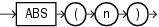

## Syntax



> ```
> ABS(n)
> ```
>
> [Copyright ©](https://docs.oracle.com/pls/topic/lookup?ctx=en/legal&id=cpyr) 2026,1996, Oracle and/or its affiliates.


[Description of the illustration abs.eps](https://docs.oracle.com/en/database/oracle/oracle-database/19/sqlrf/img_text/abs.html)

## Purpose

`ABS` returns the absolute value of *n*.

This function takes as an argument any numeric data type or any nonnumeric data type that can be implicitly converted to a numeric data type. The function returns the same data type as the numeric data type of the argument.

**See Also:** [Table 2-8](Data-Type-Comparison-Rules.md) for more information on implicit conversion

## Examples

The following example returns the absolute value of -15:

```md
SELECT ABS(-15) "Absolute"
  FROM DUAL;

  Absolute
----------
        15
```