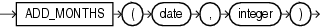

## Syntax



> ```
> ADD_MONTHS(date, integer)
> ```
>
> [Copyright ©](https://docs.oracle.com/pls/topic/lookup?ctx=en/legal&id=cpyr) 2026,1996, Oracle and/or its affiliates.


[Description of the illustration add\_months.eps](https://docs.oracle.com/en/database/oracle/oracle-database/19/sqlrf/img_text/add_months.html)

## Purpose

`ADD_MONTHS` returns the date *date* plus *integer* months. A month is defined by the session parameter `NLS_CALENDAR`. The date argument can be a datetime value or any value that can be implicitly converted to `DATE`. The *integer* argument can be an integer or any value that can be implicitly converted to an integer. The return type is always `DATE`, regardless of the data type of *date*. If *date* is the last day of the month or if the resulting month has fewer days than the day component of *date*, then the result is the last day of the resulting month. Otherwise, the result has the same day component as *date*.

**See Also:** [Table 2-8](Data-Type-Comparison-Rules.md) for more information on implicit conversion

## Examples

The following example returns the month after the *hire\_date* in the sample table `employees`:

```md
SELECT TO_CHAR(ADD_MONTHS(hire_date, 1), 'DD-MON-YYYY') "Next month"
  FROM employees
  WHERE last_name = 'Baer';

Next Month
-----------
07-JUL-2002
```