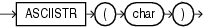

## Syntax



> ```
> ASCIISTR(char)
> ```
>
> [Copyright ©](https://docs.oracle.com/pls/topic/lookup?ctx=en/legal&id=cpyr) 2026,1996, Oracle and/or its affiliates.


[Description of the illustration asciistr.eps](https://docs.oracle.com/en/database/oracle/oracle-database/19/sqlrf/img_text/asciistr.html)

## Purpose

`ASCIISTR` takes as its argument a string, or an expression that resolves to a string, in any character set and returns an ASCII version of the string in the database character set. Non-ASCII characters are converted to the form `\xxxx`, where `xxxx` represents a UTF-16 code unit.

**See Also:**

- [*Oracle Database Globalization Support Guide*](https://docs.oracle.com/pls/topic/lookup?ctx=en/database/oracle/oracle-database/19/sqlrf&id=NLSPG006) for information on Unicode character sets and character semantics
- in [*Oracle Database Globalization Support Guide*](https://docs.oracle.com/pls/topic/lookup?ctx=en/database/oracle/oracle-database/19/sqlrf&id=NLSPG-GUID-AFCE41ED-775B-4A00-AF38-C436776AE0C5) for the collation derivation rules, which define the collation assigned to the character return value of `ASCIISTR`

## Examples

The following example returns the ASCII string equivalent of the text string “ `ABÄCDE` ”:

```md
SELECT ASCIISTR('ABÄCDE')
  FROM DUAL;

ASCIISTR('
----------
AB\00C4CDE
```