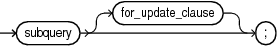
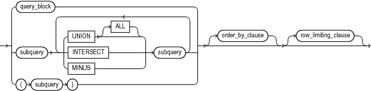
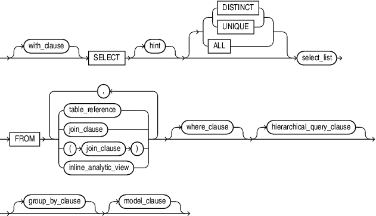

A **query** is an operation that retrieves data from one or more tables or views. In this reference, a top-level `SELECT` statement is called a **query**, and a query nested within another SQL statement is called a **subquery**.

This section describes some types of queries and subqueries and how to use them. The top level of the syntax is shown in this chapter. Refer to [SELECT](SELECT.md) for the full syntax of all the clauses and the semantics of this statement.

## select::=



> ```
> subquery [ for_update_clause ] ;
> ```
>
> [Copyright ©](https://docs.oracle.com/pls/topic/lookup?ctx=en/legal&id=cpyr) 2026,1996, Oracle and/or its affiliates.


[Description of the illustration select.eps](https://docs.oracle.com/en/database/oracle/oracle-database/19/sqlrf/img_text/select.html)

## subquery::=



> ```
> { query_block
> | subquery { UNION [ALL] | INTERSECT | MINUS } subquery
>     [ { UNION [ALL] | INTERSECT | MINUS } subquery ]...
> | ( subquery )
> } [ order_by_clause ] [ row_limiting_clause ]
> ```
>
> [Copyright ©](https://docs.oracle.com/pls/topic/lookup?ctx=en/legal&id=cpyr) 2026,1996, Oracle and/or its affiliates.


[Description of the illustration subquery.eps](https://docs.oracle.com/en/database/oracle/oracle-database/19/sqlrf/img_text/subquery.html)

## query\_block::=



> ```
> [ with_clause ]
> SELECT [ hint ] [ { { DISTINCT | UNIQUE } | ALL } ] select_list
>   FROM { table_reference | join_clause | ( join_clause ) | inline_analytic_view }
>          [ , { table_reference | join_clause | (join_clause) | inline_analytic_view} ] ...
>   [ where_clause ]
>   [ hierarchical_query_clause ]
>   [ group_by_clause ]
>   [ model_clause ]
> ```


[Description of the illustration query\_block.eps](https://docs.oracle.com/en/database/oracle/oracle-database/19/sqlrf/img_text/query_block.html)