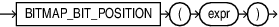

## Syntax



> ```
> BITMAP_BIT_POSITION  ( expr  )
> ```
>
> [Copyright ©](https://docs.oracle.com/pls/topic/lookup?ctx=en/legal&id=cpyr) 2026,1996, Oracle and/or its affiliates.


[Description of the illustration bitmap\_bit\_position.eps](https://docs.oracle.com/en/database/oracle/oracle-database/19/sqlrf/img_text/bitmap_bit_position.html)

## Purpose

Use `BITMAP_BIT_POSITION` to construct the one-to-one mapping between a number and a bit position.

The argument `expr` is of type `NUMBER`. It is the absolute bit position in the bitmap.

`BITMAP_BIT_POSITION` returns a `NUMBER`, the relative bit position.

If `expr` is NULL, the function returns NULL.

If `expr` is not an integer, you will see the following error message:

```md
Invalid value has been passed to a BITMAP COUNT DISTINCT related operator.
```