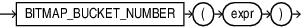

## Syntax



> ```
> BITMAP_BUCKET_NUMBER ( expr )
> ```
>
> [Copyright ©](https://docs.oracle.com/pls/topic/lookup?ctx=en/legal&id=cpyr) 2026,1996, Oracle and/or its affiliates.


[Description of the illustration bitmap\_bucket\_number.eps](https://docs.oracle.com/en/database/oracle/oracle-database/19/sqlrf/img_text/bitmap_bucket_number.html)

## Purpose

Use `BITMAP_BUCKET_NUMBER` to construct a one-to-one mapping between a number and a bit position in a bitmap.

The argument `expr` is of type `NUMBER`. It represents the absolute bit position in the bitmap.

`BITMAP_BUCKET_NUMBER` returns a `NUMBER`. It represents the relative bit position.

If `expr` is NULL, the function returns NULL.

If `expr` is not an integer, you will see the following error message:

```md
Invalid value has been passed to a BITMAP COUNT DISTINCT related operator.
```