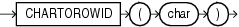

## Syntax



> ```
> CHARTOROWID(char)
> ```
>
> [Copyright ©](https://docs.oracle.com/pls/topic/lookup?ctx=en/legal&id=cpyr) 2026,1996, Oracle and/or its affiliates.


[Description of the illustration chartorowid.eps](https://docs.oracle.com/en/database/oracle/oracle-database/19/sqlrf/img_text/chartorowid.html)

## Purpose

`CHARTOROWID` converts a value from `CHAR`, `VARCHAR2`, `NCHAR`, or `NVARCHAR2` data type to `ROWID` data type.

This function does not support `CLOB` data directly. However, `CLOB` s can be passed in as arguments through implicit data conversion.

**See Also:** [Data Type Comparison Rules](Data-Type-Comparison-Rules.md) for more information.

## Examples

The following example converts a character rowid representation to a rowid. (The actual rowid is different for each database instance.)

```md
SELECT last_name
  FROM employees
  WHERE ROWID = CHARTOROWID('AAAFd1AAFAAAABSAA/');

LAST_NAME
-------------------------
Greene
```