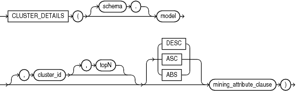
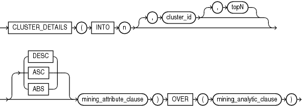

## Syntax

## cluster\_details::=



> ```
> CLUSTER_DETAILS ( [ schema . ] model
>                   [ , cluster_id [ , topN ] ] [ DESC | ASC | ABS ]
>                   mining_attribute_clause )
> ```
>
> [Copyright ©](https://docs.oracle.com/pls/topic/lookup?ctx=en/legal&id=cpyr) 2026,1996, Oracle and/or its affiliates.


[Description of the illustration cluster\_details.eps](https://docs.oracle.com/en/database/oracle/oracle-database/19/sqlrf/img_text/cluster_details.html)

## Analytic Syntax

## cluster\_details\_analytic::=



> ```
> CLUSTER_DETAILS ( INTO n
>                 [ , cluster_id [ , topN ] ] [ DESC | ASC | ABS ]
>                 mining_attribute_clause )
>                 OVER ( mining_analytic_clause )
> ```
>
> [Copyright ©](https://docs.oracle.com/pls/topic/lookup?ctx=en/legal&id=cpyr) 2026,1996, Oracle and/or its affiliates.


[Description of the illustration cluster\_details\_analytic.eps](https://docs.oracle.com/en/database/oracle/oracle-database/19/sqlrf/img_text/cluster_details_analytic.html)

## mining\_attribute\_clause::=


> ```
> USING
> { *
> | { [ schema . ] table . *
>   | expr [ [ AS ]alias ]
>   }
>     [, { [ schema . ] table . *
>        | expr [ [ AS ] alias ]
>        }
>     ]...
> }
> ```
>
> [Copyright ©](https://docs.oracle.com/pls/topic/lookup?ctx=en/legal&id=cpyr) 2026,1996, Oracle and/or its affiliates.


[Description of the illustration mining\_attribute\_clause.eps](https://docs.oracle.com/en/database/oracle/oracle-database/19/sqlrf/img_text/mining_attribute_clause.html)

## mining\_analytic\_clause::=


> ```
> [ query_partition_clause ] [ order_by_clause ]
> ```
>
> [Copyright ©](https://docs.oracle.com/pls/topic/lookup?ctx=en/legal&id=cpyr) 2026,1996, Oracle and/or its affiliates.


[Description of the illustration mining\_analytic\_clause.eps](https://docs.oracle.com/en/database/oracle/oracle-database/19/sqlrf/img_text/mining_analytic_clause.html)

**See Also:** [Analytic Functions](Analytic-Functions.md) for information on the syntax, semantics, and restrictions of *mining\_analytic\_clause*

## Purpose

`CLUSTER_DETAILS` returns cluster details for each row in the selection. The return value is an XML string that describes the attributes of the highest probability cluster or the specified *cluster\_id*.

## topN

If you specify a value for *topN*, the function returns the *N* attributes that most influence the cluster assignment (the score). If you do not specify *topN*, the function returns the 5 most influential attributes.

## DESC, ASC, or ABS

The returned attributes are ordered by weight. The weight of an attribute expresses its positive or negative impact on cluster assignment. A positive weight indicates an increased likelihood of assignment. A negative weight indicates a decreased likelihood of assignment.

By default, `CLUSTER_DETAILS` returns the attributes with the highest positive weights (`DESC`). If you specify `ASC`, the attributes with the highest negative weights are returned. If you specify `ABS`, the attributes with the greatest weights, whether negative or positive, are returned. The results are ordered by absolute value from highest to lowest. Attributes with a zero weight are not included in the output.

## Syntax Choice

`CLUSTER_DETAILS` can score the data in one of two ways: It can apply a mining model object to the data, or it can dynamically mine the data by executing an analytic clause that builds and applies one or more transient mining models. Choose **Syntax** or **Analytic Syntax**:

- **Syntax** — Use the first syntax to score the data with a pre-defined model. Supply the name of a clustering model.
- **Analytic Syntax** — Use the analytic syntax to score the data without a pre-defined model. Include `INTO` *n*, where *n* is the number of clusters to compute, and *mining\_analytic\_clause*, which specifies if the data should be partitioned for multiple model builds. The *mining\_analytic\_clause* supports a *query\_partition\_clause* and an *order\_by\_clause*. (See [analytic\_clause::=](Analytic-Functions.md).)

The syntax of the `CLUSTER_DETAILS` function can use an optional `GROUPING` hint when scoring a partitioned model. See [GROUPING Hint](Comments.md).

## mining\_attribute\_clause

*mining\_attribute\_clause* identifies the column attributes to use as predictors for scoring. When the function is invoked with the analytic syntax, these predictors are also used for building the transient models. The *mining\_attribute\_clause* behaves as described for the `PREDICTION` function. (See [mining\_attribute\_clause::=](PREDICTION.md).)

**See Also:**

- [*Oracle Data Mining User’s Guide*](https://docs.oracle.com/pls/topic/lookup?ctx=en/database/oracle/oracle-database/19/sqlrf&id=DMPRG004) for information about scoring.
- [*Oracle Data Mining Concepts*](https://docs.oracle.com/pls/topic/lookup?ctx=en/database/oracle/oracle-database/19/sqlrf&id=DMCON008) for information about clustering.

**Note:** The following examples are excerpted from the Data Mining sample programs. For more information about the sample programs, see in [*Oracle Data Mining User’s Guide*](https://docs.oracle.com/pls/topic/lookup?ctx=en/database/oracle/oracle-database/19/sqlrf&id=DMPRG714).

## Example

This example lists the attributes that have the greatest impact (more that 20% probability) on cluster assignment for customer ID 100955. The query invokes the `CLUSTER_DETAILS` and `CLUSTER_SET` functions, which apply the clustering model `em_sh_clus_sample`.

```md
SELECT S.cluster_id, probability prob,
       CLUSTER_DETAILS(em_sh_clus_sample, S.cluster_id, 5 USING T.*) det
FROM
  (SELECT v.*, CLUSTER_SET(em_sh_clus_sample, NULL, 0.2 USING *) pset
    FROM mining_data_apply_v v
   WHERE cust_id = 100955) T,
  TABLE(T.pset) S
ORDER BY 2 DESC;

CLUSTER_ID  PROB DET
---------- ----- ---------------------------------------------------------------------------------
        14 .6761 <Details algorithm="Expectation Maximization" cluster="14">
                 <Attribute name="AGE" actualValue="51" weight=".676" rank="1"/>
                 <Attribute name="HOME_THEATER_PACKAGE" actualValue="1" weight=".557" rank="2"/>
                 <Attribute name="FLAT_PANEL_MONITOR" actualValue="0" weight=".412" rank="3"/>
                 <Attribute name="Y_BOX_GAMES" actualValue="0" weight=".171" rank="4"/>
                 <Attribute name="BOOKKEEPING_APPLICATION" actualValue="1" weight="-.003"rank="5"/>
                 </Details>

         3 .3227 <Details algorithm="Expectation Maximization" cluster="3">
                 <Attribute name="YRS_RESIDENCE" actualValue="3" weight=".323" rank="1"/>
                 <Attribute name="BULK_PACK_DISKETTES" actualValue="1" weight=".265" rank="2"/>
                 <Attribute name="EDUCATION" actualValue="HS-grad" weight=".172" rank="3"/>
                 <Attribute name="AFFINITY_CARD" actualValue="0" weight=".125" rank="4"/>
                 <Attribute name="OCCUPATION" actualValue="Crafts" weight=".055" rank="5"/>
                 </Details>
```

## Analytic Example

This example divides the customer database into four segments based on common characteristics. The clustering functions compute the clusters and return the score without a predefined clustering model.

```md
SELECT * FROM (
     SELECT cust_id,
          CLUSTER_ID(INTO 4 USING *) OVER () cls,
          CLUSTER_DETAILS(INTO 4 USING *) OVER () cls_details
     FROM mining_data_apply_v)
WHERE cust_id <= 100003
ORDER BY 1;

CUST_ID CLS CLS_DETAILS
------- --- -----------------------------------------------------------------------------------
 100001   5 <Details algorithm="K-Means Clustering" cluster="5">
            <Attribute name="FLAT_PANEL_MONITOR" actualValue="0" weight=".349" rank="1"/>
            <Attribute name="BULK_PACK_DISKETTES" actualValue="0" weight=".33" rank="2"/>
            <Attribute name="CUST_INCOME_LEVEL" actualValue="G: 130\,000 - 149\,999" weight=".291"
             rank="3"/>
            <Attribute name="HOME_THEATER_PACKAGE" actualValue="1" weight=".268" rank="4"/>
            <Attribute name="Y_BOX_GAMES" actualValue="0" weight=".179" rank="5"/>
            </Details>

 100002   6 <Details algorithm="K-Means Clustering" cluster="6">
            <Attribute name="CUST_GENDER" actualValue="F" weight=".945" rank="1"/>
            <Attribute name="CUST_MARITAL_STATUS" actualValue="NeverM" weight=".856" rank="2"/>
            <Attribute name="HOUSEHOLD_SIZE" actualValue="2" weight=".468" rank="3"/>
            <Attribute name="AFFINITY_CARD" actualValue="0" weight=".012" rank="4"/>
            <Attribute name="CUST_INCOME_LEVEL" actualValue="L: 300\,000 and above" weight=".009"
             rank="5"/>
            </Details>

 100003   7 <Details algorithm="K-Means Clustering" cluster="7">
            <Attribute name="CUST_MARITAL_STATUS" actualValue="NeverM" weight=".862" rank="1"/>
            <Attribute name="HOUSEHOLD_SIZE" actualValue="2" weight=".423" rank="2"/>
            <Attribute name="HOME_THEATER_PACKAGE" actualValue="0" weight=".113" rank="3"/>
            <Attribute name="AFFINITY_CARD" actualValue="0" weight=".007" rank="4"/>
            <Attribute name="CUST_ID" actualValue="100003" weight=".006" rank="5"/>
            </Details>
```