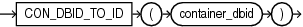

## Syntax



> ```
> CON_DBID_TO_ID(container_dbid)
> ```
>
> [Copyright ©](https://docs.oracle.com/pls/topic/lookup?ctx=en/legal&id=cpyr) 2026,1996, Oracle and/or its affiliates.


[Description of the illustration con\_dbid\_to\_id.eps](https://docs.oracle.com/en/database/oracle/oracle-database/19/sqlrf/img_text/con_dbid_to_id.html)

## Purpose

`CON_DBID_TO_ID` takes as its argument a container DBID and returns the container ID. For *container\_dbid*, specify a `NUMBER` value or any value that can be implicitly converted to `NUMBER`. The function returns a `NUMBER` value.

This function is useful in a multitenant container database (CDB). If you use this function in a non-CDB, then it returns 0.

## Example

The following query displays the ID and DBID for all containers in a CDB. The sample output shown is for the purpose of this example.

```md
SELECT CON_ID, DBID
  FROM V$CONTAINERS;

    CON_ID       DBID
---------- ----------
         1 1930093401
         2 4054529501
         4 2256797992
```

The following statement returns the ID for the container with DBID 2256797992:

```md
SELECT CON_DBID_TO_ID(2256797992) "Container ID"
  FROM DUAL;

Container ID
------------
           4
```