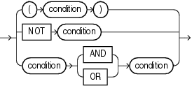

A compound condition specifies a combination of other conditions.

## compound\_condition::=



> ```
> { (condition)
> | NOT condition
> | condition { AND | OR } condition
> }
> ```
>
> [Copyright ©](https://docs.oracle.com/pls/topic/lookup?ctx=en/legal&id=cpyr) 2026,1996, Oracle and/or its affiliates.


[Description of the illustration compound\_condition.eps](https://docs.oracle.com/en/database/oracle/oracle-database/19/sqlrf/img_text/compound_condition.html)

**See Also:** [Logical Conditions](Logical-Conditions.md) for more information about `NOT`, `AND`, and `OR` conditions