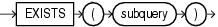

An `EXISTS` condition tests for existence of rows in a subquery.



> ```
> EXISTS (subquery)
> ```
>
> [Copyright ©](https://docs.oracle.com/pls/topic/lookup?ctx=en/legal&id=cpyr) 2026,1996, Oracle and/or its affiliates.


[Description of the illustration exists\_condition.eps](https://docs.oracle.com/en/database/oracle/oracle-database/19/sqlrf/img_text/exists_condition.html)

Table 6-11 shows the `EXISTS` condition.

Table 11 EXISTS Condition

| Type of Condition | Operation | Example |
| --- | --- | --- |
| ```md EXISTS ``` | `TRUE` if a subquery returns at least one row. | ```md SELECT department_id FROM departments d WHERE EXISTS (SELECT * FROM employees e WHERE d.department_id  = e.department_id) ORDER BY department_id; ``` |