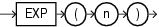

## Syntax



> ```
> EXP(n)
> ```
>
> [Copyright ©](https://docs.oracle.com/pls/topic/lookup?ctx=en/legal&id=cpyr) 2026,1996, Oracle and/or its affiliates.


[Description of the illustration exp.eps](https://docs.oracle.com/en/database/oracle/oracle-database/19/sqlrf/img_text/exp.html)

## Purpose

`EXP` returns `e` raised to the *n* th power, where `e` = 2.71828183…. The function returns a value of the same type as the argument.

This function takes as an argument any numeric data type or any nonnumeric data type that can be implicitly converted to a numeric data type. If the argument is `BINARY_FLOAT`, then the function returns `BINARY_DOUBLE`. Otherwise the function returns the same numeric data type as the argument.

**See Also:** [Table 2-8](Data-Type-Comparison-Rules.md) for more information on implicit conversion

## Examples

The following example returns `e` to the 4th power:

```md
SELECT EXP(4) "e to the 4th power"
  FROM DUAL;

e to the 4th power
------------------
          54.59815
```