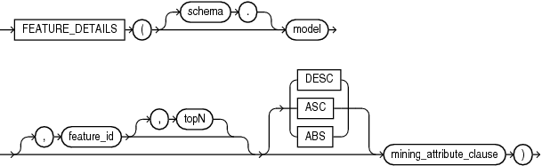
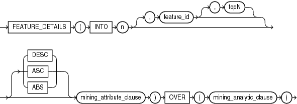

## Syntax

## feature\_details::=



> ```
> FEATURE_DETAILS ( [ schema . ] model
>                   [ , feature_id [ , topN ] ] [ DESC | ASC | ABS ]
>                   mining_attribute_clause )
> ```
>
> [Copyright ©](https://docs.oracle.com/pls/topic/lookup?ctx=en/legal&id=cpyr) 2026,1996, Oracle and/or its affiliates.


[Description of the illustration feature\_details.eps](https://docs.oracle.com/en/database/oracle/oracle-database/19/sqlrf/img_text/feature_details.html)

## Analytic Syntax

## feature\_details\_analytic::=



> ```
> FEATURE_DETAILS ( INTO n
>                   [ , feature_id [ , topN ] ] [ DESC | ASC | ABS ]
>                   mining_attribute_clause )
>                 OVER ( mining_analytic_clause )
> ```
>
> [Copyright ©](https://docs.oracle.com/pls/topic/lookup?ctx=en/legal&id=cpyr) 2026,1996, Oracle and/or its affiliates.


[Description of the illustration feature\_details\_analytic.eps](https://docs.oracle.com/en/database/oracle/oracle-database/19/sqlrf/img_text/feature_details_analytic.html)

## mining\_attribute\_clause::=


> ```
> USING
> { *
> | { [ schema . ] table . *
>   | expr [ [ AS ]alias ]
>   }
>     [, { [ schema . ] table . *
>        | expr [ [ AS ] alias ]
>        }
>     ]...
> }
> ```
>
> [Copyright ©](https://docs.oracle.com/pls/topic/lookup?ctx=en/legal&id=cpyr) 2026,1996, Oracle and/or its affiliates.


[Description of the illustration mining\_attribute\_clause.eps](https://docs.oracle.com/en/database/oracle/oracle-database/19/sqlrf/img_text/mining_attribute_clause.html)

## mining\_analytic\_clause::=


> ```
> [ query_partition_clause ] [ order_by_clause ]
> ```
>
> [Copyright ©](https://docs.oracle.com/pls/topic/lookup?ctx=en/legal&id=cpyr) 2026,1996, Oracle and/or its affiliates.


[Description of the illustration mining\_analytic\_clause.eps](https://docs.oracle.com/en/database/oracle/oracle-database/19/sqlrf/img_text/mining_analytic_clause.html)

**See Also:** “ [Analytic Functions](Analytic-Functions.md) ” for information on the syntax, semantics, and restrictions of *mining\_analytic\_clause*

## Purpose

`FEATURE_DETAILS` returns feature details for each row in the selection. The return value is an XML string that describes the attributes of the highest value feature or the specified *feature\_id*.

## topN

If you specify a value for *topN*, the function returns the *N* attributes that most influence the feature value. If you do not specify *topN*, the function returns the 5 most influential attributes.

## DESC, ASC, or ABS

The returned attributes are ordered by weight. The weight of an attribute expresses its positive or negative impact on the value of the feature. A positive weight indicates a higher feature value. A negative weight indicates a lower feature value.

By default, `FEATURE_DETAILS` returns the attributes with the highest positive weight (`DESC`). If you specify `ASC`, the attributes with the highest negative weight are returned. If you specify `ABS`, the attributes with the greatest weight, whether negative or positive, are returned. The results are ordered by absolute value from highest to lowest. Attributes with a zero weight are not included in the output.

## Syntax Choice

`FEATURE_DETAILS` can score the data in one of two ways: It can apply a mining model object to the data, or it can dynamically mine the data by executing an analytic clause that builds and applies one or more transient mining models. Choose **Syntax** or **Analytic Syntax**:

- **Syntax** — Use the first syntax to score the data with a pre-defined model. Supply the name of a feature extraction model.
- **Analytic Syntax** — Use the analytic syntax to score the data without a pre-defined model. Include `INTO` *n*, where *n* is the number of features to extract, and *mining\_analytic\_clause*, which specifies if the data should be partitioned for multiple model builds. The *mining\_analytic\_clause* supports a *query\_partition\_clause* and an *order\_by\_clause*. (See “ [analytic\_clause::=](Analytic-Functions.md) ”.)

The syntax of the `FEATURE_DETAILS` function can use an optional `GROUPING` hint when scoring a partitioned model. See [GROUPING Hint](Comments.md).

## mining\_attribute\_clause

*mining\_attribute\_clause* identifies the column attributes to use as predictors for scoring. When the function is invoked with the analytic syntax, these predictors are also used for building the transient models. The *mining\_attribute\_clause* behaves as described for the `PREDICTION` function. (See “ [mining\_attribute\_clause::=](PREDICTION.md) ”.)

**See Also:**

- [*Oracle Data Mining User’s Guide*](https://docs.oracle.com/pls/topic/lookup?ctx=en/database/oracle/oracle-database/19/sqlrf&id=DMPRG004) for information about scoring.
- [*Oracle Data Mining Concepts*](https://docs.oracle.com/pls/topic/lookup?ctx=en/database/oracle/oracle-database/19/sqlrf&id=DMCON010) for information about feature extraction.

**Note:** The following examples are excerpted from the Data Mining sample programs. For more information about the sample programs, see in [*Oracle Data Mining User’s Guide*](https://docs.oracle.com/pls/topic/lookup?ctx=en/database/oracle/oracle-database/19/sqlrf&id=DMPRG714).

## Example

This example uses the feature extraction model `nmf_sh_sample` to score the data. The query returns the three features that best represent customer 100002 and the attributes that most affect those features.

```md
SELECT S.feature_id fid, value val,
       FEATURE_DETAILS(nmf_sh_sample, S.feature_id, 5 using T.*) det
   FROM
     (SELECT v.*, FEATURE_SET(nmf_sh_sample, 3 USING *) fset
         FROM mining_data_apply_v v
         WHERE cust_id = 100002) T,
   TABLE(T.fset) S
ORDER BY 2 DESC;

 FID    VAL  DET
---- ------  ------------------------------------------------------------------------------------
   5  3.492  <Details algorithm="Non-Negative Matrix Factorization" feature="5">
             <Attribute name="BULK_PACK_DISKETTES" actualValue="1" weight=".077" rank="1"/>
             <Attribute name="OCCUPATION" actualValue="Prof." weight=".062" rank="2"/>
             <Attribute name="BOOKKEEPING_APPLICATION" actualValue="1" weight=".001" rank="3"/>
             <Attribute name="OS_DOC_SET_KANJI" actualValue="0" weight="0" rank="4"/>
             <Attribute name="YRS_RESIDENCE" actualValue="4" weight="0" rank="5"/>
             </Details>
   3  1.928  <Details algorithm="Non-Negative Matrix Factorization" feature="3">
             <Attribute name="HOUSEHOLD_SIZE" actualValue="2" weight=".239" rank="1"/>
             <Attribute name="CUST_INCOME_LEVEL" actualValue="L: 300\,000 and above"
              weight=".051" rank="2"/>
             <Attribute name="FLAT_PANEL_MONITOR" actualValue="1" weight=".02" rank="3"/>
             <Attribute name="HOME_THEATER_PACKAGE" actualValue="1" weight=".006" rank="4"/>
             <Attribute name="AGE" actualValue="41" weight=".004" rank="5"/>
             </Details>
   8   .816  <Details algorithm="Non-Negative Matrix Factorization" feature="8">
             <Attribute name="EDUCATION" actualValue="Bach." weight=".211" rank="1"/>
             <Attribute name="CUST_MARITAL_STATUS" actualValue="NeverM" weight=".143" rank="2"/>
             <Attribute name="FLAT_PANEL_MONITOR" actualValue="1" weight=".137" rank="3"/>
             <Attribute name="CUST_GENDER" actualValue="F" weight=".044" rank="4"/>
             <Attribute name="BULK_PACK_DISKETTES" actualValue="1" weight=".032" rank="5"/>
             </Details>
```

## Analytic Example

This example dynamically maps customer attributes into six features and returns the feature mapping for customer 100001.

```md
SELECT feature_id, value
  FROM (
     SELECT cust_id, feature_set(INTO 6 USING *) OVER () fset
        FROM mining_data_apply_v),
  TABLE (fset)
  WHERE cust_id = 100001
  ORDER BY feature_id;

FEATURE_ID    VALUE
---------- --------
         1    2.670
         2     .000
         3    1.792
         4     .000
         5     .000
         6    3.379
```