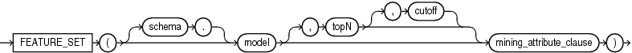
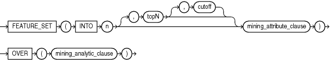

## Syntax

## feature\_set::=



> ```
> FEATURE_SET ( [ schema . ] model [, topN [, cutoff ] ] mining_attribute_clause )
> ```
>
> [Copyright ©](https://docs.oracle.com/pls/topic/lookup?ctx=en/legal&id=cpyr) 2026,1996, Oracle and/or its affiliates.


[Description of the illustration feature\_set.eps](https://docs.oracle.com/en/database/oracle/oracle-database/19/sqlrf/img_text/feature_set.html)

## Analytic Syntax

## feature\_set\_analytic::=



> ```
> FEATURE_SET ( INTO n [, topN [, cutoff ] ] mining_attribute_clause )
>             OVER ( mining_analytic_clause )
> ```
>
> [Copyright ©](https://docs.oracle.com/pls/topic/lookup?ctx=en/legal&id=cpyr) 2026,1996, Oracle and/or its affiliates.


[Description of the illustration feature\_set\_analytic.eps](https://docs.oracle.com/en/database/oracle/oracle-database/19/sqlrf/img_text/feature_set_analytic.html)

## mining\_attribute\_clause::=


> ```
> USING
> { *
> | { [ schema . ] table . *
>   | expr [ [ AS ]alias ]
>   }
>     [, { [ schema . ] table . *
>        | expr [ [ AS ] alias ]
>        }
>     ]...
> }
> ```
>
> [Copyright ©](https://docs.oracle.com/pls/topic/lookup?ctx=en/legal&id=cpyr) 2026,1996, Oracle and/or its affiliates.


[Description of the illustration mining\_attribute\_clause.eps](https://docs.oracle.com/en/database/oracle/oracle-database/19/sqlrf/img_text/mining_attribute_clause.html)

## mining\_analytic\_clause::=


> ```
> [ query_partition_clause ] [ order_by_clause ]
> ```
>
> [Copyright ©](https://docs.oracle.com/pls/topic/lookup?ctx=en/legal&id=cpyr) 2026,1996, Oracle and/or its affiliates.


[Description of the illustration mining\_analytic\_clause.eps](https://docs.oracle.com/en/database/oracle/oracle-database/19/sqlrf/img_text/mining_analytic_clause.html)

**See Also:** “ [Analytic Functions](Analytic-Functions.md) ” for information on the syntax, semantics, and restrictions of *mining\_analytic\_clause*

## Purpose

`FEATURE_SET` returns a set of feature ID and feature value pairs for each row in the selection. The return value is a varray of objects with field names `FEATURE_ID` and `VALUE`. The data type of both fields is `NUMBER`.

## topN and cutoff

You can specify *topN* and *cutoff* to limit the number of features returned by the function. By default, both *topN* and *cutoff* are null and all features are returned.

- *topN* is the *N* highest value features. If multiple features have the *N* th value, then the function chooses one of them.
- *cutoff* is a value threshold. Only features that are greater than or equal to *cutoff* are returned. To filter by *cutoff* only, specify `NULL` for *topN*.

To return up to *N* features that are greater than or equal to *cutoff*, specify both *topN* and *cutoff*.

## Syntax Choice

`FEATURE_SET` can score the data in one of two ways: It can apply a mining model object to the data, or it can dynamically mine the data by executing an analytic clause that builds and applies one or more transient mining models. Choose **Syntax** or **Analytic Syntax**:

- **Syntax** — Use the first syntax to score the data with a pre-defined model. Supply the name of a feature extraction model.
- **Analytic Syntax** — Use the analytic syntax to score the data without a pre-defined model. Include `INTO` *n*, where *n* is the number of features to extract, and *mining\_analytic\_clause*, which specifies if the data should be partitioned for multiple model builds. The *mining\_analytic\_clause* supports a *query\_partition\_clause* and an *order\_by\_clause*. (See “ [analytic\_clause::=](Analytic-Functions.md) ”.)

The syntax of the `FEATURE_SET` function can use an optional `GROUPING` hint when scoring a partitioned model. See [GROUPING Hint](Comments.md).

## mining\_attribute\_clause

*mining\_attribute\_clause* identifies the column attributes to use as predictors for scoring. When the function is invoked with the analytic syntax, these predictors are also used for building the transient models. The *mining\_attribute\_clause* behaves as described for the `PREDICTION` function. (See “ [mining\_attribute\_clause::=](PREDICTION.md) ”.)

**See Also:**

- [*Oracle Data Mining User’s Guide*](https://docs.oracle.com/pls/topic/lookup?ctx=en/database/oracle/oracle-database/19/sqlrf&id=DMPRG004) for information about scoring.
- [*Oracle Data Mining Concepts*](https://docs.oracle.com/pls/topic/lookup?ctx=en/database/oracle/oracle-database/19/sqlrf&id=DMCON010) for information about feature extraction.

**Note:** The following example is excerpted from the Data Mining sample programs. For more information about the sample programs, see in [*Oracle Data Mining User’s Guide*](https://docs.oracle.com/pls/topic/lookup?ctx=en/database/oracle/oracle-database/19/sqlrf&id=DMPRG714).

## Example

This example lists the top features corresponding to a given customer record and determines the top attributes for each feature (based on coefficient > 0.25).

```md
WITH
feat_tab AS (
SELECT F.feature_id fid,
       A.attribute_name attr,
       TO_CHAR(A.attribute_value) val,
       A.coefficient coeff
  FROM TABLE(DBMS_DATA_MINING.GET_MODEL_DETAILS_NMF('nmf_sh_sample')) F,
       TABLE(F.attribute_set) A
 WHERE A.coefficient > 0.25
),
feat AS (
SELECT fid,
       CAST(COLLECT(Featattr(attr, val, coeff))
         AS Featattrs) f_attrs
  FROM feat_tab
GROUP BY fid
),
cust_10_features AS (
SELECT T.cust_id, S.feature_id, S.value
  FROM (SELECT cust_id, FEATURE_SET(nmf_sh_sample, 10 USING *) pset
          FROM nmf_sh_sample_apply_prepared
         WHERE cust_id = 100002) T,
       TABLE(T.pset) S
)
SELECT A.value, A.feature_id fid,
       B.attr, B.val, B.coeff
  FROM cust_10_features A,
       (SELECT T.fid, F.*
          FROM feat T,
               TABLE(T.f_attrs) F) B
 WHERE A.feature_id = B.fid
ORDER BY A.value DESC, A.feature_id ASC, coeff DESC, attr ASC, val ASC;

   VALUE  FID ATTR                      VAL                        COEFF
-------- ---- ------------------------- ------------------------ -------
  6.8409    7 YRS_RESIDENCE                                       1.3879
  6.8409    7 BOOKKEEPING_APPLICATION                              .4388
  6.8409    7 CUST_GENDER               M                          .2956
  6.8409    7 COUNTRY_NAME              United States of America   .2848
  6.4975    3 YRS_RESIDENCE                                       1.2668
  6.4975    3 BOOKKEEPING_APPLICATION                              .3465
  6.4975    3 COUNTRY_NAME              United States of America   .2927
  6.4886    2 YRS_RESIDENCE                                       1.3285
  6.4886    2 CUST_GENDER               M                          .2819
  6.4886    2 PRINTER_SUPPLIES                                     .2704
  6.3953    4 YRS_RESIDENCE                                       1.2931
  5.9640    6 YRS_RESIDENCE                                       1.1585
  5.9640    6 HOME_THEATER_PACKAGE                                 .2576
  5.2424    5 YRS_RESIDENCE                                       1.0067
  2.4714    8 YRS_RESIDENCE                                        .3297
  2.3559    1 YRS_RESIDENCE                                        .2768
  2.3559    1 FLAT_PANEL_MONITOR                                   .2593
```