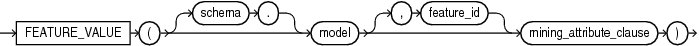
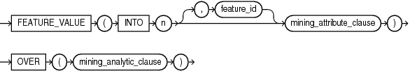
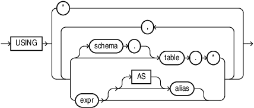
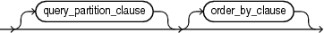

## Syntax

## feature\_value::=



> ```
> FEATURE_VALUE ( [ schema . ] model [, feature_id ] mining_attribute_clause )
> ```
>
> [Copyright ©](https://docs.oracle.com/pls/topic/lookup?ctx=en/legal&id=cpyr) 2026,1996, Oracle and/or its affiliates.


[Description of the illustration feature\_value.eps](https://docs.oracle.com/en/database/oracle/oracle-database/19/sqlrf/img_text/feature_value.html)

## Analytic Syntax

## feature\_value\_analytic::=



> ```
> FEATURE_VALUE ( INTO n [ , feature_id ] mining_attribute_clause )
>               OVER ( mining_analytic_clause )
> ```
>
> [Copyright ©](https://docs.oracle.com/pls/topic/lookup?ctx=en/legal&id=cpyr) 2026,1996, Oracle and/or its affiliates.


[Description of the illustration feature\_value\_analytic.eps](https://docs.oracle.com/en/database/oracle/oracle-database/19/sqlrf/img_text/feature_value_analytic.html)

## mining\_attribute\_clause::=



> ```
> USING
> { *
> | { [ schema . ] table . *
>   | expr [ [ AS ]alias ]
>   }
>     [, { [ schema . ] table . *
>        | expr [ [ AS ] alias ]
>        }
>     ]...
> }
> ```
>
> [Copyright ©](https://docs.oracle.com/pls/topic/lookup?ctx=en/legal&id=cpyr) 2026,1996, Oracle and/or its affiliates.


[Description of the illustration mining\_attribute\_clause.eps](https://docs.oracle.com/en/database/oracle/oracle-database/19/sqlrf/img_text/mining_attribute_clause.html)

## mining\_analytic\_clause::=



> ```
> [ query_partition_clause ] [ order_by_clause ]
> ```
>
> [Copyright ©](https://docs.oracle.com/pls/topic/lookup?ctx=en/legal&id=cpyr) 2026,1996, Oracle and/or its affiliates.


[Description of the illustration mining\_analytic\_clause.eps](https://docs.oracle.com/en/database/oracle/oracle-database/19/sqlrf/img_text/mining_analytic_clause.html)

**See Also:** “ [Analytic Functions](Analytic-Functions.md) ” for information on the syntax, semantics, and restrictions of *mining\_analytic\_clause*

## Purpose

`FEATURE_VALUE` returns a feature value for each row in the selection. The value refers to the highest value feature or to the specified *feature\_id*. The feature value is returned as `BINARY_DOUBLE`.

## Syntax Choice

`FEATURE_VALUE` can score the data in one of two ways: It can apply a mining model object to the data, or it can dynamically mine the data by executing an analytic clause that builds and applies one or more transient mining models. Choose **Syntax** or **Analytic Syntax**:

- **Syntax** — Use the first syntax to score the data with a pre-defined model. Supply the name of a feature extraction model.
- **Analytic Syntax** — Use the analytic syntax to score the data without a pre-defined model. Include `INTO` *n*, where *n* is the number of features to extract, and *mining\_analytic\_clause*, which specifies if the data should be partitioned for multiple model builds. The *mining\_analytic\_clause* supports a *query\_partition\_clause* and an *order\_by\_clause*. (See “ [analytic\_clause::=](Analytic-Functions.md) ”.)

The syntax of the `FEATURE_VALUE` function can use an optional `GROUPING` hint when scoring a partitioned model. See [GROUPING Hint](Comments.md).

## mining\_attribute\_clause

*mining\_attribute\_clause* identifies the column attributes to use as predictors for scoring. When the function is invoked with the analytic syntax, this data is also used for building the transient models. The *mining\_attribute\_clause* behaves as described for the `PREDICTION` function. (See “ [mining\_attribute\_clause::=](PREDICTION.md) ”.)

**See Also:**

- [*Oracle Data Mining User’s Guide*](https://docs.oracle.com/pls/topic/lookup?ctx=en/database/oracle/oracle-database/19/sqlrf&id=DMPRG004) for information about scoring.
- [*Oracle Data Mining Concepts*](https://docs.oracle.com/pls/topic/lookup?ctx=en/database/oracle/oracle-database/19/sqlrf&id=DMCON010) for information about feature extraction.

**Note:** The following example is excerpted from the Data Mining sample programs. For more information about the sample programs, see in [*Oracle Data Mining User’s Guide*](https://docs.oracle.com/pls/topic/lookup?ctx=en/database/oracle/oracle-database/19/sqlrf&id=DMPRG714).

## Example

The following example lists the customers that correspond to feature 3, ordered by match quality.

```md
SELECT *
  FROM (SELECT cust_id, FEATURE_VALUE(nmf_sh_sample, 3 USING *) match_quality
          FROM nmf_sh_sample_apply_prepared
          ORDER BY match_quality DESC)
  WHERE ROWNUM < 11;

   CUST_ID MATCH_QUALITY
---------- -------------
    100210    19.4101627
    100962    15.2482251
    101151    14.5685197
    101499    14.4186292
    100363    14.4037396
    100372    14.3335148
    100982    14.1716545
    101039    14.1079914
    100759    14.0913761
    100953    14.0799737
```