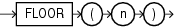

## Syntax



> ```
> FLOOR(n)
> ```
>
> [Copyright ©](https://docs.oracle.com/pls/topic/lookup?ctx=en/legal&id=cpyr) 2026,1996, Oracle and/or its affiliates.


[Description of the illustration floor.eps](https://docs.oracle.com/en/database/oracle/oracle-database/19/sqlrf/img_text/floor.html)

## Purpose

`FLOOR` returns the largest integer equal to or less than *n*. The number *n* can always be written as the sum of an integer *k* and a positive fraction *f* such that 0 <= *f* < 1 and *n* = *k* + *f*. The value of `FLOOR` is the integer *k*. Thus, the value of `FLOOR` is *n* itself if and only if *n* is precisely an integer.

This function takes as an argument any numeric data type or any nonnumeric data type that can be implicitly converted to a numeric data type. The function returns the same data type as the numeric data type of the argument.

**See Also:** [Table 2-8](Data-Type-Comparison-Rules.md) for more information on implicit conversion and [CEIL](CEIL.md)

## Examples

The following example returns the largest integer equal to or less than 15.7:

```md
SELECT FLOOR(15.7) "Floor"
  FROM DUAL;

     Floor
----------
        15
```