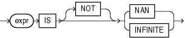

The floating-point conditions let you determine whether an expression is infinite or is the undefined result of an operation (is not a number or `NaN`).

## floating\_point\_condition::=



> ```
> expr IS [ NOT ] { NAN | INFINITE }
> ```
>
> [Copyright ©](https://docs.oracle.com/pls/topic/lookup?ctx=en/legal&id=cpyr) 2026,1996, Oracle and/or its affiliates.


[Description of the illustration floating\_point\_condition.eps](https://docs.oracle.com/en/database/oracle/oracle-database/19/sqlrf/img_text/floating_point_condition.html)

In both forms of floating-point condition, *expr* must resolve to a numeric data type or to any data type that can be implicitly converted to a numeric data type. Table 6-3 describes the floating-point conditions.

Table 3 Floating-Point Conditions

| Type of Condition | Operation | Example |
| --- | --- | --- |
| ```md IS [NOT] NAN ``` | Returns `TRUE` if *expr* is the special value `NaN` when `NOT` is not specified. Returns `TRUE` if *expr* is not the special value `NaN` when `NOT` is specified. | ```md SELECT COUNT(*) FROM employees WHERE commission_pct IS NOT NAN; ``` |
| ```md IS [NOT] INFINITE ``` | Returns `TRUE` if *expr* is the special value + `INF` or - `INF` when `NOT` is not specified. Returns `TRUE` if *expr* is neither + `INF` nor - `INF` when `NOT` is specified. | ```md SELECT last_name FROM employees WHERE salary IS NOT INFINITE; ``` |

**See Also:**

- [Floating-Point Numbers](Data-Types.md) for more information on the Oracle implementation of floating-point numbers
- [Implicit Data Conversion](Data-Type-Comparison-Rules.md) for more information on how Oracle converts floating-point data types