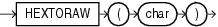

## Syntax



> ```
> HEXTORAW(char)
> ```
>
> [Copyright ©](https://docs.oracle.com/pls/topic/lookup?ctx=en/legal&id=cpyr) 2026,1996, Oracle and/or its affiliates.


[Description of the illustration hextoraw.eps](https://docs.oracle.com/en/database/oracle/oracle-database/19/sqlrf/img_text/hextoraw.html)

## Purpose

`HEXTORAW` converts *char* containing hexadecimal digits in the `CHAR`, `VARCHAR2`, `NCHAR`, or `NVARCHAR2` data type to a raw value.

This function does not support `CLOB` data directly. However, `CLOB` s can be passed in as arguments through implicit data conversion.

**See Also:** “ [Data Type Comparison Rules](Data-Type-Comparison-Rules.md) ” for more information.

## Examples

The following example creates a simple table with a raw column, and inserts a hexadecimal value that has been converted to `RAW`:

```md
CREATE TABLE test (raw_col RAW(10));

INSERT INTO test VALUES (HEXTORAW('7D'));
```

The following example converts hexadecimal digits to a raw value and casts the raw value to `VARCHAR2`:

```md
SELECT UTL_RAW.CAST_TO_VARCHAR2(HEXTORAW('4041424344'))
  FROM DUAL;

UTL_RAW.CAST_TO_VARCHAR2(HEXTORAW('4041424344'))
------------------------------------------------
@ABCD
```

**See Also:** “ [RAW and LONG RAW Data Types](Data-Types.md) ” and [RAWTOHEX](RAWTOHEX.md)