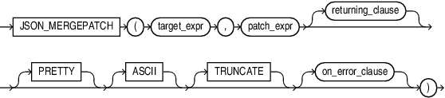
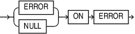

## Syntax



> ```
> JSON_MERGEPATCH
>    ( target_expr , patch_expr [ returning_clause ] [ PRETTY ] [ ASCII ]
>      [ TRUNCATE ] [ on_error_clause ] )
> ```
>
> [Copyright ©](https://docs.oracle.com/pls/topic/lookup?ctx=en/legal&id=cpyr) 2026,1996, Oracle and/or its affiliates.


[Description of the illustration json\_mergepatch.eps](https://docs.oracle.com/en/database/oracle/oracle-database/19/sqlrf/img_text/json_mergepatch.html)

## on\_error\_clause::=



> ```
> ( ERROR | NULL ) ON ERROR
> ```
>
> [Copyright ©](https://docs.oracle.com/pls/topic/lookup?ctx=en/legal&id=cpyr) 2026,1996, Oracle and/or its affiliates.


[Description of the illustration on\_error\_clause.eps](https://docs.oracle.com/en/database/oracle/oracle-database/19/sqlrf/img_text/on_error_clause.html)

## Purpose

`JSON_MERGEPATCH` is a standardized functionality for modifying a target JSON document using a JSON document called a merge patch. The function is described in RFC 7396.

`target_expr` evaluates to the JSON value target document.

`patch_expr` evaluates to the JSON value patch document.

`JSON_MERGEPATCH` evalutes the patch document against the target document to produce the result document. If the target or the patch document is NULL, then the result is also NULL.

The `JSON_query_returning_clause` specifies the return type of the operator. The default return type is `VARCHAR2(4000)`.

The `PRETTY` keyword specifies that the result should be formatted for human readability.

The `ASCII` keyword specifies that non-ASCII characters should be output using JSON escape sequences.

The `TRUNCATE` keyword specifies that the result document should be truncated to fit in the specified return type.

The `on_error_clause` optionally controls the handling of errors that occur during the processing of the target and patch documents.

- `NULL ON ERROR` - Returns null when an error occurs. This is the default.
- `ERROR ON ERROR` - Returns the appropriate Oracle error when an error occurs.

**See Also:**

- [RFC 7396 JSON Merge Patch](https://tools.ietf.org/html/rfc7396)
- [Updating a JSON Document with JSON Merge Patch](https://docs.oracle.com/pls/topic/lookup?ctx=en/database/oracle/oracle-database/19/sqlrf&id=ADJSN-GUID-31F88F28-3D92-489B-9CCD-BD1931B91F1F)