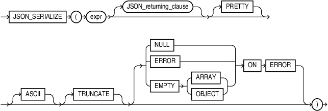

## Syntax

## json\_serialize



> ```
> JSON_SERIALIZE "(" ( expr ) [ JSON_returning_clause ] [ PRETTY ]
> [ ASCII ] [ TRUNCATE ] [ { NULL | ERROR | EMPTY { ARRAY | OBJECT} } ON ERROR ")"
> ```
>
> [Copyright ©](https://docs.oracle.com/pls/topic/lookup?ctx=en/legal&id=cpyr) 2026,1996, Oracle and/or its affiliates.


[Description of the illustration json\_serialize.eps](https://docs.oracle.com/en/database/oracle/oracle-database/19/sqlrf/img_text/json_serialize.html)

## Purpose

The `json_serialize` function takes JSON data of any SQL data type ( `VARCHAR2`, `CLOB`, `BLOB` ) as input and returns a textual representation of it. You typically use it to transform the result of a query.

You can use `json_serialize` to convert binary JSON data to textual form (`VARCHAR2` or `CLOB`), or to transform textual JSON data by pretty-printing it or escaping non-ASCII Unicode characters in it.

## expr

*expr* is the input expression. Can be any one of type `VARCHAR2`, `CLOB`, or `BLOB`.

## JSON\_returning\_clause

Use the *JSON\_returning\_clause* to specify the return type. The return type can be one of `VARCHAR2`, `CLOB`, or `BLOB`.

The default return type is `VARCHAR2(4000)`.

If the return type is `RAW` or `BLOB`, it contains `UTF8` encoded JSON text.

## PRETTY

Specify `PRETTY` if you want the result to be formatted for human readability.

## ASCII

Specify `ASCII` if you want non-ASCII characters to be output using JSON escape sequences.

## TRUNCATE

Specify `TRUNCATE`, if you want the textual output in the result document to fit into the buffer of the specified return type.

## JSON\_on\_error\_clause

Specify *JSON\_on\_error\_clause* to control the handling of processing errors.

`ERROR ON ERROR` is the default.

`EMPTY ON ERROR` is not supported.

If you specify `TRUNCATE` with *JSON\_on\_error\_clause*, then a value too large for the return type will be truncated to fit into the buffer instead of raising an error.

**Example**

```md
SELECT JSON_SERIALIZE ('{a:[1,2,3,4]}' RETURNING VARCHAR2(3) TRUNCATE ERROR ON ERROR) from dual
--------
{"a
```

**See Also:** [Oracle SQL Function JSON\_SERIALIZE](https://docs.oracle.com/pls/topic/lookup?ctx=en/database/oracle/oracle-database/19/sqlrf&id=ADJSN-GUID-667D37FF-F5FB-465D-B8AE-DAE88F191B2F)