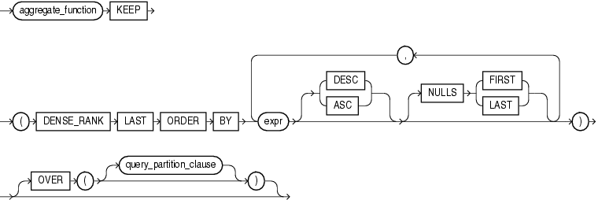

## Syntax

## last::=



> ```
> aggregate_function KEEP
>   (DENSE_RANK LAST ORDER BY
>     expr [ DESC | ASC ]
>          [ NULLS { FIRST | LAST } ]
>     [, expr [ DESC | ASC ]
>             [ NULLS { FIRST | LAST } ]
>     ]...
>   )
>   [ OVER ( [query_partition_clause] ) ]
> ```
>
> [Copyright ©](https://docs.oracle.com/pls/topic/lookup?ctx=en/legal&id=cpyr) 2026,1996, Oracle and/or its affiliates.


[Description of the illustration last.eps](https://docs.oracle.com/en/database/oracle/oracle-database/19/sqlrf/img_text/last.html)

**See Also:** “ [Analytic Functions](Analytic-Functions.md) ” for information on syntax, semantics, and restrictions of the *query\_partitioning\_clause*

## Purpose

`FIRST` and `LAST` are very similar functions. Both are aggregate and analytic functions that operate on a set of values from a set of rows that rank as the `FIRST` or `LAST` with respect to a given sorting specification. If only one row ranks as `FIRST` or `LAST`, then the aggregate operates on the set with only one element.

Refer to [FIRST](FIRST.md) for complete information on this function and for examples of its use.