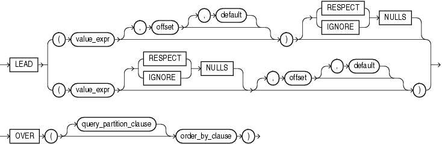

## Syntax



> ```
> LEAD
>   { ( value_expr [, offset [, default]] ) [ { RESPECT | IGNORE } NULLS ]
>   | ( value_expr [ { RESPECT | IGNORE } NULLS ] [, offset [, default]] )
>   }
>   OVER ([ query_partition_clause ] order_by_clause)
> ```
>
> [Copyright ©](https://docs.oracle.com/pls/topic/lookup?ctx=en/legal&id=cpyr) 2026,1996, Oracle and/or its affiliates.


[Description of the illustration lead.eps](https://docs.oracle.com/en/database/oracle/oracle-database/19/sqlrf/img_text/lead.html)

**See Also:** “ [Analytic Functions](Analytic-Functions.md) ” for information on syntax, semantics, and restrictions, including valid forms of *value\_expr*

## Purpose

`LEAD` is an analytic function. It provides access to more than one row of a table at the same time without a self join. Given a series of rows returned from a query and a position of the cursor, `LEAD` provides access to a row at a given physical offset beyond that position.

If you do not specify *offset*, then its default is 1. The optional *default* value is returned if the offset goes beyond the scope of the table. If you do not specify *default*, then its default value is null.

{ `RESPECT` | `IGNORE` } `NULLS` determines whether null values of *value\_expr* are included in or eliminated from the calculation. The default is `RESPECT` `NULLS`.

You cannot nest analytic functions by using `LEAD` or any other analytic function for *value\_expr*. However, you can use other built-in function expressions for *value\_expr*.

**See Also:**

- “ [About SQL Expressions](About-SQL-Expressions.md) ” for information on valid forms of *expr* and [LAG](LAG.md)
- in [*Oracle Database Globalization Support Guide*](https://docs.oracle.com/pls/topic/lookup?ctx=en/database/oracle/oracle-database/19/sqlrf&id=NLSPG-GUID-AFCE41ED-775B-4A00-AF38-C436776AE0C5) for the collation derivation rules, which define the collation assigned to the return value of `LEAD` when it is a character value

## Examples

The following example provides, for each employee in Department 30 in the `employees` table, the hire date of the employee hired just after:

```md
SELECT hire_date, last_name,
       LEAD(hire_date, 1) OVER (ORDER BY hire_date) AS "NextHired"
  FROM employees
  WHERE department_id = 30
  ORDER BY hire_date;

HIRE_DATE LAST_NAME                 Next Hired
--------- ------------------------- ----------
07-DEC-02 Raphaely                  18-MAY-03
18-MAY-03 Khoo                      24-JUL-05
24-JUL-05 Tobias                    24-DEC-05
24-DEC-05 Baida                     15-NOV-06
15-NOV-06 Himuro                    10-AUG-07
10-AUG-07 Colmenares
```