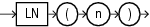

## Syntax



> ```
> LN(n)
> ```
>
> [Copyright ©](https://docs.oracle.com/pls/topic/lookup?ctx=en/legal&id=cpyr) 2026,1996, Oracle and/or its affiliates.


[Description of the illustration ln.eps](https://docs.oracle.com/en/database/oracle/oracle-database/19/sqlrf/img_text/ln.html)

## Purpose

`LN` returns the natural logarithm of *n*, where *n* is greater than 0.

This function takes as an argument any numeric data type or any nonnumeric data type that can be implicitly converted to a numeric data type. If the argument is `BINARY_FLOAT`, then the function returns `BINARY_DOUBLE`. Otherwise the function returns the same numeric data type as the argument.

**See Also:** [Table 2-8](Data-Type-Comparison-Rules.md) for more information on implicit conversion

## Examples

The following example returns the natural logarithm of 95:

```md
SELECT LN(95) "Natural log of 95"
  FROM DUAL;

Natural log of 95
-----------------
       4.55387689
```