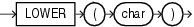

## Syntax



> ```
> LOWER(char)
> ```
>
> [Copyright ©](https://docs.oracle.com/pls/topic/lookup?ctx=en/legal&id=cpyr) 2026,1996, Oracle and/or its affiliates.


[Description of the illustration lower.eps](https://docs.oracle.com/en/database/oracle/oracle-database/19/sqlrf/img_text/lower.html)

## Purpose

`LOWER` returns *char*, with all letters lowercase. *char* can be any of the data types `CHAR`, `VARCHAR2`, `NCHAR`, `NVARCHAR2`, `CLOB`, or `NCLOB`. The return value is the same data type as *char*. The database sets the case of the characters based on the binary mapping defined for the underlying character set. For linguistic-sensitive lowercase, refer to [NLS\_LOWER](NLS_LOWER.md).

**See Also:** in [*Oracle Database Globalization Support Guide*](https://docs.oracle.com/pls/topic/lookup?ctx=en/database/oracle/oracle-database/19/sqlrf&id=NLSPG-GUID-AFCE41ED-775B-4A00-AF38-C436776AE0C5) for the collation derivation rules, which define the collation assigned to the character return value of `LOWER`

## Examples

The following example returns a string in lowercase:

```md
SELECT LOWER('MR. SCOTT MCMILLAN') "Lowercase"
  FROM DUAL;

Lowercase
--------------------
mr. scott mcmillan
```