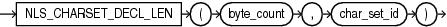

## Syntax



> ```
> NLS_CHARSET_DECL_LEN(byte_count, char_set_id)
> ```
>
> [Copyright ©](https://docs.oracle.com/pls/topic/lookup?ctx=en/legal&id=cpyr) 2026,1996, Oracle and/or its affiliates.


[Description of the illustration nls\_charset\_decl\_len.eps](https://docs.oracle.com/en/database/oracle/oracle-database/19/sqlrf/img_text/nls_charset_decl_len.html)

## Purpose

`NLS_CHARSET_DECL_LEN` returns the declaration length (in number of characters) of an `NCHAR` column. The *byte\_count* argument is the width of the column. The *char\_set\_id* argument is the character set ID of the column.

## Examples

The following example returns the number of characters that are in a 200-byte column when you are using a multibyte character set:

```md
SELECT NLS_CHARSET_DECL_LEN(200, nls_charset_id('ja16eucfixed'))
  FROM DUAL;

NLS_CHARSET_DECL_LEN(200,NLS_CHARSET_ID('JA16EUCFIXED'))
--------------------------------------------------------
                                                     100
```