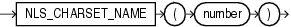

## Syntax



> ```
> NLS_CHARSET_NAME(number)
> ```
>
> [Copyright ©](https://docs.oracle.com/pls/topic/lookup?ctx=en/legal&id=cpyr) 2026,1996, Oracle and/or its affiliates.


[Description of the illustration nls\_charset\_name.eps](https://docs.oracle.com/en/database/oracle/oracle-database/19/sqlrf/img_text/nls_charset_name.html)

## Purpose

`NLS_CHARSET_NAME` returns the name of the character set corresponding to ID number *number*. The character set name is returned as a `VARCHAR2` value in the database character set. If *number* is not recognized as a valid character set ID, then this function returns null.

This function returns a `VARCHAR2` value.

**See Also:** in [*Oracle Database Globalization Support Guide*](https://docs.oracle.com/pls/topic/lookup?ctx=en/database/oracle/oracle-database/19/sqlrf&id=NLSPG-GUID-AFCE41ED-775B-4A00-AF38-C436776AE0C5) for the collation derivation rules, which define the collation assigned to the character return value of `NLS_CHARSET_NAME`

## Examples

The following example returns the character set corresponding to character set ID number 2:

```md
SELECT NLS_CHARSET_NAME(2)
  FROM DUAL;

NLS_CH
------
WE8DEC
```