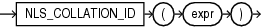

## Syntax



> ```
> NLS_COLLATION_ID(expr)
> ```
>
> [Copyright ©](https://docs.oracle.com/pls/topic/lookup?ctx=en/legal&id=cpyr) 2026,1996, Oracle and/or its affiliates.


[Description of the illustration nls\_collation\_id.eps](https://docs.oracle.com/en/database/oracle/oracle-database/19/sqlrf/img_text/nls_collation_id.html)

## Purpose

`NLS_COLLATION_ID` takes as its argument a collation name and returns the corresponding collation ID number. Collation IDs are used in the data dictionary tables and in Oracle Call Interface (OCI). Collation names are used in SQL statements and data dictionary views

For *expr*, specify the collation name as a `VARCHAR2` value. You can specify a valid named collation or a pseudo-collation, in any combination of uppercase and lowercase letters.

This function returns a `NUMBER` value. If you specify an invalid collation name, then this function returns null.

## Examples

The following example returns the collation ID of collation `BINARY_CI`:

```md
SELECT NLS_COLLATION_ID('BINARY_CI')
  FROM DUAL;

NLS_COLLATION_ID('BINARY_CI')
-----------------------------
                       147455
```