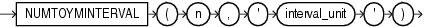

## Syntax



> ```
> NUMTOYMINTERVAL(n, 'interval_unit')
> ```
>
> [Copyright ©](https://docs.oracle.com/pls/topic/lookup?ctx=en/legal&id=cpyr) 2026,1996, Oracle and/or its affiliates.


[Description of the illustration numtoyminterval.eps](https://docs.oracle.com/en/database/oracle/oracle-database/19/sqlrf/img_text/numtoyminterval.html)

## Purpose

`NUMTOYMINTERVAL` converts number *n* to an `INTERVAL` `YEAR` `TO` `MONTH` literal. The argument *n* can be any `NUMBER` value or an expression that can be implicitly converted to a `NUMBER` value. The argument *interval\_unit* can be of `CHAR`, `VARCHAR2`, `NCHAR`, or `NVARCHAR2` data type. The value for *interval\_unit* specifies the unit of *n* and must resolve to one of the following string values:

- ‘ `YEAR` ’
- ‘ `MONTH` ’

*interval\_unit* is case insensitive. Leading and trailing values within the parentheses are ignored. By default, the precision of the return is 9.

**See Also:** [Table 2-8](Data-Type-Comparison-Rules.md) for more information on implicit conversion

## Examples

The following example uses `NUMTOYMINTERVAL` in a `SUM` analytic function to calculate, for each employee, the total salary of employees hired in the past one year from his or her hire date. Refer to “ [Analytic Functions](Analytic-Functions.md) ” for more information on the syntax of the analytic functions.

```md
SELECT last_name, hire_date, salary,
       SUM(salary) OVER (ORDER BY hire_date
       RANGE NUMTOYMINTERVAL(1,'year') PRECEDING) AS t_sal
  FROM employees
  ORDER BY last_name, hire_date;

LAST_NAME                 HIRE_DATE     SALARY      T_SAL
------------------------- --------- ---------- ----------
Abel                      11-MAY-04      11000      90300
Ande                      24-MAR-08       6400     112500
Atkinson                  30-OCT-05       2800     177000
Austin                    25-JUN-05       4800     134700
. . .
Walsh                     24-APR-06       3100     186200
Weiss                     18-JUL-04       8000      70900
Whalen                    17-SEP-03       4400      54000
Zlotkey                   29-JAN-08      10500     119000
```