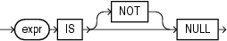

A `NULL` condition tests for nulls. This is the only condition that you should use to test for nulls.

## null\_condition::=



> ```
> expr IS [ NOT ] NULL
> ```
>
> [Copyright ©](https://docs.oracle.com/pls/topic/lookup?ctx=en/legal&id=cpyr) 2026,1996, Oracle and/or its affiliates.


[Description of the illustration null\_condition.eps](https://docs.oracle.com/en/database/oracle/oracle-database/19/sqlrf/img_text/null_condition.html)

Table 6-9 lists the null conditions.

Table 9 Null Condition

| Type of Condition | Operation | Example |
| --- | --- | --- |
| ```md IS [NOT] NULL ``` | Tests for nulls.  See Also: [Nulls](Nulls.md) | ```md SELECT last_name FROM employees WHERE commission_pct IS NULL ORDER BY last_name; ``` |