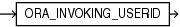

## Syntax



> ```
> ORA_INVOKING_USERID
> ```
>
> [Copyright ©](https://docs.oracle.com/pls/topic/lookup?ctx=en/legal&id=cpyr) 2026,1996, Oracle and/or its affiliates.


[Description of the illustration ora\_invoking\_userid.eps](https://docs.oracle.com/en/database/oracle/oracle-database/19/sqlrf/img_text/ora_invoking_userid.html)

## Purpose

`ORA_INVOKING_USERID` returns the identifier of the database user who invoked the current statement or view. This function takes into account the `BEQUEATH` property of intervening views referenced in the statement.

This function returns a `NUMBER` value.

**See Also:**

- [ORA\_INVOKING\_USER](ORA_INVOKING_USER.md) to learn how Oracle Database determines the database user who invoked the current statement or view
- [BEQUEATH](CREATE-VIEW.md) clause of the `CREATE` `VIEW` statement

## Examples

The following example returns the identifier of the database user who invoked the statement:

```md
SELECT ORA_INVOKING_USERID FROM DUAL;
```