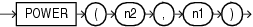

## Syntax



> ```
> POWER(n2, n1)
> ```
>
> [Copyright ©](https://docs.oracle.com/pls/topic/lookup?ctx=en/legal&id=cpyr) 2026,1996, Oracle and/or its affiliates.


[Description of the illustration power.eps](https://docs.oracle.com/en/database/oracle/oracle-database/19/sqlrf/img_text/power.html)

## Purpose

`POWER` returns *n2* raised to the *n1* power. The base *n2* and the exponent *n1* can be any numbers, but if *n2* is negative, then *n1* must be an integer.

This function takes as arguments any numeric data type or any nonnumeric data type that can be implicitly converted to a numeric data type. If any argument is `BINARY_FLOAT` or `BINARY_DOUBLE`, then the function returns `BINARY_DOUBLE`. Otherwise, the function returns `NUMBER`.

**See Also:** [Table 2-8](Data-Type-Comparison-Rules.md) for more information on implicit conversion

## Examples

The following example returns 3 squared:

```md
SELECT POWER(3,2) "Raised"
  FROM DUAL;

    Raised
----------
         9
```