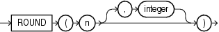

## Syntax

## round\_number::=



> ```
> ROUND(n [, integer ])
> ```
>
> [Copyright ©](https://docs.oracle.com/pls/topic/lookup?ctx=en/legal&id=cpyr) 2026,1996, Oracle and/or its affiliates.


[Description of the illustration round\_number.eps](https://docs.oracle.com/en/database/oracle/oracle-database/19/sqlrf/img_text/round_number.html)

## Purpose

`ROUND` returns *n* rounded to *integer* places to the right of the decimal point. If you omit *integer*, then *n* is rounded to zero places. If *integer* is negative, then *n* is rounded off to the left of the decimal point.

*n* can be any numeric data type or any nonnumeric data type that can be implicitly converted to a numeric data type. If you omit *integer*, then the function returns the value `ROUND` (n, 0) in the same data type as the numeric data type of *n*. If you include *integer*, then the function returns `NUMBER`.

`ROUND` is implemented using the following rules:

1. If *n* is 0, then `ROUND` always returns 0 regardless of *integer*.
2. If *n* is negative, then `ROUND` (n, integer) returns - `ROUND` (-n, integer).
3. If *n* is positive, then
```md
ROUND(n, integer) = FLOOR(n * POWER(10, integer) + 0.5) * POWER(10, -integer)
```

`ROUND` applied to a `NUMBER` value may give a slightly different result from `ROUND` applied to the same value expressed in floating-point. The different results arise from differences in internal representations of `NUMBER` and floating point values. The difference will be 1 in the rounded digit if a difference occurs.

```md
<div class="infoboxnote" markdown="1">

**See Also:**

- [Table 2-8](Data-Type-Comparison-Rules.html#GUID-98BE3A78-6E33-4181-B5CB-D96FD9DC1694__G195937 "An X in a cell indicates implicit conversion of the data types named in the first column and header row.") for more information on implicit conversion

- "[Floating-Point Numbers](Data-Types.html#GUID-F579F4B8-EF13-4CAF-9B06-03B076861C41)" for more information on how Oracle Database handles \`BINARY_FLOAT\` and \`BINARY_DOUBLE\` values

- [FLOOR](FLOOR.html#GUID-67F61AC7-C097-4397-A122-213157BF584F) and [CEIL](CEIL.html#GUID-6DCC9AFB-9B80-4C27-AF63-5AA3B1E43660), [TRUNC (number)](TRUNC-number.html#GUID-911AE7FE-E04A-471D-8B0E-9C50EBEFE07D) and [MOD](MOD.html#GUID-E12A3928-2C50-45B0-B8C3-82432C751B8C) for information on functions that perform related operations

</div>
```

## Examples

The following example rounds a number to one decimal point:

```md
SELECT ROUND(15.193,1) "Round" FROM DUAL;

     Round
----------
      15.2
```

The following example rounds a number one digit to the left of the decimal point:

```md
SELECT ROUND(15.193,-1) "Round" FROM DUAL;

     Round
----------
        20
```