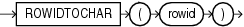

## Syntax



> ```
> ROWIDTOCHAR(rowid)
> ```
>
> [Copyright ©](https://docs.oracle.com/pls/topic/lookup?ctx=en/legal&id=cpyr) 2026,1996, Oracle and/or its affiliates.


[Description of the illustration rowidtochar.eps](https://docs.oracle.com/en/database/oracle/oracle-database/19/sqlrf/img_text/rowidtochar.html)

## Purpose

`ROWIDTOCHAR` converts a rowid value to `VARCHAR2` data type. The result of this conversion is always 18 characters long.

**See Also:** in [*Oracle Database Globalization Support Guide*](https://docs.oracle.com/pls/topic/lookup?ctx=en/database/oracle/oracle-database/19/sqlrf&id=NLSPG-GUID-AFCE41ED-775B-4A00-AF38-C436776AE0C5) for the collation derivation rules, which define the collation assigned to the character return value of `ROWIDTOCHAR`

## Examples

The following example converts a rowid value in the `employees` table to a character value. (Results vary for each build of the sample database.)

```md
SELECT ROWID FROM employees
   WHERE ROWIDTOCHAR(ROWID) LIKE '%JAAB%'
   ORDER BY ROWID;

ROWID
------------------
AAAFfIAAFAAAABSAAb
```